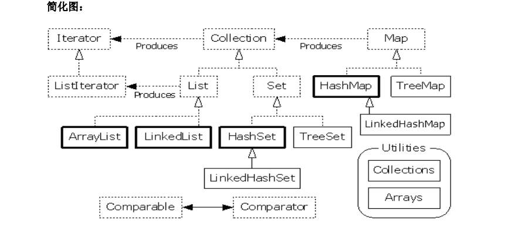
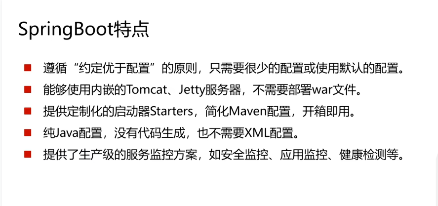

# 培训资料准备

1. D03常用工具介绍
    1. 中间件网关测试工具
    2. 浏览器调试工具（下载链接）
    3. http请求
2. java基础资料
    1. Java开发环境配置 JDK（下载链接）
    2. Java开发工具选择，采用公司常用eclipse（下载链接）
    3. Java编译工具maven（下载链接）
    4. java基础语法
        1. 基础类型
        2. 对象（类似C语言中的结构体）
        3. 循环
        4. 分支
        5. 运算
    5. java集合框架
    6. 
3. JavaWeb框架 springBoot
    1. Java常用工具类
4. Vue开发基础
    1. nodejs安装
    2. nvm管理多版本nodejs
    3. Vue开发环境搭建
    4. vue调试工具安装 vue devtools
    5. vue开发框架elementui，avue
    6. vue基础语法
5. 管理端项目开发
    1. 管理端java部分
        1. 如何和数据库交互
            1. 直接编写sql
            2. 调用存储过程（操作类，查询类）
        2. 如何调用ds服务
    2. 管理端vue部分
6. 客户端项目讲解
    1. 客户端Java部分
        1. 编写服务代码
        2. 注册DS协议
        3. 注册中间件网关协议
    2. 客户端页面部分Vue（Vue和elementui和阿里规范）（列表，表单）
        1. 初始化菜单脚本
        2. 初始化页面路由
        3. 编写页面代码
        4. 与接口交互
    3. 开发常见问题
        1. 如何获取一账通参数
        2. 如何获取2007参数
        3. 如何获取3001参数
        4. 如何获取当前用户
        5. 如何上传下载附件
7. 外联网关如何开发
