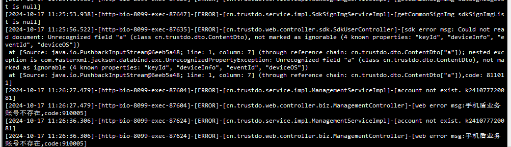
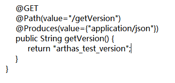
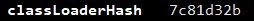
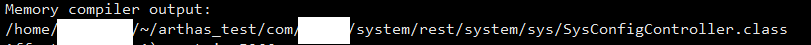
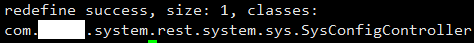
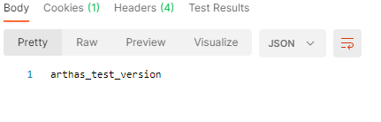

# POST请求失败如何定位问题

## 分析问题：
手机端调用信用度的密钥重置服务时，提示错误。



## 分析问题：
错误提示还算比较明显，应该就是请求方入参多了a导致的，但是手机端同事坚持自己调用的sdk没问题，因此事情陷入僵局，而且手机端抓取请求报文麻烦。只能考虑从服务端抓取报文。

## 解决问题：
身为java开发人员，第一时间就是考虑阿里线上定位问题工具arthas。

### 如何定位请求的哪个controlelr
:::info
1. watch org.springframework.web.servlet.DispatcherServlet getHandler '{returnObj}'

:::

### Arthas处理
1. 这个类从哪个 jar 包加载的？为什么会报各种类相关的 Exception

:::info
sc *.OfficeListService -d

:::

2. 我改的代码为什么没有执行到？难道是我没 commit？分支搞错了？

:::info
jad *.OfficeListService queryOfficeUser

:::

3. 遇到问题无法在线上 debug，难道只能通过加日志再重新发布吗

watch命令：对指定方法进行数据观测，包括入参、返回值和抛出异常

:::info
watch *.FormController queryApplyDataDetail -f {params,returnObj} -x2

:::

monitor命令：统计指定方法的调用情况，调用次数、成功次数、平均执行时间等

:::info
monitor -c 5 *.DashboardMetaController queryList

:::

stack命令：输出指定方法被调用的路径

:::info
stack *.FormDataService queryDataDetail

:::

4. debug时，想在代码中添加日志，但为一行日志代码重新发布太麻烦了

arthas支持代码热更新，不需要项目重新发布，只修改需要的代码，编译后就可以替换线上正在运行的类。

比如现在线上运行的getVersion接口，现在要修改成返回”arthas_test_version”。

用jad命令反编译出接口所在类的代码，输出成文件。

:::info
jad --source-only com.****.system.rest.system.sys.SysConfigController > ~/arthas_test/SysConfigController.java

:::

sc命令+grep命令，找出类的classLoader的哈希值



sc -d com.****.system.rest.system.sys.SysConfigController | grep classLoaderHash



mc命令将修改后的代码编译成class文件。-c后的参数就是找出的classLoader的哈希值。

:::info
mc -c 7c81d32b ~/arthas_test/SysConfigController.java -d ~/arthas_test

:::



最后，redefine命令加载新的class文件。

:::info
redefine ~/arthas_test/com/****/system/rest/system/sys/SysConfigController.class

:::



再次调用接口，可以看出运行的已经是修改后的代码。



5. 怎样直接从JVM内查找某个类的实例

:::info
vmtool --action getInstances --className java.lang.String -limit 30

:::

通过上述操作后，发现仍然无法看到方法的入参和应答值。

**再次分析后，考虑应该是由于入参不对导致对象无法转换，找不到方法，因此也无法正常代理方法**

### springboot日志
:::info
spring.mvc.log-request-details=true

logging.level.org.springframework.web.servlet.DispatcherServlet=DEBUG

:::

### Tcpdump抓包
#### 抓取HTTP POST 80 请求
```shell
tcpdump -i enp0s8 -s 0 -A 'tcp[((tcp[12:1] & 0xf0) >> 2):4] = 0x504F5354
```

`0x504F5354`代表的是 `P O S T`的ASCII码.

输出示例：

```shell
[root@mwiws01 ~]# tcpdump -i enp0s8 -s 0 -A 'tcp dst port 80 and tcp[((tcp[12:1] & 0xf0) >> 2):4] = 0x504F5354'
tcpdump: verbose output suppressed, use -v or -vv for full protocol decode
listening on enp0s8, link-type EN10MB (Ethernet), capture size 262144 bytes
08:12:59.552588 IP 192.168.10.1.60651 > mwiws01.http: Flags [P.], seq 1817631852:1817632015, ack 3385979723, win 4117, options [nop,nop,TS val 399453898 ecr 6715402], length 163: HTTP: POST /new.html HTTP/1.1
E.....@.@..C..
...

...PlV.l...K...........
.....fx
POST /new.html HTTP/1.1
Host: 192.168.10.10
User-Agent: curl/7.54.0
Accept: */*
X-Requested-By: middlewareinventory
TestHeader: TestValue
MyName: SaravAK


^C
1 packet captured
1 packet received by filter
0 packets dropped by kernel
[root@mwiws01 ~]#
```

## 总结
最终通过抓取tcpdump报文成功定位到问题是手机端代码混淆后导致请求不正确。
