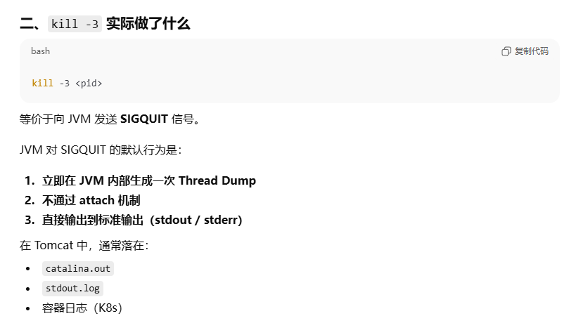

# 性能采集脚本

[jvm_diag.sh](https://www.yuque.com/attachments/yuque/0/2026/sh/960423/1768998130271-4270a258-9794-4aa3-9573-6c19820352dc.sh)

下面给你一套**生产可用的 Linux + JVM 故障现场“一键采集脚本”**。
设计目标是：**只读、低侵入、在 JVM 已经“半死不活”时也尽量能拿到证据**。

适用场景

+ JVM 无响应 / 接口超时
+ CPU 100% / Load 高
+ jstack 偶尔卡死
+ IO / Native / 锁竞争不明确

---

## 一、使用说明（先看）
### 1️⃣ 使用方式
```bash
chmod +x jvm_diag.sh
./jvm_diag.sh <java_pid>
```

### 2️⃣ 输出结果
+ 自动生成目录：`jvm_diag_YYYYMMDD_HHMMSS/`
+ **所有结果一次性打包**
+ 可直接发给同事 / 厂商 / 自己复盘

### 3️⃣ 安全性
+ ❌ 不做 jmap dump
+ ❌ 不 attach agent
+ ❌ 不 kill 进程
+ ✅ 只读命令

<svg xmlns="http://www.w3.org/2000/svg" viewBox="0 0 800 520" font-family="'Microsoft YaHei','PingFang SC',sans-serif">
  <defs>
    <marker id="ar1" markerWidth="9" markerHeight="9" refX="8" refY="4.5" orient="auto">
      <path d="M0,0 L9,4.5 L0,9 z" fill="#64748b"/>
    </marker>
  </defs>
  <text x="400" y="34" text-anchor="middle" font-size="16" font-weight="bold" fill="#1e293b">jvm_diag 一键采集脚本结构</text>
  <rect x="290" y="54" width="220" height="44" rx="8" fill="#eff6ff" stroke="#2563eb" stroke-width="1.5"/>
  <text x="400" y="81" text-anchor="middle" font-size="13" fill="#1e293b">执行 ./jvm_diag.sh</text>
  <line x1="400" y1="98" x2="400" y2="118" stroke="#64748b" stroke-width="1.5"/>
  <line x1="60" y1="118" x2="740" y2="118" stroke="#64748b" stroke-width="1.5"/>
  <line x1="60" y1="118" x2="60" y2="390" stroke="#64748b" stroke-width="1.5"/>
  <line x1="740" y1="118" x2="740" y2="390" stroke="#64748b" stroke-width="1.5"/>
  <line x1="60" y1="162" x2="88" y2="162" stroke="#64748b" stroke-width="1.5" marker-end="url(#ar1)"/>
  <line x1="60" y1="238" x2="88" y2="238" stroke="#64748b" stroke-width="1.5" marker-end="url(#ar1)"/>
  <line x1="60" y1="314" x2="88" y2="314" stroke="#64748b" stroke-width="1.5" marker-end="url(#ar1)"/>
  <line x1="60" y1="390" x2="88" y2="390" stroke="#64748b" stroke-width="1.5" marker-end="url(#ar1)"/>
  <line x1="740" y1="162" x2="712" y2="162" stroke="#64748b" stroke-width="1.5" marker-end="url(#ar1)"/>
  <line x1="740" y1="238" x2="712" y2="238" stroke="#64748b" stroke-width="1.5" marker-end="url(#ar1)"/>
  <line x1="740" y1="314" x2="712" y2="314" stroke="#64748b" stroke-width="1.5" marker-end="url(#ar1)"/>
  <line x1="740" y1="390" x2="712" y2="390" stroke="#64748b" stroke-width="1.5" marker-end="url(#ar1)"/>
  <rect x="90" y="140" width="280" height="44" rx="8" fill="#eff6ff" stroke="#2563eb" stroke-width="1.5"/>
  <text x="230" y="160" text-anchor="middle" font-size="13" fill="#1e293b">1. 系统信息</text>
  <text x="230" y="177" text-anchor="middle" font-size="11" fill="#475569">uptime·uname·os-release</text>
  <rect x="90" y="216" width="280" height="44" rx="8" fill="#eff6ff" stroke="#2563eb" stroke-width="1.5"/>
  <text x="230" y="236" text-anchor="middle" font-size="13" fill="#1e293b">2. 负载 CPU 内存</text>
  <text x="230" y="253" text-anchor="middle" font-size="11" fill="#475569">top·vmstat·free</text>
  <rect x="90" y="292" width="280" height="44" rx="8" fill="#eff6ff" stroke="#2563eb" stroke-width="1.5"/>
  <text x="230" y="312" text-anchor="middle" font-size="13" fill="#1e293b">3. IO 状态</text>
  <text x="230" y="329" text-anchor="middle" font-size="11" fill="#475569">iostat·vmstat wa</text>
  <rect x="90" y="368" width="280" height="44" rx="8" fill="#eff6ff" stroke="#2563eb" stroke-width="1.5"/>
  <text x="230" y="388" text-anchor="middle" font-size="13" fill="#1e293b">4. 进程线程状态</text>
  <text x="230" y="405" text-anchor="middle" font-size="11" fill="#475569">ps·D 状态线程</text>
  <rect x="430" y="140" width="280" height="44" rx="8" fill="#eff6ff" stroke="#2563eb" stroke-width="1.5"/>
  <text x="570" y="160" text-anchor="middle" font-size="13" fill="#1e293b">5. JVM 专项</text>
  <text x="570" y="177" text-anchor="middle" font-size="11" fill="#475569">jstack·GC 状态</text>
  <rect x="430" y="216" width="280" height="44" rx="8" fill="#eff6ff" stroke="#2563eb" stroke-width="1.5"/>
  <text x="570" y="236" text-anchor="middle" font-size="13" fill="#1e293b">6. Native / 内核</text>
  <text x="570" y="253" text-anchor="middle" font-size="11" fill="#475569">句柄·limits·dmesg</text>
  <rect x="430" y="292" width="280" height="44" rx="8" fill="#eff6ff" stroke="#2563eb" stroke-width="1.5"/>
  <text x="570" y="312" text-anchor="middle" font-size="13" fill="#1e293b">7. 网络</text>
  <text x="570" y="329" text-anchor="middle" font-size="11" fill="#475569">ss·netstat</text>
  <rect x="430" y="368" width="280" height="44" rx="8" fill="#eff6ff" stroke="#2563eb" stroke-width="1.5"/>
  <text x="570" y="388" text-anchor="middle" font-size="13" fill="#1e293b">8. 进程级 CPU Top</text>
  <text x="570" y="405" text-anchor="middle" font-size="11" fill="#475569">top -H 线程</text>
  <path d="M 60,390 L 60,466 L 287,466" fill="none" stroke="#64748b" stroke-width="1.5" marker-end="url(#ar1)"/>
  <path d="M 740,390 L 740,466 L 513,466" fill="none" stroke="#64748b" stroke-width="1.5" marker-end="url(#ar1)"/>
  <rect x="290" y="444" width="220" height="44" rx="8" fill="#ecfdf5" stroke="#16a34a" stroke-width="1.5"/>
  <text x="400" y="471" text-anchor="middle" font-size="13" fill="#1e293b">生成目录并打包</text>
</svg>

*图：jvm_diag 一键采集脚本八类采集项示意（依正文整理）*

---

## 二、完整采集脚本（生产级）
```bash
#!/bin/bash

PID=$1
if [ -z "$PID" ]; then
  echo "Usage: $0 <java_pid>"
  exit 1
fi

TS=$(date +%Y%m%d_%H%M%S)
DIR="jvm_diag_${PID}_${TS}"
mkdir -p $DIR

echo "==== JVM + Linux Diagnostic Collection ===="
echo "PID: $PID"
echo "Output: $DIR"
echo "==========================================="

############################################
# 1. 基础系统信息
############################################
echo "[1] Collecting system info..."
uptime > $DIR/uptime.txt
uname -a > $DIR/uname.txt
cat /etc/os-release > $DIR/os-release.txt 2>/dev/null
lscpu > $DIR/lscpu.txt 2>/dev/null
free -h > $DIR/free.txt

############################################
# 2. 负载 / CPU / 内存
############################################
echo "[2] Collecting CPU / load / memory..."
vmstat 1 5 > $DIR/vmstat.txt
mpstat -P ALL 1 3 > $DIR/mpstat.txt 2>/dev/null
top -b -n 1 > $DIR/top.txt

############################################
# 3. IO 状态
############################################
echo "[3] Collecting IO info..."
iostat -x 1 3 > $DIR/iostat.txt 2>/dev/null
df -h > $DIR/df.txt
mount > $DIR/mount.txt

############################################
# 4. 进程 / 线程状态
############################################
echo "[4] Collecting process / thread info..."
ps -p $PID -o pid,ppid,stat,%cpu,%mem,cmd > $DIR/ps_pid.txt
ps -eLo pid,tid,stat,pcpu,comm --sort=-pcpu | head -50 > $DIR/ps_threads_top.txt

# D 状态线程
ps -eLo pid,tid,stat,comm | awk '$3=="D"' > $DIR/d_state_threads.txt

############################################
# 5. JVM 专项
############################################
echo "[5] Collecting JVM info..."

# JVM 基本信息
jcmd $PID VM.version > $DIR/jvm_version.txt 2>/dev/null
jcmd $PID VM.flags > $DIR/jvm_flags.txt 2>/dev/null

# GC 状态
jstat -gcutil $PID 1 5 > $DIR/jstat_gcutil.txt 2>/dev/null

# jstack（非阻塞方式）
echo "  - jstack"
jstack $PID > $DIR/jstack.txt 2>/dev/null &
sleep 5

# 强制 SIGQUIT（兜底）
echo "  - kill -3 (SIGQUIT)"
kill -3 $PID
sleep 3

############################################
# 6. Native / 内核
############################################
echo "[6] Collecting native / kernel info..."

# 文件句柄
ls -l /proc/$PID/fd > $DIR/fd_list.txt 2>/dev/null

# limits
cat /proc/$PID/limits > $DIR/limits.txt 2>/dev/null

# 内核日志
dmesg -T | tail -200 > $DIR/dmesg_tail.txt

############################################
# 7. 网络
############################################
echo "[7] Collecting network info..."
ss -s > $DIR/ss_summary.txt
ss -antp > $DIR/ss_antp.txt 2>/dev/null

############################################
# 8. JVM 进程级 CPU Top（线程）
############################################
echo "[8] Collecting top threads..."
top -H -b -n 1 -p $PID > $DIR/top_threads.txt

############################################
# 打包
############################################
tar czf ${DIR}.tar.gz $DIR

echo "==========================================="
echo "Collection completed:"
echo "  ${DIR}.tar.gz"
echo "==========================================="
```

---

## 三、你拿到这些文件后怎么用（关键）
### 1️⃣ 先看这 5 个文件
```plain
uptime.txt
vmstat.txt
iostat.txt
top_threads.txt
jstack.txt
```

### 2️⃣ 快速判断路径
+ `vmstat wa 高` → IO
+ `top_threads + jstack nid 对不上` → Native
+ `jstack 为空 / 不完整` → JVM stuck
+ `D 状态线程多` → 存储 / 文件系统

---

## 四、为什么这个脚本“抗事故”
| 场景 | 是否能采集 |
| --- | --- |
| JVM 卡在 Native | ✅ |
| jstack 卡死 | ✅ kill -3 |
| IO Hang | ✅ |
| CPU 100% | ✅ |
| swap 假死 | ✅ |

---


