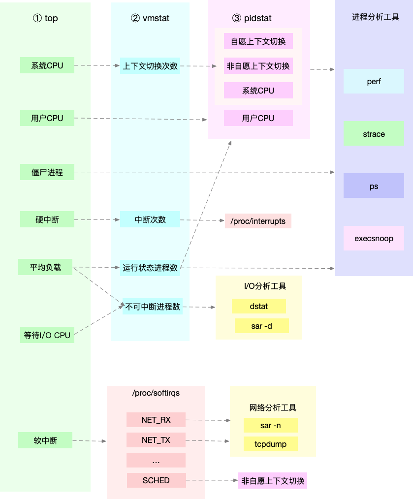
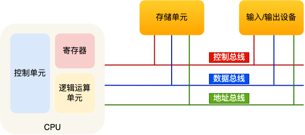
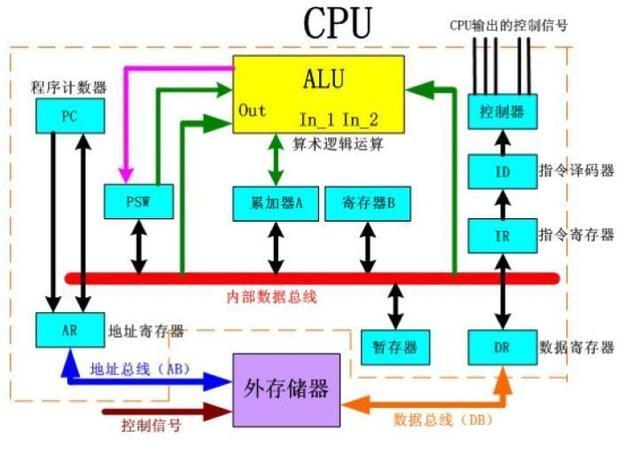

# CPU性能分析

1. top命令查看cpu的使用率和系统负载。按键1切换查看各cpu的使用率 负载高cpu占用率也可能低，高IO
    1. 进程运行状态
        1. R运行状态 Runnable
        2. D不可中断休眠状态 Disk Sleep
        3. Z僵尸状态，进程结束，父进程还没回收 Zombie
        4. S中断休眠状态 Interruptible Sleep
        5. Idea空闲状态
    2. 进程
        1. 控制终端TTY-会话-s 表示这个进程是一个会话的领导进程
        2. 后台进程组
        3. 前台进程组-+ 表示前台进程组
2. pidstat 查看进程的用户态cpu和内核态cpu
    1. pidstat -p 指定进程号
    2. pidstat -d 输出 I/O 使用情况
    3. 用户态使用时间
    4. 内核态使用时间
3. perf top 实时显示占用cpu最多的函数和指令
    1. perf -g 开启调用关系分析
    2. perf record -g #记录性能事件，等待大约15秒后按 Ctrl+C 退出
    3. perf report 查看报告
4. pstree 树状形式显示所有进程之间的关系
5. execsnoop短时进程导致cpu升高，有可能导致看不到高cpu占用的进程
6. sar -w 直观的看到每秒生成线程或者进程的数量
7. watch -d cat /proc/softirqs 查看中断次数的变化速率
8. tcpdump 抓包 软中断多 网络延时过大照成机器卡顿，此时用其他服务器ping会发现延时增加
