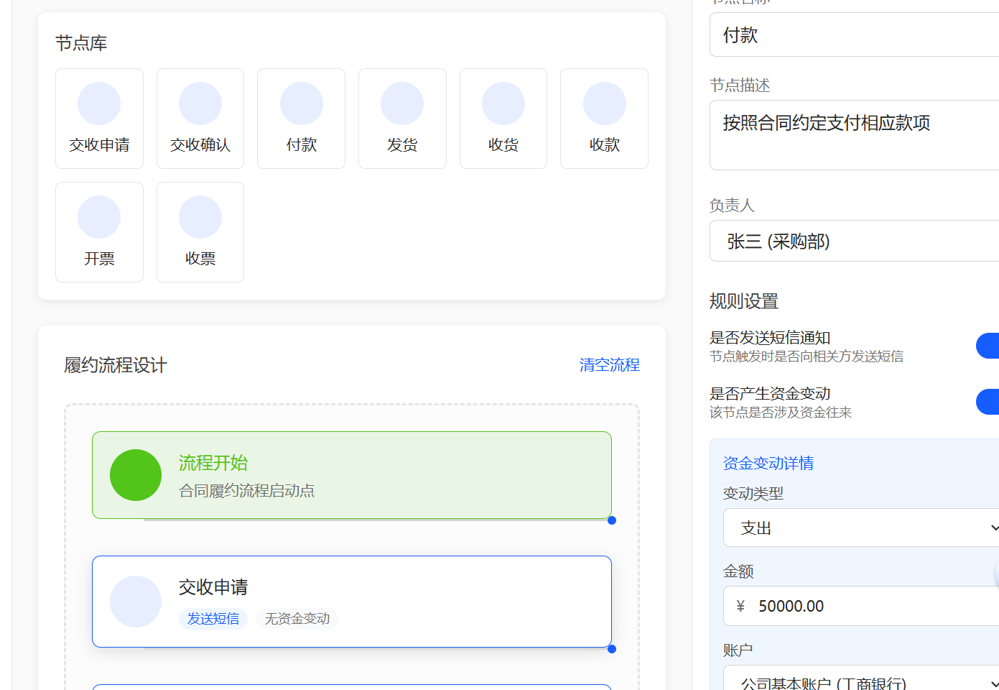

# 管理端

备注：

帮我设计一个合同履约规则编排的界面：可编排节点：交收申请，交收确认，付款，发货，收货，收款，开票，收票等节点，每个节点可以设置其相关的规则：是否发送短信，是否产生资金变动

## 系统管理
### 合同类型管理
| 合同类型 | 备注 | | |
| --- | --- | --- | --- |
| 普通合同 | | | |
| 预交收合同 | | | |
| 链式合同 | | | |

## 合同模板管理
| 模板名称 | 模板类型 | 模板地址 | 支持字段 |
| --- | --- | --- | --- |
| | | | |
| | | | |

| 模板名称 | 字段名称 | 字段说明 | |
| --- | --- | --- | --- |
| | | | |
| | | | |

### 结算银行管理
| 结算银行 | 交收规则 | 付款规则 | 备注 |
| --- | --- | --- | --- |
| 交行交e宝 | 组织交收 | 担保支付 | 特殊银行，只能使用指定交收规则和付款规则 |
| 工行E企付 | 组织交收 | |  |
| 工行聚富通 | | | |
| 中行数币 | | | |

### 资金类型管理
| 资金类型 | 支付渠道 | |
| --- | --- | --- |
| 手续费 | 账本 | |
| 货款 | 账本 | |
| | 信用 | |
| | 数证 | |
| | 线下 | |
| | 网银 | |
| 履约金 | 账本 | |
|  | 网银 | |

### 交收规则管理
| 交收规则 | 付款规则 | 备注 | |
| --- | --- | --- | --- |
| 组织交收 | | | |
| 自由交收 | | | |
| 先货后款 | | | |
| 整单交收 | | | |
| 链式交收 | | | |
|  | | | |

| 交收节点 | 备注 | 节点规则 |
| --- | --- | --- |
| 申请 | | 是否发送短信，是否资金变动 |
| 确认 | | |
| 付款 | | |
| 发货 | | |
| 收货 | | |
| 收款 | | |
| 开票 | | |
| 收票 | | |

| 交收类型 | 交收节点 | 执行类型 | 节点规则 |
| --- | --- | --- | --- |
| 组织交收 | 申请 | 手动 | 发送短信 |
| 组织交收 | 确认 | 手动 | |
| 组织交收 | 付款 | 手动 | |
| 组织交收 | 发货 | 手动 | |
| 组织交收 | 收货 | 手动 | |
| 组织交收 | 收款 | 自动 | |
| 组织交收 | 开票 | 手动 | |
| 组织交收 | 收票 | 手动 | |

### 付款规则管理
| 付款规则 | 收款节点 | 买保证金释放节点 | 卖保证金释放节点 |
| --- | --- | --- | --- |
| 分批付款1 | 付款时 | 付款时 | 收款时 |
| 分批付款2 | 收货时 | | |
| 担保支付 | 收款时 | | |
| 整单支付 | 收票时 | | |

### 商品交收参数
| 商品名称 | 保证金冲抵 | 保证金比例 | 手续费比例 | 节点期限 | 配货类型 | 最大超提量... |
| --- | --- | --- | --- | --- | --- | --- |
| 小麦 | 不冲抵 | | | | | |
| 钢铁 | 比例冲抵 | | | | | |
| 重晶石 | 延迟冲抵 | | | | | |
| 菜粕 | 比例尾量 | | | | | |
| 菜粕 | 延迟尾量 | | | | | |

### 客户私有参数
| 商品名称 | 客户名称 | 保证金比例 | 手续费比例 |
| --- | --- | --- | --- |
| | | | |
| | | | |

## 合同管理
### 合同管理
合同详情，履约记录，办理日志，资金流水，开票详情

| | | | |
| --- | --- | --- | --- |
| | | | |
| | | | |

### 履约管理
履约详情，办理日志，资金流水，附件查询

| | | | |
| --- | --- | --- | --- |

## 申诉管理
售后服务无法正常执行的，由客户申诉后，平台统一进行处理

| | | | |
| --- | --- | --- | --- |

## 统计报表
| 模块 | 功能 | 功能说明 |
| --- | --- | --- |
| 统计报表 | 合同报表 | 1. 全生命周期合同查询：提供包含合同起草、审批、执行、归档等阶段的全生命周期查询列表；支持按合同类型、名称、相对方、日期、收支类型、项目等条件筛选。   2. 查看筛选结果：支持查看筛选后合同的详细信息，包括条款、状态和相关附件；用户可将合同台账导出为Excel文件，方便离线分析或备份。   3. 数据权限控制：台账功能可结合数据权限，不同用户查看不同范围的合同。   4. 合同情况报表：按收款类和付款类分类，展示合同本年度情况、同期完成情况、同比增量、同比增幅。 |
| 统计报表 | 报表统计分析 | 1. 合同签订情况报表：提供合同签订数量、收支类型、金额等统计数据，帮助分析签订活跃度和分布情况；支持按时间维度展示签订趋势。   2. 合同付款统计报表：汇总合同付款情况，包括已付款项、付款进度、逾期付款等；支持从财务角度分析付款数据，辅助现金流管理和预算控制。   3. 合同收款统计报表：展示合同收款情况，包括应收款项、实收款项、收款延迟等。 |
