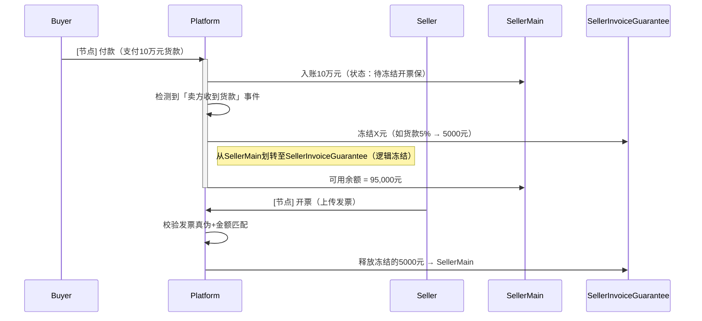

# 合同中心支付模型

基于您提供的合同交收流程、资金流向和支付方式，我为您设计一套**灵活、可配置、支持多阶段资金管控的支付模型**。该模型兼顾合规性（如银行凭证需体现真实交易双方）、业务灵活性（如开票保证金后置冻结），并适配多种支付方式。

---

## ✅ 一、模型核心设计原则
| 原则 | 说明 |
| --- | --- |
| **三方映射一致** | 所有资金操作在平台、银行、税务系统中保持「买方 ↔ 平台 ↔ 卖方」三方主体信息一致，满足银行凭证显示真实交易方的要求（避免“二清”风险） |
| **履约金与货款解耦** | 履约金独立账户管理，支持冲抵、释放、冻结等原子操作 |
| **开票保证金后置冻结** | 不预收保证金，而是在「卖方收到货款」事件触发后，按规则动态冻结部分资金作为开票保证金 |
| **支付方式正交化** | 支付方式（余额/银行授权/线下）作为执行通道，不影响业务流程逻辑，流程引擎驱动节点流转，支付通道执行动作 |

---

## ✅ 二、整体架构分层
```plain
┌──────────────────────────────────────┐
│        交收流程引擎（状态机）         │
│   管理节点流转：申请→确认→付款→…→收票 │
└────────────────────┬─────────────────┘
                     │ 触发资金指令
┌────────────────────▼─────────────────┐
│        资金调度中心（核心）           │
│  - 指令解析（如：冻结、释放、冲抵）    │
│  - 账户操作路由（调用对应支付通道）    │
└────────────────────┬─────────────────┘
                     │ 分通道执行
┌────────────────────▼─────────────────┐
│      支付通道适配层                   │
│  ├─ 余额类：平台虚拟账户系统           │
│  ├─ 银行授权类：直连银行/网关（代收付）│
│  └─ 线下支付类：人工核验+系统登记       │
└──────────────────────────────────────┘
```

---

## ✅ 三、关键资金账户设计（逻辑账户，可物理隔离）
| 账户类型 | 所属方 | 说明 |
| --- | --- | --- |
| `BuyerMain` | 买方 | 主资金池（余额类）或绑定银行卡（银行授权类） |
| `SellerMain` | 卖方 | 同上 |
| `BuyerPerformanceBond` | 买方 | 履约金专用子账户（初始冻结） |
| `SellerPerformanceBond` | 卖方 | 履约金专用子账户（初始冻结） |
| `SellerInvoiceGuarantee` | 卖方 | **动态子账户**：货款到账后临时创建并冻结 |
| `PlatformEscrow` | 平台 | 可选：大额交易中作为临时中转（需持牌） |

> ✅ 所有子账户为逻辑隔离，物理可共用主账户，靠 tag / memo 区分用途。
>

---

## ✅ 四、重点业务场景实现方案
### 1️⃣ **银行支付凭证显示真实买卖双方**
#### 问题背景
若平台代收代付，银行流水显示为「买方→平台」「平台→卖方」，不合规。

#### ✅ 解决方案：**银行直连 + 真实交易信息透传**
+ 采用 **银行授权类支付**（如银企直连、开放银行API）
+ 在发起支付时，向银行提交「扩展字段」：

```json
{
  "payerName": "张三（买方）",
  "payeeName": "XX有限公司（卖方）",
  "transactionPurpose": "货款-合同号:CT20251121001",
  "tradeDate": "2025-11-21",
  "amount": 100000.00
}
```

+ 要求合作银行支持在**回单/凭证**中打印上述字段（国内多数大行开放此能力，如招行CBS、工行API）
+ 若银行不支持 → 采用「受托支付」模式：买方授权平台以自己名义向卖方付款，法律协议明确委托关系，凭证仍为「买方→卖方」

> 🔐 合规提示：避免无证经营支付结算业务，大额交易建议引入持牌支付机构或银行托管。
>

---

### 2️⃣ **卖方开票保证金后置冻结**
#### 需求：卖方无预存资金，仅在收到货款后冻结部分作为开票担保
#### ✅ 实现逻辑（事件驱动）


#### 关键设计点：
+ **不预收保证金**：`SellerInvoiceGuarantee` 初始余额为 0，仅在货款到账后动态创建并冻结。
+ **冻结来源**：从卖方已到账的货款中划转（非额外扣款），卖方感知为「部分货款暂不可用」。
+ **释放条件**：发票校验通过（可对接税务平台验真） + 买方「收票」确认。

---

## ✅ 五、灵活配置支持（面向运营）
| 配置项 | 示例值 | 说明 |
| --- | --- | --- |
| `invoice_guarantee_rate` | 5% | 开票保证金比例 |
| `performance_bond_rate_buyer` | 10% | 买方履约金比例 |
| `support_bond_offset` | true | 是否允许履约金冲抵货款 |
| `payment_channel_priority` | [bank, balance, offline] | 支付方式优先级 |
| `bond_release_on` | ["收货确认", "账单确认"] | 履约金释放触发节点 |

> 可按「合同模板」或「商户等级」差异化配置。
>

---

## ✅ 六、支付方式适配示例
| 场景 | 余额类 | 银行授权类 | 线下支付类 |
| --- | --- | --- | --- |
| **买方付款** | 扣`BuyerMain` → 冻`BuyerPerformanceBond` | 发起银行扣款（透传买卖方信息） | 登记凭证号，人工审核后系统确认 |
| **释放履约金** | 原路退回余额账户 | 发起银行退款（附言注明“履约金释放”） | 标记状态，不实际操作 |
| **冻结开票保** | 从`SellerMain`划转至冻结子账户 | ——（线下不支持自动冻结，需人工干预） | 同左 |

---

## ✅ 七、异常处理建议
+ **卖方收款后拒不冻结保证金？**
→ 在合同条款中约定：货款到账即视为同意冻结规则；系统自动执行，卖方可申诉但不停止流程。
+ **银行不支持信息透传？**
→ 提供「平台代开凭证」服务：平台生成含三方信息的**交易确认书**（PDF+电子签），供用户作为补充凭证。
+ **履约金冲抵货款时余额不足？**
→ 支持部分冲抵 + 差额补足；或禁止冲抵，强制全额支付。

---

如需，我可进一步提供：

+ 状态机流程图（含资金操作标注）
+ 数据库表结构建议（账户流水、冻结记录、支付指令）
+ 与主流银行/支付网关对接字段映射表

是否需要继续深化某一部分？
