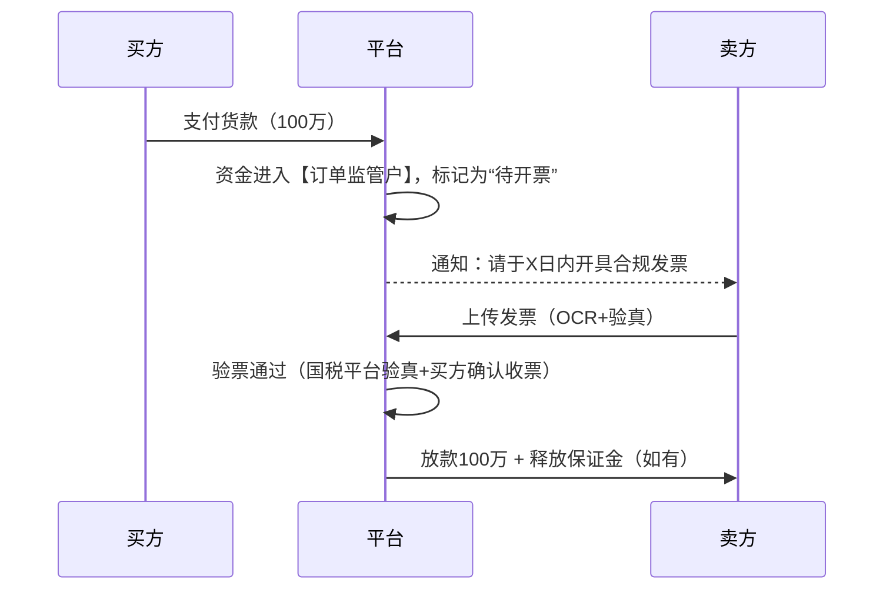

# 订单支付解决开票保证金问题

这是一个非常关键且典型的**资金时序与风控冲突问题**，常见于大宗商品、B2B平台交易场景：

> **问题本质**：
若合同约定「**买方付款时卖方即收款**」（资金已划给卖方），
但后续需在「**买方收票时释放保证金**」——
→ 此时卖方账户资金已自由支配，平台失去对“开票履约”的约束力。
>

---

## 一、问题再定义（明确痛点）
| 步骤 | 当前行为 | 风险 |
| --- | --- | --- |
| ① 买方支付货款 | ✅ 卖方立即实收资金（如 T+0 到账） | 卖方收款后拖延/拒绝开票 |
| ② 卖方应开票 | ⏳ 无强制约束 | 买方无法抵扣税，平台被投诉 |
| ③ 买方收票后 | ✅ 释放保证金（但可能已无保证金可释放） | 保证金若已提前释放或根本未收，失控 |

👉 **核心矛盾**：**资金放款时序早于开票履约时序，导致“先放钱、后办事”的道德风险**。

---

## 二、解决方案总览（按可行性排序）
| 方案 | 适用场景 | 优势 | 劣势 | 推荐度 |
| --- | --- | --- | --- | --- |
| **A. 改变收款时序：延迟放款**（推荐） | 所有支付方式 | 风控强，逻辑自洽 | 卖方体验略降 | ⭐⭐⭐⭐⭐ |
| **B. 保证金后置收取/动态冻结** | 余额/平台可控账户 | 兼顾体验与风控 | 银行类支持弱 | ⭐⭐⭐⭐ |
| **C. 履约保函替代现金保证金** | 高信用企业/对公场景 | 无资金占用 | 对卖方资质要求高 | ⭐⭐⭐ |
| **D. 合同违约金条款兜底 + 人工介入** | 线下/低频场景 | 实施快 | 事后补救，成本高 | ⭐⭐ |

---

## 三、重点方案详解（推荐落地路径）
### ✅ 方案 A：**延迟放款 + 开票验证联动**（首选！）
> **核心思想**：即使买方付了款，**卖方也不立即到账**，而是资金暂存平台监管户，待开票完成后再释放。
>

#### 流程改造：


#### 关键设计点：
+ **监管户资金属性**：
    - 对买方：已付款 ✔️（可开收据/预付款凭证）
    - 对卖方：显示为「应收未付」或「待开票放款」，**不计入可提现余额**
+ **超时处理**：
    - 到期未开票 → 自动触发：
        * 卖方信用降级
        * 扣划履约保证金赔偿买方（如合同约定）
        * 冻结后续订单收款权限
+ **买方收票确认**：
    - 支持自动（OCR识别+买方ERP回传）或手动确认
    - 以「买方确认收票」作为最终释放节点（匹配你原有规则）

> 💡 优势：**完全兼容你现有“买方收票时释放保证金”逻辑**，且卖方收款与开票强绑定。
>

---

### ✅ 方案 B：**动态冻结（后置保证金）** —— 适配“卖方先收款”场景
> 如果业务强要求「卖方必须T+0收款」（如现货急单），则用**事后冻结**补充风控。
>

#### 实现步骤：
1. **初始阶段不收保证金**，但合同约定：

> “卖方须在收款后24h内开票，否则平台有权冻结其账户等额资金作为违约保证金”
>

2. 卖方收款后，系统监控：
    - 若按时上传合规发票 → 流程结束
    - 若超时未开票 → **自动冻结卖方账户资金**（=合同额 × k%，如10%）
        * 冻结来源：卖方**其他订单余额 / 保证金池 / 待结算款**
        * 冻结动作：平台发起『事后履约冻结』指令（需账户支持负向操作）
3. 冻结后继续催票；若最终仍不开票：
    - 将冻结资金赔付买方（作为税损补偿）
    - 启动法律追偿

#### 技术前提：
| 条件 | 是否满足？ |
| --- | --- |
| 卖方有平台余额/多订单沉淀资金 | ✅ 前端工程师可推动账户体系支持 |
| 平台具备「事后冻结」权限（如：风控系统接口） | 建议建设 |
| 用户协议明确授权平台事后冻结权 | ⚠️ 必须法律审核 |

> 📌 **适用性**：更适合高频交易、卖方有长期经营意愿的平台（如：1688、找钢网）。
>

---

### 方案 C 补充：电子履约保函（银行/保险）
+ 卖方申请**电子履约保函**（担保开票义务），由银行/保险公司出函
+ 平台验证保函真伪（通过中登网/银行API）
+ 买方付款后卖方实时收款
+ 若未开票，买方凭平台证明向担保方索赔

> 优势：无资金占用；劣势：卖方需授信，中小商户难覆盖。
>

---

## 四、针对不同支付方式的适配建议
| 支付方式 | 推荐策略 |
| --- | --- |
| **余额类** | ✔️ 首选「方案A：监管户延迟放款」，技术实现简单 |
| **银行类** | ✔️ 同样可用方案A：资金入平台**银行存管子账户**（如招行CBS），开票后批量代付   ⚠️ 避免直连卖方银行账户实时到账 |
| **线下类** | ⚠️ 仅能用「方案D：违约条款+人工跟进」，或要求线下付款时同步缴保证金 |

---

## 五、给前端工程师的落地建议（结合你的角色）
作为高级前端工程师，你可推动以下**产品+技术协同点**：

1. **状态可视化**
    - 卖方端订单页显式展示：
`已收款（监管中）→ 待开票 → 已放款`
    - 倒计时提示：“请在24h内开票，否则将冻结保证金”
2. **发票上传体验优化**
    - 集成**发票OCR识别**（阿里云/腾讯云）
    - 自动回填发票代码/号码/金额/校验码
    - 实时调用税务局接口验真（需后端支持）
3. **风控弹窗拦截**
    - 当卖方尝试提现被监管资金时：

```typescript
if (order.status === 'WAITING_INVOICE') {
  showBlockingModal({
    title: '请先完成开票',
    content: `订单${order.id}尚有¥${amount}待开票放款，开票后资金将自动到账`,
    actions: [{ text: '去开票', onClick: goToInvoiceUpload }]
  });
}
```

4. **资金流水标签化**
    - 在账户明细中区分：
`货款收入（已到账）` vs `货款收入（监管中-待开票）`

---

## 六、一句话总结
> **不要让“收款”和“开票履约”脱钩**——
要么**延迟放款**（资金等票），要么**事后冻结**（用账户权限兜底），
根本上，是把「开票」从事后动作变为**资金释放的前置条件**。
>

如需，我可提供：

+ 「监管户延迟放款」的数据库状态字段设计
+ 发票验真对接税务局的API流程
+ 卖方端开票引导页的交互原型建议

是否需要进一步展开？
