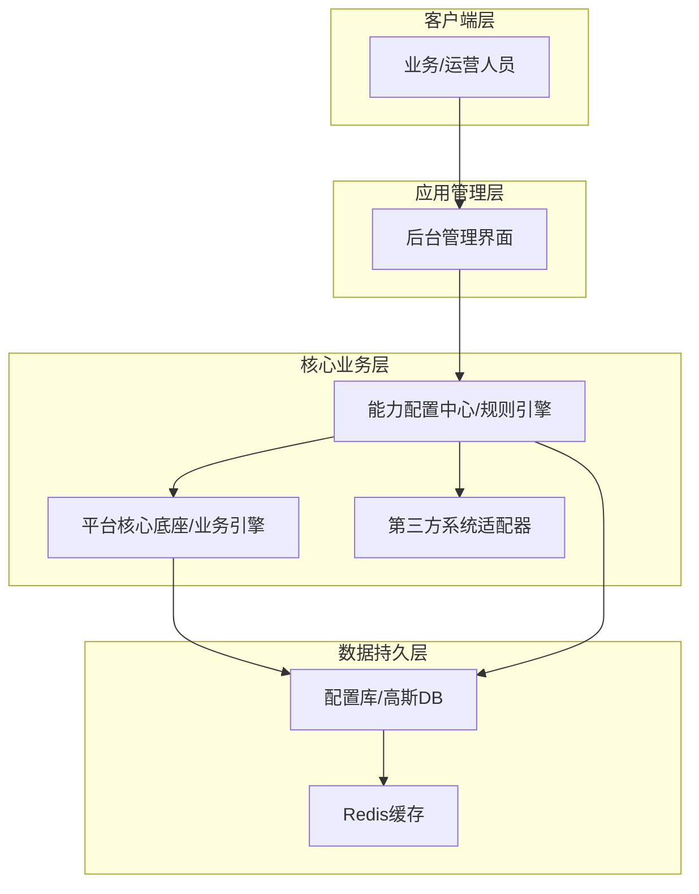
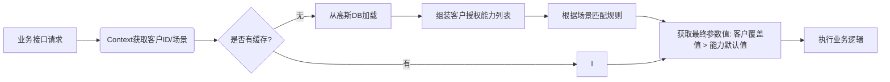

这份《B2B产品平台化参数治理方案》是针对**“客户一多、参数一多、组合爆炸、系统不稳”**这一核心病症的**终极根治方案**。文档已按企业级交付标准排版，你可以直接作为技术方案文档下发评审。

---

# 平台化参数治理与能力配置中心方案
## —— 终结“客户定制-参数爆炸-系统不稳定”危机
### 版本：V1.0
**编制：架构师**
**日期：2026年4月**

---

## 一、方案背景与问题诊断 (Problem Statement)
### 1.1 现状痛点
当前系统处于**多客户并行运营阶段**，针对不同客户的个性化需求（Customization），为了快速交付，通常采用**硬编码参数（Flag/Switch）****或****配置表字段**的方式进行适配。
目前系统存在以下严重问题：

+ **参数泛滥（Configuration Spaghetti）：** 代码中充斥着大量 `if (enableXXX) { ... } else if (enableYYY) { ... }` 的嵌套逻辑。
+ **组合爆炸（Combination Explosion）：** 为A客户加的参数，在B客户特定场景下触发时产生未知冲突，客户间逻辑互相污染。
+ **架构不稳定：** 每改一个客户参数，风险波及全平台，上线事故率高，老板感知为“系统处处是Bug”。
+ **维护灾难：** 参数无归属、无约束，新老交接困难，新人无法理解复杂逻辑。

### 1.2 核心症结
**这不是技术问题，是平台化架构缺失。**
错误模式：_客户 -> 直连参数 -> 破坏核心逻辑_
正确模式：_客户 -> 授权套餐 -> 标准化能力 -> 受控参数_

---

## 二、治理目标 (Goals)
1. **架构解耦：** 彻底消除“为了客户改核心代码”的现象，核心底座保持纯净。
2. **参数归位：** 结束参数乱飞状态，让参数**强归属**于具体业务能力。
3. **客户隔离：** 客户间配置完全隔离，A客户改动绝不影响B客户。
4. **可扩展：** 未来新增客户或功能，只需配置“能力”，无需动底层代码。
5. **可视化治理：** 提供后台管理界面，业务人员可直观管理客户能力与参数。

---

## 三、整体架构设计 (Architecture)
采用**“平台底座 + 能力组件 + 配置规则 + 客户套餐”**的四层架构模型：

### 3.1 架构分层图


### 3.2 核心模型图解
**参数不再挂载在客户身上，而是挂载在“能力”上。**

+ **能力（Capability）：** 封装一组相关的参数、逻辑和动作，是产品功能的原子单元。
+ **套餐（Package）：** 给客户分配的能力集合，相当于客户的“功能许可证”。
+ **规则（Rule）：** 定义能力在不同场景下的表现行为。

---

## 四、核心模块设计 (Module Design)
### 4.1 能力中心 (Capability Center)
这是治理方案的核心，负责统一管理所有参数和逻辑。

#### 4.1.1 能力定义 (Capability Metadata)
每一项能力都有唯一的身份ID，参数不能独立存在，必须归属于某个能力。

+ **能力编码 (Code)：** 唯一标识（如：`AUTO_INVOICE` 自动开票）
+ **能力名称 (Name)：** 如 "自动开票能力"
+ **归属模块 (Module)：** 订单中心 / 支付中心 / 履约中心
+ **状态 (Status)：** 启用 / 禁用 / 灰度
+ **是否必选 (Mandatory)：** 基础能力不可关闭

#### 4.1.2 能力参数 (Capability Params)
参数被结构化，带类型约束和默认值。

+ **参数Key：** 如 `invoice_days`
+ **参数名称：** 开票提前天数
+ **参数类型：** INT / STRING / BOOLEAN
+ **默认值：** 平台通用默认
+ **可见性：** 是否允许客户自定义

### 4.2 规则引擎 (Rule Engine)
负责处理复杂的场景逻辑，替代 `if-else` 嵌套。

+ **场景 (Scene)：** 下单 / 支付 / 发货 / 取消
+ **条件 (Condition)：** 金额 > 10万 / 客户等级是VIP
+ **动作 (Action)：** 走特殊审批 / 跳过某环节

### 4.3 客户授权层 (Customer Entitlement)
负责客户与能力的绑定，实现客户隔离。

#### 4.3.1 套餐 (Package)
+ 定义一组能力的组合（如：企业版套餐 = 预付款 + 分期 + 电子签）。
+ 客户只能通过“套餐”获取能力，避免直接给客户开单个参数。

#### 4.3.2 客户配置覆盖 (Customer Override)
+ 仅在需要特殊定制时生效。
+ 结构：`[客户ID, 能力编码, 参数Key, 自定义值]`

---

## 五、数据库表结构设计 (Schema Design)
### 5.1 核心表结构 (SQL 草案)
```sql
-- 1. 能力定义表
CREATE TABLE `sys_capability` (
  `id` bigint NOT NULL AUTO_INCREMENT,
  `code` varchar(64) NOT NULL COMMENT '能力唯一编码',
  `name` varchar(128) NOT NULL COMMENT '能力名称',
  `module` varchar(64) NOT NULL COMMENT '归属模块（ORDER/PAYMENT/LOGISTICS）',
  `status` tinyint NOT NULL DEFAULT 1 COMMENT '1-启用 0-禁用',
  `description` varchar(512) DEFAULT NULL,
  `created_at` datetime NOT NULL DEFAULT CURRENT_TIMESTAMP,
  PRIMARY KEY (`id`),
  UNIQUE KEY `uk_code` (`code`)
) ENGINE=InnoDB DEFAULT CHARSET=utf8mb4 COMMENT='平台能力注册中心';

-- 2. 能力参数表
CREATE TABLE `sys_capability_param` (
  `id` bigint NOT NULL AUTO_INCREMENT,
  `capability_code` varchar(64) NOT NULL COMMENT '关联能力编码',
  `param_key` varchar(64) NOT NULL COMMENT '参数Key',
  `param_name` varchar(128) NOT NULL COMMENT '参数名称',
  `value_type` varchar(32) NOT NULL COMMENT '参数类型(INT/STR/BOOL/JSON)',
  `default_value` varchar(512) DEFAULT NULL COMMENT '默认值',
  `is_visible` tinyint DEFAULT 1 COMMENT '1-客户可见可改 0-平台内部不可见',
  `created_at` datetime NOT NULL DEFAULT CURRENT_TIMESTAMP,
  PRIMARY KEY (`id`),
  UNIQUE KEY `uk_cap_param` (`capability_code`,`param_key`),
  CONSTRAINT `fk_capability` FOREIGN KEY (`capability_code`) REFERENCES `sys_capability` (`code`)
) ENGINE=InnoDB DEFAULT CHARSET=utf8mb4 COMMENT='能力参数配置表';

-- 3. 套餐表
CREATE TABLE `sys_package` (
  `id` bigint NOT NULL AUTO_INCREMENT,
  `code` varchar(64) NOT NULL COMMENT '套餐编码',
  `name` varchar(128) NOT NULL COMMENT '套餐名称',
  `status` tinyint NOT NULL DEFAULT 1,
  `created_at` datetime NOT NULL DEFAULT CURRENT_TIMESTAMP,
  PRIMARY KEY (`id`),
  UNIQUE KEY `uk_code` (`code`)
) ENGINE=InnoDB DEFAULT CHARSET=utf8mb4 COMMENT='客户功能套餐';

-- 4. 套餐-能力关联表
CREATE TABLE `sys_package_capability` (
  `id` bigint NOT NULL AUTO_INCREMENT,
  `package_code` varchar(64) NOT NULL,
  `capability_code` varchar(64) NOT NULL,
  `created_at` datetime NOT NULL DEFAULT CURRENT_TIMESTAMP,
  PRIMARY KEY (`id`),
  UNIQUE KEY `uk_pkg_cap` (`package_code`,`capability_code`),
  CONSTRAINT `fk_package` FOREIGN KEY (`package_code`) REFERENCES `sys_package` (`code`),
  CONSTRAINT `fk_capability_pkg` FOREIGN KEY (`capability_code`) REFERENCES `sys_capability` (`code`)
) ENGINE=InnoDB DEFAULT CHARSET=utf8mb4 COMMENT='套餐能力关联表';

-- 5. 客户-套餐关联表
CREATE TABLE `customer_package_rel` (
  `customer_id` bigint NOT NULL COMMENT '客户ID',
  `package_code` varchar(64) NOT NULL,
  `effect_time` datetime NOT NULL COMMENT '生效时间',
  `expire_time` datetime DEFAULT NULL COMMENT '过期时间',
  `created_at` datetime NOT NULL DEFAULT CURRENT_TIMESTAMP,
  PRIMARY KEY (`customer_id`,`package_code`)
) ENGINE=InnoDB DEFAULT CHARSET=utf8mb4 COMMENT='客户套餐关联';

-- 6. 客户参数个性化覆盖表（关键！解决特殊场景）
CREATE TABLE `customer_param_override` (
  `customer_id` bigint NOT NULL,
  `capability_code` varchar(64) NOT NULL,
  `param_key` varchar(64) NOT NULL,
  `param_value` varchar(512) NOT NULL COMMENT '客户自定义值',
  `created_at` datetime NOT NULL DEFAULT CURRENT_TIMESTAMP,
  `updated_at` datetime NOT NULL DEFAULT CURRENT_TIMESTAMP ON UPDATE CURRENT_TIMESTAMP,
  PRIMARY KEY (`customer_id`,`capability_code`,`param_key`)
) ENGINE=InnoDB DEFAULT CHARSET=utf8mb4 COMMENT='客户参数个性化覆盖表';
```

---

## 六、核心业务流程 (Workflow)
### 6.1 流程配置流程（管理员/运营）
1. **注册能力**：在后台注册新业务能力（如：自定义交收流程）。
2. **配置参数**：为该能力定义参数及默认值。
3. **创建套餐**：创建一个套餐（如“高级履约包”）。
4. **挂载能力**：将已注册的能力挂载到套餐下。
5. **分配套餐**：将套餐分配给特定客户。

### 6.2 运行时获取流程（核心引擎）
**这一步彻底消灭 **`if-else`。



### 6.3 代码示例 (Java 伪代码)
**旧代码（屎山代码）：**

```java
// 到处都是if，逻辑混乱
public void handleOrder(Order order) {
    if (customerService.hasParam(order.getCustomerId(), "ENABLE_AUTO_INVOICE")) {
        // 自动开票逻辑
        if (order.getAmount() > 10000 && customerService.hasParam(order.getCustomerId(), "INVOICE_TYPE", "SPECIAL")) {
            // 开专票
        }
    }
    // ... 一堆其他逻辑
}
```

**新代码（能力中心驱动）：**

```java
// 核心代码，纯净稳定
@Service
public class OrderServiceImpl implements OrderService {

    @Autowired
    private CapabilityClient capabilityClient;

    public void handleOrder(OrderDTO orderDTO) {
        Long customerId = orderDTO.getCustomerId();
        
        // 1. 检查客户是否拥有【自动开票】能力
        if (!capabilityClient.hasCapability(customerId, "AUTO_INVOICE")) {
            return; // 无能力则不执行
        }

        // 2. 获取参数，传入默认值
        Integer invoiceDays = capabilityClient.getParam(
            customerId, 
            "AUTO_INVOICE", 
            "invoice_days", 
            3 // 默认3天
        );

        // 3. 执行业务逻辑，逻辑清晰
        if (LocalDate.now().isAfter(orderDTO.getCreateTime().plusDays(invoiceDays))) {
            invoiceService.generateInvoice(orderDTO.getOrderId());
        }
    }
}
```

---

## 七、实施策略与迁移计划 (Migration Plan)
### 7.1 实施阶段
**本方案需分阶段实施，避免一次性大改动导致上线风险。**

+ **第一阶段：底座搭建（1-2周）**
    - 完成数据库表设计与开发。
    - 开发核心 `CapabilityService` SDK包。
    - 开发后台管理界面（能力管理、套餐管理）。
+ **第二阶段：存量参数清洗（2-4周）**
    - 梳理现有所有 `if` 逻辑中的参数。
    - 将零散参数归类为**能力**。
    - 编写迁移脚本，将客户配置从旧表结构迁移到新的 `customer_param_override` 表。
+ **第三阶段：逐步替换（持续迭代）**
    - 按模块（先订单、再支付、最后履约）逐个替换 `if-else` 逻辑。
    - 新功能开发强制走**能力中心**。

### 7.2 风险控制
1. **性能兜底：** 所有能力配置必须放入 **Redis缓存**，缓存过期时间设为30分钟，保证查询极速。
2. **回滚机制：** 替换旧逻辑时，保留旧代码作为兜底，观察1-2个版本后再删除。
3. **灰度发布：** 新套餐和能力先给试点客户使用，验证无误后再全量推广。

---

## 八、总结 (Conclusion)
本次参数治理方案，从根本上改变了**“为客户改系统”**的现状。
****通过**能力化、套餐化、规则化**，我们实现了：

1. **稳定性回归：** 核心底座稳定，个性化逻辑由外部配置驱动，无代码侵入。
2. **客户隔离：** 客户之间完全独立，杜绝组合爆炸带来的未知风险。
3. **可维护性：** 任何参数都有归属，任何客户配置都可追溯。
4. **扩展性：** 未来产品迭代，只需增加“能力”，无需修改核心引擎。

这是B2B产品从“项目制”走向“平台制”的关键一步。
