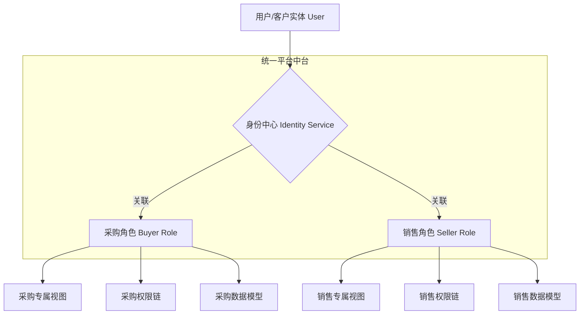

# 角色区分

现在其实对于我们来说，我们的系统里边还是有一个点目前做的特别不好。就是在我们的整个大众平台里边，没有明确的区分采购方还是销售方的问题。就是每一个客户，他入驻到平台以后，都可以是采购商，也可以是销售方，这样就导致了整个页面布局的混乱。就是每个客户登进来，他都能看到双方的功能权限。但有时候这个客户可能他仅仅只是想采购一些东西，或者销售一些东西

听得出来，这个“角色混淆”的问题确实是架构设计上的核心硬伤，就像系统里没有明确的模块划分，导致代码耦合度极高，维护起来既臃肿又混乱。

这不仅仅是页面展示的问题，本质上是**数据模型与权限链路的缺失**。我们可以从技术架构和业务落地两个维度，直接给出一套**可执行的重构方案**。

## 一、 核心问题定性与拆解
目前的系统属于**扁平式角色架构**，缺乏**垂直的角色隔离**。

1. **视图层混乱（UI）：** 采购功能（下单、购物车）与销售功能（上架、库存、报价）堆砌在一起，导致用户认知成本高，操作路径长。
2. **数据层混乱（Data）：** 同一套客户数据，既维护采购信息也维护销售信息，导致字段冗余、状态逻辑冲突。
3. **权限层混乱（Auth）：** 角色权限泛化，无法针对单一角色进行精细化的功能点（Button/API）控制。

## 二、 可视化重构方案（架构对比）
我们可以通过**“垂直拆分 + 统一身份”**的模式来解决。

### 1. 新架构逻辑图

### 2. 旧系统 vs 新系统 对比
| 维度 | 旧系统（现状） | 新系统（重构后） | 改造动作 |
| :--- | :--- | :--- | :--- |
| **登录入口** | 单一入口，登录后看到全部功能 | **双入口/智能识别**   登录页区分「我要采购」「我要销售」 | 新增登录场景识别 |
| **数据模型** | 一张客户表，字段混杂 | **双表/多字段区分**   `buyer_info` / `seller_info`   状态独立维护 | 数据库表结构扩展 |
| **前端路由** | 同一页面渲染所有功能按钮 | **路由隔离**   `/buyer/...` 与 `/seller/...` 两套路由 | 前端工程拆分，懒加载 |
| **权限控制** | 基于角色的全量分配 | **基于场景的细粒度控制**   只分配当前角色的API/菜单 | 重构Shiro/Security策略 |

## 三、 具体落地执行步骤（CLI 操作级思路）
### Step 1：身份中心建设（核心）
**目标：** 系统底层支持一个用户拥有多角色，但**运行时**只激活一个。

1. **数据库设计：**
    - 保留 `t_customer` 基础表（存公司名、联系方式等通用数据）。
    - 新增 `t_customer_role_mapping` 映射表，记录一个客户可以拥有的角色（采购商/销售商）。
    - 新增 `t_buyer_profile` / `t_seller_profile` 两张扩展表，专门存储该角色独有的配置（如采购组、销售价目表等）。
2. **后端接口开发：**
    - 编写 `IdentityContext` 上下文类，存储当前登录用户的**当前激活角色**。
    - 所有业务接口（查询商品、下单）都传入 `roleType` 参数，做逻辑分流。

### Step 2：前端页面重塑（UI 去耦合）
**目标：** 让采购商进来只有“商城”和“订单”的感觉，让销售商进来只有“店铺”和“库存”的感觉。

1. **布局差异化：**
    - **采购商视角：** 顶部导航栏 = 首页、商品搜索、购物车、我的订单、账户余额。
    - **销售商视角：** 顶部导航栏 = 首页、商品管理、订单处理、库存管理、数据分析。
2. **组件懒加载：**
    - 使用 CMD/Bash 脚本辅助构建多环境打包。
    - `npm run build:buyer` 只打包采购组件，`npm run build:seller` 只打包销售组件，减少主包体积。

### Step 3：权限矩阵固化
**目标：** 杜绝“看到功能点不了”或者“误操作”。

1. **权限列表梳理：**
    - 列出所有功能点（API/Button）。
    - 打上标签：`Buyer_Only` / `Seller_Only` / `Common`。
2. **动态路由渲染：**
    - 登录后，根据 `roleType` 从后端获取对应的路由菜单列表。
    - 前端直接渲染该角色的菜单树，不存在的功能直接不渲染。

## 四、 关键风险与兜底
1. **历史数据迁移：** 平台内已有的客户，需要通过**数据清洗脚本**初始化角色。
    - _逻辑：_ 统计该客户下的订单数据，如果采购订单数 > 销售订单数，默认标记为“主要采购商”，并给予手动调整权限。
2. **过渡期策略：** 上线初期保留“角色切换”入口，允许用户在同一个账号下随时切换视角，避免业务停摆。

这套方案本质上是把一个**“大而全”的单体系统**，在不破坏底层互通的前提下，做了**业务层面的微服务化拆分**。你觉得这个方向和技术路径是否符合你们现在的改造诉求？

需要我帮你生成一份具体的**数据字典（SQL脚本）或者前端路由配置示例**吗？
