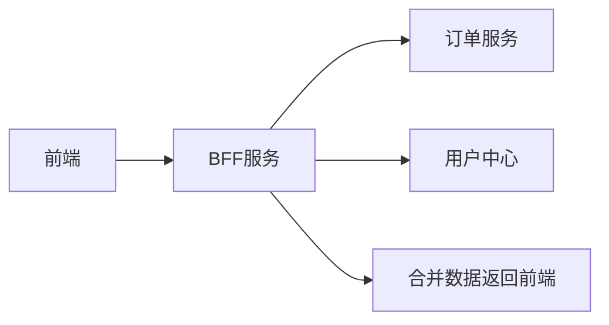

# 常见难点

这是一个非常典型且重要的微服务架构设计问题 👉 **“在订单列表、审批列表、商品列表等业务模块中，如何显示用户（如创建人、审批人、客户联系人）的姓名、头像、部门等信息？”**

---

## ✅ 核心答案：
> **不推荐直接 JOIN 用户表。推荐使用“服务调用”或“数据冗余（宽表）”方式，在业务服务中聚合用户信息，避免跨服务数据库耦合。**
>

---

## 🧩 一、为什么不能直接 JOIN 用户表？
在微服务架构中：

+ **用户信息** 存在于 **用户中心服务（User Service）** 的数据库
+ **订单/商品/审批数据** 存在于 **各自业务服务** 的数据库
+ 微服务原则：**每个服务拥有自己的独立数据库，禁止跨库 JOIN**

❌ 如果订单服务直接连用户库查用户名：

+ 破坏服务自治
+ 数据库耦合，无法独立部署/扩展
+ 用户库变更影响订单服务
+ 性能差（跨网络 JOIN 不可行）

---

## 🏗️ 二、推荐解决方案（3种主流方式）
### ✅ 方案1：API 调用实时获取（适合列表量小、实时性要求高）
#### 流程：
```mermaid
sequenceDiagram
    前端->>订单服务： GET /orders?status=approved
    订单服务->>用户中心： 批量调用 /users/batch?ids=1,2,3,4
    用户中心-->>订单服务： 返回 { id:1, name:"张三", dept:"采购部" }
    订单服务-->>前端： 返回订单列表 + 用户信息
```

#### 优点：
+ 数据实时
+ 无冗余，一致性好

#### 缺点：
+ 性能瓶颈（N+1问题 → 需批量接口）
+ 依赖用户中心可用性

#### 优化技巧：
+ 使用 **批量查询接口**（`/users/batch?ids=1,2,3`）
+ 本地缓存用户信息（如Guava Cache，缓存5分钟）
+ 异步预加载（如用Redis提前缓存常用用户）

#### 代码示例（Java + Feign）：
```java
// 订单服务中
public List<OrderVO> listOrdersWithUserInfo() {
    List<Order> orders = orderMapper.selectList(...);
    Set<Long> userIds = orders.stream().map(Order::getCreatorId).collect(Collectors.toSet());
    
    // 批量调用用户中心
    List<UserDTO> users = userClient.batchGetUsers(new ArrayList<>(userIds));
    Map<Long, UserDTO> userMap = users.stream().collect(Collectors.toMap(UserDTO::getId, u -> u));

    return orders.stream().map(order -> {
        OrderVO vo = convertToVO(order);
        vo.setCreatorName(userMap.get(order.getCreatorId()).getName());
        vo.setCreatorDept(userMap.get(order.getCreatorId()).getDeptName());
        return vo;
    }).collect(Collectors.toList());
}
```

---

### ✅ 方案2：数据冗余 + 宽表设计（适合列表量大、性能要求高）
#### 思想：
在订单表中**冗余存储**用户关键信息：

```sql
CREATE TABLE `order` (
  id BIGINT,
  order_no VARCHAR(32),
  creator_id BIGINT,
  creator_name VARCHAR(50),     -- 冗余
  creator_dept VARCHAR(100),    -- 冗余
  approver_id BIGINT,
  approver_name VARCHAR(50),    -- 冗余
  ...
);
```

#### 数据如何同步？
+ **方式A：业务写入时同步写冗余字段**
    - 下单时，调用用户中心获取创建人姓名、部门，一并写入订单表
+ **方式B：监听用户变更事件（推荐）**
    - 用户中心发布 `UserUpdatedEvent`
    - 订单服务监听事件，异步更新所有关联订单的冗余字段

#### 优点：
+ 查询性能极高（单表查询）
+ 不依赖用户中心实时可用

#### 缺点：
+ 数据冗余，占用空间
+ 用户信息变更后需异步更新（最终一致性）

#### 适用场景：
+ 订单列表、审批列表、日志列表等高频查询场景
+ 用户信息不常变更（如姓名、部门）

---

### ✅ 方案3：前端分步加载 / BFF聚合（适合复杂页面）
#### 流程：
1. 前端先调用订单列表接口 → 只返回 `creatorId`, `approverId`
2. 前端再调用用户中心 `/users/batch?ids=...` 获取用户信息
3. 前端在浏览器中合并数据并渲染

或使用 **BFF层（Backend for Frontend）**：



#### 优点：
+ 后端服务完全解耦
+ 前端/BFF灵活控制加载策略

#### 缺点：
+ 增加前端/BFF复杂度
+ 多次请求影响体验（可合并为BFF一次调用）

#### 适用场景：
+ 管理后台复杂列表
+ 需要按需加载用户信息的场景

---

## 🆚 三、方案对比
| 方案 | 实时性 | 性能 | 一致性 | 复杂度 | 适用场景 |
| --- | --- | --- | --- | --- | --- |
| API实时调用 | ★★★ | ★★ | ★★★ | ★★ | 小数据量、强实时 |
| 数据冗余（宽表） | ★★ | ★★★ | ★★ | ★★ | 大数据量、高性能 |
| 前端/BFF聚合 | ★★ | ★★ | ★★★ | ★★★ | 复杂页面、灵活控制 |

> 💡 **B2B电商推荐组合使用：**
>
> + **列表页** → 用“数据冗余”保证性能（如订单列表显示创建人姓名）
> + **详情页** → 用“API实时调用”保证信息最新（如审批详情页显示审批人最新部门）
> + **管理后台** → 可用“BFF聚合”灵活组装数据
>

---

## 🔁 四、数据冗余如何保证一致性？
### 推荐：事件驱动 + 异步更新
```mermaid
sequenceDiagram
    用户中心->>Kafka： 发布 UserUpdatedEvent(userId=1001, newName="李四")
    Kafka->>订单服务： 消费事件
    订单服务->>订单DB： UPDATE order SET creator_name='李四' WHERE creator_id=1001
    订单服务->>审批服务： 同样更新审批人姓名
```

### 技术实现：
+ **消息队列**：Kafka / RabbitMQ
+ **可靠事件**：本地事务表 + 定时补偿（防止消息丢失）
+ **幂等处理**：即使重复消费也不影响数据

---

## 🧱 五、数据库设计示例（订单表 + 冗余）
```sql
-- 订单表（包含冗余用户信息）
CREATE TABLE `b2b_order` (
  `id` BIGINT PRIMARY KEY AUTO_INCREMENT,
  `order_no` VARCHAR(64) NOT NULL,
  `company_id` BIGINT NOT NULL COMMENT '采购企业ID',
  `creator_id` BIGINT NOT NULL COMMENT '创建人ID',
  `creator_name` VARCHAR(50) NOT NULL COMMENT '创建人姓名（冗余）',
  `creator_dept` VARCHAR(100) COMMENT '创建人部门（冗余）',
  `approver_id` BIGINT COMMENT '审批人ID',
  `approver_name` VARCHAR(50) COMMENT '审批人姓名（冗余）',
  `status` VARCHAR(20),
  `created_at` DATETIME,
  INDEX idx_creator_id (creator_id),
  INDEX idx_company_id (company_id)
);
```

---

## 🛡️ 六、安全与权限注意
即使显示用户信息，也要注意：

1. **数据权限过滤**：

```sql
WHERE company_id = #{currentCompanyId}  -- 从JWT中获取
```

    - 采购员只能看到自己企业的订单
    - 店铺只能看到自己店铺的订单
2. **敏感信息脱敏**：
    - 非管理员不显示用户手机号、邮箱
    - 用 `****` 替代部分信息

---

## 🎯 七、B2B电商中的典型场景
| 业务模块 | 显示哪些用户信息 | 推荐方案 |
| --- | --- | --- |
| 订单列表 | 创建人姓名、审批人姓名 | 数据冗余 + 宽表 |
| 审批待办 | 申请人姓名、部门 | API实时调用 |
| 商品管理 | 上架人、最后修改人 | 数据冗余 |
| 客服工单 | 提交人、处理人 | API调用 + 缓存 |
| 数据报表 | 业务员、客户经理 | 宽表 + 预计算 |

---

## ✅ 八、最佳实践总结
1. **禁止跨服务数据库JOIN** —— 违反微服务基本原则
2. **列表页优先用“数据冗余”** —— 保证查询性能
3. **详情页可用“实时API”** —— 保证信息最新
4. **用“事件驱动”同步冗余数据** —— 保证最终一致性
5. **前端可分步加载** —— 减少后端压力
6. **始终做数据权限过滤** —— 避免越权查看

---

## 🛠️ 九、配套工具推荐
+ **服务调用**：OpenFeign（Java） / gRPC / Axios（Node.js）
+ **批量接口**：`/users/batch?ids=1,2,3`
+ **缓存**：Redis / Caffeine（本地缓存）
+ **事件总线**：Kafka / RabbitMQ
+ **BFF层**：Node.js / GraphQL / Spring Cloud Gateway + 聚合

---

如果你正在设计订单服务或用户中心，我可以为你：

+ 📐 提供“订单列表接口”完整代码模板（含用户信息聚合）
+ 🔄 设计“用户信息变更事件”的消息格式与消费逻辑
+ 🖼️ 画出数据流时序图
+ 🧩 给出缓存更新策略（如用户改名后如何清缓存）

欢迎告诉我你使用的技术栈（Java/Go/Node.js）和当前痛点，我会给出针对性解决方案！
