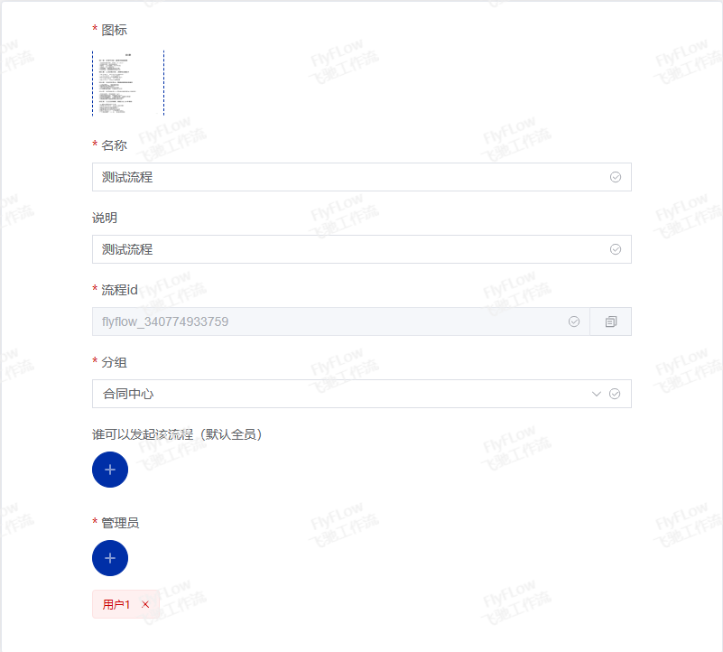
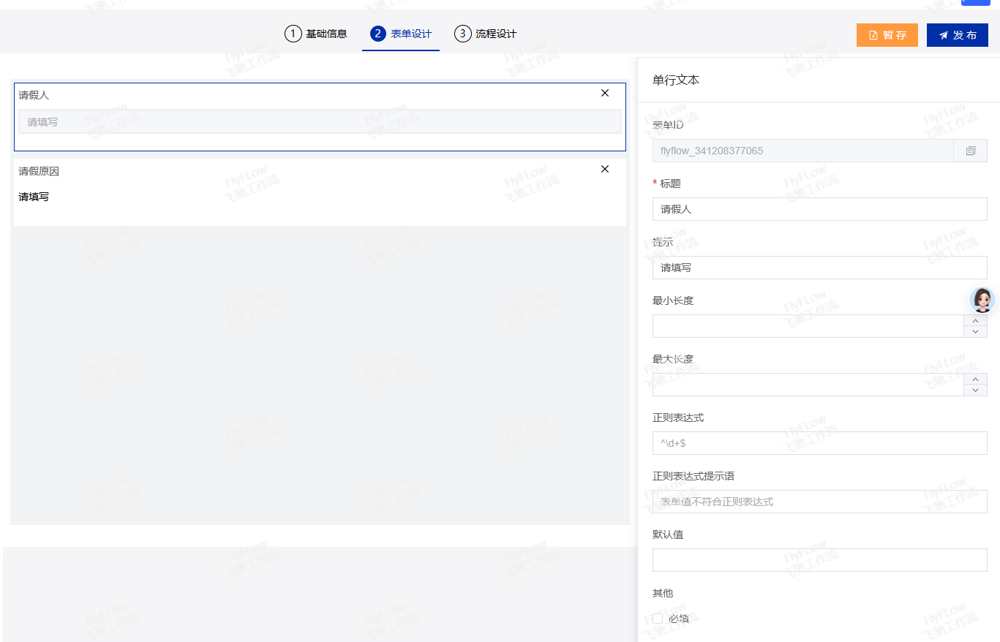
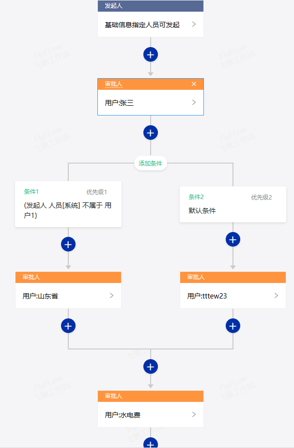

# 审批流报文格式

## 基础：


## 表单：


## 流程图：


## 报文格式：
```json
{
  "logo": "http://127.0.0.1:26859/file/show/2024-05-23/b4de083cd1264a3a99272b5ce774f971.jpg",
  "name": "测试流程",
  "flowId": "p9vzwe81716434236358",
  "uniqueId": "flyflow_340774933759",
  "groupId": "1793480067548602369",
  "admin": "[{\"id\":\"1\",\"name\":\"用户1\",\"avatar\":\"http://127.0.0.1:26859/file/show/2024-05-23/e2376d213800496abcd551af8bb95dc8.jpg\",\"type\":\"user\"}]",
  "rangeList": [],
  "remark": "测试流程",
  "formItems": "",
  "formItemsPc": "",
  "process": "",
  "publish": true
}
```

```json
[
    {
        "name": "请假人",
        "type": "Input",
        "typeName": "单行文本",
        "icon": "EditPen",
        "placeholder": "请填写",
        "required": false,
        "printable": true,
        "props": {
            "value": "",
            "regex": "",
            "regexDesc": ""
        },
        "id": "flyflow_341208377065"
    },
    {
        "name": "请假原因",
        "icon": "ChatLineSquare",
        "type": "Description",
        "typeName": "说明",
        "placeholder": "请填写",
        "required": false,
        "printable": true,
        "props": {
            "value": ""
        },
        "id": "flyflow_341241448739"
    }
]
```

```json
{
    "id": "root",
    "type": 0,
    "error": false,
    "tempId": "root|2cc0b58dff404a6890b66e757fc92ed8",
    "nodeName": "发起人",
    "operList": [
        {
            "key": "pass",
            "edit": false,
            "name": "提交",
            "type": "primary",
            "checked": true,
            "defaultName": "提交"
        }
    ],
    "childNode": {
        "id": "flyflow_341465493485",
        "error": false,
        "listener": {
            "create": {
                "enable": false,
                "url": "http://127.0.0.1:26859/test/notify",
                "header": [],
                "body": []
            },
            "assign": {
                "enable": false,
                "url": "http://127.0.0.1:26859/test/notify",
                "header": [],
                "body": []
            },
            "complete": {
                "enable": false,
                "url": "http://127.0.0.1:26859/test/notify",
                "header": [],
                "body": []
            },
            "change": {
                "enable": false,
                "url": "",
                "header": [],
                "body": []
            }
        },
        "fromOtherNodeList": [
            {
                "id": "root",
                "nodeName": "发起人"
            }
        ],
        "containChildrenDept": false,
        "assignedType": 1,
        "multiple": false,
        "needSignature": false,
        "multipleMode": 1,
        "completeRate": 100,
        "deptLeaderLevel": 1,
        "formUserId": "",
        "formUserName": "",
        "deptUserType": "allUser",
        "roleList": [],
        "formPerms": {
            "flyflow_341208377065": "R",
            "flyflow_341241448739": "R"
        },
        "expireSetting": {
            "enable": false,
            "value": 6,
            "valueUnit": "TH",
            "type": 1,
            "once": true
        },
        "dynamicFormConfig": {
            "enable": false,
            "url": "",
            "header": [],
            "body": [],
            "result": [
                {
                    "field": "",
                    "contentConfig": "",
                    "value": ""
                }
            ]
        },
        "nobody": {
            "handler": "TO_PASS",
            "assignedUser": []
        },
        "sameAsStarter": {
            "handler": "TO_CONTINUE"
        },
        "refuse": {
            "nodeId": "",
            "handler": "TO_END"
        },
        "operList": [
            {
                "key": "pass",
                "edit": false,
                "name": "通过",
                "type": "primary",
                "checked": true,
                "defaultName": "通过"
            },
            {
                "key": "refuse",
                "edit": false,
                "name": "拒绝",
                "type": "danger",
                "checked": true,
                "defaultName": "拒绝"
            }
        ],
        "nodeUserList": [
            {
                "id": "15",
                "name": "张三",
                "type": "user",
                "avatar": "http://127.0.0.1:26859/file/show/2024-05-23/04cb48bc73f84b15ae2f66adfc1d1915.jpg",
                "containChildrenDept": false
            }
        ],
        "type": 1,
        "tempId": "flyflow_341465493485|ee69683329e34dfcac9d11e34fadf1da",
        "nodeName": "审批人",
        "parentId": "root",
        "childNode": {
            "nodeName": "条件分支",
            "type": 4,
            "id": "flyflow_545269948900",
            "parentId": "flyflow_341465493485",
            "childNode": {
                "id": "flyflow_341732928722",
                "type": 1,
                "error": false,
                "nobody": {
                    "handler": "TO_PASS",
                    "assignedUser": []
                },
                "refuse": {
                    "nodeId": "",
                    "handler": "TO_END"
                },
                "tempId": "flyflow_341732928722|01d413bb700147f383840d6d789b78a0",
                "multiple": false,
                "nodeName": "审批人",
                "operList": [
                    {
                        "key": "pass",
                        "edit": false,
                        "name": "通过",
                        "type": "primary",
                        "checked": true,
                        "defaultName": "通过"
                    },
                    {
                        "key": "refuse",
                        "edit": false,
                        "name": "拒绝",
                        "type": "danger",
                        "checked": true,
                        "defaultName": "拒绝"
                    }
                ],
                "parentId": "flyflow_341465493485",
                "roleList": [],
                "formPerms": {
                    "flyflow_341208377065": "R",
                    "flyflow_341241448739": "R"
                },
                "formUserId": "",
                "placeHolder": "用户:水电费",
                "assignedType": 1,
                "deptUserType": "allUser",
                "formUserName": "",
                "multipleMode": 1,
                "nodeUserList": [
                    {
                        "id": "6",
                        "name": "水电费",
                        "type": "user",
                        "avatar": "http://127.0.0.1:26859/file/show/2024-05-23/b40b7eba8fa046c0896fa795c0f38efd.jpg",
                        "containChildrenDept": false
                    }
                ],
                "deptLeaderLevel": 1,
                "remarkedAtNodeShow": false,
                "containChildrenDept": false,
                "errorMsg": ""
            },
            "conditionNodes": [
                {
                    "id": "flyflow_545269948878",
                    "nodeName": "条件1",
                    "mode": true,
                    "groupRelationMode": true,
                    "groupRelation": [],
                    "error": false,
                    "type": 3,
                    "parentId": "flyflow_545269948900",
                    "priorityLevel": 1,
                    "conditionList": [
                        {
                            "mode": true,
                            "conditionList": [
                                {
                                    "key": "rootUser",
                                    "expression": "notin",
                                    "userKeyFieldList": [
                                        {
                                            "key": "rangeUser",
                                            "type": "SelectUser",
                                            "name": "人员[系统]"
                                        },
                                        {
                                            "key": "rangeDept",
                                            "type": "SelectDept",
                                            "name": "部门[系统]"
                                        },
                                        {
                                            "key": "empty",
                                            "type": "",
                                            "name": "为空[系统]"
                                        },
                                        {
                                            "key": "notempty",
                                            "type": "",
                                            "name": "不为空[系统]"
                                        },
                                        {
                                            "key": "role",
                                            "type": "Role",
                                            "name": "角色[系统]"
                                        }
                                    ],
                                    "keyType": "SelectUser",
                                    "name": "发起人",
                                    "userKey": "rangeUser",
                                    "value": [
                                        {
                                            "type": "user",
                                            "id": "1",
                                            "name": "用户1",
                                            "avatar": "http://127.0.0.1:26859/file/show/2024-05-23/e2376d213800496abcd551af8bb95dc8.jpg"
                                        }
                                    ]
                                }
                            ]
                        }
                    ],
                    "nodeUserList": [],
                    "childNode": {
                        "id": "flyflow_545785351211",
                        "error": false,
                        "listener": {
                            "create": {
                                "enable": false,
                                "url": "http://127.0.0.1:26859/test/notify",
                                "header": [],
                                "body": []
                            },
                            "assign": {
                                "enable": false,
                                "url": "http://127.0.0.1:26859/test/notify",
                                "header": [],
                                "body": []
                            },
                            "complete": {
                                "enable": false,
                                "url": "http://127.0.0.1:26859/test/notify",
                                "header": [],
                                "body": []
                            },
                            "change": {
                                "enable": false,
                                "url": "",
                                "header": [],
                                "body": []
                            }
                        },
                        "fromOtherNodeList": [
                            {
                                "id": "root",
                                "nodeName": "发起人"
                            }
                        ],
                        "containChildrenDept": false,
                        "assignedType": 1,
                        "multiple": false,
                        "needSignature": false,
                        "multipleMode": 1,
                        "completeRate": 100,
                        "deptLeaderLevel": 1,
                        "formUserId": "",
                        "formUserName": "",
                        "deptUserType": "allUser",
                        "roleList": [],
                        "formPerms": {
                            "flyflow_341208377065": "R",
                            "flyflow_341241448739": "R"
                        },
                        "expireSetting": {
                            "enable": false,
                            "value": 6,
                            "valueUnit": "TH",
                            "type": 1,
                            "once": true
                        },
                        "dynamicFormConfig": {
                            "enable": false,
                            "url": "",
                            "header": [],
                            "body": [],
                            "result": [
                                {
                                    "field": "",
                                    "contentConfig": "",
                                    "value": ""
                                }
                            ]
                        },
                        "nobody": {
                            "handler": "TO_PASS",
                            "assignedUser": []
                        },
                        "sameAsStarter": {
                            "handler": "TO_CONTINUE"
                        },
                        "refuse": {
                            "handler": "TO_END",
                            "nodeId": ""
                        },
                        "operList": [
                            {
                                "key": "pass",
                                "checked": true,
                                "edit": false,
                                "name": "通过",
                                "type": "primary",
                                "defaultName": "通过"
                            },
                            {
                                "key": "refuse",
                                "checked": true,
                                "edit": false,
                                "name": "拒绝",
                                "type": "danger",
                                "defaultName": "拒绝"
                            }
                        ],
                        "nodeUserList": [
                            {
                                "type": "user",
                                "id": "3",
                                "name": "山东省",
                                "avatar": "http://127.0.0.1:26859/file/show/2024-05-23/cc240955c37a48628ca58e99d20aca7c.jpg"
                            }
                        ],
                        "parentId": "flyflow_545269948878",
                        "nodeName": "审批人",
                        "type": 1,
                        "childNode": null,
                        "errorMsg": "",
                        "placeHolder": "用户:山东省"
                    },
                    "placeHolder": "(发起人 人员[系统] 不属于 用户1)"
                },
                {
                    "nodeName": "条件2",
                    "type": 3,
                    "groupRelationMode": true,
                    "groupRelation": [],
                    "id": "flyflow_545269944468",
                    "mode": true,
                    "error": false,
                    "parentId": "flyflow_545269948900",
                    "priorityLevel": 2,
                    "conditionList": [
                        {
                            "mode": true,
                            "conditionList": [
                                {
                                    "key": "",
                                    "expression": ""
                                }
                            ]
                        }
                    ],
                    "nodeUserList": [],
                    "childNode": {
                        "id": "flyflow_545927508185",
                        "error": false,
                        "listener": {
                            "create": {
                                "enable": false,
                                "url": "http://127.0.0.1:26859/test/notify",
                                "header": [],
                                "body": []
                            },
                            "assign": {
                                "enable": false,
                                "url": "http://127.0.0.1:26859/test/notify",
                                "header": [],
                                "body": []
                            },
                            "complete": {
                                "enable": false,
                                "url": "http://127.0.0.1:26859/test/notify",
                                "header": [],
                                "body": []
                            },
                            "change": {
                                "enable": false,
                                "url": "",
                                "header": [],
                                "body": []
                            }
                        },
                        "fromOtherNodeList": [
                            {
                                "id": "root",
                                "nodeName": "发起人"
                            }
                        ],
                        "containChildrenDept": false,
                        "assignedType": 1,
                        "multiple": false,
                        "needSignature": false,
                        "multipleMode": 1,
                        "completeRate": 100,
                        "deptLeaderLevel": 1,
                        "formUserId": "",
                        "formUserName": "",
                        "deptUserType": "allUser",
                        "roleList": [],
                        "formPerms": {
                            "flyflow_341208377065": "R",
                            "flyflow_341241448739": "R"
                        },
                        "expireSetting": {
                            "enable": false,
                            "value": 6,
                            "valueUnit": "TH",
                            "type": 1,
                            "once": true
                        },
                        "dynamicFormConfig": {
                            "enable": false,
                            "url": "",
                            "header": [],
                            "body": [],
                            "result": [
                                {
                                    "field": "",
                                    "contentConfig": "",
                                    "value": ""
                                }
                            ]
                        },
                        "nobody": {
                            "handler": "TO_PASS",
                            "assignedUser": []
                        },
                        "sameAsStarter": {
                            "handler": "TO_CONTINUE"
                        },
                        "refuse": {
                            "handler": "TO_END",
                            "nodeId": ""
                        },
                        "operList": [
                            {
                                "key": "pass",
                                "checked": true,
                                "edit": false,
                                "name": "通过",
                                "type": "primary",
                                "defaultName": "通过"
                            },
                            {
                                "key": "refuse",
                                "checked": true,
                                "edit": false,
                                "name": "拒绝",
                                "type": "danger",
                                "defaultName": "拒绝"
                            }
                        ],
                        "nodeUserList": [
                            {
                                "type": "user",
                                "id": "11",
                                "name": "tttew23",
                                "avatar": "http://127.0.0.1:26859/file/show/2024-05-23/8337392dec4b48379445094c8c8508ae.jpg"
                            }
                        ],
                        "parentId": "flyflow_545269944468",
                        "nodeName": "审批人",
                        "type": 1,
                        "childNode": null,
                        "errorMsg": "",
                        "placeHolder": "用户:tttew23"
                    },
                    "placeHolder": "默认条件"
                }
            ]
        },
        "placeHolder": "用户:张三",
        "remarkedAtNodeShow": false,
        "errorMsg": ""
    },
    "formPerms": {
        "flyflow_341208377065": "R",
        "flyflow_341241448739": "E"
    },
    "multipleMode": 1,
    "remarkedAtNodeShow": false,
    "errorMsg": ""
}
```
