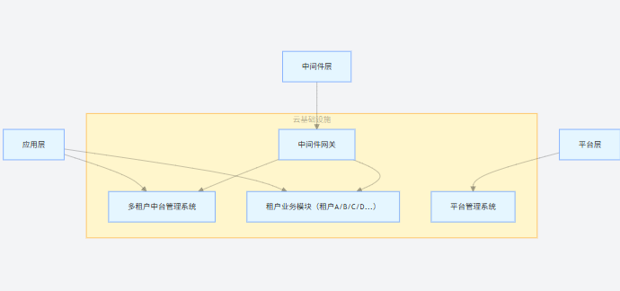

# SaaS 平台设计方案（详细版）
## 一、总体架构设计
### （一）架构图

### （二）分层说明
1. **应用层**：面向租户和平台运营人员，承载实际业务功能。多租户中台管理系统聚焦租户全局管控，租户业务模块满足各租户个性化运营需求 。
2. **中间件层**：作为流量与服务的 “中枢”，拦截并处理所有租户请求，实现智能路由、安全校验与流量治理，保障系统交互顺畅、稳定 。
3. **平台层**：提供底层基础服务与管理能力，为上层应用筑牢根基，支撑多租户模式下的标准化、规范化运营 。
4. **云基础设施**：基于公有云（如阿里云、AWS ）或混合云部署，利用云服务器、容器服务、存储与网络资源，实现弹性扩缩容，降低硬件投入与运维成本 。

## 二、各层详细设计
### （一）平台管理系统
#### 1. 功能模块拆解与交互逻辑
+ **统一基础服务模块**
    - **统一会员**：
        * 搭建**租户 - 终端用户**双层会员体系。租户侧，记录租户企业信息、合作等级、服务套餐；用户侧，管理终端用户注册、登录、信息（姓名、手机号、地址 ）、会员等级（通过积分、消费累计升级 ）与权益（专属折扣、优先客服 ）。
        * 交互流程：终端用户注册时，调用统一认证接口校验身份，数据同步至会员库；租户查看会员数据，需通过中台管理系统申请权限，经平台授权后，从会员模块拉取 。
    - **统一认证**：
        * 集成 **OAuth2.0 + JWT** 方案。租户管理员登录中台时，跳转至平台认证中心，输入账号密码，认证通过后颁发 JWT 令牌；终端用户访问租户业务系统，支持手机号 + 验证码、第三方社交账号（微信、支付宝 ）快捷登录，均通过平台认证服务校验 。
        * 安全机制：JWT 令牌设置短有效期（如 1 小时 ），配合 Refresh Token 无感续期；定期更新签名密钥，防止令牌伪造 。
    - **统一资金结算**：
        * 对接 **支付宝、微信支付、银行直连** 通道。租户交易产生订单后，支付请求经平台转发至支付渠道，回调结果同步更新订单状态；结算时，按租户协议分账比例（如平台抽成、租户收款 ），自动完成资金划拨，生成电子账单，支持导出 PDF/Excel 。
        * 对账逻辑：每日定时拉取支付渠道账单，与平台订单系统对账，差异数据标记待处理，触发人工复核流程 。
+ **风控与运营支撑模块**
    - **风险管理**：
        * 构建 **规则引擎 + 机器学习模型**。预设规则（如单笔交易金额超阈值、短时间内频繁下单 ），触发实时拦截或预警；基于历史风险数据训练模型，识别潜在欺诈、违约行为，输出风险评分与处置建议（冻结账户、限制交易 ）。
        * 风险数据流转：租户业务操作产生数据，经中间件网关实时同步至风控模块，分析结果反馈至业务系统，如交易管理模块拦截高风险订单 。
    - **数据备份与统计分析**：
        * 备份策略：采用 **增量备份 + 全量备份** 结合，每日增量备份业务数据，每周全量备份，存储至异地灾备中心；支持按租户、业务模块灵活恢复数据 。
        * 统计分析：基于 **大数据平台（Hadoop + Spark ）**，清洗、聚合平台运营数据（租户活跃度、交易趋势 ）、租户业务数据（商品销量、会员增长 ），通过 BI 工具（Tableau、PowerBI ）生成可视化报表，如柱状图展示各租户月度交易对比、折线图呈现平台会员增长曲线 。

### （二）多租户中台管理系统
#### 1. 租户全流程管控设计
+ **租户入驻**：
    - 流程：租户访问平台官网，进入 “入驻申请” 页面，填写企业信息（名称、法人、经营范围 ）、上传资质文件（营业执照、行业许可证 ）→ 平台运营人员初审（校验资料完整性、合规性 ）→ 审核通过后，自动分配租户编码、初始权限（基础业务模块访问权限 ）与资源配额（存储容量、API 调用次数 ）→ 租户管理员设置子账号权限，开展业务配置 。
    - 自动化能力：利用 **工作流引擎**，配置审核节点、超时提醒（如初审 3 个工作日未处理，自动触发邮件催办 ），提升入驻效率 。
+ **授权管理**：
    - 精细授权：支持 **时间维度**（试用 15 天、年度付费 ）、**功能维度**（会员管理可编辑 / 仅查看、商品模板选择基础版 / 高级版 ）、**交易模式**（开启零售 / 关闭批发 ）、**接口权限**（开放订单查询 API 、限制库存修改 API ）灵活组合授权 。
    - 交互示例：租户申请开通 “预售交易模式”，提交申请后，中台管理系统校验租户服务套餐、费用缴纳情况，符合条件则更新租户权限配置，同步至中间件网关与租户业务模块，生效新交易模式 。
+ **租户服务监控**：
    - 指标采集：实时抓取 **系统性能指标**（租户业务系统响应时间、接口调用成功率 ）、**业务使用指标**（会员管理模块日活、交易模块订单量 ），通过 **Prometheus 采集器** 上报数据 。
    - 预警与处置：设置阈值（如响应时间超 2 秒、订单量突降 50% ），触发邮件、短信告警；针对性能问题，自动扩容租户业务容器（基于 Kubernetes HPA ）；业务异常则推送工单至运营人员，协同排查 。

### （三）中间件网关
#### 1. 核心功能实现
+ **流量转发与路由**：
    - 路由策略：基于 **租户标识（Tenant ID ）** 路由，租户请求携带标识（如请求头 Tenant - Code ），网关匹配路由规则，转发至对应租户业务模块集群（如租户 A 请求转发至租户 A 业务容器组 ）。
    - 负载均衡：采用 **加权轮询 + 最少连接数** 算法，根据租户业务模块服务器负载、响应时间，动态分配请求，保障流量均匀分发 。
+ **安全校验与治理**：
    - 权限校验：拦截请求后，调用平台管理系统 **统一认证服务**，校验 JWT 令牌有效性、租户权限范围（如租户 A 申请调用 “商品模板管理” 接口，网关校验是否已授权 ），无权则返回 403 错误 。
    - 流量治理：配置 **限流规则**（单租户每秒最大请求数 、接口级 QPS 限制 ）、**熔断策略**（连续失败请求超阈值，暂停该接口调用 1 分钟 ），防止雪崩效应；记录请求日志，用于故障排查与审计 。

### （四）租户业务模块
#### 1. 租户 A 业务流程闭环设计（以零售租户为例 ）
+ **核心流程**：
    1. **会员管理**：终端用户注册成为租户 A 会员，填写信息（收货地址、偏好 ）→ 租户 A 运营人员设置会员等级（普通会员、黄金会员 ），配置权益（黄金会员享 9 折优惠 ）→ 会员登录后，查看专属权益、积分明细，参与营销活动（积分兑换、生日福利 ）。
    2. **商品管理**：租户 A 上传商品信息（名称、规格、价格、库存 ），关联平台商品模板（如 “快消品模板” 包含保质期、批次字段 ）→ 审核通过后，商品上架展示，支持按分类（食品、日用品 ）、销量排序 。
    3. **交易管理**：会员下单选购商品，选择支付方式（微信 / 支付宝 ）→ 交易模块调用平台统一资金结算服务，完成支付 → 订单状态更新为 “待发货”，触发仓储管理模块拣货、发货 。
    4. **仓储与供应链**：仓储模块接收订单发货指令，校验库存（扣减可用库存 ），生成物流单；供应链模块管理供应商，触发补货预警（库存低于安全值 ），自动生成采购订单 。
    5. **数据与运营**：租户 A 运营人员通过数据查询模块，查看 “商品销量 Top10”“会员复购率趋势”；利用统计分析功能，生成 “月度销售报表”，辅助调整商品策略、营销活动 。
+ **权限与日志**：
    - 权限：租户管理员为员工分配角色（运营岗可操作商品、交易；财务岗仅访问资金数据 ），细化至按钮级权限（如 “删除商品” 仅高级运营可操作 ）。
    - 日志：记录用户操作（如 “修改商品价格”“审批订单” ），包含操作时间、人员、IP 、操作内容，支持按时间、模块检索，用于审计与问题追溯 。

## 三、部署与运维方案
### （一）部署架构
+ **容器化部署**：采用 **Docker + Kubernetes（K8s ）**，将平台管理系统、多租户中台、中间件网关、租户业务模块分别打包为容器镜像，上传至镜像仓库（Harbor ）。
+ **集群规划**：
    - 平台管理系统集群：部署 3 个节点，保障底层服务高可用，承载统一认证、资金结算等高并发基础服务 。
    - 多租户中台集群：部署 2 个节点，处理租户管控请求，资源按需分配 。
    - 中间件网关集群：部署 4 个节点（可弹性扩容 ），应对海量租户请求，实现流量转发与治理 。
    - 租户业务模块集群：按租户规模弹性伸缩，如租户 A 业务量高，自动扩容 2 个业务容器，保障响应速度 。

### （二）运维管理
+ **监控体系**：
    - 指标覆盖：通过 **Prometheus + Grafana** 监控服务器（CPU 使用率、内存占用 ）、中间件（网关请求延迟、API 调用成功率 ）、业务系统（订单处理时长、会员注册量 ）全链路指标 。
    - 告警策略：设置多级告警（如 CPU 使用率超 80% 触发警告，超 90% 触发紧急告警 ），通过邮件、企业微信推送，关联运维工单系统，自动派单处理 。
+ **故障自愈**：
    - 容器自愈：K8s 监测到容器故障（如进程崩溃 ），自动重启容器；节点故障时，触发节点替换，迁移 Pod 至健康节点 。
    - 业务降级：配置降级规则（如流量高峰时，关闭非核心功能接口 ），保障关键业务（交易、支付 ）可用性；降级状态实时展示，便于运营人员决策恢复时机 。

## 四、租户使用流程与价值体现
### （一）租户操作流程（以新租户入驻为例 ）
1. **入驻申请**：企业填写信息、上传资质 → 平台初审（1 - 2 工作日 ）→ 开通租户账号，分配初始权限 。
2. **业务配置**：租户管理员登录中台，申请功能授权（如开启 “预售交易” ）、配置会员等级规则、商品模板 。
3. **业务运营**：员工登录租户业务系统，开展会员招募、商品上架、订单处理；利用数据模块分析销售趋势，优化运营策略 。
4. **系统迭代**：平台发布新版本，中台推送升级通知，租户选择灰度升级（先更新 10% 用户，验证无问题后全量升级 ），保障业务无感知过渡 。

### （二）平台价值输出
+ **对租户**：
    - 降低成本：无需自建 IT 基础设施，通过 SaaS 模式按需使用，节省服务器、运维投入 。
    - 快速上线：复用平台基础服务与业务模板，入驻后可快速配置业务，缩短项目周期 。
    - 灵活扩展：随业务增长，按需申请功能授权、资源扩容，适配企业发展节奏 。
+ **对平台运营方**：
    - 规模化复制：通过多租户架构，一套系统服务多个租户，提升资源利用率与盈利空间 。
    - 数据沉淀与增值：聚合多租户数据，挖掘行业趋势、用户需求，反哺产品优化与增值服务（如行业报告、精准营销 ）。

此方案覆盖架构、功能、部署运维全环节，可基于实际技术栈（如选择 Java 微服务框架、替换云厂商 ）灵活调整，助力打造稳定、高效、易扩展的 SaaS 平台 。
