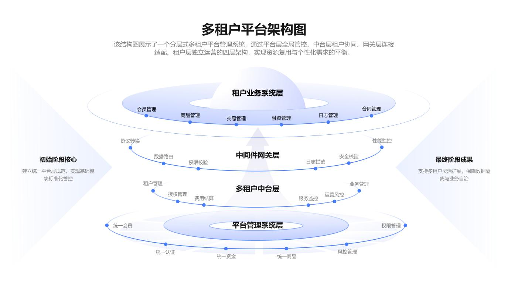

# 农产品大宗商品 SaaS 平台业务功能与系统架构详细说明
本文档基于 “平台管理系统层 - 多租户中台管理系统层 - 中间件网关层 - 租户业务系统层” 四层架构，详细拆解各层级功能模块的核心业务逻辑、操作流程及价值定位，明确层间数据交互与协同规则，为系统设计、开发落地、运营优化提供标准化指导，适配电商、供应链、企业服务等多行业多租户场景。

## 一、平台管理系统层
平台管理系统层作为整个 SaaS 平台的 “中枢大脑”，承担着全局资源统筹、业务规则制定与统一管控的核心职责，确保各层级系统高效协同、数据规范统一，为多租户运营奠定坚实基础。各功能模块详细说明如下：

### 1. 统一会员模块
该模块旨在打破各租户系统的会员数据壁垒，构建全平台统一的会员体系，实现会员资源的高效管理与复用。核心功能包括：

+ **会员信息统一存储**：整合所有租户侧注册的会员数据，建立包含基本信息（姓名、联系方式、身份证号等）、身份类型（采购商、企业、物流商等）、资质认证状态、会员等级等维度的统一数据库，支持会员信息的实时同步与更新。
+ **会员等级体系管理**：制定全平台统一的会员等级规则，可依据会员累计交易金额、交易频次、履约情况等指标自动升级或降级，并配置不同等级对应的权益（如交易手续费折扣、优先参与促销活动、专属客服等），同时支持租户在统一规则基础上微调个性化权益。
+ **会员跨租户协同**：支持会员在不同租户系统间无缝切换，无需重复注册，仅需通过平台统一认证即可获取对应租户的服务权限，同时记录会员在各租户的交易行为，形成完整的会员行为画像，为平台精准运营提供数据支撑。

### 2. 统一认证模块
以保障平台数据安全与用户身份合法性为核心，构建多维度、高安全的统一认证体系，覆盖用户登录、接口调用、数据访问等全场景。具体功能包括：

+ **多方式身份认证**：支持账号密码、手机验证码、人脸识别、Ukey 硬件认证等多种登录方式，用户可根据自身安全需求选择；针对高权限操作（如资金结算、合同签署），强制启用多因子认证，提升账户安全性。
+ **认证权限粒度控制**：基于 RBAC（角色基础访问控制）模型，为不同类型用户（平台管理员、租户管理员、普通会员）分配差异化的认证权限，明确各角色可访问的系统资源与操作范围；同时支持动态调整认证策略，如登录超时时间、密码复杂度要求等。
+ **第三方系统对接认证**：提供标准化的认证接口，支持与银行、物流、质检等第三方系统对接，实现跨平台身份核验，例如在会员进行资金结算时，自动对接银行系统验证账户身份，确保交易安全。

### 3. 统一资金结算模块
作为平台资金流转的核心枢纽，该模块实现全平台交易资金的统一归集、清算与划拨，保障资金流转透明、高效、合规。详细功能如下：

+ **资金账户管理**：为平台、各租户及会员分别建立独立的资金账户，记录账户余额、收支明细、冻结金额等信息；支持账户类型分类（如结算账户、保证金账户、预付款账户），满足不同业务场景的资金管理需求。
+ **交易资金清算**：对接各租户交易系统，实时获取交易订单数据，按照预设的结算规则（如 T+1、T+3 结算周期，平台手续费比例、租户分成比例等）自动完成资金清算，计算平台、租户、企业应得金额，并生成清算报表。
+ **资金划拨与对账**：根据清算结果，自动或手动向相关账户划拨资金，支持银行转账、第三方支付（如支付宝、微信支付）等多种划拨方式；每日生成资金对账报表，对比平台账户流水与银行流水、租户交易流水，确保账实相符，同时支持异常交易的排查与处理。

### 4. 统一银行模块
搭建平台与多家银行的标准化对接通道，实现银行服务的集中管理与调用，为资金结算、账户管理等模块提供底层支撑。具体功能包括：

+ **银行接口统一封装**：对接国内主流商业银行（如工商银行、农业银行、建设银行等）的 API 接口，对不同银行的账户查询、转账汇款、流水下载等功能进行统一封装，形成标准化的银行服务接口，供平台其他模块调用，避免因银行接口差异导致的开发重复工作。
+ **银行账户监控**：实时监控平台及租户在各银行的账户状态，包括账户余额、交易流水、账户冻结情况等，当账户出现异常（如余额不足、异常转账）时，自动触发预警通知（短信、系统消息），及时提醒相关人员处理。
+ **银行合作管理**：记录与各银行的合作协议信息（如合作期限、手续费率、服务范围），支持合作协议的新增、修改、终止操作；定期统计各银行的服务使用情况（如转账笔数、资金流转金额），为平台优化银行合作方案提供数据参考。

### 5. 统一商品模块
构建全平台标准化的商品信息库，规范商品分类、属性与编码，实现商品信息的统一管理与共享，提升商品流通效率。详细功能如下：

+ **商品分类体系搭建**：基于农产品（小麦、大豆）的特性，建立多级分类体系，例如一级分类为 “粮食类”，二级分类为 “小麦”“大豆”，三级分类为 “冬小麦”“春小麦”“黄大豆”“黑大豆” 等；支持租户根据自身业务需求在统一分类基础上新增自定义分类，但需遵循平台分类规范。
+ **商品属性标准化**：为每类商品定义统一的核心属性（如小麦的容重、水分含量、杂质含量、产地、等级；大豆的蛋白质含量、脂肪含量、颗粒大小、产地等），并设置属性值的取值范围与校验规则，确保商品信息的准确性与一致性；同时支持上传商品图片、检测报告等附加信息，丰富商品详情。
+ **商品编码管理**：为每个商品分配唯一的平台级商品编码，编码规则包含商品分类、属性等信息，便于商品的快速识别与检索；支持商品编码的批量生成、修改与注销，同时关联租户侧的商品编码，实现平台编码与租户编码的映射，确保数据交互顺畅。

### 6. 统一仓储模块
整合全平台的仓储资源，实现仓储设施、库存信息的统一管理与调度，为租户与会员提供高效的仓储服务支持。具体功能包括：

+ **仓储资源管理**：收录平台合作的仓储中心信息，包括仓储地址、仓库类型（常温仓、恒温仓、冷藏仓）、仓储面积、存储容量、可存储商品类型、仓储设备（如叉车、地磅）等；支持仓储中心的资质审核（如营业执照、仓储许可证），确保仓储服务合规。
+ **库存统一监控**：实时采集各仓储中心的库存数据，包括商品名称、规格、数量、存储位置（库区、货架、货位）、入库时间、保质期（如有）等信息，形成全平台库存台账；支持按商品、仓储中心、租户等维度查询库存，当库存低于预警阈值或临近保质期时，自动发送预警通知。
+ **仓储调度管理**：根据租户与会员的仓储需求（如入库、出库、调拨），结合各仓储中心的库存情况与地理位置，智能推荐最优仓储方案；支持仓储订单的统一创建与跟踪，实时更新订单状态（如待入库、已入库、待出库、已出库），并对接物流模块，实现仓储与物流的协同。

### 7. 统一仓单模块
围绕农产品仓单的全生命周期进行管理，实现仓单的标准化生成、流转、质押与注销，为商品交易与供应链融资提供凭证支持。详细功能如下：

+ **仓单标准化生成**：根据统一仓储模块的库存数据，自动生成标准化仓单，仓单信息包含仓单编号、商品名称、规格、数量、仓储中心、入库时间、有效期、质检报告编号等；支持仓单的线上审核，审核通过后生成电子仓单，具备唯一标识与防伪功能，可通过平台查询验证。
+ **仓单流转管理**：支持仓单在会员之间的转让、背书等流转操作，流转过程中实时更新仓单持有人信息，并记录流转轨迹；流转完成后，自动同步至统一仓储模块，更新库存归属，确保仓单与实物的一致性；同时支持仓单的拆分与合并，满足不同交易场景的需求。
+ **仓单质押与注销**：对接供应链融资模块，为会员提供仓单质押融资服务，审核通过后冻结对应仓单，待融资结清后解除冻结；当仓单对应的商品出库或过期时，触发仓单注销流程，注销后的仓单不可再流转或质押，并保留注销记录供后续查询。

### 8. 统一短信模块
为平台各业务场景提供标准化的短信服务，实现短信的统一发送、管理与统计，提升平台与用户的沟通效率。具体功能包括：

+ **短信模板管理**：建立全平台统一的短信模板库，涵盖验证码（登录、注册、支付）、通知（订单状态变更、库存预警、账单提醒）、营销（促销活动、新品推荐）等类型；模板需经过合规审核，确保内容符合短信发送规范，支持模板的新增、修改、启用与禁用。
+ **短信发送与调度**：对接多家短信服务商（如阿里云短信、腾讯云短信），根据短信类型与发送量自动选择最优服务商，确保短信发送的及时性与到达率；支持单次发送、批量发送与定时发送，例如会员注册时实时发送验证码，每月固定日期发送账单提醒短信。
+ **短信数据统计与分析**：记录每条短信的发送状态（成功、失败、待发送）、发送时间、接收号码、所属业务场景等信息，生成短信发送报表；分析短信到达率、点击率（针对营销短信）等数据，为优化短信内容与发送策略提供依据。

### 9. 统一证书模块
管理平台内所有与资质相关的证书，实现证书的标准化存储、审核与查询，确保平台运营与用户业务的合规性。详细功能如下：

+ **证书分类存储**：按照证书类型（如平台资质证书、租户营业执照、会员身份证、企业生产许可证、商品质检报告等）建立分类存储体系，支持证书的线上上传（格式包括 PDF、JPG、PNG 等），并记录证书编号、有效期、颁发机构、关联主体（平台、租户、会员、商品）等信息。
+ **证书审核管理**：设置证书审核流程，例如租户上传营业执照后，由平台管理员进行审核，审核内容包括证书真实性、有效期、经营范围等；审核通过后，证书状态更新为 “已生效”，并关联至对应主体，作为业务开展的依据；审核不通过则反馈原因，允许租户重新上传。
+ **证书到期预警与更新**：实时监控证书有效期，当证书临近到期（如提前 30 天）时，自动向证书关联主体发送预警通知，提醒及时更新；支持证书的更新上传与重新审核，更新后的证书信息自动覆盖旧信息，并保留证书更新记录，形成完整的证书生命周期档案。

### 10. 统一发票模块
实现全平台发票的统一开具、管理与流转，满足平台、租户、会员的发票需求，确保税务合规。具体功能包括：

+ **发票类型管理**：支持增值税专用发票、增值税普通发票、电子发票等多种发票类型，配置不同发票类型的开具规则（如开票金额阈值、所需资质、税率）；针对农产品交易，可根据国家税收政策，自动适配农产品相关的税收优惠规则。
+ **发票开具与分发**：对接交易与资金结算模块，当交易完成且资金到账后，自动触发发票开具流程，根据订单信息（商品名称、金额、税率）生成发票；支持批量开具与单张开具，电子发票可直接发送至会员邮箱或在会员中心供下载，纸质发票由平台统一邮寄或由租户自行邮寄（根据配置）。
+ **发票对账与归档**：记录所有发票的开具状态（待开具、已开具、已作废、红冲）、发票号码、开票日期、受票方信息等，生成发票台账；每月与财务系统对账，确保发票金额与交易金额、纳税金额一致；同时对已开具的发票进行电子化归档，支持按发票号码、受票方、日期等维度查询与导出。

### 11. 风控管理模块
构建全平台的风险防控体系，实时识别、评估与处置各类业务风险，保障平台运营安全与用户权益。详细功能如下：

+ **风险指标体系搭建**：围绕会员、交易、资金、仓储等业务环节，设置风险指标，如会员异常登录（异地登录、频繁登录）、交易异常（大额交易、高频交易、关联交易）、资金异常（大额转账、快进快出、账户余额骤降）、库存异常（库存与仓单不匹配、频繁调拨）等，并为每个指标设置风险阈值。
+ **实时风险监测与预警**：通过大数据技术实时采集各模块的业务数据，对比风险指标阈值，当触发风险条件时，自动生成风险预警信息，并按照风险等级（低、中、高）采取不同的预警措施，如低风险发送系统消息提醒、中风险冻结部分功能、高风险暂停账户操作，并通知风控人员介入。
+ **风险处置与复盘**：为风控人员提供风险处置工具，包括风险核查（查看相关业务数据与轨迹）、风险确认（判定是否为真实风险）、风险处理（如解冻账户、取消订单、终止合作）；定期对已处置的风险事件进行复盘，分析风险产生的原因、处置效果，优化风险指标与预警规则，提升风控能力。

### 12. 信息管理模块
统筹管理平台内的各类信息资源，实现信息的标准化发布、审核与传播，为用户提供准确、及时的信息服务。具体功能包括：

+ **信息分类与发布**：将平台信息分为政策公告、市场资讯、行业动态、操作指南等类型，设置不同类型信息的发布权限（如平台管理员发布政策公告、租户发布自身活动资讯）；支持信息的富文本编辑（插入图片、视频、链接），发布前需经过审核，确保信息内容真实、合规。
+ **信息推送与触达**：根据用户类型（平台管理员、租户、采购商、企业）与兴趣标签，实现信息的精准推送，例如向企业推送农产品收购政策，向采购商推送市场价格行情；推送方式包括系统消息、短信、邮件等，支持用户自定义信息订阅偏好。
+ **信息检索与归档**：提供信息检索功能，用户可通过关键词、信息类型、发布时间等条件查询所需信息；对已发布的信息进行归档管理，按照时间维度（如按年、按月）分类存储，支持历史信息的查询与导出，同时定期清理无效或过期信息，保持信息库的整洁。

### 13. 权限管理模块
基于精细化的权限控制模型，实现平台内所有用户、角色与资源的权限分配与管理，确保各角色仅能访问与操作权限范围内的资源。详细功能如下：

+ **角色管理**：支持自定义角色创建，如平台超级管理员、平台运营管理员、租户管理员、租户财务员、普通会员等；为每个角色分配预设的权限集合，权限涵盖系统模块访问权限（如是否可访问资金结算模块）、操作权限（如是否可新增订单、修改商品信息）、数据权限（如是否可查看全平台数据、仅查看自身租户数据）。
+ **用户权限分配**：将用户与角色进行关联，一个用户可关联多个角色，权限为多个角色权限的叠加；支持批量为用户分配角色，也可针对单个用户进行权限微调（在角色权限基础上增加或减少部分权限）；同时支持权限的临时授权，如租户管理员临时将部分权限授权给下属，授权到期后自动回收。
+ **权限审计与监控**：记录所有用户的权限变更记录（如角色分配、权限调整），生成权限审计报表；实时监控用户的权限使用情况，当出现越权操作（如用户尝试访问无权限的模块）时，自动记录日志并触发预警，确保权限使用合规。

### 14. 日志管理模块
全面记录平台各模块的操作行为与系统运行状态，形成完整的日志档案，为问题排查、安全审计与责任追溯提供依据。具体功能包括：

+ **日志类型与采集**：日志类型涵盖操作日志（用户登录、订单创建、资金转账等用户操作）、系统日志（系统启动、接口调用、服务异常等系统运行情况）、安全日志（登录失败、越权访问、异常 IP 访问等安全事件）；通过埋点技术与系统监控工具，实时采集各类日志数据，确保日志的完整性与及时性。
+ **日志存储与检索**：采用分布式存储技术，对海量日志数据进行安全存储，设置日志保存周期（如保存 1 年），到期后自动归档或清理；提供高效的日志检索功能，支持按日志类型、操作人、时间范围、关键词等多维度组合查询，快速定位所需日志。
+ **日志分析与告警**：对日志数据进行统计分析，生成日志分析报表，如用户操作频次报表、系统错误率报表、安全事件统计报表；设置日志告警规则，如当某一账号短时间内多次登录失败、系统错误率超过阈值时，自动发送告警通知，及时发现并处理异常情况。

### 15. 数据查询模块
为平台管理员与租户提供灵活、高效的数据查询工具，支持多维度、多条件查询平台与租户的业务数据，满足日常运营与决策需求。详细功能如下：

+ **查询模板管理**：预设常用的数据查询模板，如会员信息查询、商品交易查询、库存查询、资金流水查询等，每个模板包含固定的查询维度（如时间、区域、商品类型）与筛选条件（如会员等级、交易状态、库存区间）；同时支持用户自定义查询模板，保存常用的查询条件与维度，方便后续重复使用。
+ **多维度查询支持**：支持按业务主题（如会员、商品、交易、资金）划分查询维度，每个主题下提供丰富的查询字段，例如商品交易查询支持按交易时间、交易金额、交易类型、买卖双方、商品名称等字段筛选；支持多条件组合查询与模糊查询，满足复杂的查询需求。
+ **查询结果展示与导出**：查询结果支持以列表、表格、图表（柱状图、折线图、饼图）等多种形式展示，直观呈现数据；支持查询结果的导出，导出格式包括 Excel、CSV、PDF 等，方便用户进行离线分析与报表制作。

### 16. 统计分析模块
基于平台海量业务数据，运用数据分析技术进行多维度统计与深度分析，生成可视化报表与分析结论，为平台运营决策与租户业务优化提供数据支撑。详细功能如下：

+ **统计指标体系构建**：围绕平台运营核心目标，构建统计指标体系，包括会员指标（新增会员数、活跃会员数、会员留存率）、交易指标（交易总额、交易笔数、客单价、成交率）、商品指标（商品上架数、热销商品排行、商品滞销率）、资金指标（资金流入流出金额、结算效率）、仓储指标（库存周转率、仓储利用率）等。
+ **多维度统计分析**：支持按时间维度（日、周、月、季、年）、区域维度（省份、城市）、租户维度、商品维度等进行统计分析，例如按月份统计各省份小麦的交易金额，按租户统计其会员活跃度；支持同比、环比分析，直观展示数据变化趋势。
+ **可视化报表与决策建议**：将统计分析结果以 Dashboard（数据仪表盘）、趋势图、排行榜、对比图等可视化形式呈现，平台管理员与租户可实时查看核心数据；同时基于数据分析结果，自动生成运营决策建议，如针对滞销商品推荐促销策略，针对低活跃会员推荐精准营销方案。

## 二、多租户中台管理系统层
多租户中台管理系统层聚焦 “平台赋能租户”，通过对租户全生命周期、授权、费用、监控与风控的精细化管理，实现平台与租户的协同运营，既保障平台规范，又为租户个性化运营提供支持。各功能模块详细说明如下：

### （一）租户生命周期管理
围绕租户从入驻到退出的全流程，提供标准化、规范化的管理流程，确保租户入驻合规、运营有序、退出顺畅。具体功能包括：

+ **租户入驻申请**：租户通过平台提交入驻申请，需填写租户基本信息（企业名称、统一社会信用代码、注册地址、联系方式）、业务范围（如主营小麦、大豆的批发或零售）、资质证明（营业执照、行业经营许可证、银行开户许可证）等资料；平台提供线上申请入口与资料上传通道，支持申请进度查询。
+ **租户资质审核**：平台设置专门的租户审核团队，对入驻申请资料进行审核，审核内容包括资质真实性（如核查营业执照是否在有效期内、是否存在经营异常）、业务匹配度（如是否符合农产品大宗商品经营范畴）、风险评估（如是否存在不良经营记录）；审核流程分为初审、复审，审核结果实时通知租户，审核不通过需反馈原因，允许租户补充资料后重新申请。
+ **租户开通与初始化**：审核通过后，平台为租户开通专属的租户业务系统，自动完成初始化配置，包括创建租户管理员账号、分配基础权限、初始化商品分类模板、设置默认交易规则等；同时为租户提供系统初始化指导文档与培训服务，帮助租户快速熟悉系统操作。
+ **租户运营监控与调整**：在租户运营过程中，实时监控租户的业务开展情况（如交易规模、会员数量、服务质量），定期对租户进行运营评估（如每季度一次）；对于运营良好的租户，可提供升级服务（如增加功能模块、提升交易额度）；对于运营异常或违规的租户，采取警告、限期整改、暂停服务等措施。
+ **租户退出管理**：支持租户主动申请退出与平台强制终止合作两种退出方式。租户主动申请退出时，需完成未结交易处理、资金清算、会员告知等流程；平台强制终止合作（如租户严重违规）时，需提前通知租户，清理租户数据（脱敏处理后归档），注销租户账号，确保退出流程合规、数据安全。

### （二）授权管理
根据租户的业务需求与合作协议，为租户分配精准的权限，明确租户可使用的平台资源与业务功能，实现 “按需授权、动态调整”。各授权类型详细说明如下：

#### 1. 时间授权
+ **授权期限设置**：根据平台与租户的合作协议，设置租户的授权使用期限，如 1 年、2 年，明确授权开始时间与结束时间；支持设置授权到期提醒（如提前 60 天、30 天提醒），提醒租户与平台及时续签合作协议。
+ **期限内权限调整**：在授权期限内，若租户需延长使用期限或提前终止授权，可提交申请，平台审核通过后调整授权期限；若租户未按时续签，授权到期后自动暂停租户业务系统使用权限，待续签后恢复。

#### 2. 会员授权
+ **会员资源访问授权**：设置租户可访问的会员范围，分为 “仅自身发展会员”“共享平台公共会员”“跨租户会员共享” 三种模式；例如普通租户仅能管理自身发展的会员，高级租户可访问平台公共会员资源（需支付额外费用），特定合作租户可与其他租户共享会员资源（需双方同意）。
+ **会员操作权限授权**：明确租户对会员的操作权限，如是否可新增会员、修改会员信息、删除会员、为会员设置等级权益等；支持精细化权限控制，例如仅允许租户查看会员基本信息，禁止修改会员资金相关信息。

#### 3. 商品授权
+ **商品品类授权**：根据租户的业务范围，授权租户可经营的商品品类，如仅授权经营 “小麦” 品类，或授权经营 “小麦 + 大豆” 品类；禁止租户经营未授权的商品品类，若租户需新增品类，需提交申请并补充相关资质。
+ **商品资源使用授权**：授权租户是否可使用平台统一商品库中的商品信息（如商品属性模板、质检标准），是否可将自身商品信息共享至平台统一商品库；例如授权租户使用平台小麦的质检标准模板，同时允许其将自有优质大豆商品信息共享至平台，提升商品曝光度。

#### 4. 交易模式授权
+ **交易模式选择授权**：平台提供多种交易模式（如挂牌交易、竞价交易、协议交易、远期交易），根据租户的资质与业务需求，授权租户可使用的交易模式；例如初级租户仅授权协议交易模式，中级租户授权协议 + 挂牌交易模式，高级租户授权全量交易模式。
+ **交易规则自定义授权**：授权租户是否可在平台统一交易规则基础上自定义部分规则，如自定义交易手续费比例（在平台规定范围内）、订单有效期、支付方式等；自定义规则需经过平台审核，确保不违反平台整体规范与行业法规。

#### 5. 接口授权
+ **接口访问范围授权**：明确租户可调用的平台接口范围，如会员接口、商品接口、交易接口、资金接口、物流接口等；例如仅开展商品销售的租户，仅授权调用商品接口与交易接口，禁止调用资金接口。
+ **接口调用权限与额度**：设置租户对各接口的调用权限（如只读、读写）与调用额度（如每日最大调用次数、单次调用数据量）；例如授权租户对商品接口拥有读写权限，每日最大调用次数为 1000 次；当租户调用量超过额度时，自动限制调用，并通知租户申请提升额度。

### （三）租户费用与结算管理
实现租户费用的统一核算、收取与结算，明确平台与租户的利益分配，确保费用管理透明、合规。具体功能包括：

+ **费用类型与标准设置**：设置租户需支付的费用类型，主要包括：
    - 入驻服务费：租户入驻时一次性支付或按年支付的基础服务费用，标准根据租户类型（如个人租户、企业租户）与规模制定。
    - 交易手续费：按租户交易金额的一定比例收取，比例可根据租户等级、合作期限设置差异化标准（如长期合作租户手续费折扣）。
    - 功能使用费：租户使用平台额外功能模块（如供应链融资、营销推广）需支付的费用，按模块或按使用时长 / 次数收费。
    - 资源占用费：租户占用平台资源（如存储空间、带宽、会员资源）需支付的费用，按实际占用量收费。
+ **费用核算与账单生成**：实时采集租户的业务数据（交易金额、功能使用记录、资源占用量），按照费用标准自动核算租户应缴费用，每月生成租户费用账单；账单内容包括费用类型、核算依据、金额、缴费期限等，通过系统消息与邮件发送给租户。
+ **费用收取与催缴**：支持租户通过平台资金账户代扣、银行转账、第三方支付等方式缴纳费用；设置费用催缴规则，如缴费截止日前 3 天发送提醒，逾期未缴收取滞纳金，逾期超过 15 天暂停部分功能权限，直至费用缴清。
+ **租户与平台结算**：对于租户通过平台获得的收益（如商品销售收入、服务收入），扣除应缴费用后，按照约定的结算周期（如每月一次）与结算方式，将剩余款项划拨至租户指定账户；结算完成后生成结算报表，供租户核对。
+ **费用查询与对账**：为租户提供费用查询功能，支持查询历史账单、缴费记录、结算记录；每月与租户进行费用对账，确保双方费用数据一致；若存在费用争议，提供争议处理流程，及时核实并解决问题。

### （四）租户服务监控
实时监控租户业务系统的运行状态与服务质量，及时发现并解决问题，保障租户业务的稳定开展。具体功能包括：

+ **系统运行监控**：监控租户业务系统的核心指标，如系统响应时间、接口调用成功率、服务器 CPU 使用率、内存占用率、数据库读写性能等；设置监控阈值，当指标超过阈值（如响应时间超过 3 秒、调用成功率低于 95%）时，自动触发告警，通知平台技术团队与租户管理员。
+ **业务服务监控**：监控租户的业务服务情况，如订单处理效率（从下单到确认的平均时长）、支付成功率、仓储对接效率、客服响应速度等；定期生成租户服务质量报表，分析服务短板，为租户提供优化建议（如优化订单处理流程、提升客服人员数量）。
+ **用户体验监控**：通过用户反馈（如投诉、评价）、系统埋点数据（如页面跳转率、操作失败率），收集租户用户的使用体验数据；分析用户体验痛点，如某租户商品详情页加载缓慢、下单流程复杂，及时反馈给租户并协助优化。
+ **故障处理与服务保障**：建立租户服务故障处理流程，当租户系统出现故障时，平台技术团队快速响应（如 1 小时内响应、4 小时内解决一般故障）；提供故障应急预案，如系统宕机时自动切换至备用服务器，确保租户业务最小化受影响；定期为租户提供系统维护与升级服务，保障系统安全性与稳定性。

### （五）租户运营与风控
在保障租户自主运营的同时，对租户的运营行为进行规范与风险管控，避免租户违规操作影响平台秩序与其他用户权益。具体功能包括：

#### 1. 租户违规与风险
+ **违规行为定义与识别**：明确租户的违规行为类型，主要包括：
    - 资质违规：使用虚假资质、资质过期未更新。
    - 商品违规：上架禁售商品、商品信息虚假（如以次充好、虚报产地）、未按规定提供质检报告。
    - 交易违规：虚假交易、哄抬价格、拖欠货款、不履行合同义务。
    - 服务违规：客服态度恶劣、拒绝处理用户投诉、泄露用户信息。

通过系统监控（如关键词检测商品信息、交易数据异常分析）与用户举报，实时识别租户违规行为。

+ **风险评估与分级**：对租户违规行为进行风险评估，根据违规严重程度分为轻度违规、中度违规、重度违规：
    - 轻度违规：如商品信息存在小幅瑕疵、客服响应不及时。
    - 中度违规：如商品质检报告过期、偶尔虚假交易。
    - 重度违规：如使用虚假资质、大量虚假交易、恶意拖欠货款。
+ **违规处置与整改**：根据违规等级采取差异化处置措施：
    - 轻度违规：发送警告通知，要求租户在 3 个工作日内整改，整改完成后恢复正常运营。
    - 中度违规：暂停租户部分功能（如商品上架、营销推广），处以罚款，要求在 7 个工作日内整改，整改通过后解除限制。
    - 重度违规：暂停租户全部业务，冻结租户资金账户，情节严重的终止合作，并将租户列入平台黑名单，禁止再次入驻。

同时跟踪租户整改情况，确保整改到位。

#### 2. 租户日志审计
+ **租户日志采集**：采集租户业务系统的所有操作日志，包括租户管理员操作（如修改商品信息、调整交易规则）、租户员工操作（如处理订单、回复客服咨询）、租户用户操作（如下单、支付）；日志内容涵盖操作人、操作时间、操作内容、操作结果等。
+ **日志审计分析**：定期对租户日志进行审计，分析租户操作是否合规，是否存在异常行为（如租户管理员频繁修改交易数据、员工泄露用户信息）；针对审计发现的问题，及时与租户沟通核实，若确认违规，按租户违规处置流程处理。
+ **审计报告生成与归档**：每季度生成租户日志审计报告，内容包括审计范围、审计结果、发现问题、整改建议等，发送给租户与平台管理团队；审计报告与相关日志数据进行归档存储，保存期限不少于 3 年，供后续查询与监管检查。

#### 3. 租户升级与版本管理
+ **租户等级体系设置**：建立租户等级体系，如初级租户、中级租户、高级租户、旗舰租户，每个等级对应不同的权限、资源与服务（如高级租户可使用供应链融资功能、享受更低的交易手续费、获得平台优先推广资源）；设置各等级的升级条件，如初级租户升级至中级租户需满足 “入驻满 6 个月、累计交易金额超 100 万元、无违规记录”。
+ **租户升级申请与审核**：租户满足升级条件后，可提交升级申请，上传相关证明材料（如交易流水、合规证明）；平台审核团队对申请材料进行审核，核实租户是否符合升级条件、是否存在潜在风险，审核通过后为租户办理升级手续，更新租户权限与服务内容，并通知租户。
+ **系统版本管理**：平台定期对租户业务系统进行版本更新，包括功能优化、bug 修复、安全升级等；提供版本更新预告（如提前 1 周通知），明确更新内容、更新时间与可能影响；支持租户选择更新时间（如夜间非高峰时段），避免影响业务开展；更新完成后，为租户提供版本更新说明与操作指导，帮助租户快速适应新功能。
+ **租户个性化定制支持**：对于高级别租户或有特殊需求的租户，提供系统个性化定制服务，如新增专属功能模块、修改界面风格、对接租户自有系统（如 ERP、CRM）；定制需求需经过平台评估，明确开发周期、费用与维护责任，开发完成后进行测试与上线，并提供长期技术支持。

## 三、中间件网关层
中间件网关层作为平台管理系统与租户业务系统之间的 “桥梁” 与 “管家”，承担着请求路由、协议转换、数据适配、安全防护等核心职责，确保租户业务与平台全局管理的高效协同，同时保障系统交互的安全性与稳定性。详细功能说明如下：

### 1. 请求路由与负载均衡
+ **请求路由管理**：接收租户业务系统发起的各类请求（如会员注册、订单创建、资金查询），根据请求类型与目标服务（如调用统一会员模块、统一资金结算模块），自动匹配对应的平台管理系统接口，实现请求的精准路由；支持动态路由配置，当平台服务地址发生变更时，无需修改租户系统，仅需在网关层更新路由规则即可。
+ **负载均衡策略**：当多个平台服务实例（如多台部署统一交易模块的服务器）同时提供服务时，网关层采用负载均衡策略（如轮询、加权轮询、最小连接数），将租户请求均匀分配至各服务实例，避免单个服务实例负载过高导致响应缓慢或宕机；同时实时监控各服务实例的健康状态，自动剔除故障实例，将请求转发至正常实例，保障服务可用性。

### 2. 协议转换与数据适配
+ **多协议支持与转换**：租户业务系统与平台管理系统可能采用不同的通信协议（如 HTTP、HTTPS、WebSocket、RPC），网关层支持多种协议的接入，并实现协议之间的自动转换；例如租户系统通过 HTTP 协议发起请求，网关层将其转换为平台内部使用的 RPC 协议，发送至对应的平台模块，再将平台模块返回的 RPC 协议响应转换为 HTTP 协议，反馈给租户系统。
+ **数据格式适配**：租户业务系统与平台管理系统的数据格式可能存在差异（如租户系统使用 JSON 格式，平台模块使用 XML 格式），网关层对请求与响应数据进行格式转换，确保数据交互顺畅；同时根据平台数据规范，对租户发送的数据进行格式校验（如字段类型、长度、取值范围），不符合规范的数据将被拦截并返回错误提示，保障平台数据的准确性。
+ **租户数据隔离与映射**：为实现租户数据隔离，网关层在数据交互过程中，自动为租户请求添加租户标识（如租户 ID），平台管理系统根据租户标识处理对应租户的数据；同时维护平台统一数据与租户自定义数据的映射关系，如平台统一商品编码与租户商品编码的映射，确保数据在平台与租户之间正确关联。

### 3. 安全防护
+ **请求鉴权与认证**：所有租户系统发起的请求，均需经过网关层的鉴权与认证，网关层校验请求中的租户标识、接口访问令牌（由统一认证模块生成）是否有效，仅通过认证的请求才能被转发至平台管理系统；对于未认证或认证失败的请求，直接返回 401 未授权错误，防止非法请求访问平台资源。
+ **流量控制与限流**：为避免租户系统过度调用平台接口导致平台资源耗尽，网关层设置流量控制规则，按租户、接口类型设置不同的限流阈值（如某租户每分钟最多调用 100 次商品查询接口）；当租户请求量超过阈值时，网关层自动触发限流措施，如拒绝请求、排队等待，并返回限流提示，保障平台整体服务的稳定性。
+ **恶意请求拦截**：通过内置的安全防护规则（如 SQL 注入检测、XSS 攻击防护、CSRF 攻击防护）与黑名单机制，对租户请求进行安全检测，拦截恶意请求（如包含恶意代码的请求、来自黑名单 IP 的请求）；同时支持实时更新安全防护规则，应对新型网络攻击，保障平台与租户系统的安全。

### 4. 监控与日志
+ **请求监控与统计**：实时监控网关层的请求处理情况，包括请求量、成功量、失败量、响应时间、错误类型等指标，生成请求监控报表；按租户、接口类型统计请求数据，分析租户接口使用频率、热门接口、异常请求分布，为平台资源优化与租户服务调整提供依据。
+ **日志记录与分析**：记录所有经过网关层的请求日志，包括请求时间、租户 ID、请求接口、请求参数、响应结果、响应时间等信息；支持日志的多维度查询与分析，当出现请求失败、响应缓慢等问题时，可通过日志快速定位问题原因（如租户请求参数错误、平台模块响应超时）。
+ **告警机制**：设置网关层告警规则，如请求失败率超过 5%、平均响应时间超过 2 秒、限流次数超过 100 次 / 小时等，当触发告警规则时，自动发送告警通知（短信、邮件、系统消息）给平台运维团队，及时处理网关层异常情况，保障网关服务的稳定运行。

## 四、租户业务系统层（以租户 A、B、C、D 等为例，各租户功能模块一致）
租户业务系统层为每个租户提供独立的业务运营载体，覆盖从会员管理到日志管理的全流程业务功能，支持租户根据自身业务需求进行个性化配置，实现自主运营。各功能模块详细说明如下：

### 1. 会员管理模块
租户通过该模块管理自身发展的会员，实现会员的招募、维护、服务与运营，提升会员活跃度与忠诚度。具体功能包括：

+ **会员注册与审核**：提供会员注册入口（支持个人会员与企业会员），注册信息包括基本信息（姓名 / 企业名称、联系方式、地址）、身份类型（采购商、企业）、资质证明（个人身份证、企业营业执照）；租户可设置会员审核规则，如自动审核（信息完整且符合规则）或人工审核（对高风险会员），审核通过后会员正式入驻租户平台。
+ **会员信息管理**：维护会员的详细信息，包括基本信息、账户信息（余额、积分）、交易记录、会员等级、标签（如 “优质采购商”“长期企业”）；支持会员信息的修改与更新，会员可自行修改个人信息（需租户审核），租户管理员可批量或单个修改会员信息（如调整会员等级）。
+ **会员等级与权益管理**：租户可在平台统一会员等级规则基础上，自定义自身的会员等级体系（如普通会员、白银会员、黄金会员、钻石会员），设置各等级的升级条件（如累计消费金额、交易频次）与专属权益（如购物折扣、优先发货、专属客服、生日福利）；支持权益的灵活配置，如为黄金会员提供 “满 1000 元减 100 元” 的优惠券，为钻石会员提供免费仓储服务。
+ **会员互动与运营**：提供会员互动功能，如会员签到、积分兑换（积分可通过交易、签到获取，兑换商品或优惠券）、会员专属活动（如会员日促销）；支持会员精准营销，根据会员标签与消费习惯，推送个性化的商品推荐与活动通知（如向采购小麦的会员推送小麦促销信息）；记录会员反馈与投诉，及时处理并跟踪处理结果，提升会员满意度。

### 2. 商品管理模块
租户通过该模块管理自身经营的商品，实现商品的上架、维护、下架与优化，提升商品曝光度与销售转化率。具体功能包括：

+ **商品新增与上架**：租户从平台统一商品库中选择可经营的商品品类，或在授权范围内创建自定义商品，填写商品详细信息（如名称、规格、产地、等级、价格、库存、质检报告、商品图片）；设置商品上架规则，如立即上架、定时上架（设置上架时间），上架前需经过租户内部审核（如商品信息完整性、价格合理性审核），审核通过后商品在租户前端展示。
+ **商品信息维护**：支持商品信息的实时修改与更新，如调整商品价格（可设置价格生效时间，支持批量调价）、更新库存数量（手动更新或对接仓储系统自动同步）、补充商品详情（如添加使用说明、检测报告）、更换商品图片；支持商品信息的批量操作，如批量修改商品分类、批量更新商品标签（如 “热销”“新品”）。
+ **商品上下架与状态管理**：设置商品状态（上架、下架、预售、售罄），支持手动上下架与自动上下架（如库存为 0 时自动下架、预售时间结束后自动上架）；对下架商品进行管理，可选择 “暂时下架”（后续可重新上架）或 “永久下架”（从商品列表中移除，保留记录）；定期对商品进行清理，下架长期无销量、信息过时的商品。
+ **商品优化与推广**：分析商品销售数据（如销量、点击率、转化率），识别热销商品与滞销商品；对热销商品进行重点推广，如设置为 “推荐商品”“首页展示商品”；对滞销商品进行优化，如调整价格、优化商品详情、开展促销活动；支持商品关联销售设置，如购买小麦时推荐搭配购买大豆，提升客单价。

### 3. 商品模板管理模块
为租户提供标准化的商品信息模板，简化商品创建流程，确保商品信息的一致性与规范性，提升商品管理效率。具体功能包括：

+ **模板创建与配置**：租户可创建多种商品模板，按商品品类（如小麦模板、大豆模板）或商品类型（如预售商品模板、常规商品模板）分类；每个模板包含固定的商品属性字段（如名称、规格、产地、等级）与可选字段（如检测报告、使用说明），设置字段的必填项、取值范围与默认值（如小麦模板中 “水分含量” 默认值为 “≤13%”）。
+ **模板使用与修改**：创建商品时，租户可选择对应的商品模板，系统自动填充模板中的默认字段，租户仅需补充或修改部分字段信息，大幅减少商品创建时间；支持模板的修改与更新，当商品属性需求发生变化时（如新增 “农药残留检测” 字段），可修改对应模板，修改后新创建的商品将应用更新后的模板，历史商品可选择是否同步更新。
+ **模板共享与权限管理**：支持租户内部不同角色（如商品管理员、运营人员）共享商品模板，设置模板的使用权限（如仅允许商品管理员修改模板、运营人员仅可使用模板创建商品）；同时支持将租户自定义模板提交至平台，经平台审核通过后，可共享给其他租户使用（租户可获得一定的收益），实现模板资源的复用。

### 4. 交易管理模块
作为租户业务的核心模块，该模块实现商品交易的全流程管理，包括订单创建、审核、履约、售后等，确保交易顺畅、合规。具体功能包括：

+ **订单创建与接收**：支持多种订单创建方式，如会员线上自主下单（通过租户前端交易中心）、租户管理员手动创建订单（针对线下协商的交易）、API 对接创建订单（对接租户自有 ERP 系统）；订单信息包括买卖双方信息、商品信息（名称、规格、数量、单价）、交易金额、支付方式、配送方式、交货地址、合同编号（如有）等；订单创建后，系统自动发送订单通知给买卖双方。
+ **订单审核与确认**：租户可设置订单审核流程，如小额订单自动确认、大额订单（如超过 10 万元）需人工审核（审核内容包括订单信息准确性、买方支付能力、卖方库存情况）；审核通过后，订单状态更新为 “已确认”，并触发后续流程（如通知卖方备货、生成支付单）；审核不通过则反馈原因，允许修改订单后重新提交审核。
+ **订单履约管理**：跟踪订单的履约进度，包括支付、备货、发货、收货等环节：
    - 支付环节：对接平台统一资金结算模块，支持会员通过多种方式支付订单款项，实时同步支付状态，支付完成后订单状态更新为 “已支付”。
    - 备货环节：通知卖方备货，同步仓储模块的库存信息，备货完成后订单状态更新为 “已备货”。
    - 发货环节：支持卖方在线填写物流信息（如物流公司、运单号），或对接物流系统自动获取物流信息，发货后订单状态更新为 “已发货”，并通知买方。
    - 收货环节：买方确认收货后，订单状态更新为 “已完成”；若买方提出异议（如商品质量问题），则进入售后流程。
+ **订单售后与异常处理**：支持订单售后申请，如退货、换货、退款，买方提交售后申请后，租户审核申请理由与相关证明（如商品质检报告、图片），审核通过后制定售后方案（如同意退货并退款、同意换货）；跟踪售后流程进度，直至售后完成；对于订单异常情况（如买方逾期未支付、卖方逾期未发货、物流丢失），系统自动触发预警，通知相关人员处理，并记录异常处理结果。
+ **订单查询与统计**：提供订单多维度查询功能，支持按订单状态、时间范围、买卖双方、商品类型等条件查询订单；生成订单统计报表，如每日 / 每月订单量、交易金额、成交率、售后率等，分析订单趋势与交易情况，为租户运营决策提供依据。

### 5. 信息管理模块
租户通过该模块管理自身的业务信息，包括公告、活动、资讯等，实现与会员的有效沟通，提升会员粘性。具体功能包括：

+ **信息发布与审核**：租户可发布多种类型的信息，如租户公告（如系统升级通知、业务调整通知）、促销活动（如限时折扣、满减活动）、行业资讯（如农产品市场动态、种植技术）；信息发布前需经过租户内部审核，审核内容包括信息真实性、合规性、内容质量；审核通过后，信息可在租户前端指定位置（如首页公告栏、资讯中心）展示。
+ **信息推送与触达**：支持信息的精准推送，根据会员类型、兴趣标签、消费习惯，将信息推送给目标会员，推送方式包括系统消息、短信、邮件；例如向近期有采购需求的会员推送促销活动信息，向企业会员推送市场行情资讯；支持设置信息推送时间，如定时推送（如活动开始前 1 小时）。
+ **信息管理与互动**：管理已发布的信息，支持信息的修改、下架、置顶（如将重要公告置顶展示）；记录会员对信息的互动行为（如查看次数、点击次数、评论、点赞），分析信息传播效果与会员兴趣点；回复会员评论与咨询，增强与会员的互动，提升信息传播的有效性。

### 6. 仓单管理模块
租户通过该模块管理自身业务相关的仓单，实现仓单的生成、流转、质押与注销，为商品交易与融资提供支持。具体功能包括：

+ **仓单生成与关联**：对接租户仓储模块，当商品入库并验收合格后，自动生成租户级仓单，仓单信息包括仓单编号（租户标识 + 平台仓单编号）、商品信息（名称、规格、数量、等级）、仓储信息（仓储中心、货位、入库时间）、质检信息（质检报告编号、检测结果）；将仓单与对应的订单或商品关联，确保仓单与实物的一致性。
+ **仓单流转管理**：支持仓单在租户会员之间的转让、背书等流转操作，流转时需填写流转信息（如受让方会员 ID、流转原因、流转日期），并经过租户审核（审核内容包括流转双方资质、仓单真实性）；审核通过后，更新仓单持有人信息，记录流转轨迹，并同步至平台统一仓单模块；支持仓单的拆分与合并，满足会员小批量交易或集中存储的需求。
+ **仓单质押管理**：对接平台供应链融资模块，为租户会员提供仓单质押融资服务；会员提交仓单质押申请后，租户审核仓单价值、会员资质，审核通过后将仓单提交至平台，由平台对接金融机构完成后续融资流程；在质押期间，冻结对应仓单，禁止流转或注销；融资结清后，解除仓单冻结，恢复正常使用。
+ **仓单查询与监控**：提供仓单多维度查询功能，支持按仓单编号、商品类型、持有人、状态（正常、冻结、质押、注销）等条件查询仓单；实时监控仓单状态，当仓单临近有效期或出现异常（如仓储中心反馈商品损坏）时，自动发送预警通知给仓单持有人与租户管理员；记录仓单全生命周期信息，包括生成、流转、质押、注销，形成完整的仓单档案。

### 7. 仓储管理模块
租户通过该模块管理自身使用的仓储资源，实现商品入库、出库、库存监控与盘点，确保仓储高效、准确。具体功能包括：

+ **仓储资源关联与管理**：租户可从平台统一仓储模块中选择合作的仓储中心，或关联自身拥有的仓储设施，建立租户专属的仓储资源库；记录仓储中心的详细信息（地址、类型、容量、设备、联系人）、合作协议（费用标准、服务期限）；支持仓储中心的新增、修改、停用，当仓储中心无法提供服务时，及时调整库存分配。
+ **入库管理**：处理商品入库流程，包括入库申请、验收、入库确认：
    - 入库申请：会员或租户提交入库申请，填写商品信息（名称、规格、数量、预计入库时间）、目标仓储中心；租户审核申请，审核通过后生成入库单。
    - 验收：仓储中心收到商品后，按入库单信息进行验收，检查商品数量、质量、规格是否与申请一致，记录验收结果（合格、不合格、短缺）；不合格商品需反馈原因，由租户与会员协商处理。
    - 入库确认：验收合格后，系统更新库存数量，生成入库记录，入库单状态更新为 “已完成”，并同步至仓单管理模块生成对应仓单。
+ **出库管理**：处理商品出库流程，包括出库申请、拣货、出库确认：
    - 出库申请：根据订单需求或会员申请，生成出库单，填写商品信息、出库数量、收货地址、物流方式；租户审核出库申请，审核内容包括库存是否充足、出库单信息准确性。
    - 拣货：仓储中心根据出库单进行拣货，确认商品位置与数量，拣货完成后反馈拣货状态。
    - 出库确认：商品出库后，仓储中心更新出库信息（如出库时间、物流公司、运单号），系统更新库存数量，出库单状态更新为 “已完成”，并同步至交易管理模块。
+ **库存管理与盘点**：实时监控库存动态，记录各商品的库存数量、存储位置、入库时间、保质期（如有）；支持库存预警设置，当库存低于安全库存（租户自定义）或临近保质期时，自动发送预警通知；定期进行库存盘点，支持人工盘点（打印盘点表，手动录入盘点结果）与系统辅助盘点（通过扫码枪扫描商品条码快速盘点）；对比盘点结果与系统库存，生成盘点差异报表，分析差异原因（如损耗、错发），并调整库存数据。

### 8. 供应链融资模块
为租户会员提供基于农产品交易与仓单的融资服务，解决会员资金周转难题，促进租户业务发展。具体功能包括：

+ **融资产品管理**：租户可对接平台合作的金融机构（银行、保理公司），引入多种供应链融资产品，如仓单质押融资、订单融资、应收账款融资；为每种融资产品设置申请条件（如会员等级、交易记录、仓单价值）、融资额度（如仓单价值的 70%-80%）、利率、期限（如 3 个月、6 个月）、还款方式（如按月付息、到期还本）；在租户前端展示融资产品详情，供会员查看与申请。
+ **融资申请与审核**：会员选择融资产品后，在线提交融资申请，上传相关材料（如仓单、订单合同、营业执照、财务报表）；租户对申请材料进行初步审核，审核内容包括材料完整性、会员资质、融资用途合规性；初步审核通过后，将申请材料提交至合作金融机构，由金融机构进行最终审核与风险评估；审核结果实时通知会员，审核通过后确定融资额度与条款。
+ **融资发放与跟踪**：金融机构审核通过后，与会员签订融资合同，租户协助完成合同签署（线上电子签约）；金融机构按合同约定发放融资款项，款项可直接发放至会员在平台的资金账户，或根据约定支付给上游企业；租户跟踪融资资金的使用情况，确保资金用于约定用途（如采购农产品、扩大生产）；实时监控融资还款进度，在还款日前发送还款提醒，避免会员逾期。
+ **融资还款与结清**：会员按合同约定的还款方式与期限，通过平台资金账户偿还融资本息；还款完成后，融资流程结束，系统更新融资状态为 “已结清”；若会员出现逾期，租户协助金融机构进行催收，根据合同约定采取相应措施（如处置质押仓单）；记录会员融资记录，包括申请、审核、发放、还款等环节，为会员后续融资提供信用参考。

### 9. 合同管理模块
实现租户业务相关合同的全生命周期管理，包括合同创建、签署、归档、查询，确保交易合规、权责清晰。具体功能包括：

+ **合同模板管理**：租户可创建多种合同模板，如商品买卖合同、仓储合同、融资合同、服务合同等；模板内容包括合同条款（如交易双方信息、商品信息、价格、交货方式、付款期限、违约责任）、附件（如质检报告、仓单）；支持模板的自定义编辑，租户可根据业务需求修改条款内容，添加或删除条款；模板需经过租户法务或专业人员审核，确保条款合规、无法律风险。
+ **合同创建与编辑**：创建合同时，租户可选择对应的合同模板，系统自动填充模板中的固定条款，租户仅需补充变量信息（如买卖双方名称、交易金额、合同期限）；支持合同的在线编辑，可添加自定义条款、上传附件（如订单截图、资质证明）；合同创建后，系统自动生成合同编号（租户标识 + 日期 + 序号），确保合同编号唯一。
+ **合同签署与生效**：支持线上电子签约，对接第三方电子签章平台（如 e 签宝、法大大），交易双方通过实名认证后在线签署合同，电子签章具有法律效力；签署流程可设置为单方签署或双方签署，签署完成后合同自动生效；系统记录签署时间、签署人信息，生成签署日志；合同生效后，自动发送合同副本给双方，供下载保存。
+ **合同归档与查询**：合同签署生效后，系统自动对合同进行电子化归档，按合同类型、签署时间、交易双方等维度分类存储；设置合同归档期限（如永久保存），确保合同档案的安全性与完整性；提供合同多维度查询功能，支持按合同编号、合同类型、交易双方、签署时间、合同状态（未签署、已签署、已过期）等条件查询合同；支持合同的在线查看与下载，方便租户与会员查阅。
+ **合同履约监控与提醒**：关联合同对应的订单、资金、物流等业务数据，监控合同履约进度，如是否按时交货、是否按时付款；设置合同履约提醒，如交货日前 3 天提醒卖方备货、付款日前 5 天提醒买方准备款项；当出现合同违约情况（如卖方逾期交货、买方逾期付款）时，自动发送违约预警，通知相关人员处理，并记录违约情况，为后续纠纷解决提供依据。

### 10. 租户账单管理模块
管理租户自身的各类账单，包括收入账单、支出账单、费用账单，实现账单的核算、查询、对账，清晰掌握租户经营收支情况。具体功能包括：

+ **账单生成与分类**：系统自动采集租户的业务数据（交易金额、费用支出、服务收入），按账单类型生成账单：
    - 收入账单：包括商品销售收入、服务收入（如仓储费、手续费）、融资相关收入等，记录收入来源、金额、时间、对应的业务单据（如订单号、合同号）。
    - 支出账单：包括采购支出、仓储支出、物流支出、平台费用（如入驻服务费、交易手续费）、员工薪酬等，记录支出用途、金额、时间、支付方式、对应的单据（如采购单、费用发票）。
    - 费用账单：平台生成的租户应缴费用账单（如交易手续费、功能使用费），自动同步至租户账单模块。

账单生成后，系统自动发送账单通知给租户管理员。

+ **账单审核与确认**：租户管理员对生成的账单进行审核，核对账单金额与业务数据是否一致，检查账单附件（如发票、支付凭证）是否完整；审核通过后，账单状态更新为 “已确认”；审核不通过则反馈原因，修改相关数据后重新生成账单。
+ **账单查询与统计**：提供账单多维度查询功能，支持按账单类型、时间范围、金额范围、业务类型等条件查询账单；生成账单统计报表，如月度收支报表、季度利润报表、费用占比报表，直观展示租户收支情况与盈利状况；支持报表的导出（Excel、PDF 格式），方便租户进行财务核算与税务申报。
+ **账单对账与核销**：租户定期与平台、企业、客户进行账单对账，如与平台核对交易手续费账单，与企业核对采购支出账单；对账过程中发现差异，及时排查原因并调整；支持账单核销，如收到客户付款后，核销对应的收入账单；支付企业款项后，核销对应的支出账单；核销完成后，记录核销信息，确保账实相符。

### 11. 数据查询模块
为租户管理员与运营人员提供灵活的数据查询工具，支持查询租户业务相关的各类数据，满足日常运营需求。具体功能包括：

+ **查询维度与条件设置**：支持按业务主题（会员、商品、交易、库存、资金、合同）设置查询维度，每个主题下提供丰富的查询条件，例如：
    - 会员查询：支持按会员等级、注册时间、消费金额、所在区域等条件查询。
    - 交易查询：支持按订单状态、交易时间、商品类型、买卖双方、交易金额等条件查询。
    - 库存查询：支持按商品名称、规格、仓储中心、库存状态（正常、冻结、缺货）等条件查询。

支持多条件组合查询与模糊查询，满足复杂的查询需求。

+ **查询模板与保存**：预设常用的查询模板，如 “本月新增会员查询”“近 7 天热销商品查询”“未付款订单查询” 等，用户可直接使用模板进行查询；支持用户自定义查询模板，保存常用的查询条件与维度，下次查询时直接调用，无需重复设置；支持查询模板的共享，租户内部不同角色可共享查询模板，提升工作效率。
+ **查询结果展示与导出**：查询结果支持以列表、表格、图表（柱状图、折线图、饼图）等形式展示，用户可根据需求切换展示方式；支持对查询结果进行排序（升序、降序）、筛选（二次筛选）、分组（如按商品类型分组统计交易金额）；支持查询结果的导出，导出格式包括 Excel、CSV、PDF，方便用户进行离线分析与报表制作。

### 12. 数据统计模块
基于租户业务数据，进行多维度统计与分析，生成可视化报表，为租户运营决策提供数据支撑。具体功能包括：

+ **统计指标与报表设置**：围绕租户运营核心目标，设置统计指标，包括：
    - 会员指标：新增会员数、活跃会员数、会员留存率、会员消费频次、客单价。
    - 商品指标：商品上架数、热销商品排行、滞销商品排行、商品点击率、转化率。
    - 交易指标：交易总额（GMV）、交易笔数、成交率、平均订单金额、退款率。
    - 库存指标：库存总量、库存周转率、库存预警次数、滞销库存金额。
    - 资金指标：收入总额、支出总额、利润、资金周转率、应收账款金额。

根据统计指标生成各类报表，如日报、周报、月报、季报、年报，支持自定义报表周期。

+ **多维度统计分析**：支持按时间维度（日、周、月、季、年）、区域维度（会员所在省份、城市）、商品维度（商品品类、品牌）、会员维度（会员等级、消费习惯）进行统计分析；例如按月份统计各省份大豆的交易金额，按会员等级统计消费金额占比；支持同比、环比分析，如对比本月与上月的交易总额增长情况，分析业务发展趋势。
+ **可视化展示与解读**：统计分析结果以 Dashboard（数据仪表盘）、趋势图、排行榜、饼图、地图等可视化形式展示，直观呈现数据；例如用柱状图展示每日交易笔数，用折线图展示商品销量趋势，用饼图展示会员等级分布；提供报表解读功能，自动分析数据背后的业务含义，如 “本月交易总额增长 15%，主要因小麦热销，销量增长 20%”，为租户提供运营优化建议。
+ **报表分享与订阅**：支持将统计报表分享给租户内部相关人员（如运营经理、财务人员），分享方式包括链接分享、邮件发送；支持报表订阅，用户可设置订阅周期（如每日 9 点发送日报），系统自动将报表发送至指定邮箱或系统消息；支持报表的打印与存档，方便租户进行业务汇报与历史数据查阅。

### 13. 权限管理模块
实现租户内部用户与角色的权限管理，确保租户内部各岗位仅能访问与操作权限范围内的资源，保障租户业务数据安全。具体功能包括：

+ **角色管理**：租户可创建自定义角色，如租户管理员、商品管理员、交易管理员、财务管理员、客服人员等；为每个角色分配权限，权限涵盖租户业务系统的各模块（如会员管理、商品管理、交易管理），包括模块访问权限（是否可访问）、操作权限（如新增、修改、删除、查询）、数据权限（如查看全部数据、仅查看自身负责的数据）；支持角色权限的批量调整与复制，如复制 “商品管理员” 角色的权限，创建 “商品助理” 角色并微调权限。
+ **用户管理**：管理租户内部用户账号，包括用户的创建、修改、启用、禁用；创建用户时，为用户分配角色，用户权限为所分配角色权限的叠加；支持用户信息的维护，如修改用户名、密码、联系方式、所属部门；支持用户账号的批量操作，如批量创建客服人员账号、批量禁用离职人员账号；设置用户密码规则，如密码长度、复杂度要求，定期提醒用户更换密码。
+ **权限细化与控制**：支持精细化权限控制，例如在 “交易管理” 模块中，为 “交易审核员” 分配 “订单审核” 权限，但仅允许审核金额低于 10 万元的订单；在 “数据统计” 模块中，为 “区域运营人员” 分配仅查看所在区域数据的权限；支持临时权限授权，如租户管理员临时将 “财务审核” 权限授权给某用户，授权到期后自动回收权限。
+ **权限审计与监控**：记录租户内部用户的权限变更记录（如角色分配、权限调整），生成权限审计报表；实时监控用户的权限使用情况，当用户尝试访问无权限的资源或进行越权操作时，自动记录日志并触发预警，通知租户管理员；定期进行权限审计，检查是否存在权限冗余（如用户拥有不必要的权限）或权限缺失（如岗位所需权限未分配），及时调整权限设置。

### 14. 日志管理模块
记录租户业务系统的所有操作日志与系统运行日志，为问题排查、安全审计与责任追溯提供依据。具体功能包括：

+ **日志采集与分类**：采集租户内部用户的操作日志（如用户登录、商品新增、订单审核、资金支付）、系统运行日志（如系统启动、接口调用、服务异常）、安全日志（如登录失败、越权访问、密码修改）；按日志类型进行分类存储，确保日志数据的完整性与准确性；日志内容包括操作人、操作时间、操作内容、操作结果、IP 地址、设备信息等。
+ **日志存储与检索**：采用安全的存储方式，对日志数据进行加密存储，设置日志保存周期（如保存 6 个月），到期后自动归档或清理；提供高效的日志检索功能，支持按日志类型、操作人、时间范围、关键词、操作结果等多维度组合查询，快速定位所需日志；例如查询 “2025 年 8 月 1 日 - 8 月 7 日，商品管理员新增商品的操作日志”。
+ **日志分析与告警**：对日志数据进行统计分析，生成日志分析报表，如用户操作频次报表、系统错误率报表、安全事件统计报表；设置日志告警规则，如某用户短时间内多次登录失败、系统错误率超过阈值、出现越权访问事件时，自动发送告警通知（短信、系统消息）给租户管理员，及时发现并处理异常情况；支持日志的导出与打印，方便租户进行安全审计与问题复盘。

### 15. 系统管理模块
为租户提供业务系统的基础配置与维护功能，确保租户系统稳定、高效运行，满足租户个性化运营需求。具体功能包括：

#### （1）用户账号管理
+ **账号创建与维护**：租户管理员可创建租户内部各岗位的用户账号，设置账号用户名、初始密码、所属部门、联系方式等信息；支持账号信息的修改与更新，如修改用户所属部门、联系方式，重置用户密码（当用户忘记密码时）；支持账号的启用与禁用，对于离职人员或不再需要使用系统的用户，禁用其账号，禁止登录系统。
+ **账号安全设置**：设置账号安全规则，如账号登录超时时间（如 30 分钟无操作自动退出）、密码有效期（如 90 天）、密码复杂度要求（如包含大小写字母、数字、特殊字符）、登录 IP 限制（如仅允许指定 IP 段登录，提升账号安全性）；记录账号登录记录，包括登录时间、IP 地址、登录设备、登录状态（成功、失败），当出现异常登录（如异地登录）时，自动发送告警通知。

#### （2）角色与权限分配
+ **角色定义与管理**：租户可根据内部岗位设置自定义角色，如 “商品运营”“订单处理”“客户服务” 等，明确每个角色的职责范围；为角色分配具体权限，权限颗粒度细化到模块操作（如 “商品运营” 角色拥有商品新增、修改、上下架权限，无订单审核权限）；支持角色的修改与删除，当岗位职责调整时，及时更新角色权限，删除不再使用的角色。
+ **用户角色关联**：将租户内部用户与对应角色关联，一个用户可关联多个角色，权限为多个角色权限的叠加；支持批量为用户分配角色，如为所有 “客服人员” 分配 “客户服务” 角色；支持权限的个别调整，如某用户除 “订单处理” 角色权限外，额外授予 “订单退款审核” 权限，满足个性化权限需求。

#### （3）操作日志记录与查询
+ **操作日志全面记录**：实时记录租户内部用户在系统中的所有操作行为，包括操作模块（如会员管理、商品管理）、操作内容（如新增会员、修改商品价格）、操作时间、操作人、操作结果（成功、失败）、操作 IP 等信息，确保每一项操作都有迹可循。
+ **日志多维度查询**：提供灵活的日志查询功能，支持按操作人、操作时间、操作模块、操作结果、关键词等条件组合查询；例如查询 “2025 年 8 月 20 日 - 8 月 25 日，用户‘张三’在‘交易管理’模块的所有操作日志”；查询结果支持分页展示与导出（Excel、CSV 格式），方便租户进行日志分析与问题排查。

#### （4）系统参数设置
+ **基础参数配置**：租户可配置系统基础参数，如租户名称、logo、联系方式、业务时间（如客服工作时间、交易结算时间）、默认语言、时区等，这些参数将在租户前端与后台系统中展示，体现租户个性化品牌形象。
+ **业务参数配置**：配置与租户业务相关的参数，如商品默认库存预警阈值、订单默认有效期、交易手续费比例（在平台规定范围内）、会员积分规则（如消费 1 元获得 1 积分）、促销活动规则（如满减活动的满减门槛与优惠金额）；支持参数的实时修改，修改后立即生效，无需重启系统；记录参数修改历史，包括修改人、修改时间、修改前值、修改后值，便于追溯参数变更原因。

#### （5）数据备份与恢复
+ **自动与手动备份**：支持数据自动备份与手动备份两种方式：
    - 自动备份：租户可设置备份周期（如每日凌晨 3 点）、备份内容（如会员数据、交易数据、商品数据、合同数据）、备份存储位置（平台云存储、租户自有存储），系统按设置自动执行备份操作，确保数据定期备份。
    - 手动备份：租户管理员可在需要时（如系统升级前、重要业务操作前）手动触发备份，选择需备份的数据范围，快速完成备份。
+ **备份管理与恢复**：管理所有备份文件，包括备份时间、备份大小、备份状态（成功、失败），支持备份文件的查看、下载、删除（删除前需确认，避免误删）；当系统数据出现丢失或损坏时（如误删除数据、系统故障），租户可选择指定的备份文件进行数据恢复，恢复过程中系统暂停相关业务操作，恢复完成后验证数据完整性，确保数据准确无误。

### 16. 营销管理模块
为租户提供多样化的营销工具，助力租户吸引客户、提升销量、增强会员粘性，实现业务增长。具体功能包括：

#### （1）促销活动管理
+ **活动类型与创建**：支持多种促销活动类型，如限时折扣（指定时间段内商品降价销售）、满减活动（消费满一定金额减免部分金额，如满 500 减 50、满 1000 减 120）、满赠活动（消费满一定金额赠送商品或优惠券，如满 2000 赠小麦种子）、团购活动（多人组团购买享受更低价格，如 3 人团 9 折、5 人团 8 折）、秒杀活动（指定时间限量低价抢购，吸引流量）；创建活动时，设置活动名称、时间、参与商品、活动规则（如折扣力度、满减门槛、赠品数量）、活动预算（如满减总金额上限），支持活动预览，确认无误后发布。
+ **活动监控与调整**：实时监控促销活动的开展情况，包括参与人数、订单量、交易额、活动预算使用情况；分析活动效果，如活动转化率（参与活动的用户中下单的比例）、客单价变化、新增会员数；根据活动数据调整活动策略，如增加热门商品的活动库存、延长效果好的活动时间、调整活动规则（如降低满减门槛）；当活动预算即将用完或出现异常（如恶意刷单）时，自动触发预警，及时处理。
+ **活动结束与复盘**：活动结束后，自动停止活动，恢复商品原价；生成活动复盘报告，内容包括活动期间的关键数据（总交易额、总订单量、参与用户数）、活动效果评估（与预期目标的对比）、存在的问题（如库存不足、活动规则复杂导致参与率低）、改进建议；复盘报告为后续营销活动策划提供参考，优化活动方案。

#### （2）优惠券发放与使用
+ **优惠券类型与创建**：支持多种优惠券类型，如满减券（满 X 元减 Y 元）、折扣券（享受 X 折优惠）、现金券（直接抵扣 Y 元现金，无使用门槛）、品类券（仅可用于指定商品品类，如小麦专用券）；创建优惠券时，设置优惠券名称、面值、使用门槛（如满减券的满减金额、折扣券的折扣比例）、使用期限（生效时间、失效时间）、使用范围（全店通用、指定商品、指定品类）、发放数量、每人限领张数，支持设置优惠券的领取方式（如主动领取、定向发放）。
+ **优惠券发放与领取：**支持多种发放方式，满足不同营销场景需求。主动领取方式下，租户可在前端设置优惠券领取入口（如首页弹窗、会员中心专属领取区），会员点击即可领取，系统自动记录领取记录并限制每人领取次数；定向发放方式则针对特定会员群体（如高活跃会员、新注册会员、流失会员），由租户通过系统批量推送优惠券至会员账户，会员无需主动领取即可直接使用，提升精准营销效果。同时，支持优惠券链接分享，会员可将优惠券分享至社交平台（如微信、QQ），邀请好友领取，实现裂变式拉新，分享成功后可给予分享者额外奖励（如积分、小额优惠券）。
+ **优惠券使用与核销**：会员在下单时，系统自动识别符合使用条件的优惠券（如订单金额满足满减门槛、商品在使用范围内），并在结算页面展示可选优惠券，会员选择使用后，系统自动抵扣对应金额；若会员未主动选择，系统默认推荐优惠力度最大的优惠券，提升优惠券使用率。优惠券核销时，系统实时更新优惠券状态（从 “未使用” 变为 “已使用”），并同步至订单数据与会员账户，确保数据一致性。同时，设置优惠券使用限制，如同一订单仅可使用一张优惠券、优惠券不可叠加使用（除非租户特殊配置）、过期未使用的优惠券自动失效并从会员账户移除，避免资源浪费。
+ **优惠券监控与管理**：租户可实时监控优惠券的发放、领取、使用、过期数据，包括总发放量、已领取量、已使用量、使用率、过期量等核心指标，通过数据看板直观查看优惠券生命周期状态。针对未使用的优惠券，可设置到期提醒（如过期前 3 天通过系统消息通知会员），提升使用率；对于使用率极低的优惠券，可分析原因（如使用门槛过高、优惠力度不足），并及时调整策略（如降低使用门槛、加大优惠力度）。同时，支持优惠券的手动作废操作，当发现优惠券设置错误（如面值输入错误）时，可快速作废未使用的优惠券，避免造成租户损失。

#### （3）广告位管理
为租户提供平台内广告位的自主管理功能，帮助租户精准展示商品或活动信息，提升曝光量与转化效率，具体功能包括：

+ **广告位资源管理**：租户可查看平台分配的广告位资源，包括广告位位置（如首页顶部 Banner、商品列表页侧边栏、资讯详情页底部广告位）、尺寸规格（如 1920_500px、300_600px）、展示形式（图片广告、视频广告、文字链接广告）、每日曝光上限等信息。支持广告位申请与调整，若租户需增加广告位数量或更换广告位位置，可向平台提交申请，平台审核通过后为其分配相应资源；同时，支持广告位临时关闭，当租户无需展示广告时，可手动关闭广告位，关闭期间不再展示广告内容，避免无效曝光。
+ **广告内容创建与审核**：租户上传广告内容时，需按照广告位尺寸规格设计素材（图片需清晰展示商品或活动信息，视频时长控制在 15-30 秒内，文字链接需简洁明了），并填写广告跳转链接（如商品详情页、活动专题页）。上传完成后，需经过租户内部审核（审核内容包括广告素材合规性、跳转链接有效性、信息真实性，如避免使用虚假宣传词汇、确保跳转页面与广告内容一致），审核通过后广告方可上线；若广告内容涉及促销活动，需关联对应的活动信息，确保用户点击广告后可直接参与活动，减少跳转损耗。
+ **广告投放与排期**：支持广告定时投放与排期管理，租户可设置广告上线时间与下线时间，系统按设置自动上线 / 下线广告，无需手动操作，适用于限时活动推广（如 “中秋农产品促销” 广告仅在中秋前 1 周上线）。同时，支持多广告轮播排期，当一个广告位需展示多个广告内容时，可设置轮播规则（如按展示时长轮播、按点击量轮播），例如在首页 Banner 位同时投放小麦与大豆的促销广告，每 30 分钟切换一次，确保不同商品都能获得曝光机会。此外，支持广告投放地域限制，租户可根据目标客户所在区域（如主要采购地为华北、华东地区），设置仅在指定区域展示广告，提升广告精准度。
+ **广告数据监控与优化**：实时统计广告投放数据，包括曝光量（广告被查看的次数）、点击量（用户点击广告的次数）、点击率（点击量 / 曝光量）、跳转成功率（成功跳转到目标页面的次数 / 点击量）、转化量（点击广告后完成下单的次数）、转化率（转化量 / 点击量）等指标。租户可通过数据报表分析广告效果，例如某小麦广告曝光量高但点击率低，可能是广告素材吸引力不足，需优化图片或文案；某大豆广告点击率高但转化率低，可能是跳转页面体验差（如加载缓慢、商品信息不完整），需针对性优化。根据分析结果及时调整广告策略，提升广告投入产出比。

#### （4）推荐商品设置
通过智能化推荐规则，将优质商品精准推送给目标会员，提升商品曝光率与下单转化率，具体功能包括：

+ **推荐规则配置**：支持多种推荐规则，满足不同运营需求。热门推荐规则基于商品销量、点击率、好评率等数据，自动筛选平台内或租户店内的热门商品（如近 7 天销量 TOP10 的小麦品种），展示在首页热门推荐区，吸引流量；个性化推荐规则基于会员历史行为数据（如浏览记录、购买记录、收藏记录），通过算法精准推荐会员可能感兴趣的商品，例如会员近期多次浏览高蛋白大豆，则推荐相似规格的高蛋白大豆产品，提升推荐相关性；关联推荐规则则基于商品关联关系（如购买小麦的会员常同时购买玉米），在商品详情页展示 “为你推荐” 板块，推荐关联商品，促进连带销售，提升客单价。
+ **推荐位置与展示**：租户可选择推荐商品的展示位置，包括首页推荐区、商品详情页关联推荐区、会员中心个性化推荐区、订单完成页推荐区等，不同位置对应不同转化场景。例如首页推荐区面向所有访问用户，以大图 + 简短文案形式展示，突出商品核心卖点（如 “优质冬小麦，亩产超 1200 斤”）；订单完成页推荐区则针对已下单用户，展示与订单商品相关的互补商品（如用户购买大豆种子后，推荐大豆种植肥料），利用用户购买意愿尚未消退的时机促进二次下单。同时，支持推荐商品排序调整，租户可手动调整推荐商品的展示顺序，将重点推广的商品（如新品、高利润商品）排在靠前位置，提升曝光优先级。
+ **推荐商品管理与更新**：租户可手动添加或移除推荐商品，当有新品上架或需重点推广某商品时，可手动将其加入推荐列表；当商品库存不足、下架或出现质量问题时，及时将其从推荐列表移除，避免用户点击后无法购买的情况。同时，设置推荐商品自动更新规则，如热门推荐商品按每日销量数据自动更新，确保推荐内容的时效性；个性化推荐商品按会员最新行为数据实时更新，例如会员当天浏览了某款大豆，则当天即更新推荐内容，提升推荐精准度。此外，支持推荐商品标签设置，如为推荐商品添加 “新品”“限时优惠”“产地直供” 等标签，增强商品吸引力，引导用户点击。

#### （5）营销效果分析
通过多维度数据统计与分析，评估营销活动整体效果，为后续营销策略优化提供数据支撑，具体功能包括：

+ **营销数据多维度统计**：整合促销活动、优惠券、广告位、推荐商品等所有营销手段的数据，形成统一的营销数据报表，统计维度包括时间维度（日、周、月、季）、营销类型维度（促销活动效果、优惠券效果、广告效果、推荐商品效果）、商品维度（不同品类商品的营销转化情况）、会员维度（不同会员群体的营销响应率）。例如，时间维度可查看 “8 月份每周促销活动交易额”，商品维度可查看 “小麦与大豆在广告投放中的点击率对比”，会员维度可查看 “新会员与老会员的优惠券使用率差异”，全面掌握营销数据表现。
+ **营销效果核心指标分析**：围绕营销目标（如提升销量、拉新会员、提高客单价），分析核心指标表现。提升销量目标下，重点分析营销期间总交易额、营销带动交易额（剔除自然流量交易额后的增量）、营销转化率（营销带来的订单数 / 营销触达用户数）；拉新会员目标下，重点分析营销期间新增会员数、新增会员转化率（新增会员数 / 营销触达非会员用户数）、新增会员首单率；提高客单价目标下，重点分析营销期间平均客单价、营销订单客单价与非营销订单客单价的差异、关联销售转化率。同时，支持指标同比与环比分析，如对比本月与上月促销活动的交易额增长率，判断营销效果是否提升。
+ **营销 ROI（投资回报率）计算**：计算营销活动的投入与产出比，投入包括营销成本（如广告位费用、优惠券减免金额、促销活动补贴），产出包括营销带来的增量收益（营销带动交易额 * 毛利率），ROI=（增量收益 - 营销成本）/ 营销成本。通过 ROI 分析，判断营销活动是否盈利，例如某促销活动投入 10000 元成本，带来增量收益 15000 元，则 ROI 为 50%，活动盈利；若投入 10000 元仅带来 8000 元增量收益，则 ROI 为 - 20%，需分析原因并调整策略。同时，支持按营销类型计算 ROI，如对比广告投放与优惠券活动的 ROI，优先选择高 ROI 的营销方式。
+ **营销效果复盘与策略建议**：营销活动结束后，生成营销效果复盘报告，内容包括营销目标达成情况（如目标交易额 100 万元，实际达成 120 万元，达成率 120%）、核心指标表现、存在的问题（如广告点击率高但转化率低、优惠券使用率低于预期）、原因分析（如广告跳转页面体验差、优惠券使用门槛过高）。基于复盘结果，系统自动生成策略建议，如针对优惠券使用率低的问题，建议降低使用门槛或定向推送给高活跃会员；针对广告转化率低的问题，建议优化广告素材与跳转页面。同时，支持将复盘报告导出（Excel、PDF 格式），便于租户内部汇报与分享，为后续营销活动策划提供参考。

## 1 门户功能
### 1.首页功能
首页作为用户进入平台的 “第一入口”，需实现 “信息聚合 + 快速跳转 + 精准引导” 的核心目标，帮助用户在最短时间内获取关键信息、找到目标功能，具体功能如下：

#### （1）农产品行情动态展示
聚焦小麦、大豆等核心品类，打造实时、直观的行情展示区，满足用户对市场价格的即时需求：

+ **多维度行情呈现**：按品类（小麦 / 大豆）、产地（如河南小麦、黑龙江大豆）、等级（国标一级 / 二级）分类展示实时价格，价格数据每 10 分钟更新一次，同步标注价格波动方向（上涨标红、下跌标绿、持平标黑）与波动幅度（如 “+2.5 元 / 吨”）；同时展示当日成交量、成交均价，帮助用户判断市场活跃度。
+ **可视化行情看板**：采用折线图展示当日价格实时走势，支持用户切换 “分时图 / 日 K 图”，点击图表任意时间点可查看对应时刻的价格、成交量详情；设置 “行情对比” 入口，用户可选择两个不同产地的同品类商品（如 “河南小麦 vs 山东小麦”），直观对比价格差异，辅助采购决策。
+ **重点品类置顶**：支持用户自定义 “关注品类”，将常用的小麦、大豆品种置顶展示，无需反复筛选；针对价格波动剧烈的品类（如单日波动超 5 元 / 吨），自动弹出 “行情预警” 提示，点击可查看波动原因分析（如政策调控、供需变化）。

#### （2）热门商品推荐
基于用户行为与平台数据，实现 “千人千面” 的商品推荐，提升商品曝光与转化效率：

+ **推荐逻辑分层**：分为 “平台热门”“个性化推荐”“新品推荐” 三个板块。“平台热门” 基于近 7 天全平台销量、点击率筛选 TOP10 商品（如 “2025 年产黑龙江高蛋白大豆”），标注 “销量 1.2 万吨”“好评率 98%” 等关键数据；“个性化推荐” 基于用户历史浏览、购买记录，如用户近期查看过小麦种子，则推荐同品类优质种子或配套肥料；“新品推荐” 展示近 30 天上架的新商品，标注 “新品首发” 标签，吸引用户关注。
+ **商品卡片设计**：每张商品卡片包含商品图片（清晰展示颗粒度、包装）、名称、核心参数（如 “大豆：蛋白质含量 42%、水分≤13%”）、实时价格、产地、企业名称，以及 “加入收藏”“立即咨询”“对比” 三个快捷按钮，用户无需进入详情页即可完成基础操作；支持 hover 查看商品简要评价（如 “颗粒饱满，到货及时”），降低决策成本。
+ **动态更新机制**：热门商品列表每日凌晨更新，确保推荐内容的时效性；当推荐商品库存低于预警阈值（如剩余 100 吨）时，自动标注 “库存紧张” 标签，当库存售罄时立即下架，避免用户点击后无法购买的情况。

#### （3）促销活动展示
打造醒目的活动入口，吸引用户参与促销，提升平台交易额与用户活跃度：

+ **活动分区展示**：分为 “重点活动 Banner”“限时秒杀”“满减专区”“租户活动” 四个区域。顶部 “重点活动 Banner” 采用轮播形式（3 秒 / 张），展示平台级大型活动（如 “2025 年秋收农产品采购节”），点击跳转活动专题页，专题页包含活动时间、参与商品、优惠规则、玩法说明（如 “满 100 吨减 5000 元”）；“限时秒杀” 板块展示倒计时（如 “距结束还有 6 小时 23 分”），标注秒杀价与原价对比（如 “原价 3200 元 / 吨，秒杀价 3050 元 / 吨”），限制单用户购买量（如 “每人限购 50 吨”），营造紧迫感。
+ **活动标签化区分**：为不同类型的活动添加专属标签，如 “平台补贴”“租户让利”“新客专享”，帮助用户快速识别活动权益；针对 “新客专享” 活动（如首次注册用户购买小麦享 95 折），自动校验用户身份，新用户可见且仅可参与一次，老用户则提示 “非新客无法参与”，确保活动规则精准落地。
+ **活动进度展示**：在活动卡片上标注 “已参与人数”“已成交吨数”（如 “128 人已参与，成交 3200 吨”），利用 “从众效应” 吸引更多用户参与；当活动优惠名额即将用完（如满减券剩余 10 张）时，标注 “名额紧张” 提示，刺激用户立即行动。

#### （4）市场资讯与政策公告
构建权威、及时的信息发布区，帮助用户掌握行业动态与政策导向，降低经营风险：

+ **资讯分类展示**：分为 “政策公告”“行业新闻”“产地动态” 三个子板块，每个板块展示 5 条最新资讯，按发布时间倒序排列（标注 “1 小时前”“今日”“昨日”）。“政策公告” 优先展示国家及地方农业部门发布的政策（如 “2025 年小麦最低收购价调整通知”），标注 “官方发布” 标签，确保权威性；“行业新闻” 涵盖市场供需变化、产业链动态（如 “大豆进口量同比增长 15%”）；“产地动态” 展示主产区天气、产量预估（如 “河南小麦主产区墒情良好，预计亩产提升 5%”）。
+ **资讯详情优化**：点击资讯标题进入详情页，详情页顶部设置 “收藏”“分享” 按钮，支持分享至微信、QQ、短信；正文采用 “标题 + 导语 + 正文 + 数据图表” 的结构，如政策类资讯附政策原文链接，数据类资讯配折线图 / 柱状图（如 “2025 年 1-8 月大豆进口量趋势图”）；底部设置 “相关推荐” 板块，推荐 3-5 条同类资讯（如阅读完小麦政策后，推荐 “小麦种植补贴政策”），提升用户停留时长。
+ **订阅与推送**：支持用户订阅特定资讯类型（如 “仅订阅小麦政策”），设置 “每日资讯推送” 开关，用户开启后，系统每日 9 点通过短信 / 系统消息推送前一日核心资讯摘要；针对重大政策（如最低收购价调整），自动触发 “紧急推送”，确保用户第一时间获取关键信息。

#### （5）供需信息匹配推荐
搭建 “需求 - 供给” 精准匹配通道，解决用户 “找货难”“找买家难” 的痛点，提升交易效率：

+ **智能匹配算法**：基于用户发布的供需信息（如采购商发布 “求购 1000 吨河南一级小麦”，企业发布 “供应 5000 吨黑龙江大豆”），结合品类、产地、数量、价格区间、交货时间等维度进行智能匹配，每日为用户推送 3-5 条高匹配度的供需信息，标注 “匹配度 95%”“优先推荐” 等标签。
+ **供需信息展示**：每条供需信息卡片包含发布方类型（采购商 / 企业）、需求 / 供应内容（如 “求购小麦：1000 吨，河南产地，一级”）、期望价格、交货地点、发布时间、联系方式（隐藏中间 4 位手机号，点击 “获取联系方式” 需登录验证）；支持用户点击 “立即对接” 直接发送消息（如 “您好，我有河南一级小麦，可供应 1000 吨，价格 3100 元 / 吨”），消息实时送达对方会员中心。
+ **供需信息管理**：设置 “我的供需” 入口，用户可查看自己发布的供需信息状态（待匹配 / 已匹配 / 已成交），编辑或下架未成交的信息；针对发布超过 7 天未匹配的信息，系统自动发送 “供需优化建议”（如 “您发布的大豆求购价格低于市场均价，建议调整至 3200-3250 元 / 吨以提升匹配率”），帮助用户优化信息，提高匹配成功率。

### 2.商品中心
商品中心作为平台商品的 “集中展示库”，需实现 “快速找货、精准筛选、深度了解” 的核心目标，满足用户多样化采购需求：

#### （1） 商品分类浏览
采用 “分层分类” 逻辑，帮助用户快速定位目标品类，降低查找成本：

+ **分类体系设计**：按 “品类 - 产地 - 等级” 三级分类，一级分类为 “小麦”“大豆” 两大核心品类；二级分类按产地划分（如小麦下分 “河南小麦”“山东小麦”“河北小麦”，大豆下分 “黑龙江大豆”“内蒙古大豆”“安徽大豆”）；三级分类按等级划分（如河南小麦下分 “国标一级”“国标二级”“国标三级”），分类标签采用 “图标 + 文字” 形式（如小麦品类配小麦图标），直观易懂。
+ **分类导航交互**：左侧设置固定分类导航栏，用户点击一级分类（如 “小麦”），右侧自动加载对应二级分类；点击二级分类（如 “河南小麦”），自动加载对应三级分类与商品列表，无需跳转页面，提升操作流畅度；支持 “分类记忆”，用户下次进入商品中心时，自动定位至上次浏览的分类，减少重复操作。
+ **特殊分类入口**：在分类导航顶部设置 “推荐分类”（如 “高性价比小麦”“有机大豆”），针对季节性需求（如春耕前的种子需求）设置 “ seasonal 分类”（如 “2025 年小麦种子专区”），点击直接进入对应商品列表，满足用户特定场景需求。

#### （2）多条件筛选（价格、产地、等级等）
提供 “多维度 + 精细化” 的筛选功能，帮助用户快速缩小商品范围，找到符合需求的商品：

+ **筛选条件分层**：分为 “基础筛选”“进阶筛选”“自定义筛选” 三个层级。“基础筛选” 包含价格区间（支持手动输入价格范围，如 “3000-3200 元 / 吨”）、产地（多选，如同时勾选 “河南”“山东”）、等级（多选，如勾选 “国标一级”）；“进阶筛选” 包含交货方式（自提 / 送货上门）、付款方式（全款 / 预付款）、质检报告（有无）、企业类型（生产厂家 / 贸易商）；“自定义筛选” 支持用户按 “蛋白质含量”（大豆专属）、“容重”（小麦专属）、“保质期” 等特殊参数筛选，如大豆可筛选 “蛋白质含量≥40%”，小麦可筛选 “容重≥770g/L”。
+ **筛选交互优化**：筛选条件支持 “多选 + 实时生效”，用户勾选条件后，商品列表实时更新，无需点击 “确认筛选”；设置 “筛选记忆”，用户下次进入同一分类时，自动保留上次的筛选条件；筛选结果顶部显示 “筛选条件标签”（如 “价格 3000-3200 元 / 吨 | 产地河南 | 等级一级”），点击标签可快速取消该筛选条件，操作便捷。
+ **热门筛选推荐**：在筛选区顶部展示 “热门筛选组合”（如 “河南一级小麦 3000-3200 元 / 吨”“黑龙江高蛋白大豆 42% 以上”），用户点击即可直接应用该筛选条件，减少手动操作步骤；针对无筛选结果的情况（如用户筛选 “河南一级小麦 2800 元 / 吨以下”），自动提示 “暂无符合条件的商品，为您推荐相似商品（河南二级小麦 2900 元 / 吨）”，避免用户流失。

#### （3） 商品详情查看
打造 “全维度 + 场景化” 的商品详情页，帮助用户全面了解商品信息，消除采购顾虑：

+ **详情页结构设计**：分为 “商品基础信息区”“规格参数区”“质检报告区”“企业信息区”“用户评价区”“相关推荐区” 六个板块。“商品基础信息区” 展示商品高清图片（支持放大查看细节）、名称、实时价格、库存、产地、起订量（如 “起订量 50 吨”）、交货周期（如 “付款后 3 天内发货”），设置 “加入购物车”“立即下单”“咨询企业” 三个核心按钮；“规格参数区” 以表格形式展示详细参数（如小麦：容重 780g/L、水分 12.5%、杂质 0.8%；大豆：蛋白质 42.3%、脂肪 19.5%、不完善粒 2.1%），参数标注 “符合国标 GB 1351-2021”，增强可信度。
+ **质检报告与资质展示**：上传商品对应的第三方质检报告（PDF 格式，支持在线查看 / 下载），标注检测机构名称、检测时间；若商品为 “有机认证”“绿色食品”，则展示对应的认证证书图片，点击可查看证书详情；针对小麦、大豆等粮食类商品，展示 “产地检疫证明”，确保商品合规性。
+ **场景化信息补充**：添加 “商品用途”“存储建议” 板块，如大豆详情页标注 “适用于豆制品加工、榨油”，存储建议 “阴凉干燥处存储，保质期 6 个月”；展示 “交货流程”（如 “下单→付款→质检→发货→验收”），明确各环节时间节点与责任方；设置 “常见问题” 板块（如 “是否支持样品寄送？”“质量不符如何处理？”），提前解答用户疑问，减少客服咨询量。

#### （4）价格走势图表
提供 “历史 + 预测” 的价格分析工具，帮助用户判断价格趋势，优化采购 / 销售时机：

+ **多周期走势展示**：支持用户切换 “近 7 天”“近 30 天”“近 90 天”“近 1 年” 四个时间周期，采用折线图展示商品价格走势，图表标注关键价格点（如 “3 月 15 日 3150 元 / 吨，历史高点”）；同时展示同周期的成交量走势（柱状图），帮助用户分析 “量价关系”（如价格上涨时成交量是否同步增加）。
+ **对比分析功能**：支持用户添加 “对比商品”，如在查看 “河南一级小麦” 价格走势时，可添加 “山东一级小麦”“河北一级小麦”，图表中用不同颜色折线区分，直观对比不同产地同品类商品的价格差异与走势一致性；支持对比 “历史同期” 价格，如 2025 年 5 月小麦价格与 2024 年 5 月价格对比，标注 “同比上涨 3.2%”，辅助用户判断市场趋势。
+ **价格波动原因标注**：在价格走势突变点（如单日上涨超 5 元 / 吨）标注波动原因（如 “政策：最低收购价上调”“供需：产区暴雨导致减产预期”），点击原因标签可查看详细分析（如政策原文链接、供需数据来源）；针对未来 15 天的价格走势，提供 “预测区间”（如 “预计 5 月 20 日 - 6 月 5 日，价格区间 3120-3180 元 / 吨”），预测依据标注 “基于历史数据 + 市场供需模型”，供用户参考。

#### （5）商品对比功能
支持用户同时对比多款商品，直观查看差异，提升决策效率：

+ **对比添加与管理**：商品列表页与详情页均设置 “加入对比” 按钮，用户点击后，页面顶部 “对比栏” 实时显示已添加的商品（最多支持 4 款），标注商品名称、价格；支持用户在对比栏中删除不需要的商品，或点击 “清空对比” 重新添加；当用户添加同款商品时，系统提示 “该商品已在对比列表中，无需重复添加”。
+ **对比页面设计**：点击 “对比栏” 的 “开始对比” 按钮，进入对比页面，采用 “参数对照表” 形式，横向为商品名称，纵向为对比维度（价格、产地、等级、核心参数、起订量、交货方式、企业评分、好评率）；不同维度用不同颜色标注差异（如价格最低的商品标绿，等级最高的商品标红），相同参数标注 “一致”，帮助用户快速定位差异点。
+ **对比结果推荐**：对比页面底部设置 “对比建议” 板块，基于用户需求（如采购商更关注价格、等级，贸易商更关注交货周期、企业实力）生成推荐结论，如 “综合价格与等级，推荐商品 A（河南一级小麦，3100 元 / 吨）；若您注重交货速度，推荐商品 B（山东一级小麦，3120 元 / 吨，付款后 2 天发货）”；支持用户直接从对比页面点击 “加入购物车” 或 “咨询企业”，减少跳转步骤。

### 3.交易中心
交易中心作为平台核心业务场景，需实现 “下单 - 跟踪 - 结算 - 评价” 全流程闭环，确保交易安全、高效：

#### （1）在线下单功能
打造 “简洁 + 可控” 的下单流程，降低用户操作门槛，减少下单失误：

+ **下单流程设计**：采用 “三步式” 下单（确认商品→填写订单→确认支付），每步仅展示核心信息，避免信息过载。第一步 “确认商品”：展示商品名称、规格、单价、数量（支持用户修改，需满足起订量与库存限制）、小计金额，标注 “库存剩余 XXX 吨”；第二步 “填写订单”：填写收货地址（支持选择默认地址 / 新增地址，地址库自动关联物流可达区域）、交货方式（自提 / 送货上门，选择送货上门需填写联系人、手机号）、付款方式（全款 / 预付款，预付款比例可选择 30%/50%/70%）、备注信息（如 “需随车携带质检报告”）；第三步 “确认支付”：展示订单总金额（商品金额 + 运费，运费按重量 / 距离自动计算）、付款期限（如 “预付款需 24 小时内支付”）、交易条款（点击可查看详细合同模板），用户勾选 “同意交易条款” 后，点击 “提交订单” 生成订单号。
+ **订单校验与提示**：下单过程中实时校验信息，如数量超过库存时提示 “库存不足，当前最大可购买 XXX 吨”；收货地址不在企业配送范围时提示 “该地址暂不支持送货上门，建议选择自提或更换地址”；预付款比例不符合企业要求（如企业设置最低 50% 预付款）时提示 “该商品最低预付款比例为 50%，请调整”；确保订单信息合规、可执行。
+ **草稿订单功能**：支持用户保存 “草稿订单”，当用户填写部分信息后需暂停下单（如需确认收货地址），可点击 “保存草稿”，草稿订单保留 7 天，用户下次进入交易中心 “我的草稿” 即可继续编辑，无需重新填写，提升用户体验。

#### （2）订单查询与跟踪
提供 “多维度查询 + 实时跟踪” 功能，帮助用户随时掌握订单状态，降低沟通成本：

+ **多维度订单查询**：支持按 “订单状态”（待付款 / 待发货 / 待收货 / 已完成 / 已取消）、“时间范围”（近 7 天 / 近 30 天 / 自定义时间）、“商品类型”（小麦 / 大豆）、“订单号”（精确查询）筛选订单；查询结果以列表形式展示，包含订单号、商品名称、订单金额、下单时间、订单状态、操作按钮（如待付款订单显示 “去付款”，待收货订单显示 “查看物流”）；支持订单导出（Excel 格式），包含订单所有详情，方便用户进行财务对账。
+ **实时订单跟踪**：点击订单号进入 “订单详情页”，详情页设置 “订单跟踪 timeline”，按时间顺序展示订单关键节点（如 “2025-08-28 10:00 订单创建成功”“2025-08-28 10:30 预付款支付完成”“2025-08-29 09:00 商品已发货，物流单号：SF123456789”），每个节点标注时间与状态描述，发货节点同步展示物流信息（物流公司、物流单号、实时位置，支持点击跳转至物流公司官网查看详情）。
+ **订单状态提醒**：系统自动向用户发送订单状态变更通知（短信 + 系统消息），如 “您的订单已发货，物流单号 SF123456789”“您的订单已送达，请及时验收”；针对待付款订单，在付款截止前 24 小时、1 小时分别发送 “付款提醒”，避免订单超时取消；待收货订单在预计送达前 1 天发送 “收货提醒”，提醒用户准备验收。

#### （3）合同签署
实现 “线上化 + 合规化” 的合同签署流程，确保交易权责清晰、具备法律效力：

+ **合同自动生成**：用户提交订单后，系统基于订单信息（商品、价格、数量、交货方式、付款方式）自动生成电子合同，合同模板包含平台标准条款（如质量标准、验收方式、违约责任、争议解决）与订单个性化条款，确保合同内容完整、合规；支持租户自定义合同补充条款（如特定行业约定），补充条款自动融入合同，无需用户手动编辑。
+ **电子签署流程**：合同生成后，系统向买卖双方发送 “合同签署通知”，用户登录会员中心 “我的合同” 即可查看合同内容；签署时需完成实名认证（个人用户人脸识别、企业用户营业执照 + 法人认证），认证通过后可在线签署电子签章（签章与用户身份绑定，具备法律效力）；支持 “分步签署”，如买方先签署，系统通知卖方签署，卖方签署完成后，合同正式生效，双方均可下载 PDF 格式的生效合同，保存至本地或打印。
+ **合同管理与溯源**：所有电子合同在平台区块链存证，确保合同不可篡改、可追溯；用户可在 “我的合同” 中按 “签署状态”（待签署 / 已生效 / 已终止）查询合同，查看合同签署记录（签署人、签署时间、IP 地址）；针对已生效合同，支持关联订单查看，当发生合同纠纷时，可随时调取存证合同作为法律依据。

#### （4）支付结算入口
整合多支付方式，提供 “安全 + 便捷” 的支付通道，确保资金流转高效：

+ **多支付方式支持**：支持 “银行转账”“第三方支付”“平台账户支付” 三种方式。“银行转账”：展示企业 / 平台指定的银行账户信息（开户行、账号、户名），用户转账后需上传转账凭证（图片 / PDF），系统审核通过后确认支付；“第三方支付”：对接支付宝、微信支付企业版，支持扫码支付（生成支付二维码，用户用手机扫码付款）、在线支付（跳转至第三方支付页面完成付款），支付完成后实时同步支付状态；“平台账户支付”：用户使用会员中心 “资金账户” 余额支付，支付时需输入支付密码，确保账户安全。
+ **支付安全保障**：所有支付环节采用 HTTPS 加密传输，保护用户支付信息；设置 “支付限额”，如单笔支付最大金额 500 万元，超过限额需分笔支付或联系平台审核；针对大额支付（如超 100 万元），自动触发 “支付二次验证”（如短信验证码 + 支付密码），防止账户被盗用；实时监控支付异常（如同一账户短时间内多次支付失败），触发异常时暂停支付功能，通知用户核实身份后恢复。
+ **结算进度查询**：用户支付完成后，可在 “订单详情页” 查看结算进度，如预付款支付后显示 “预付款已到账，待发货”，全款支付后显示 “全款已到账，已通知企业发货”；针对分期结算（如预付款 + 尾款），标注尾款支付时间（如 “尾款需在收货后 7 天内支付”），并发送尾款支付提醒；结算完成后生成 “结算单”，包含支付金额、支付时间、结算状态，支持下载作为财务凭证。

#### （5）交易评价系统
构建 “双向评价 + 信用积累” 体系，帮助用户了解交易对象口碑，规范平台交易行为：

+ **评价触发与维度**：订单完成后（买方确认收货且无售后纠纷），系统向买卖双方发送 “评价提醒”，评价有效期 7 天，逾期未评价则默认 “好评”。评价分为 “买方评价卖方”“卖方评价买方” 双向评价，评价维度包含 “商品质量”（1-5 星，针对卖方）、“交货速度”（1-5 星，针对卖方）、“服务态度”（1-5 星，双方互评）、“付款及时性”（1-5 星，针对买方），同时支持填写 “评价内容”（10-500 字，可上传商品实拍图 / 物流凭证）、“是否推荐”（是 / 否）。
+ **评价展示与互动**：评价完成后，展示在商品详情页 “用户评价区” 与企业中心 “评价管理” 板块，按评价时间倒序排列，标注评价者身份（如 “采购商”“企业”）、交易商品、交易时间；支持其他用户 “有用” 投票（点击 “有用” 按钮，统计投票数），投票数高的评价优先展示；支持评价回复，如卖方可针对买方的负面评价（如 “商品水分超标”）回复 “已联系买方退换货，问题已解决”，展示平台售后态度，减少负面影响。
+ **评价与信用关联**：将评价结果与用户信用等级挂钩，如累计 10 条好评提升 1 级信用，累计 3 条差评降低 1 级信用；信用等级展示在用户主页（如 “AAA 级企业”“AA 级采购商”），高信用等级用户可获得平台优先推荐（如企业信用等级高则商品排名靠前）；针对恶意评价（如虚假差评、辱骂性评价），支持用户提交 “评价申诉”，平台审核后可删除恶意评价，确保评价公平性。

### 4.行情分析
行情分析板块作为 “市场决策辅助工具”，需提供 “实时 + 历史 + 预测” 的全方位数据服务，帮助用户把握市场趋势：

#### （1）实时价格行情
打造 “全品类 + 多维度” 的实时行情看板，满足用户对即时价格的精准需求：

+ **行情数据覆盖**：涵盖小麦、大豆的主产区（河南、山东、黑龙江等 10 余个核心产地）、主销区（北京、上海、广州等一线城市）、港口（如大连港、天津港）的实时价格，数据来源包括平台交易数据、产区经纪人报价、港口成交价，每 5 分钟更新一次；按 “品类 - 产地 - 等级 - 交易场景” 细分，如小麦分为 “河南一级小麦（产地自提价）”“山东二级小麦（港口成交价）”“河北一级小麦（火车运输价）”，确保价格维度精准。
+ **行情展示形式**：采用 “行情表格 + 实时波动提示” 结合的形式，表格包含品类、产地、等级、交易场景、实时价格、较上一更新周期涨跌、成交量、报价时间；价格上涨标红、下跌标绿、持平标黑，涨跌幅度超过 2 元 / 吨时加粗显示；设置 “行情预警栏”，实时展示价格波动剧烈的品类（如 “黑龙江大豆：5 分钟内上涨 3 元 / 吨，当前 3250 元 / 吨”），点击可查看波动原因分析（如 “港口到货量减少，需求增加”）。
+ **个性化行情订阅**：支持用户自定义 “关注行情”，如添加 “河南一级小麦（产地自提价）”“黑龙江大豆（港口成交价）” 至 “我的行情”，下次进入行情分析板块时自动置顶展示；支持 “行情推送”，用户设置价格波动阈值（如小麦价格上涨超 5 元 / 吨时推送），当达到阈值时，系统通过短信 / APP 推送提醒，确保用户及时捕捉行情变化。

#### （2）历史价格查询
提供 “多维度 + 精细化” 的历史数据查询功能，帮助用户分析价格规律：

+ **查询维度与周期**：支持按 “品类”（小麦 / 大豆）、“产地”（如河南 / 黑龙江）、“等级”（一级 / 二级）、“交易场景”（产地自提 / 港口成交 / 物流运输）筛选，时间周期可选择 “近 30 天”“近 90 天”“近 1 年”“近 3 年”“自定义时间”（精确到日）；查询结果支持 “表格 / 图表” 两种展示形式，表格包含日期、价格、成交量、涨跌；图表支持 “折线图（价格走势）”“柱状图（成交量）”“K 线图（专业分析）”，满足不同用户的分析习惯。
+ **历史数据对比**：支持 “跨周期对比”，如对比 2025 年 1-3 月与 2024 年 1-3 月河南小麦价格走势，标注 “同比涨跌”（如 “2025 年 2 月均价 3120 元 / 吨，同比 2024 年 2 月上涨 4.5%”）；支持 “跨产地对比”，如对比 2025 年 5 月河南、山东、河北三地一级小麦的价格走势，直观查看区域价差；支持 “数据导出”，导出 Excel 格式的历史数据，包含日期、价格、成交量、涨跌幅度，方便用户进行离线分析（如用 Excel 制作趋势图）。
+ **历史极值查询**：提供 “历史最高价 / 最低价” 查询功能，用户选择品类、产地、时间周期后，系统自动筛选该周期内的价格极值，标注极值出现日期与原因（如 “2024 年 6 月 10 日，河南小麦历史最高价 3300 元 / 吨，原因：产区干旱导致减产预期”）；支持 “历史均价” 计算，如查询 2024 年河南小麦全年均价、季度均价，帮助用户判断价格中枢。

#### （3）品类趋势分析
基于历史数据与市场因素，提供 “中长期 + 多维度” 的趋势分析，辅助用户战略决策：

+ **趋势分析维度**：分为 “价格趋势”“供需趋势”“政策趋势” 三个维度。“价格趋势”：采用折线图展示近 1-3 年价格走势，标注关键拐点（如政策调整、自然灾害导致的价格突变），并给出趋势判断（如 “小麦价格近 3 年呈‘稳中有涨’趋势，年均涨幅 3.2%”）；“供需趋势”：结合产区产量、进口量、消费量数据，采用柱状图展示供需缺口（如 “2025 年大豆预计产量 1900 万吨，进口量 9000 万吨，消费量 1.05 亿吨，供需基本平衡”）；“政策趋势”：分析近 3 年农业政策（如最低收购价、补贴政策）对价格的影响，预测未来政策方向（如 “预计 2026 年小麦最低收购价或小幅上调，支撑价格”）。
+ **季节性趋势分析**：针对小麦、大豆的季节性特点（如小麦秋收、大豆夏收），分析 “季节性价格规律”，如 “小麦价格通常在秋收后（10-11 月）因供应量增加而小幅下跌，次年 3-4 月因库存减少而上涨”；采用 “季节对比图” 展示近 5 年同一季度的价格走势，帮助用户识别季节性规律，优化采购 / 销售时机（如建议小麦采购商在秋收后备货，降低成本）。
+ **区域趋势对比**：分析不同区域的价格趋势差异，如 “黑龙江大豆因蛋白含量高，价格常年高于内蒙古大豆，价差约 50-80 元 / 吨，且价差呈扩大趋势”；结合区域供需（如河南小麦主产区产量大，价格波动较小；山东小麦因靠近消费区，价格波动更频繁）、物流成本（如偏远产区价格低于沿海港口），为用户提供区域选择建议（如贸易商可在产区低价时采购，运输至港口销售，赚取价差）。

#### （4）市场预测报告
提供 “专业 + 权威” 的预测报告，帮助用户提前布局，规避市场风险：

+ **报告类型与周期**：分为 “周报”“月报”“季报”“年报” 四种类型，周报每周一发布，分析当周市场动态与下周预测；月报每月 5 日前发布，总结上月行情与下月趋势；季报、年报分别在季度末、年末发布，进行阶段性总结与年度预测。报告内容涵盖 “行情回顾”（价格、成交量、供需变化）、“影响因素分析”（政策、天气、国际市场、成本变化）、“未来预测”（价格区间、供需趋势）、“操作建议”（采购商 / 企业分别建议）。
+ **报告专业性支撑**：报告由平台联合农业行业专家、期货分析师共同撰写，数据来源包括国家统计局、农业农村部、海关总署、国际粮农组织（FAO）；预测模型结合历史数据、机器学习算法（如时间序列分析）、专家经验，确保预测的科学性；针对不确定性因素（如极端天气、国际局势），在报告中标注 “风险提示”（如 “若冬季出现极端低温，可能导致小麦减产，价格或突破 3300 元 / 吨”）。
+ **报告获取与解读**：平台会员可免费查看周报、月报，季报、年报需按会员等级获取（如 VIP 会员免费，普通会员需付费购买）；报告支持在线阅读、下载（PDF 格式）、打印；设置 “报告解读” 直播，每月 10 日邀请专家在线解读月报，用户可在直播间提问（如 “大豆进口量增加对国内价格影响如何？”），专家实时解答，提升报告实用性。

#### （5） 行情预警订阅
构建 “主动预警 + 精准推送” 机制，帮助用户及时应对市场变化，把握机会：

+ **预警类型与设置**：支持 “价格预警”“供需预警”“政策预警” 三种类型。“价格预警”：用户设置目标品类、价格阈值（如 “河南小麦价格上涨至 3200 元 / 吨时预警”“黑龙江大豆价格下跌至 3100 元 / 吨时预警”），选择预警方式（短信 / APP 推送 / 邮件）；“供需预警”：当产区出现产量大幅波动（如减产超 10%）、进口量突变（如同比增减超 20%）时，自动触发预警；“政策预警”：国家发布农业相关政策（如最低收购价调整、补贴政策出台）时，实时推送预警。
+ **预警触发与推送**：系统实时监控市场数据，当达到用户设置的预警阈值或出现重大市场变化时，立即触发预警，推送内容包含 “预警类型”“触发原因”“当前数据”“建议措施”（如 “河南小麦价格预警：当前价格 3200 元 / 吨，达到您设置的上涨预警阈值，建议采购商可适当减少采购，等待价格回落”）；预警推送延迟不超过 5 分钟，确保用户第一时间获取信息。
+ **预警管理与优化**：用户可在 “我的预警” 中查看所有预警记录（已触发 / 未触发），编辑或删除预警设置（如调整价格阈值、修改预警方式）；系统根据用户预警触发后的操作行为（如是否根据预警调整采购计划），定期推送 “预警优化建议”（如 “您设置的大豆价格预警阈值过高，近 3 个月未触发，建议下调至 3150 元 / 吨”），帮助用户优化预警策略。

### 5.企业店铺
企业中心作为 “企业展示与互动窗口”，需实现 “品牌曝光 + 信任建立 + 商机获取” 的核心目标，帮助企业吸引采购商：

#### （1）企业店铺展示
打造 “个性化 + 专业化” 的店铺主页，全面展示企业实力与商品，提升品牌形象：

+ **店铺主页结构**：分为 “店铺头部”“商品展示区”“企业简介区”“资质展示区”“交易数据区”“用户评价区” 六个板块。“店铺头部” 展示企业名称、Logo、信用等级（如 “AAA 级”）、店铺评分（1-5 星，基于评价综合计算）、联系方式（电话 / 在线咨询入口）、“关注店铺” 按钮；“商品展示区” 按 “热销商品”“新品商品”“分类商品” 展示，支持用户按价格、销量排序；“企业简介区” 包含成立时间、注册资本、员工规模、主营品类、核心优势（如 “20 年小麦种植基地，年产 10 万吨”）、厂区 / 仓库实拍图，增强可信度。
+ **店铺个性化设置**：企业可在后台自定义店铺风格（如色调、Banner 图片），上传店铺公告（如 “2025 年秋收大豆已上市，欢迎采购”）；设置 “店铺活动”（如 “满 200 吨包邮”），活动信息在店铺主页置顶展示；支持添加 “合作案例”（如 “与 XX 食品厂长期合作，年供应大豆 5000 吨”），展示合作企业 Logo，提升品牌影响力；针对优质企业（如信用等级 AAA、年交易额超 1000 万元），平台给予 “优选企业” 标签，店铺在搜索结果中优先展示。
+ **店铺流量统计**：企业可在后台查看店铺流量数据，包括 “访问量（PV/UV）”“商品浏览量”“咨询量”“下单量”，按日 / 周 / 月统计；展示 “流量来源”（如平台搜索、首页推荐、商品对比），帮助企业分析流量渠道效果；提供 “流量优化建议”（如 “您的店铺搜索流量占比仅 20%，建议优化商品标题关键词，提升搜索排名”），辅助企业提升店铺曝光。

#### （2）企业资质查询
构建 “透明 + 合规” 的资质展示体系，帮助采购商核实企业实力，建立信任：

+ **资质类型与展示**：企业需上传的核心资质包括 “营业执照”（清晰展示注册资本、经营范围、成立时间）、“生产经营许可证”（如粮食收购许可证、食品生产许可证）、“产地检疫证明”（针对自有种植基地的企业）、“第三方质检报告”（年度 / 季度商品检测报告）、“荣誉证书”（如 “农业产业化龙头企业”“有机认证证书”）；资质文件支持在线查看（高清扫描件）、下载，标注 “审核状态”（平台审核通过 / 待审核 / 审核不通过）与 “有效期”，过期资质自动标注 “已过期”，提醒企业更新。
+ **资质审核机制**：企业上传资质后，平台在 3 个工作日内完成审核，审核内容包括资质真实性（如查询营业执照是否在国家企业信用信息公示系统备案）、合规性（如经营范围是否包含农产品销售）、完整性（如质检报告是否包含关键指标）；审核通过后，资质在企业中心 “资质查询” 板块展示；审核不通过则反馈原因（如 “营业执照模糊，无法识别注册资本”），允许企业重新上传；针对伪造资质的企业，平台永久封禁账号，确保资质真实可靠。
+ **资质查询便捷性**：采购商在企业店铺主页点击 “资质查询” 即可查看所有审核通过的资质；支持 “资质筛选”，如仅查看 “有机认证证书”“质检报告”；针对长期合作的采购商，可申请 “资质实时更新提醒”，当企业资质更新或过期时，系统自动通知采购商，确保采购商始终掌握企业资质状态。

#### （3）企业产品目录
打造 “分类清晰 + 信息完整” 的产品目录，帮助采购商快速找到目标商品，提升采购效率：

+ **目录分类与展示**：按 “品类 - 规格 - 用途” 分层分类，如大豆分为 “高蛋白大豆（蛋白质≥42%）”“榨油大豆（脂肪≥20%）”“食用大豆（颗粒饱满）”，每个分类下展示对应商品，包含商品名称、图片、核心参数（如 “高蛋白大豆：黑龙江产地，水分≤13%，杂质≤1%”）、参考价格、起订量；支持 “快速筛选”，采购商可按价格、产地、等级、交货方式筛选商品，筛选结果实时更新。
+ **目录信息完整性**：每个商品条目包含 “产品详情”（点击跳转商品详情页）、“质检报告”（点击查看对应商品的检测报告）、“交货周期”（如 “付款后 5 天内发货”）、“售后保障”（如 “质量不符可退换货”）；针对系列商品（如 “2025 年产黑龙江大豆系列”），设置 “系列对比” 入口，支持采购商同时对比该系列下的不同规格商品（如高蛋白 vs 普通蛋白），快速找到符合需求的产品。
+ **目录更新与提醒**：企业可在后台实时更新产品目录，新增商品、修改价格 / 库存、下架滞销商品；当企业新增采购商关注的商品（如采购商曾浏览过大豆，企业新增高蛋白大豆）时，系统自动向采购商发送 “新品提醒”（如 “您关注的 XX 企业新增‘2025 年产高蛋白大豆’，点击查看”）；支持采购商 “订阅企业产品目录”，企业更新目录时，采购商可收到更新通知，及时了解企业新品动态。

#### （4）直接联系企业
提供 “多渠道 + 即时响应” 的沟通方式，帮助采购商与企业快速对接，解决沟通痛点：

+ **沟通渠道多样化**：支持 “在线咨询”“电话沟通”“留言咨询” 三种方式。“在线咨询”：企业店铺主页设置 “在线客服” 入口，采购商点击即可发起实时聊天，支持发送文字、图片（如商品需求示意图）、文件（如采购清单），客服在线状态实时显示（“在线 / 离线 / 忙碌”），离线时自动提示 “客服已离线，可留言或拨打客服电话”；“电话沟通”：展示企业客服电话（隐藏中间 4 位，采购商点击 “获取完整号码” 需登录验证），支持点击号码直接拨号（移动端）；“留言咨询”：采购商可填写留言内容（需求、联系方式），企业在 24 小时内回复，回复后系统通知采购商查看。
+ **沟通效率优化**：设置 “常用问题自动回复”，采购商咨询常见问题（如 “是否支持样品寄送？”“最小起订量多少？”）时，客服无需手动回复，系统自动发送预设答案；支持 “沟通记录保存”，采购商与企业的所有沟通记录（在线咨询、留言）保存 1 年，方便后续查阅（如核对需求细节）；针对大额采购需求（如超 500 吨），系统自动为采购商匹配企业专属客户经理，提供 “一对一” 沟通服务，提升对接效率。
+ **沟通安全保障**：禁止在沟通中发送第三方平台链接、私人联系方式（如微信 / QQ），防止用户脱离平台交易，保障交易安全；监控恶意沟通行为（如辱骂、骚扰），一旦发现，暂停相关用户沟通功能，情节严重者封禁账号；支持用户 “沟通投诉”，如企业拒绝回复或态度恶劣，采购商可提交投诉，平台审核后督促企业整改。

#### （5）企业评价
构建 “客观 + 全面” 的评价体系，帮助采购商了解企业口碑，同时推动企业提升服务质量：

+ **评价维度与内容**：评价维度包含 “商品质量”（1-5 星，核心维度，如 “符合国标、颗粒饱满”）、“交货速度”（1-5 星，如 “按约定时间发货，无延迟”）、“服务态度”（1-5 星，如 “咨询响应及时，耐心解答”）、“售后保障”（1-5 星，如 “质量问题处理及时，无推诿”），同时支持填写 “评价内容”（可上传商品实拍图 / 物流凭证）、“是否推荐合作”（是 / 否）；针对长期合作的采购商，支持 “阶段性评价”（如每季度评价一次），而非仅单次交易评价，更全面反映企业长期服务能力。
+ **评价展示与排序**：评价展示在企业店铺主页 “用户评价区”，按 “评价时间倒序 + 有用投票数” 综合排序，有用投票数高的评价（如 “10 人认为有用”）优先展示；评价标注 “评价者身份”（如 “采购商：XX 食品厂”）、“交易商品”“交易时间”“交易金额”（如 “2025-08-10，采购小麦 500 吨，金额 155 万元”），增强评价可信度；支持 “评价筛选”，采购商可按 “好评 / 中评 / 差评”“近 3 个月 / 近 6 个月” 筛选评价，快速了解企业近期口碑。
+ **评价反馈与改进**：企业可针对每条评价进行回复，如针对好评回复 “感谢认可，期待长期合作”，针对差评回复 “已联系客户处理，问题已解决，后续将加强质量管控”；平台定期向企业推送 “评价分析报告”，包含平均评分、各维度评分排名（如 “您的商品质量评分高于行业平均 20%，交货速度评分低于行业平均 5%”）、差评原因分析（如 “30% 的差评集中在交货延迟”），并提供改进建议（如 “建议优化物流合作方，提升交货速度”），推动企业持续优化服务。

### 6.会员中心
会员中心作为 “用户个人业务管理中枢”，需实现 “信息管理 + 业务跟踪 + 权益查看” 的核心目标，帮助用户高效管理个人事务：

#### （1）个人信息管理
提供 “安全 + 便捷” 的信息管理功能，确保用户信息准确、完整，同时保护用户隐私：

+ **信息分类与编辑**：分为 “基本信息”“联系信息”“账户安全” 三个板块。“基本信息” 包含姓名 / 企业名称、身份类型（个人 / 企业）、身份证号 / 统一社会信用代码（需实名认证，信息脱敏展示，如 “410101********1234”），支持用户修改（修改后需重新实名认证）；“联系信息” 包含手机号码、邮箱、常用地址（支持添加多个地址，设置默认地址，地址信息包含收货人、电话、省市区、详细地址、邮编），支持地址编辑、删除、设为默认；“账户安全” 包含登录密码、支付密码、实名认证状态、绑定手机 / 邮箱，支持修改密码（需验证原密码 + 短信验证码）、更换绑定手机 / 邮箱（需验证原绑定信息）。
+ **实名认证流程**：个人用户实名认证需上传身份证正反面照片、进行人脸识别（与公安系统对接，验证身份真实性）；企业用户需上传营业执照、法人身份证正反面、法人人脸识别，若经办人办理需额外上传 “授权委托书”；实名认证审核在 1-2 个工作日内完成，审核通过后标注 “已实名认证”，未通过则反馈原因（如 “身份证模糊”“人脸识别不通过”），允许重新提交；实名认证通过后，用户可解锁平台全部功能（如在线下单、支付结算），未实名认证用户仅可浏览商品、查看行情，无法进行交易。
+ **隐私保护机制**：用户敏感信息（身份证号、银行卡号）全程脱敏展示，仅在实名认证、支付结算等必要场景临时展示完整信息；平台严格遵守《个人信息保护法》，不泄露、出售用户信息；用户可在 “隐私设置” 中控制信息展示范围（如 “仅平台可见”“仅交易对手可见”），如联系方式仅在交易时展示给交易对手，非交易场景隐藏；支持用户 “账户注销”，注销前需结清所有订单、清空账户余额，注销后用户信息依法保存一定期限后删除，确保隐私安全。

#### （2）我的订单
实现 “全订单生命周期管理”，帮助用户集中查看、操作所有订单，提升业务管理效率：

+ **订单分类展示**：按 “订单状态” 分为 “待付款”“待发货”“待收货”“已完成”“已取消”“售后中” 六个标签页，用户点击对应标签即可查看该状态下的所有订单；每个订单条目包含订单号、商品名称、订单金额、下单时间、订单状态、核心操作按钮（如待付款订单显示 “去付款”“取消订单”，待收货订单显示 “查看物流”“申请售后”）；支持 “订单搜索”，用户输入订单号、商品名称即可快速找到目标订单。
+ **订单操作功能**：针对不同状态的订单提供对应的操作功能：待付款订单支持 “去付款”（跳转至支付页面）、“取消订单”（未支付预付款可直接取消，已支付预付款需申请退款后取消）；待发货订单支持 “修改收货地址”（企业未发货前可修改）、“联系企业”（咨询发货进度）；待收货订单支持 “查看物流”（实时跟踪物流信息）、“确认收货”（验收无误后点击确认，系统通知企业完成交易）、“申请售后”（如质量问题、数量短缺）；已完成订单支持 “查看详情”“评价”“再次购买”（点击直接跳转商品详情页，快速下单）；已取消订单支持 “查看取消原因”（如用户主动取消、超时未付款）。
+ **订单数据统计**：在 “我的订单” 页面顶部展示订单统计数据，包括 “本月订单数”“本月交易金额”“累计订单数”“累计交易金额”，采用数字 + 进度条形式展示（如 “本月订单数：12 单，较上月 + 2 单”）；支持 “订单数据导出”，用户选择时间范围（如近 3 个月），导出 Excel 格式的订单列表，包含订单所有详情（订单号、商品、金额、状态、时间），方便进行财务对账、业务分析。

#### （3）我的收藏
打造 “个性化收藏夹”，帮助用户快速保存关注的商品、企业、行情，减少重复查找：

+ **收藏类型与管理**：支持 “商品收藏”“企业收藏”“行情收藏” 三种类型。“商品收藏”：用户在商品详情页点击 “收藏”，商品加入 “我的收藏 - 商品”，展示商品名称、实时价格、库存状态、企业，支持按 “收藏时间”“价格” 排序，点击商品可直接进入详情页，价格变动时标注 “价格变动：3100 元→3150 元”；“企业收藏”：用户在企业店铺主页点击 “关注店铺”，企业加入 “我的收藏 - 企业”，展示企业名称、信用等级、店铺评分、最新商品，支持查看企业新品动态、店铺活动；“行情收藏”：用户在行情分析板块点击 “收藏行情”，目标行情（如 “河南一级小麦产地价”）加入 “我的收藏 - 行情”，实时展示最新价格，价格波动时触发提醒。
+ **收藏交互优化**：收藏列表支持 “批量操作”，如批量取消收藏、批量分享（分享至微信 / QQ）；支持 “收藏备注”，用户可给收藏的商品 / 企业添加备注（如 “小麦企业，质量好”“高蛋白大豆，待采购”），方便后续识别；针对收藏的商品，若库存售罄或下架，系统自动标注 “已售罄”“已下架”，并推荐相似商品（如 “该商品已售罄，为您推荐 XX 商品”）；针对收藏的企业，若企业资质过期或信用等级下降，系统发送 “收藏提醒”，提示用户重新评估合作风险。
+ **收藏同步功能**：支持用户多设备（手机 / 电脑 / 平板）登录，收藏数据实时同步，用户在电脑端收藏的商品，在手机端 “我的收藏” 中可直接查看；支持 “收藏备份与恢复”，用户账户注销后重新注册，可申请恢复历史收藏数据（需验证身份），减少用户数据丢失风险。

#### （4）交易记录
提供 “详细 + 可追溯” 的交易流水记录，帮助用户清晰掌握资金往来，确保财务合规：

+ **交易记录分类**：分为 “支付记录”“收款记录”“退款记录” 三个板块。“支付记录” 包含用户所有付款记录（订单预付款、全款、尾款），展示交易时间、交易金额、支付方式（银行转账 / 第三方支付 / 平台账户支付）、订单号、交易状态（成功 / 失败 / 待审核），点击记录可查看支付凭证（如转账截图、第三方支付订单号）；“收款记录” 包含用户所有收款记录（如企业收到的货款、平台补贴），展示收款时间、收款金额、付款方、收款方式（平台账户 / 银行账户）、关联业务（如 “订单 XXX 收款”）；“退款记录” 包含用户所有退款记录（如取消订单退款、售后退款），展示退款时间、退款金额、退款原因（用户取消 / 质量问题）、退款状态（待审核 / 已到账 / 已拒绝）、到账时间。
+ **交易记录查询与筛选**：支持按 “时间范围”（近 7 天 / 近 30 天 / 自定义时间，精确到日）、“交易类型”（支付 / 收款 / 退款）、“金额范围”（如 “1000-10000 元”）、“交易状态” 筛选交易记录；查询结果以列表形式展示，包含所有关键信息，支持 “导出”（Excel/PDF 格式），导出文件包含交易记录详情与支付 / 收款凭证截图（如有），可直接作为财务凭证使用；支持 “交易备注”，用户可给交易记录添加备注（如 “XX 订单预付款”“XX 企业货款”），方便财务对账时识别。
+ **交易安全与追溯**：所有交易记录在平台区块链存证，确保记录不可篡改、可追溯；针对异常交易记录（如大额支付、异地支付），系统自动标记 “异常”，并发送 “交易提醒” 给用户，核实是否为本人操作；支持用户 “交易投诉”，如发现不明交易记录（非本人操作），可提交投诉，平台冻结相关账户，协助用户核查交易原因，保障资金安全。

#### （5） 消息通知
构建 “分类 + 精准” 的消息推送体系，确保用户及时获取关键信息，同时避免消息骚扰：

+ **消息类型分类**：分为 “系统通知”“订单通知”“营销通知”“行情通知” 四个标签页。“系统通知” 包含平台公告（如系统升级、规则调整）、账户安全提醒（如异地登录、密码修改）、实名认证结果；“订单通知” 包含订单状态变更（如订单创建、支付、发货、收货）、售后进度（如售后申请审核通过、退款到账）；“营销通知” 包含平台促销活动（如采购节、满减活动）、企业店铺活动（如关注的企业新品上架）；“行情通知” 包含用户订阅的行情预警（如价格波动、政策发布）、行情分析报告推送。
+ **消息推送与设置**：消息推送方式支持 “系统内消息”（会员中心 “消息通知” 板块）、“短信通知”、“邮件通知”，用户可在 “消息设置” 中自定义每种消息类型的推送方式（如 “订单通知开启短信 + 系统内消息，营销通知仅开启系统内消息”）；支持 “消息免打扰” 设置，用户可设置免打扰时间段（如 “22:00-8:00”），该时间段内不发送短信、邮件通知，仅保留系统内消息；针对重要消息（如订单支付提醒、账户安全预警），强制发送短信通知，确保用户不遗漏。
+ **消息管理功能**：支持消息 “标记已读 / 未读”“删除”，批量操作（如 “全部已读”“批量删除已读消息”）；支持 “消息搜索”，用户输入关键词（如 “订单 XXX”“行情预警”）即可快速找到目标消息；消息保存期限为 3 个月，超过期限自动归档，用户可在 “归档消息” 中查询历史消息；针对未读消息，系统在会员中心 “消息通知” 图标上标注未读数量（如 “消息 (12)”），提醒用户查看。

### 7.资讯中心
资讯中心作为 “行业信息聚合平台”，需实现 “权威发布 + 深度解读 + 便捷获取” 的核心目标，帮助用户掌握行业动态、提升专业认知：

#### （1）行业新闻
聚焦小麦、大豆产业链核心动态，提供 “及时 + 全面” 的新闻报道，帮助用户了解行业全貌：

+ **新闻分类与内容**：按 “产业链环节” 分为 “种植端”“加工端”“贸易端”“消费端” 四个板块。“种植端” 涵盖产区天气（如 “河南小麦主产区迎来降雨，利于出苗”）、种植技术（如 “大豆密植高产技术推广”）、病虫害防治（如 “小麦蚜虫防治最佳时期”）；“加工端” 包含加工企业动态（如 “XX 大豆加工厂扩建，年产能提升至 50 万吨”）、加工技术创新（如 “小麦精深加工产品研发成功”）、产品市场需求（如 “豆制品消费需求同比增长 10%”）；“贸易端” 涵盖国内贸易（如 “河南小麦跨省调运量增加”）、国际贸易（如 “中国大豆进口量同比增长 8%，主要来源国为巴西”）、物流成本（如 “铁路运费下调，降低农产品运输成本”）；“消费端” 包含终端消费数据（如 “居民人均小麦消费量变化”）、消费趋势（如 “有机大豆消费占比提升”）。
+ **新闻发布与更新**：新闻来源包括权威媒体（如农民日报、农业农村部官网）、行业期刊（如《中国粮食经济》）、平台特约记者（产区一线报道）；新闻更新频率为每日 3-5 条，重大事件（如自然灾害、政策发布）实时更新；每条新闻标注 “发布时间”“来源”“作者”，确保信息可追溯；设置 “头条新闻” 板块，每日选取 1 条最重要的行业新闻置顶展示，采用大图 + 加粗标题形式，吸引用户关注。
+ **新闻交互与传播**：新闻详情页支持 “收藏”“分享”（微信 / QQ / 微博 / 短信）、“评论” 功能，用户可发表观点（如 “您认为大豆进口量增加对国内市场影响如何？”），其他用户可点赞、回复，形成互动讨论；支持 “相关新闻推荐”，在新闻详情页底部推荐 3-5 条同类新闻（如阅读完种植端新闻后，推荐其他种植端动态），提升用户停留时长；针对深度新闻（如产业链分析），设置 “阅读时长预估”（如 “阅读本文约需 8 分钟”），帮助用户合理安排阅读时间。

#### （2）政策法规
整合农业相关政策法规，提供 “权威解读 + 落地指导”，帮助用户合规经营、享受政策红利：

+ **政策分类与内容**：按 “政策类型” 分为 “国家政策”“地方政策”“行业标准”“法律法规” 四个板块。“国家政策” 包含中央一号文件、农业农村部政策（如小麦最低收购价政策、大豆生产者补贴政策）、财政部补贴政策（如农业保险补贴）；“地方政策” 按省份分类（如河南 / 黑龙江 / 山东），展示地方政府出台的农业扶持政策（如 “河南省 2025 年小麦种植补贴细则”）；“行业标准” 包含国家标准（如 GB 1351-2021《小麦》、GB 1352-2009《大豆》）、行业规范（如农产品质量安全追溯管理办法）；“法律法规” 包含《农业法》《农产品质量安全法》《粮食流通管理条例》等。
+ **政策解读与落地**：每条政策法规附带 “政策解读”，由平台联合农业政策专家撰写，解读内容包括 “政策核心要点”（如补贴标准、申请条件）、“适用范围”（如哪些地区 / 人群可享受）、“实施时间”“申请流程”（如补贴申请步骤、所需材料）；针对补贴类政策，提供 “政策计算器”，用户输入所在地区、种植面积等信息，可估算可获得的补贴金额（如 “您在黑龙江种植 50 亩大豆，预计可获得补贴 1.5 万元”）；设置 “政策咨询” 入口，用户可提交政策相关疑问（如 “补贴申请材料如何准备？”），平台在 3 个工作日内回复。
+ **政策查询与提醒**：支持 “政策搜索”，用户输入关键词（如 “小麦补贴”“大豆进口政策”）、选择政策类型 / 地区 / 时间范围，即可快速找到目标政策；设置 “政策订阅” 功能，用户订阅特定政策类型（如 “河南省大豆政策”），当该类型政策更新时，系统自动发送 “政策更新提醒”；针对政策有效期（如补贴申请截止时间），在政策详情页标注 “倒计时”（如 “补贴申请仅剩 7 天”），并发送提醒，避免用户错过政策红利。

#### （3）技术指导
提供 “实用 + 落地” 的农业技术内容，帮助种植户、加工企业提升生产效率、保障产品质量：

+ **技术分类与内容**：按 “产业链环节” 分为 “种植技术”“加工技术”“仓储技术”“质检技术” 四个板块。“种植技术” 针对小麦、大豆种植户，内容包括品种选择（如 “2025 年推荐小麦品种：豫麦 70-36”）、播种技术（如 “大豆最佳播种深度与密度”）、施肥管理（如 “小麦不同生长期施肥方案”）、病虫害防治（如 “大豆根腐病防治技术”）、收获技术（如 “小麦机械化收获注意事项”），附带图文 / 视频教程（如病虫害识别图片、施肥操作视频）；“加工技术” 针对加工企业，内容包括小麦制粉技术、大豆榨油技术、豆制品加工技术（如 “豆腐制作工艺优化”），涵盖设备选型、工艺参数、质量控制；“仓储技术” 包含小麦、大豆仓储条件（如温度、湿度控制）、防虫防霉技术（如 “磷化铝熏蒸操作规范”）、库存管理（如 “定期检查与通风技巧”）；“质检技术” 包含商品自检方法（如 “小麦水分快速检测”“大豆蛋白质含量简易判断”）、第三方质检流程、质检标准解读。
+ **技术实用性设计**：技术内容采用 “问题导向” 结构，如 “大豆出苗率低怎么办？”“小麦仓储霉变如何处理？”，直接解决用户实际问题；标注技术 “适用场景”（如 “该施肥方案适用于华北地区小麦种植”）、“注意事项”（如 “磷化铝熏蒸需远离人畜，做好防护”），避免用户误用；针对复杂技术（如加工工艺），提供 “技术手册下载”（PDF 格式），包含详细步骤、示意图、常见问题解答，方便用户离线查看、现场操作。
+ **技术互动与答疑**：设置 “技术问答” 板块，用户可提交生产中遇到的技术问题（如 “我的大豆叶片发黄，是什么原因？”），平台邀请农业技术专家、资深从业者在线解答，解答后标注 “专家解答” 标签，确保专业性；支持用户 “技术分享”，用户可发布自己的实操经验（如 “我种的小麦采用这种施肥方法，亩产提升 10%”），分享内容经审核后展示，优质分享给予平台积分奖励；针对区域性技术需求（如 “黑龙江大豆种植技术”），设置 “地区技术交流群” 入口，用户可加入群聊，与同地区从业者交流技术、分享经验。

#### （4）市场分析
提供 “深度 + 专业” 的市场分析内容，帮助用户理解市场逻辑、把握盈利机会：

+ **分析分类与内容**：按 “分析维度” 分为 “供需分析”“价格分析”“竞争分析”“消费分析” 四个板块。“供需分析” 包含小麦、大豆的产量预测（如 “2025 年全球大豆产量预计 2.9 亿吨”）、消费量估算（如 “中国大豆年消费量 1.05 亿吨”）、库存水平（如 “国内小麦库存充足，可满足 6 个月消费”）、进出口数据（如 “大豆进口量占消费量 85%”），采用图表形式（柱状图、折线图）展示供需平衡表；“价格分析” 包含价格影响因素（如政策、成本、国际市场）、价格走势预测（如 “短期小麦价格或震荡上行”）、区域价差分析（如 “产区与销区小麦价差分析”）；“竞争分析” 包含市场主体竞争格局（如 “国内大豆加工企业 CR5 占比 30%”）、主要品牌优势、市场份额变化；“消费分析” 包含消费结构变化（如 “小麦消费中，口粮占比 60%，工业用粮占比 30%”）、消费升级趋势（如 “有机大豆消费增速快于普通大豆”）、终端需求变化（如 “豆制品企业采购偏好高蛋白大豆”）。
+ **分析专业性支撑**：分析内容由平台联合行业分析师、期货公司研究员撰写，数据来源包括国家统计局、海关总署、国际谷物理事会（IGC）、美国农业部（USDA）；采用 “数据 + 逻辑” 分析方法，如分析价格走势时，先展示历史数据，再分析影响因素，最后给出结论，避免主观判断；针对不确定性因素（如天气、政策），在分析中标注 “风险提示”（如 “若出现极端天气，产量预测或下调，价格或超预期上涨”）。
+ **分析应用指导**：每个分析报告末尾设置 “操作建议” 板块，针对不同用户类型（种植户 / 贸易商 / 加工企业）给出具体建议，如 “种植户：当前大豆价格处于高位，建议适时出售，锁定收益”“贸易商：产区与销区价差扩大，可考虑跨区域套利”；支持 “分析报告订阅”，用户订阅后，系统定期推送最新分析报告；设置 “分析解读直播”，每月邀请分析师在线解读市场分析报告，用户可提问互动，提升分析内容的实用性。

#### （5）专家观点
汇聚行业专家智慧，提供 “权威 + 前沿” 的观点分享，帮助用户把握行业趋势、提升决策高度：

+ **专家类型与内容**：专家涵盖 “政策专家”（农业农村部研究员、高校农业经济教授）、“技术专家”（农业技术推广研究员、资深种植顾问）、“市场专家”（期货分析师、行业协会负责人）、“企业专家”（大型粮企高管、加工企业技术总监）。专家观点内容包括政策解读（如 “解读 2025 年农业补贴政策导向”）、技术分享（如 “大豆高产种植关键技术”）、市场预判（如 “2025 年下半年小麦价格走势展望”）、行业趋势（如 “农产品电商化发展趋势”），采用 “访谈录”“专栏文章”“视频演讲” 三种形式呈现。
+ **观点权威性与时效性**：专家观点需经过平台审核，确保观点客观、权威，不传播虚假信息、误导性言论；标注专家 “身份背景”（如 “XX 农业大学教授，长期研究粮食政策”），增强可信度；观点更新频率为每周 2-3 篇，重大事件（如政策发布、市场突变）时邀请专家实时发表观点，确保时效性。
+ **观点互动与传播**：专家观点详情页支持用户 “评论”“提问”，用户可针对观点内容提问（如 “专家您好，您认为大豆进口政策未来会如何调整？”），专家在 1 周内回复；支持 “观点分享”，用户可将专家观点分享至社交平台，分享时自动附带专家身份与平台标识，提升传播范围；设置 “专家专栏”，每个专家拥有专属专栏，用户可关注专家，专家发布新观点时，系统自动通知用户，方便用户持续关注专家动态。

### 8.服务中心
服务中心作为 “用户问题解决与反馈通道”，需实现 “高效响应 + 全面覆盖” 的核心目标，提升用户满意度：

#### （1）在线客服
提供 “实时 + 专业” 的客服服务，帮助用户快速解决问题，提升服务体验：

+ **客服类型与服务时间**：分为 “智能客服” 与 “人工客服”。“智能客服” 7×24 小时在线，采用 AI 机器人解答常见问题（如 “如何注册账号？”“订单如何取消？”），支持用户输入文字、语音提问（语音自动转文字），智能客服无法解答时，自动提示 “转人工客服”；“人工客服” 服务时间为 8:00-22:00，按 “业务类型” 分为 “订单客服”（处理订单相关问题）、“支付客服”（处理支付结算问题）、“售后客服”（处理售后纠纷）、“技术客服”（处理系统操作问题），用户可根据问题类型选择对应客服，减少转接时间。
+ **客服响应与解决效率**：智能客服响应时间不超过 1 秒，常见问题解答准确率不低于 95%；人工客服接入等待时间不超过 3 分钟，超过 3 分钟时提示 “当前客服繁忙，可留言或稍后再试，留言将在 24 小时内回复”；客服解决问题遵循 “首问负责制”，即第一个接待用户的客服负责跟进问题解决，避免用户重复描述；针对复杂问题（如售后纠纷），客服无法即时解决时，需告知用户 “问题处理流程”“预计解决时间”（如 “已为您提交售后申请，将在 3 个工作日内审核”），并在解决后主动反馈用户。
+ **客服质量保障**：平台定期对客服进行培训（业务知识、沟通技巧），考核客服服务质量（响应时间、解决率、用户满意度）；设置 “客服评价” 功能，用户与客服沟通结束后，可对客服服务进行评价（“满意 / 基本满意 / 不满意”），并填写评价内容；针对用户评价 “不满意” 的客服，平台进行复盘，分析原因并督促改进；支持用户 “客服投诉”，如客服态度恶劣、推诿责任，用户可提交投诉，平台在 24 小时内处理并反馈结果。

#### （2）常见问题解答（FAQ）
构建 “全面 + 易查” 的 FAQ 体系，帮助用户自主解决常见问题，减少客服咨询量：

+ **FAQ 分类与内容**：按 “用户类型”“业务场景” 分为 “新用户指南”“会员中心”“商品中心”“交易中心”“支付结算”“售后保障”“账户安全” 七个板块。每个板块包含该场景下的高频问题，如 “新用户指南” 包含 “如何注册账号？”“如何实名认证？”“平台有哪些收费项目？”；“交易中心” 包含 “如何下单？”“订单如何取消？”“合同如何签署？”；每个问题包含 “问题标题”“详细解答”，解答内容采用 “步骤式” 描述（如 “下单步骤：1. 进入商品详情页→2. 点击‘立即下单’→3. 填写订单信息→4. 提交订单”），复杂问题附带截图（如标注 “立即下单” 按钮位置），提升易懂性。
+ **FAQ 查询与检索**：设置 “FAQ 搜索框”，用户输入关键词（如 “订单取消”“实名认证”），系统自动匹配相关问题，按匹配度排序展示；支持 “按板块浏览”，用户点击对应板块，即可查看该板块下的所有问题，问题按 “咨询频次” 排序（高频问题置顶）；针对用户在操作过程中可能遇到的问题（如下单时提示 “库存不足”），在对应页面设置 “FAQ 入口”（如 “遇到问题？点击查看常见问题”），引导用户自主查询。
+ **FAQ 更新与优化**：平台定期统计客服咨询数据，将新增的高频问题（如 “如何申请供应链融资？”）添加至 FAQ；根据用户反馈（如 “解答不清晰”）优化 FAQ 内容，确保解答准确、易懂；针对政策调整、系统更新导致的问题变化（如实名认证流程变更），及时更新 FAQ，避免提供过时信息；设置 “用户反馈” 入口，用户可针对 FAQ 内容提交建议（如 “建议增加 XX 问题”“解答不够详细”），平台审核后采纳合理建议。

#### （3） 投诉建议
提供 “便捷 + 透明” 的投诉建议通道，帮助用户反馈问题、表达诉求，同时推动平台优化服务：

+ **投诉建议类型与提交**：支持 “投诉” 与 “建议” 两种类型。“投诉” 针对平台服务、交易纠纷、企业 / 采购商违规行为，用户需选择投诉类型（如 “客服服务投诉”“订单纠纷投诉”“企业虚假宣传投诉”），填写投诉内容（问题描述、时间、相关证据，如订单号、聊天记录截图、商品图片），留下联系方式；“建议” 针对平台功能、内容、服务的改进建议，用户需选择建议类型（如 “功能优化建议”“资讯内容建议”“活动建议”），填写建议内容，可上传示意图（如功能优化草图）。
+ **投诉建议处理流程**：投诉建议提交后，系统生成唯一 “受理编号”，用户可通过受理编号查询处理进度；平台在 1 个工作日内完成 “受理审核”，审核通过后分配至对应部门（如客服部处理客服投诉、交易部处理订单纠纷）；处理部门在 3-5 个工作日内完成处理（复杂问题可延长至 7 个工作日），处理完成后生成 “处理结果”（如 “已督促客服道歉并改进”“已协调企业为用户退款”“建议已采纳，将在下次系统更新中优化”），并通过短信 / 系统消息通知用户；用户对处理结果不满意的，可提交 “二次申诉”，平台重新审核处理。
+ **投诉建议公示与改进**：定期公示 “

## 六、架构价值总结
+ **合规保障**：覆盖农产品经营资质、质检、溯源、资金监管全环节，符合国家粮食安全与食品安全监管要求；
+ **效率提升**：批量交易、期货联动、融资对接等功能，解决大宗农产品 “交易慢、融资难、交割繁” 痛点；
+ **风险管控**：价格波动预警、质检差异结算、大额交易复核，降低贸易风险与资金风险；
+ **生态协同**：连接贸易商、加工企业、仓储商、金融机构，构建 “从田间到工厂” 的农产品 B2B 生态链。
