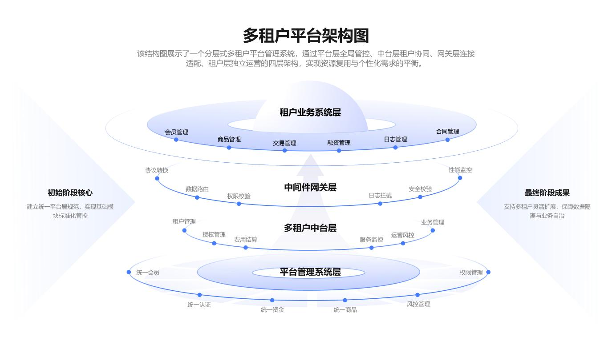
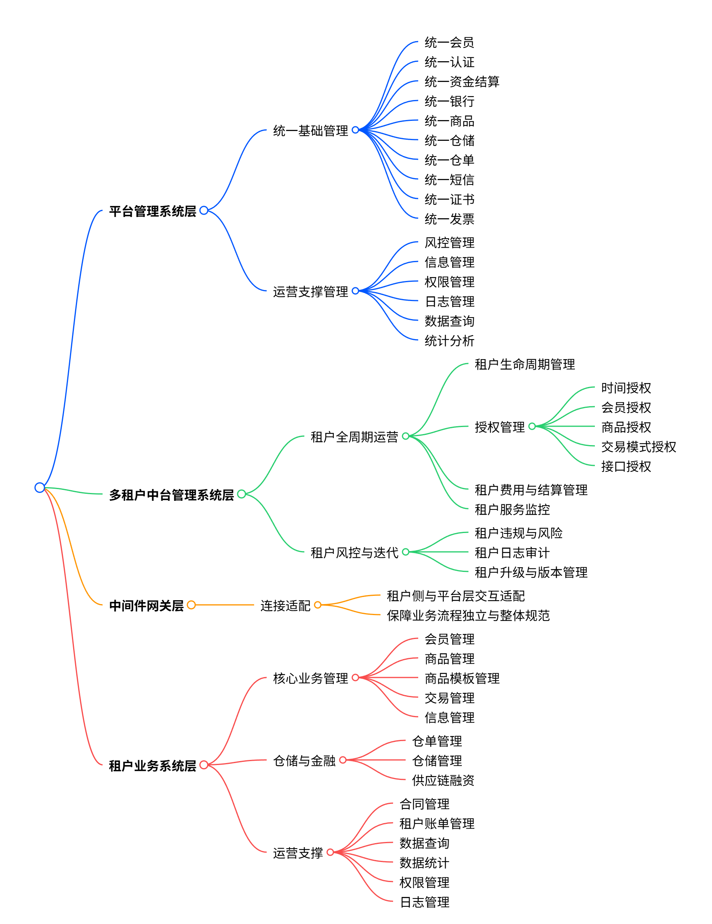

# 多租户平台管理系统业务架构详解文档

## 一、文档概述
本文档基于 “平台管理系统层 - 多租户中台管理系统层 - 中间件网关层 - 租户业务系统层” 四层架构，详细拆解各层级功能模块的核心业务逻辑、操作流程及价值定位，明确层间数据交互与协同规则，为系统设计、开发落地、运营优化提供标准化指导，适配电商、供应链、企业服务等多行业多租户场景。

## 二、各层级业务架构详解

### （一）平台管理系统层：全局标准化能力的 “基础底座”
**定位**：承担全平台基础资源管控、公共服务输出与业务规则统一的核心职能，所有租户共用此层能力，避免重复开发，保障平台数据安全、合规与高效运转。

| 功能模块 | 核心子功能 | 业务逻辑与应用场景 | 业务价值 |
| --- | --- | --- | --- |
| 统一会员 | 1. 会员信息管理（个人 / 企业信息采集、实名认证、标签体系）2. 跨租户会员互通（唯一会员 ID、积分 / 权益共享）3. 会员生命周期监控（注册 - 活跃 - 流失预警） | - 个人会员通过手机号注册，企业会员上传营业执照完成认证，生成平台唯一会员 ID；- 租户 A 的黄金会员可凭积分在租户 B 兑换服务，避免用户重复注册；- 对 30 天未登录会员推送专属优惠券，提升复购。 | 1. 降低租户会员体系开发成本；2. 沉淀平台全域会员数据，支撑精准运营；3. 提升用户跨租户体验。 |
| 统一认证 | 1. 多维度身份校验（账号密码、短信验证码、数字证书、OAuth 第三方登录）2. 平台级 RBAC 权限模型（角色 - 权限映射）3. 接口鉴权（AppID + 密钥 + 时间戳校验） | - 租户管理员登录需 “账号密码 + 手机验证码” 双重校验；- 平台超级管理员可配置 “租户管理员仅能操作本租户商品，不可修改平台规则”；- 租户调用 “统一支付接口” 时，需通过接口鉴权防止非法访问。 | 1. 保障平台与租户数据安全，防止越权操作；2. 统一认证标准，降低租户接口对接复杂度。 |
| 统一资金结算 | 1. 支付通道聚合（支付宝、微信、银行对公账户）2. 智能分账（按比例 / 固定金额拆分至租户、供应商、平台）3. 对账中心（三方账单自动校验、人工调账） | - 租户商品交易资金先进入平台监管账户，T+1 按 “租户 85%+ 供应商 10%+ 平台 5%” 分账；- 每日自动比对 “支付通道账单 - 平台流水 - 租户账单”，差异项触发人工复核；- 支持租户申请 “退款原路返回”，平台同步更新分账记录。 | 1. 规避租户单独对接支付的合规风险；2. 简化资金流转流程，提升对账效率；3. 保障租户与合作方资金安全。 |
| 统一银行 | 1. 银行账户管理（租户对公账户绑定、平台监管账户维护）2. 银企直连（大额转账、批量代发工资）3. 征信数据同步（对接银行征信系统） | - 租户申请供应链融资时，平台同步其在银行的征信记录至 “风控管理” 模块；- 平台每月通过银企直连向租户代付 “供应商货款”，减少人工操作；- 实时监控租户绑定账户的资金流水，异常变动触发预警。 | 1. 打通金融服务链路，支撑租户融资需求；2. 提升大额资金操作效率与安全性。 |
| 统一商品 | 1. 平台商品库（基础信息模板、分类体系、资质文件标准）2. 合规校验（禁售商品拦截、质检报告审核）3. 跨租户商品联动（平台大促商品池） | - 租户上架 “食品类商品” 需从平台商品库选择 “预包装食品模板”，上传质检报告；- 平台自动拦截 “三无产品”“违规保健品” 等禁售品类；- 双 11 大促时，租户可申请将商品加入 “平台大促池”，共享平台流量。 | 1. 统一商品标准，减少租户重复录入；2. 防范商品合规风险，维护平台生态；3. 支撑平台级营销活动，提升租户销量。 |
| 统一仓储 | 1. 仓储资源管理（仓库信息维护、容量 / 作业能力监控）2. 库存同步（实时更新跨租户共享库存）3. 标准化作业（入库 - 出库 - 盘点流程） | - 平台维护 “华东仓”“华南仓” 信息，租户可申请将商品存放至就近仓库；- 租户 A 的商品库存不足时，可调用 “统一仓储” 接口调配租户 B 的共享库存；- 仓库人员按平台标准流程盘点，差异数据同步至租户与平台。 | 1. 优化仓储资源利用率，降低租户仓储成本；2. 实现库存实时共享，减少超卖 / 缺货风险。 |
| 统一仓单 | 1. 数字化仓单生成（关联商品、库存、仓库信息）2. 仓单流转（背书转让、质押登记）3. 真实性校验（对接区块链存证） | - 租户将 “1000 件服装” 存入平台仓库，系统自动生成带唯一编码的数字化仓单；- 租户可将仓单背书转让给供应商抵付货款，平台记录流转轨迹；- 仓单质押融资时，银行通过区块链验证仓单真实性，避免伪造。 | 1. 盘活租户库存资产，支撑供应链金融；2. 保障仓单流转安全，降低信任成本。 |
| 统一短信 | 1. 短信模板管理（验证码、订单通知、营销短信模板）2. 发送策略（定时发送、触发式发送）3. 通道监控（到达率统计、黑名单过滤） | - 租户配置 “订单发货后触发短信通知”，系统自动调用统一短信接口推送；- 营销短信需从平台模板库选择，避免违规内容；- 实时监控短信到达率，低于 95% 时自动切换备用通道。 | 1. 降低租户短信运营成本；2. 保障短信服务稳定性与合规性。 |
| 统一证书 | 1. 证书全生命周期管理（申请 - 审核 - 签发 - 续期 - 吊销）2. 证书校验（SSL 证书加密、企业资质核验）3. 证书存储（加密云存储） | - 租户入驻时需上传 “营业执照”，平台对接工商系统核验真实性后生成电子证书；- 平台接口通信采用 SSL 证书加密，防止数据传输泄露；- 证书到期前 30 天，系统自动提醒租户续期。 | 1. 保障业务合规，提供可信凭证；2. 简化证书管理流程，降低安全风险。 |
| 统一发票 | 1. 发票开具（电子 / 纸质发票、关联订单自动开票）2. 发票管理（查重、验真、归档）3. 税务协同（对接税控系统） | - 租户完成交易后，系统按订单金额自动开具电子发票，推送至用户邮箱；- 平台自动校验租户上传的进项发票真伪，避免假票入账；- 每月自动汇总租户发票数据，对接税控系统完成报税。 | 1. 简化租户税务处理流程；2. 防范税务风险，提升发票管理效率。 |
| 风控管理 | 1. 风险模型构建（交易欺诈、信用风险、合规风险模型）2. 实时监控（异常行为识别、风险预警）3. 风险处置（交易拦截、租户限权） | - 某租户单日交易金额突增 10 倍，系统触发 “交易欺诈预警”，冻结其交易功能；- 基于租户征信与交易数据生成信用评分，低评分租户限制融资额度；- 识别 “虚假宣传” 违规行为，自动下架违规商品并警告租户。 | 1. 保障平台与租户业务安全；2. 提前拦截风险，减少损失。 |
| 信息管理 | 1. 静态信息维护（平台公告、业务规则文档）2. 动态数据管理（交易记录、租户运营数据）3. 全文检索（多维度数据查询） | - 平台发布 “新手续费规则” 后，自动同步至所有租户信息中心；- 租户可查询 “近 3 个月交易明细”，支持按订单号 / 时间筛选；- 运营人员通过全文检索快速定位 “某租户违规记录”。 | 1. 实现信息高效流转与共享；2. 提升数据检索效率，支撑业务决策。 |
| 权限管理 | 1. 权限规则配置（按租户 / 角色 / 场景自定义权限）2. 权限审批（申请 - 复核 - 生效流程）3. 权限审计（操作日志追溯） | - 租户申请 “新增商品品类权限”，需平台运营人员审核通过后生效；- 配置 “财务人员仅能查看账单，不可修改分账规则”；- 记录 “谁在何时修改了租户权限”，便于审计追溯。 | 1. 实现权限精准管控，防止数据泄露；2. 保障权限调整可追溯，降低合规风险。 |
| 日志管理 | 1. 日志采集（用户操作日志、系统运行日志、接口调用日志）2. 日志存储（按租户 / 模块分类归档）3. 日志分析（故障定位、异常行为挖掘） | - 记录 “租户管理员删除商品”“用户登录失败” 等操作日志，保留 1 年；- 系统报错时，通过日志快速定位 “接口调用超时” 问题；- 分析租户操作日志，识别 “频繁修改价格” 等异常行为。 | 1. 支撑故障排查与问题追溯；2. 为风控与审计提供数据依据。 |
| 数据查询 | 1. 多条件查询（按租户 / 时间 / 业务类型筛选）2. 数据导出（Excel/PDF 格式）3. 可视化预览（表格 / 图表展示） | - 平台运营人员查询 “租户 A 近 1 个月交易额”，支持按日 / 周拆分；- 租户可导出 “会员消费明细” 用于内部分析；- 以柱状图展示 “各租户库存占比”，直观呈现资源分布。 | 1. 满足多角色数据获取需求；2. 提升数据使用便捷性。 |
| 统计分析 | 1. 指标体系构建（平台交易量、租户活跃度、商品转化率）2. 深度分析（趋势分析、关联分析、RFM 用户分层）3. 报表输出（自定义看板、定时推送） | - 生成 “平台季度运营报表”，含 “新租户增长 30%”“核心品类转化率 15%” 等指标；- 通过 RFM 模型将平台会员分为 “高价值”“潜力”“流失” 三类，推送至租户用于精准营销；- 租户可自定义 “商品销售看板”，每日自动推送至管理员邮箱。 | 1. 挖掘数据价值，支撑平台战略决策；2. 为租户运营提供数据支撑，提升其业务能力。 |

### （二）多租户中台管理系统层：租户协同与管控的 “核心枢纽”
**定位**：衔接平台层与租户层，既要保障平台对租户的合规管控，又要赋予租户灵活运营空间，平衡 “全局规范” 与 “租户个性”。

#### 1. 租户生命周期管理

| 阶段 | 核心子功能 | 业务逻辑与应用场景 | 业务价值 |
| --- | --- | --- | --- |
| 租户接入 | 1. 资质审核（企业执照、行业许可证核验）2. 资源初始化（服务器配额、功能权限套餐）3. 入驻培训（系统操作指南、规则讲解） | - 电商租户需上传 “食品经营许可证”，平台对接工商系统核验；- 按租户规模分配资源：小型租户 1 台服务器 + 基础功能，大型租户 3 台服务器 + 高级功能；- 入驻后为租户管理员提供 1 次系统操作培训，降低使用门槛。 | 1. 筛选合规租户，维护平台生态；2. 按需分配资源，提升资源利用率。 |
| 租户运营 | 1. 运营健康度评估（交易量、用户满意度、合规评分）2. 资源动态调整（扩容 / 缩容申请审批）3. 运营支持（营销活动协助、问题答疑） | - 每月生成 “租户运营报告”，合规评分低于 80 分的租户需整改；- 租户大促前申请 “临时扩容服务器”，平台 1 个工作日内完成审批与配置；- 协助租户接入 “平台大促活动”，提供活动规则解读与技术支持。 | 1. 保障租户业务稳定运行；2. 提升租户运营能力与满意度。 |
| 租户退出 | 1. 退出原因核查（主动终止 / 违规清退）2. 数据处理（业务数据导出、审计数据留存）3. 资源回收（服务器、权限、支付通道解绑） | - 违规租户清退前，需完成 “未结订单处理”“用户退款”；- 为租户导出 “历史交易数据”，平台留存 “合规审计数据” 3 年；- 回收租户服务器资源，解绑支付通道，避免后续风险。 | 1. 降低租户退出对平台的影响；2. 保障数据合规与资源复用。 |

#### 2. 授权管理

| 授权类型 | 核心子功能 | 业务逻辑与应用场景 | 业务价值 |
| --- | --- | --- | --- |
| 时间授权 | 1. 功能可用时段配置（按自然时间 / 业务周期）2. 超时自动限权 | - 测试租户仅在 “工作日 9:00-18:00” 可访问交易系统；- 租户 “双 11 专属营销功能” 仅 11.1-11.11 可用，超时自动关闭。 | 1. 合理分配平台资源，避免非必要占用；2. 支撑限时业务场景，降低操作风险。 |
| 会员授权 | 1. 会员范围限定（本租户会员 / 平台指定会员）2. 会员数据使用权限（查询 / 编辑） | - 普通租户仅能访问 “本租户注册会员” 数据，核心租户可访问 “平台共享会员” 基础信息；- 租户仅能编辑 “会员偏好标签”，不可修改会员实名认证信息。 | 1. 保护会员数据隐私；2. 按需开放会员资源，支撑租户运营。 |
| 商品授权 | 1. 品类权限（可经营品类范围）2. 价格管控（波动阈值、最低价限制）3. 资质要求（特定品类需额外资质） | - 服装租户仅能经营 “男装 / 女装”，不可上架 “3C 产品”；- 商品价格单日波动不可超过 ±20%，防止恶意调价；- 上架 “进口商品” 需额外上传 “海关报关单”。 | 1. 维护平台商品生态秩序；2. 防范商品合规风险与恶性竞争。 |
| 交易模式授权 | 1. 模式开启 / 关闭（零售 / 预售 / 拍卖）2. 模式参数配置（预售周期、拍卖保证金） | - 新租户仅开放 “普通零售” 模式，运营 3 个月后可申请 “预售”；- 租户配置 “预售周期 15 天”“拍卖保证金 10%”，参数需符合平台下限要求。 | 1. 引导租户逐步熟悉业务，降低运营风险；2. 统一交易规则，提升用户体验。 |
| 接口授权 | 1. 接口访问范围（可调用接口列表）2. 调用频率限制（每秒 / 每日上限）3. 数据返回范围（本租户数据） | - 租户仅能调用 “商品查询”“订单创建” 接口，不可调用 “平台统计数据” 接口；- 接口调用频率限制为 “每秒 10 次”，防止冲击系统；- 租户调用 “物流接口” 仅返回 “本租户订单物流信息”。 | 1. 保障平台数据安全，防止接口滥用；2. 维护系统稳定性。 |

#### 3. 租户费用与结算管理

| 核心子功能 | 业务逻辑与应用场景 | 业务价值 |
| --- | --- | --- |
| 费用核算 | 1. 收费项目配置（功能年费、交易手续费、资源占用费）2. 自动核算（按周期 / 流水计算） | - 基础功能年费按 “租户规模” 分级：小型 5000 元 / 年，大型 2 万元 / 年；- 交易手续费按 “流水 0.5%” 自动核算，每日统计待缴金额。 |
| 费用收取 | 1. 付费方式（预付费 / 后付费 / 自动扣费）2. 催缴与限权（逾期欠费触发） | - 租户可选择 “预存 1 万元抵扣后续费用” 或 “按月后付费”；- 欠费超过 7 天，系统自动限制 “商品上架” 功能，直至缴费。 |
| 结算管理 | 1. 租户与平台结算（手续费抵扣、返利计算）2. 租户与合作方结算（分账数据同步） | - 租户季度交易额超 100 万，平台返还 0.1% 手续费；- 自动同步租户与供应商的分账数据，生成结算对账单供双方确认。 |

#### 4. 租户服务监控

| 核心子功能 | 业务逻辑与应用场景 | 业务价值 |
| --- | --- | --- |
| 业务性能监控 | 1. 指标采集（接口响应时间、并发数、错误率）2. 阈值预警（超阈值触发告警） | - 监控 “租户订单接口” 响应时间，超过 3 秒触发短信告警；- 实时展示租户系统并发数，接近服务器上限时提醒扩容。 |
| 服务质量监控 | 1. 用户反馈分析（投诉率、满意度评分）2. 服务流程监测（售后处理时长、发货时效） | - 租户售后处理时长超过 48 小时，系统提醒优化；- 按月统计租户用户满意度，低于 90% 需提交改进方案。 |
| 数据一致性监控 | 1. 跨系统数据校验（订单数据 - 库存数据 - 财务数据）2. 差异修复（自动同步 / 人工干预） | - 每日校验 “租户订单量” 与 “平台支付流水量”，差异项自动触发数据同步；- 库存数据与实际盘点差异超过 5%，需人工核查并修复。 |

#### 5. 租户运营与风控

| 核心子功能 | 业务逻辑与应用场景 | 业务价值 |
| --- | --- | --- |
| 租户违规与风险 | 1. 违规识别（规则引擎 + 人工复核）2. 分级处置（警告 - 限流 - 清退）3. 整改跟踪 | - 识别 “租户虚假交易”，首次警告并删除虚假订单，二次限流 30 天，三次清退；- 违规租户需提交整改方案，审核通过后方可恢复功能。 |
| 租户日志审计 | 1. 日志采集（租户操作日志、业务日志）2. 审计分析（合规检查、问题追溯） | - 监管部门检查时，导出租户 “资金操作日志” 用于合规审计；- 租户订单丢失时，通过日志追溯 “操作人 - 时间 - 步骤”，定位问题原因。 |
| 租户升级与版本管理 | 1. 版本规划（基础版 / 高级版功能包）2. 灰度发布（部分租户试点）3. 回滚机制 | - 租户从 “基础版” 升级至 “高级版”，可新增 “供应链融资” 功能；- 新功能先对 10% 租户灰度发布，无问题后全量上线；- 版本升级出现故障时，10 分钟内可回滚至旧版本。 |

### （三）中间件网关层：层间交互的 “智能桥梁”
**定位**：作为平台层与租户层的 “通信中转站”，解决异构系统适配问题，同时承担流量管控与安全防护职能，保障层间数据交互高效、安全、合规。

| 功能模块 | 核心子功能 | 业务逻辑与应用场景 | 业务价值 |
| --- | --- | --- | --- |
| 协议转换与适配 | 1. 多协议解析（HTTP/HTTPS/RPC/REST）2. 数据格式转换（JSON/XML/ 二进制） | - 租户业务系统采用 RPC 协议调用 “统一支付接口”，网关转换为平台层支持的 HTTP 协议；- 将租户系统输出的 XML 格式数据，转换为平台层需要的 JSON 格式。 | 1. 解决平台与租户系统异构问题，降低集成复杂度；2. 实现 “一次开发，多端适配”。 |
| 请求路由 | 1. 租户标识路由（按租户 ID 分配业务节点）2. 负载均衡（轮询 / 加权最少连接）3. 故障转移（节点故障自动切换） | - 租户 A 的请求路由至 “华东节点”，租户 B 的请求路由至 “华南节点”，降低跨区域延迟；- 某节点负载过高时，自动将请求分配至负载较低的节点；- 节点故障时，1 秒内切换至备用节点，无感知恢复服务。 | 1. 优化请求响应速度，提升用户体验；2. 保障系统高可用性，减少故障影响。 |
| 流量管控 | 1. 限流（按租户 / 接口设置 QPS 上限）2. 熔断（异常率超阈值关闭接口）3. 流量整形（平滑突发流量） | - 限制单个租户 QPS 为 100，防止其独占资源；- “统一商品接口” 异常率超 5% 时，自动熔断 1 分钟，避免故障扩散；- 租户大促突发流量时，网关按 “每秒 50 次” 平滑放行，防止冲击平台层。 | 1. 维护平台层稳定性，防止流量过载；2. 保护核心接口，减少故障范围。 |
| 安全防护 | 1. 接口鉴权（校验租户 Token / 签名）2. 数据加密（传输加密 / 敏感数据脱敏）3. 攻击防护（防 SQL 注入 / XFF 伪造） | - 租户请求需携带 “网关签发的 Token”，无效 Token 直接拦截；- 传输过程中采用 TLS 加密，用户手机号等敏感数据脱敏显示；- 拦截含 SQL 注入语句的请求，防止数据库攻击。 | 1. 保障层间数据传输安全；2. 抵御网络攻击，保护平台与租户数据。 |

### （四）租户业务系统层：租户自主运营的 “独立单元”
**定位**：为每个租户提供专属业务闭环，基于平台层基础能力与中台层授权，租户可灵活配置业务流程与运营策略，实现 “个性化运营 + 合规管控” 平衡。

| 功能模块 | 核心子功能 | 业务逻辑与应用场景 | 业务价值 |
| --- | --- | --- | --- |
| 会员管理 | 1. 租户会员分层（自定义等级与权益）2. 会员营销（专属优惠券、积分规则）3. 会员画像（消费习惯分析） | - 租户将会员分为 “普通 - 白银 - 黄金”，黄金会员享 “9 折 + 免费配送”；- 针对 “30 天未消费会员” 推送 “满 200 减 50” 专属券；- 分析会员消费偏好，自动推荐关联商品（如买衬衫推荐领带）。 | 1. 实现租户会员精细化运营；2. 提升会员活跃度与复购率。 |
| 商品管理 | 1. 租户商品库（基于平台模板创建）2. 商品运营（上下架、库存调整、详情页配置）3. 商品分析（销量、转化率） | - 租户从平台 “服装模板” 创建商品，自定义详情页图片与文案；- 实时调整商品库存，库存低于 10 件时自动下架；- 分析 “某 T 恤销量 TOP3” 原因，优化其他商品详情页。 | 1. 满足租户商品个性化运营需求；2. 提升商品运营效率与转化率。 |
| 商品模板管理 | 1. 租户自定义模板（基于平台模板扩展）2. 模板复用（同类商品快速创建）3. 模板权限（内部角色管控） | - 租户在平台 “电子产品模板” 基础上，新增 “保修期限” 字段，创建专属模板；- 上架 “不同型号手机” 时，复用 “手机专属模板”，仅修改参数；- 配置 “运营人员仅能使用模板，不可修改模板结构”。 | 1. 提升租户商品创建效率；2. 保障租户商品信息标准化。 |
| 交易管理 | 1. 订单处理（创建 - 支付 - 发货 - 售后）2. 交易配置（配送方式、退款规则）3. 订单分析（成交率、售后率） | - 租户配置 “满 99 元免运费”“7 天无理由退款”；- 订单支付后，自动同步至平台 “统一仓储” 安排发货；- 分析 “售后率高的订单”，优化商品质量或配送服务。 | 1. 实现租户交易全流程管控；2. 提升交易效率与用户满意度。 |
| 信息管理 | 1. 租户专属信息（店铺公告、活动通知）2. 信息推送（站内信、APP 推送）3. 信息统计（阅读率、点击率） | - 租户发布 “店铺周年庆活动通知”，同步推送至会员站内信；- 统计 “活动通知阅读率 80%”，调整下次推送时间（如周末 10 点）。 | 1. 实现租户信息精准触达；2. 优化信息推送策略，提升效果。 |
| 仓单管理 | 1. 仓单申请（向平台提交仓储需求）2. 仓单操作（查询、背书转让、质押申请）3. 仓单跟踪（状态变更记录） | - 租户向平台申请 “1000 件家电仓储”，生成数字化仓单；- 将仓单背书转让给供应商抵付货款，记录流转轨迹；- 仓单质押融资时，跟踪 “质押 - 放款 - 解押” 全流程。 | 1. 盘活租户库存资产；2. 简化仓单操作流程，提升效率。 |
| 仓储管理 | 1. 库存监控（实时查看平台仓库库存）2. 出入库管理（发起申请、跟踪进度）3. 库存预警（低库存 / 滞销预警） | - 实时查看 “华东仓” 家电库存，不足时发起补货申请；- 发起 “销售出库” 申请，跟踪平台仓库发货进度；- 滞销 3 个月的商品触发预警，提示 “促销清库存”。 | 1. 实现租户库存精准管控；2. 减少库存积压与缺货风险。 |
| 供应链融资 | 1. 融资申请（基于仓单 / 交易流水提交）2. 资料上传（对接金融机构需求）3. 融资跟踪（审批 - 放款 - 还款） | - 租户凭 “100 万仓单” 向平台合作银行申请融资，上传营业执照；- 跟踪融资审批进度，放款后自动同步至 “租户账单管理”；- 到期前提醒还款，避免逾期影响信用。 | 1. 缓解租户资金压力；2. 打通 “业务 - 金融” 链路，提升租户竞争力。 |
| 合同管理 | 1. 合同模板（基于平台模板自定义）2. 在线签署（对接电子签名服务）3. 合同归档（加密存储、查询） | - 租户从平台 “销售合同模板” 扩展 “保修条款”，生成专属合同；- 与供应商在线签署合同，电子签名实时生效；- 归档所有合同，支持按 “供应商 / 时间” 查询。 | 1. 简化租户合同流程，降低法律风险；2. 提升合同管理效率。 |
| 租户账单管理 | 1. 收支明细（平台费用、自营收入、供应商付款）2. 账单分析（营收结构、成本占比）3. 对账与付款（对接平台结算） | - 展示 “平台手续费 5000 元 + 商品销售收入 10 万元 - 供应商货款 8 万元” 收支明细；- 分析 “服装品类营收占比 60%”，加大该品类投入；- 与平台对账无误后，发起 “供应商货款付款” 申请。 | 1. 帮助租户清晰掌握财务状况；2. 简化对账与付款流程，提升财务管理效率。 |
| 数据查询 | 1. 租户业务数据查询（会员 / 商品 / 订单）2. 自定义查询（多条件组合筛选）3. 数据导出（用于内部分析） | - 查询 “近 7 天新注册会员”，筛选 “消费满 100 元” 用户；- 导出 “月度订单明细”，用于内部财务核算。 | 1. 满足租户多样化数据获取需求；2. 支撑租户内部业务分析。 |
| 数据统计 | 1. 运营指标统计（销量、营收、会员增长）2. 可视化报表（柱状图 / 折线图 / 饼图）3. 趋势分析（环比 / 同比） | - 生成 “月度营收报表”，含 “环比增长 15%”“核心品类占比 70%”；- 以折线图展示 “会员增长趋势”，分析活动效果；- 同比去年同期销量，制定下季度目标。 | 1. 为租户运营决策提供数据支撑；2. 直观呈现业务状况，便于优化策略。 |
| 权限管理 | 1. 租户内部角色创建（运营 / 财务 / 客服）2. 权限分配（按角色配置业务模块权限）3. 权限审计（操作日志） | - 创建 “客服角色”，仅开放 “订单查询 / 售后处理” 权限；- 财务人员离职后，立即回收 “付款审批” 权限；- 审计 “谁修改了会员权益”，保障操作可追溯。 | 1. 保障租户内部数据安全；2. 实现精细化权限管控，提升运营效率。 |
| 日志管理 | 1. 租户操作日志（会员修改、商品上下架）2. 业务日志（订单状态变更、支付记录）3. 日志检索（按时间 / 模块筛选） | - 记录 “运营人员删除商品”“用户支付失败” 等日志，保留 6 个月；- 检索 “某订单状态变更日志”，定位 “发货延迟” 原因；- 分析 “高频操作日志”，优化业务流程（如简化商品上架步骤）。 | 1. 支撑租户内部问题追溯；2. 为业务优化提供数据依据。 |

## 三、层间协同逻辑
1. **租户侧 - 网关层**：租户发起 “商品上架” 请求，网关校验租户 Token→转换协议→路由至对应平台节点；
2. **网关层 - 平台层**：平台 “统一商品” 模块接收请求→校验商品资质（合规性）→同步至 “统一仓储” 更新库存；
3. **平台层 - 中台层**：中台 “租户服务监控” 实时获取 “商品上架成功率”→异常时触发预警→推送至租户管理员；
4. **中台层 - 租户侧**：租户通过 “数据统计” 模块查看 “商品销量”→数据来源于平台层 “统计分析”→经网关脱敏后返回。

## 四、核心应用场景
1. **电商多租户场景**：平台层提供 “统一支付 / 物流”，中台层管控租户 “商品合规 / 交易权限”，租户侧自主运营店铺（如服饰租户做 “会员专属折扣”）；
2. **供应链协同场景**：平台层 “统一仓单 / 银行” 支撑租户融资，中台层监控 “租户库存与交易风险”，租户侧管理 “采购 - 仓储 - 销售” 全流程。

## 五、架构价值总结
1. **资源复用**：平台层统一基础能力，减少租户重复开发，降低整体成本；
2. **灵活自治**：租户侧可自定义运营策略，适配不同行业需求；
3. **安全合规**：中台层与网关层双重管控，保障平台生态与数据安全；
4. **高效协同**：层间分工明确，数据交互顺畅，支撑业务快速迭代。

（注：文档部分内容可能由 AI 生成）
