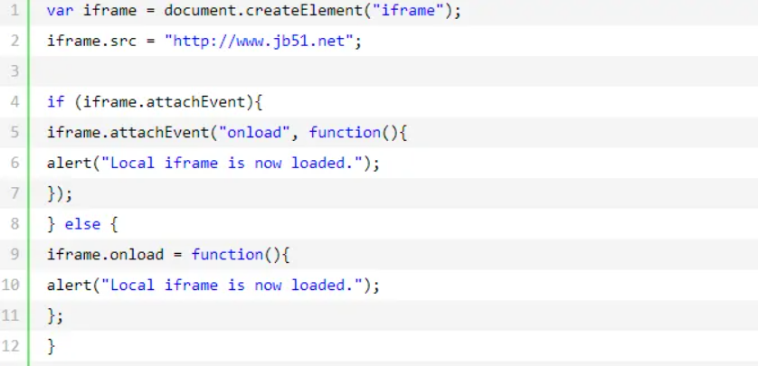

# console.log打印日志技巧

## js中toFixed四舍五入精度问题
1 、tofixed方法

toFixed() 方法可把 Number 四舍五入为指定小数位数的数字。例如将数据Num保留2位小数，则表示为：toFixed(Num)；**但是其四舍五入的规则与数学中的规则不同，使用的是银行家舍入规则**，银行家舍入：所谓银行家舍入法，其实质是一种四舍六入五取偶（又称四舍六入五留双）法。具体规则如下：

简单来说就是：四舍六入五考虑，五后非零就进一，五后为零看奇偶，五前为偶应舍去，五前为奇要进一。

2. 解决办法

单独封装toFixed方法实现

## el-input 失去焦点时触发blur 事件用法， 可以获取input 的其他属性值
updateRate(e){

      let val = e.target.value

      let row = e.target.getAttribute("row")

      let col = e.target.getAttribute("col")

      // doing 得到value ，  所在行列坐标， 开始处理你的业务逻辑吧

   }

总结， 主要是e.target.value 和e.target.getAttribute("xxx")的用法

## 判断 iframe 是否加载完毕

## console打印日志技巧
**console.log();**

**JSON.stringify(对象) 打印当前时刻的内容值，如果不转string则打印的其实是引用地址**

打印DOM元素详细信息

let node = document.getElementById("#app");

如果直接console.log(node);则打印的其实是html代码

如果console.log([node]);则可打印dom元素的属性值
