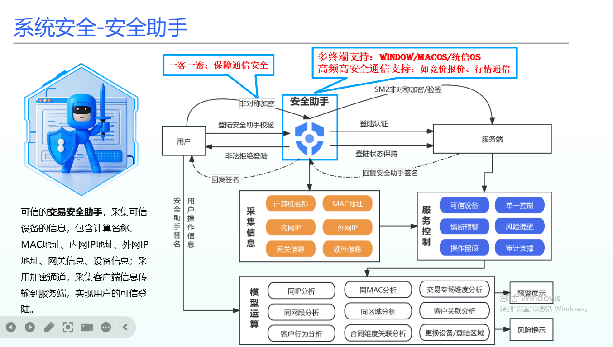
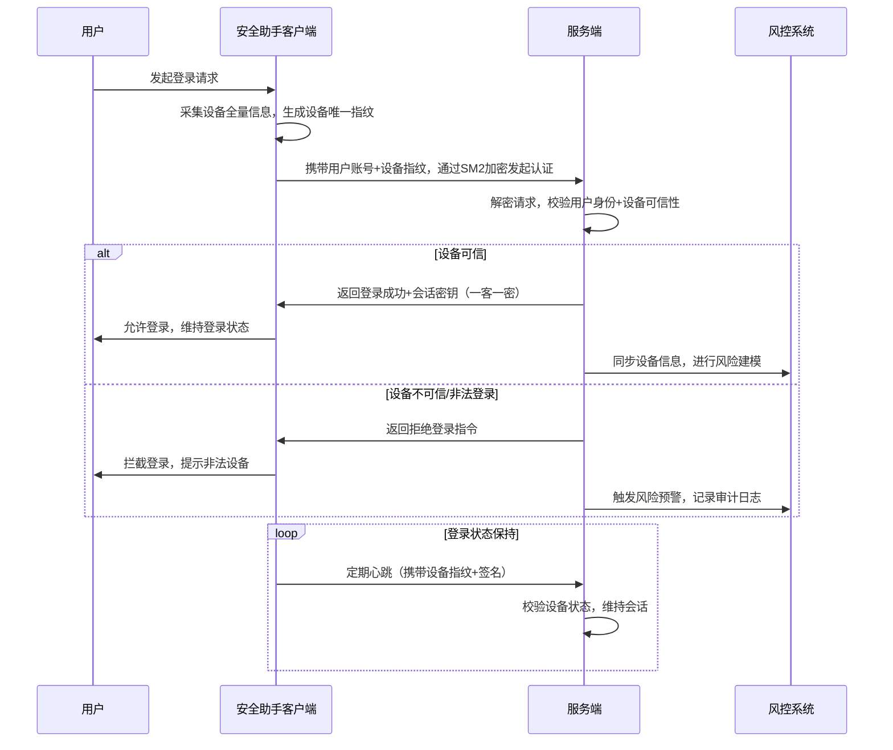

这是金融领域的一个安全助手，你现在根据图片帮我写一份完整的设计方案，然后并选择好开发框架，这个开发框架要支持可以跨平台。好，最终给出完整的设计方案，并配上可以实现的逻辑

# 金融级系统安全-安全助手完整设计方案
## 一、方案概述
### 1.1 项目背景
金融行业（证券、期货、银行等）的交易系统面临着账号盗用、非法登录、数据泄露、交易篡改等多重安全风险，传统的账号密码登录、单一IP校验等方式已无法满足高频交易、多终端办公场景下的安全需求。本方案设计的**安全助手**，是一款面向金融场景的可信交易安全增强工具，通过设备可信采集、国密级加密通信、多维度风险建模、全链路审计等能力，为金融交易系统构建端到端的安全防护体系，保障用户登录、行情通信、竞价报价等核心业务的安全合规。

### 1.2 核心目标
1. **可信登录**：基于设备唯一特征，实现用户身份+设备的双重可信认证，杜绝非法设备登录
2. **安全通信**：采用国密SM2非对称加密，实现一客一密，保障高频行情、竞价报价等敏感数据的传输安全
3. **跨平台兼容**：支持Windows/macOS/统信UOS等多终端，适配金融行业国产化办公需求
4. **风险防控**：通过多维度模型运算，实现实时风险预警、熔断预警、操作留痕，满足金融监管审计要求
5. **服务端管控**：提供可信设备管理、统一控制、全链路审计能力，满足金融机构运维与合规需求

---

## 二、系统架构设计
### 2.1 整体架构
系统采用**客户端-服务端**分离架构，分为5大核心模块，架构图如下：

```plain
┌─────────────┐      ┌──────────────────────────────────────────────────┐      ┌─────────────┐
│   用户终端   │──────│                安全助手（客户端）                  │──────│   服务端系统  │
│(Win/macOS/  │      │  设备采集模块  加密通信模块  登录校验模块  日志模块  │      │  认证/风控/  │
│  统信UOS)    │      └──────────────────────────────────────────────────┘      │  审计服务端  │
└─────────────┘                                                                 └─────────────┘
                                      ↑
                                      │
                                      ↓
┌─────────────────────────────────────────────────────────────────────────────────────┐
│                                  服务端管控与风控体系                                  │
│  设备信息采集 → 服务控制 → 模型运算 → 预警/风险提示 → 审计支撑                          │
└─────────────────────────────────────────────────────────────────────────────────────┘
```

### 2.2 核心模块拆解
#### 2.2.1 客户端模块（安全助手核心）
| 模块名称 | 核心功能 | 技术要点 |
| --- | --- | --- |
| 设备信息采集模块 | 采集计算机名称、MAC地址、内网IP、外网IP、网关信息、硬件信息（CPU/硬盘/主板序列号等） | 跨平台硬件信息获取、设备特征哈希生成 |
| 加密通信模块 | 基于SM2国密算法的非对称加密/验签、一客一密密钥管理、高频数据加密传输 | 国密算法适配、TLS国密改造、会话密钥协商 |
| 登录校验模块 | 客户端登录校验、非法登录拦截、登录状态保持、服务端响应验签 | 双向认证、登录状态心跳、非法请求拦截 |
| 日志审计模块 | 客户端操作留痕、登录日志、通信日志、异常日志采集 | 本地加密存储、日志同步服务端 |

#### 2.2.2 服务端模块
| 模块名称 | 核心功能 | 技术要点 |
| --- | --- | --- |
| 认证服务模块 | 用户登录认证、设备可信校验、登录状态管理 | JWT+设备特征双因子认证、会话管理 |
| 服务控制模块 | 可信设备管理、单一控制、熔断预警、风险提醒 | 设备白名单、熔断规则引擎、实时风控 |
| 风险建模模块 | 多维度风险分析、异常行为识别 | 同IP/同MAC/同网段分析、客户行为画像、关联分析 |
| 审计支撑模块 | 全链路操作审计、日志存储、合规报表生成 | 分布式日志存储、审计报表导出、监管对接 |

---

## 三、核心业务流程与实现逻辑
### 3.1 可信登录全流程


### 3.2 安全通信流程（高频行情/竞价报价场景）
1. **密钥协商**：用户登录成功后，服务端为该用户生成唯一SM2密钥对（一客一密），客户端存储公钥，服务端存储私钥
2. **数据加密**：客户端发起行情/报价请求时，使用用户公钥对请求数据进行SM2加密，同时生成数字签名
3. **服务端验签解密**：服务端接收请求后，先通过SM2验签确认数据完整性，再使用私钥解密，执行业务逻辑
4. **响应加密**：服务端返回行情/报价结果时，使用客户端公钥加密响应数据，客户端使用本地私钥解密
5. **高频优化**：针对高频通信场景，采用会话密钥+SM2签名结合的方式，平衡安全性与性能，满足低延迟需求

### 3.3 风险建模与预警流程
1. **数据采集**：服务端持续采集全量用户设备信息、登录行为、交易行为数据
2. **多维度模型运算**：
    - 基础维度：同IP分析、同MAC分析、同网段分析、同区域分析
    - 业务维度：交易专场维度分析、客户关联分析、合同维度关联分析
    - 行为维度：客户行为分析、更换设备/登录区域分析
3. **风险判定**：基于预设风控规则（如异地登录、多设备同账号登录、异常交易行为），自动判定风险等级
4. **预警处置**：
    - 低风险：风险提示、二次认证
    - 中风险：熔断预警、限制交易权限
    - 高风险：强制下线、账号锁定、人工告警
5. **审计留痕**：全流程操作日志存储，支持审计追溯与监管报表生成

---

## 四、跨平台开发框架选型
### 4.1 选型原则
1. **跨平台原生支持**：一套代码多端运行，支持Windows、macOS、统信UOS（Linux）
2. **国密算法适配**：原生支持SM2/SM3/SM4等国密算法，满足金融合规要求
3. **高性能**：适配高频交易场景，低延迟、高并发
4. **成熟稳定**：金融级稳定性，社区活跃，企业级支持
5. **国产化适配**：兼容国产操作系统、国产芯片（x86/ARM）

### 4.2 最终选型方案
| 层级 | 技术选型 | 选型理由 |
| --- | --- | --- |
| **客户端跨平台框架** | **Electron + Tauri 双方案（推荐Tauri）** | 1. **Tauri（首选）**：基于Rust+Web前端，原生性能高、体积小、安全性强，完美支持Windows/macOS/Linux（统信UOS），符合金融安全要求   2. **Electron（备选）**：基于Chromium+Node.js，开发效率高，生态丰富，适合快速迭代，跨平台兼容性极强 |
| **后端服务框架** | **Spring Boot + Spring Cloud** | 1. Java生态成熟，金融行业主流技术栈，稳定性强   2. 支持微服务架构，可扩展性强   3. 丰富的国密算法集成方案（Bouncy Castle、国密Java库）   4. 适配国产化中间件（Nacos、Sentinel等） |
| **国密算法支持** | **Bouncy Castle + 国密标准Java库** | 1. 原生支持SM2/SM3/SM4等国密算法，符合金融密码应用标准   2. 支持TLS国密改造，适配HTTPS国密通信   3. 支持一客一密密钥管理、数字签名/验签 |
| **数据库** | **MySQL + Redis** | 1. MySQL：存储用户信息、设备信息、审计日志，支持事务，金融级稳定   2. Redis：存储会话密钥、登录状态、风控缓存，高性能低延迟 |
| **中间件** | **Nacos + Sentinel + RocketMQ** | 1. Nacos：服务注册发现、配置中心，适配国产化   2. Sentinel：熔断限流，实现熔断预警功能   3. RocketMQ：异步日志同步、风控消息队列，削峰填谷 |
| **前端技术栈（客户端）** | **Vue 3 + TypeScript + Element Plus** | 1. 开发效率高，组件化开发，适合跨平台客户端UI   2. TypeScript类型安全，减少线上bug   3. Element Plus适配国产化，支持国际化 |

### 4.3 框架优势对比
| 特性 | Tauri（首选） | Electron（备选） |
| --- | --- | --- |
| 性能 | 原生Rust内核，性能接近原生，内存占用低 | 基于Chromium，内存占用高，性能略低 |
| 安全性 | 沙箱隔离，权限可控，符合金融安全要求 | 权限较高，需额外做安全加固 |
| 包体积 | 安装包仅几十MB，启动快 | 安装包上百MB，启动较慢 |
| 开发效率 | 需掌握Rust，学习成本略高 | 前端技术栈即可开发，学习成本低 |
| 国产化适配 | 完美支持统信UOS等国产Linux系统 | 完美支持，生态更成熟 |

---

## 五、详细技术实现方案
### 5.1 客户端核心实现（Tauri + Rust + Vue3）
#### 5.1.1 设备信息采集模块
**实现逻辑**：

+ 基于Rust跨平台库`sysinfo`、`mac_address`、`network-interface`，实现多终端硬件/网络信息采集
+ 采集内容：计算机名称、MAC地址、内网IP、外网IP（通过公共API获取）、网关信息、CPU序列号、硬盘序列号、主板序列号
+ 生成设备唯一指纹：对采集的核心特征进行SHA-256哈希，生成不可篡改的设备唯一标识
+ 代码示例（Rust核心采集逻辑）：

```rust
use sysinfo::{System, Networks, NetworkExt};
use mac_address::get_mac_address;
use std::net::IpAddr;

#[derive(Debug, Serialize, Deserialize)]
pub struct DeviceInfo {
    pub computer_name: String,
    pub mac_address: String,
    pub internal_ip: String,
    pub external_ip: String,
    pub gateway: String,
    pub cpu_serial: String,
    pub disk_serial: String,
    pub device_fingerprint: String,
}

impl DeviceInfo {
    pub fn collect() -> Self {
        let mut sys = System::new_all();
        sys.refresh_all();
        
        // 1. 采集计算机名称
        let computer_name = sys.host_name().unwrap_or_default();
        
        // 2. 采集MAC地址
        let mac_address = get_mac_address().unwrap_or_default().to_string();
        
        // 3. 采集内网IP
        let networks = Networks::new_with_refreshed_list();
        let internal_ip = networks.iter()
            .find(|(_, net)| net.is_up() && !net.is_loopback())
            .map(|(_, net)| net.ipv4().first().map(|ip| ip.to_string()).unwrap_or_default())
            .unwrap_or_default();
        
        // 4. 采集外网IP（通过公共API）
        let external_ip = reqwest::blocking::get("https://api.ipify.org")
            .and_then(|res| res.text())
            .unwrap_or_default();
        
        // 5. 采集网关信息
        let gateway = networks.iter()
            .find(|(_, net)| net.is_up() && !net.is_loopback())
            .map(|(_, net)| net.gateway().to_string())
            .unwrap_or_default();
        
        // 6. 采集硬件信息（CPU/硬盘序列号，需管理员权限）
        let cpu_serial = sys.cpus().first().map(|cpu| cpu.serial().to_string()).unwrap_or_default();
        let disk_serial = sys.disks().first().map(|disk| disk.serial().to_string()).unwrap_or_default();
        
        // 7. 生成设备唯一指纹
        let fingerprint_str = format!("{}{}{}{}{}{}{}", 
            computer_name, mac_address, internal_ip, external_ip, 
            gateway, cpu_serial, disk_serial);
        let device_fingerprint = sha256::digest(fingerprint_str.as_bytes());
        
        DeviceInfo {
            computer_name,
            mac_address,
            internal_ip,
            external_ip,
            gateway,
            cpu_serial,
            disk_serial,
            device_fingerprint,
        }
    }
}
```

#### 5.1.2 SM2国密加密通信模块
**实现逻辑**：

+ 基于Rust国密库`rustls` + `gmssl`，实现SM2非对称加密/验签
+ 一客一密：用户登录时，服务端生成唯一SM2密钥对，客户端存储公钥，服务端存储私钥
+ 高频通信优化：采用SM2签名+AES-GCM会话密钥结合，首次登录协商会话密钥，后续通信使用会话密钥加密，SM2仅做签名验签，提升性能
+ 代码示例（SM2加密/验签）：

```rust
use gmssl::sm2::{Sm2Cipher, Sm2Signature};
use gmssl::rand::Rand;

// 生成SM2密钥对（服务端执行）
pub fn generate_sm2_keypair() -> (Vec<u8>, Vec<u8>) {
    let mut rng = Rand::new();
    let (pk, sk) = Sm2Cipher::generate_keypair(&mut rng);
    (pk.to_bytes(), sk.to_bytes())
}

// SM2加密（客户端执行，使用服务端公钥）
pub fn sm2_encrypt(public_key: &[u8], data: &[u8]) -> Vec<u8> {
    let cipher = Sm2Cipher::new(public_key);
    let mut rng = Rand::new();
    cipher.encrypt(data, &mut rng)
}

// SM2解密（服务端执行，使用服务端私钥）
pub fn sm2_decrypt(private_key: &[u8], cipher_data: &[u8]) -> Vec<u8> {
    let cipher = Sm2Cipher::new_with_sk(private_key);
    cipher.decrypt(cipher_data).unwrap()
}

// SM2签名（客户端执行，使用客户端私钥）
pub fn sm2_sign(private_key: &[u8], data: &[u8]) -> Vec<u8> {
    let signer = Sm2Signature::new(private_key);
    let mut rng = Rand::new();
    signer.sign(data, &mut rng).to_bytes()
}

// SM2验签（服务端执行，使用客户端公钥）
pub fn sm2_verify(public_key: &[u8], data: &[u8], signature: &[u8]) -> bool {
    let verifier = Sm2Signature::new(public_key);
    verifier.verify(data, signature).is_ok()
}
```

#### 5.1.3 登录校验模块
**实现逻辑**：

+ 客户端发起登录时，携带用户账号、密码、设备指纹、SM2签名
+ 服务端校验：用户身份认证 + 设备可信校验（白名单/历史设备匹配） + 签名验签
+ 非法登录拦截：设备不匹配/签名失败时，直接返回拒绝登录，客户端拦截
+ 登录状态保持：客户端定期发送心跳（携带设备指纹+签名），服务端维持会话状态
+ 代码示例（登录校验核心逻辑）：

```rust
// 客户端登录请求
#[tauri::command]
pub async fn login(
    app_handle: AppHandle,
    username: String,
    password: String,
) -> Result<LoginResponse, String> {
    // 1. 采集设备信息
    let device_info = DeviceInfo::collect();
    
    // 2. 生成登录请求数据
    let login_req = LoginRequest {
        username,
        password: sha256::digest(password.as_bytes()),
        device_fingerprint: device_info.device_fingerprint,
        device_info: serde_json::to_string(&device_info).unwrap(),
        timestamp: chrono::Utc::now().timestamp(),
    };
    
    // 3. SM2签名请求数据
    let req_data = serde_json::to_vec(&login_req).unwrap();
    let signature = sm2_sign(&client_private_key, &req_data);
    
    // 4. 发送加密请求到服务端
    let encrypted_req = sm2_encrypt(&server_public_key, &req_data);
    let response = reqwest::Client::new()
        .post("https://api.xxx.com/auth/login")
        .body(encrypted_req)
        .header("X-Signature", base64::encode(signature))
        .send()
        .await
        .map_err(|e| e.to_string())?;
    
    // 5. 解密响应，校验签名
    let encrypted_resp = response.bytes().await.map_err(|e| e.to_string())?;
    let decrypted_resp = sm2_decrypt(&client_private_key, &encrypted_resp);
    let login_resp: LoginResponse = serde_json::from_slice(&decrypted_resp).map_err(|e| e.to_string())?;
    
    // 6. 校验服务端签名
    if !sm2_verify(&server_public_key, &decrypted_resp, &base64::decode(login_resp.signature).unwrap()) {
        return Err("服务端响应验签失败".to_string());
    }
    
    // 7. 存储会话密钥，启动心跳
    app_handle.state::<AppState>().set_session_key(login_resp.session_key);
    start_heartbeat(app_handle).await;
    
    Ok(login_resp)
}
```

### 5.2 服务端核心实现（Spring Boot + Java）
#### 5.2.1 认证服务模块
**实现逻辑**：

+ 基于Spring Security + JWT，实现用户身份认证
+ 双因子认证：用户密码 + 设备指纹双重校验
+ 一客一密密钥管理：为每个用户生成唯一SM2密钥对，存储在Redis中
+ 登录状态管理：基于Redis存储会话信息，实现登录状态保持与过期控制
+ 代码示例（登录认证接口）：

```java
@RestController
@RequestMapping("/auth")
public class AuthController {

    @Autowired
    private UserService userService;

    @Autowired
    private DeviceService deviceService;

    @Autowired
    private Sm2CryptoService sm2CryptoService;

    @Autowired
    private RedisTemplate<String, Object> redisTemplate;

    @PostMapping("/login")
    public ResponseEntity<LoginResponse> login(@RequestBody byte[] encryptedReq, @RequestHeader("X-Signature") String signature) {
        // 1. 解密请求数据
        byte[] decryptedReq = sm2CryptoService.sm2Decrypt(encryptedReq);
        LoginRequest loginReq = JSON.parseObject(decryptedReq, LoginRequest.class);

        // 2. 验签
        if (!sm2CryptoService.sm2Verify(loginReq.getDeviceFingerprint().getBytes(), decryptedReq, Base64.getDecoder().decode(signature))) {
            throw new BusinessException("请求验签失败，非法请求");
        }

        // 3. 用户身份认证
        UserDO user = userService.getUserByUsername(loginReq.getUsername());
        if (user == null || !user.getPassword().equals(DigestUtils.sha256Hex(loginReq.getPassword()))) {
            throw new BusinessException("用户名或密码错误");
        }

        // 4. 设备可信校验
        DeviceDO device = deviceService.getDeviceByFingerprint(loginReq.getDeviceFingerprint());
        if (device == null) {
            // 新设备，触发风险预警
            riskService.sendNewDeviceAlert(user.getId(), loginReq.getDeviceInfo());
            throw new BusinessException("非法设备，禁止登录");
        }

        // 5. 生成一客一密SM2密钥对
        KeyPair keyPair = sm2CryptoService.generateSm2KeyPair();
        String sessionKey = UUID.randomUUID().toString();

        // 6. 存储密钥与会话信息
        redisTemplate.opsForValue().set("sm2:sk:" + user.getId(), keyPair.getPrivate().getEncoded(), 24 * 60 * 60);
        redisTemplate.opsForValue().set("session:" + sessionKey, JSON.toJSONString(user), 24 * 60 * 60);

        // 7. 生成响应数据，加密+签名
        LoginResponse loginResp = new LoginResponse();
        loginResp.setUserId(user.getId());
        loginResp.setUsername(user.getUsername());
        loginResp.setSessionKey(sessionKey);
        loginResp.setPublicKey(keyPair.getPublic().getEncoded());
        loginResp.setTimestamp(System.currentTimeMillis());

        byte[] respData = JSON.toJSONBytes(loginResp);
        byte[] encryptedResp = sm2CryptoService.sm2Encrypt(keyPair.getPublic().getEncoded(), respData);
        byte[] respSignature = sm2CryptoService.sm2Sign(keyPair.getPrivate().getEncoded(), respData);
        loginResp.setSignature(Base64.getEncoder().encodeToString(respSignature));

        return ResponseEntity.ok().body(loginResp);
    }
}
```

#### 5.2.2 风险建模与管控模块
**实现逻辑**：

+ 基于Spring Boot + 规则引擎（Drools），实现多维度风险分析
+ 实时计算：同IP/同MAC/同网段/同区域分析，识别异常登录
+ 行为分析：基于用户历史登录行为，构建行为画像，识别异常操作
+ 熔断预警：基于Sentinel实现熔断限流，异常时自动限制交易权限
+ 审计留痕：基于Elasticsearch存储全量操作日志，支持审计查询
+ 代码示例（风险分析核心逻辑）：

```java
@Service
public class RiskAnalysisService {

    @Autowired
    private DeviceService deviceService;

    @Autowired
    private LoginLogService loginLogService;

    @Autowired
    private RiskRuleEngine riskRuleEngine;

    public RiskResult analyzeRisk(Long userId, String deviceFingerprint, String ip) {
        RiskResult riskResult = new RiskResult();
        riskResult.setUserId(userId);
        riskResult.setDeviceFingerprint(deviceFingerprint);
        riskResult.setIp(ip);

        // 1. 同IP分析：同一IP下多个账号登录
        long sameIpUserCount = loginLogService.countUserByIp(ip);
        if (sameIpUserCount > 5) {
            riskResult.addRisk(RiskType.SAME_IP_MULTI_USER, "同一IP下存在多个账号登录，风险等级：中");
        }

        // 2. 同MAC分析：同一MAC下多个账号登录
        DeviceDO device = deviceService.getDeviceByFingerprint(deviceFingerprint);
        if (device != null) {
            long sameMacUserCount = deviceService.countUserByMac(device.getMacAddress());
            if (sameMacUserCount > 3) {
                riskResult.addRisk(RiskType.SAME_MAC_MULTI_USER, "同一MAC地址下存在多个账号登录，风险等级：高");
            }
        }

        // 3. 异地登录分析：与历史登录区域不一致
        List<LoginLogDO> historyLogs = loginLogService.getLatestLoginLogs(userId, 5);
        if (!historyLogs.isEmpty()) {
            String lastArea = historyLogs.get(0).getArea();
            String currentArea = IpUtils.getIpArea(ip);
            if (!lastArea.equals(currentArea)) {
                riskResult.addRisk(RiskType.CROSS_AREA_LOGIN, "异地登录，历史区域：" + lastArea + "，当前区域：" + currentArea + "，风险等级：中");
            }
        }

        // 4. 规则引擎综合判定风险等级
        riskResult.setRiskLevel(riskRuleEngine.calculateRiskLevel(riskResult.getRisks()));

        return riskResult;
    }
}
```

---

## 六、安全合规设计
### 6.1 金融合规要求适配
1. **密码合规**：采用国密SM2算法，符合《金融数据安全 数据安全生命周期规范》《信息安全技术 密码应用基本要求》
2. **等保合规**：满足网络安全等级保护2.0要求，实现身份认证、访问控制、安全审计、入侵防范等能力
3. **监管审计**：全链路操作留痕，日志存储不少于6个月，支持监管审计查询与报表导出
4. **数据安全**：敏感数据加密存储、传输，实现数据脱敏、访问控制，防止数据泄露

### 6.2 安全加固措施
1. **客户端安全**：代码混淆、反调试、反Hook，防止客户端被篡改
2. **通信安全**：TLS 1.3国密改造，一客一密，防中间人攻击
3. **服务端安全**：WAF防护、入侵检测、漏洞扫描，定期安全加固
4. **密钥安全**：密钥定期轮换，硬件加密机存储根密钥，防止密钥泄露

---

## 七、部署方案
### 7.1 客户端部署
+ 打包方式：Tauri打包为Windows(macOS/统信UOS)原生安装包，支持静默安装、批量部署
+ 升级方案：内置自动升级模块，服务端推送升级包，客户端自动更新
+ 部署范围：金融机构内部办公终端、交易员终端、客户终端

### 7.2 服务端部署
+ 部署架构：微服务架构，基于K8s容器化部署，支持水平扩展
+ 环境要求：Java 11+、MySQL 8.0+、Redis 6.0+、Elasticsearch 7.x
+ 高可用：多实例部署、负载均衡、数据备份与容灾
+ 国产化适配：支持国产服务器、国产操作系统（麒麟/统信）、国产数据库（高斯DB）

---

## 八、项目实施计划
| 阶段 | 时间 | 核心任务 |
| --- | --- | --- |
| 需求调研与设计 | 1-2周 | 需求确认、架构设计、详细设计文档输出 |
| 客户端开发 | 4-6周 | Tauri客户端开发、设备采集、加密通信、登录模块 |
| 服务端开发 | 4-6周 | Spring Boot服务端开发、认证、风控、审计模块 |
| 联调测试 | 2-3周 | 功能联调、性能测试、安全测试、兼容性测试 |
| 试运行 | 2-4周 | 金融机构内部试运行、问题修复、优化 |
| 正式上线 | 1周 | 全量部署、上线培训、运维支持 |

---

## 九、方案总结
本方案设计的金融级安全助手，基于**Tauri跨平台框架+Spring Boot后端**，实现了设备可信采集、国密级安全通信、多维度风险防控、全链路审计等核心能力，完美适配Windows/macOS/统信UOS多终端，满足金融行业高频交易、合规审计、安全防护的核心需求。方案技术栈成熟稳定，符合金融国产化趋势，可直接落地实施，为金融交易系统构建全方位的安全防护体系。

---

### 补充说明
+ 若团队前端技术栈更熟悉，可将客户端框架替换为Electron，开发效率更高，仅需将Rust核心逻辑替换为Node.js实现即可
+ 国密算法可根据金融机构要求，替换为符合监管要求的国密SDK（如CFCA国密SDK）
+ 风险模型可根据金融机构实际业务需求，自定义风控规则，灵活扩展

需要我基于这个方案，帮你生成一份**可直接交付的PRD文档（含原型图说明）**，或者补充一份**详细的接口设计文档**吗？
