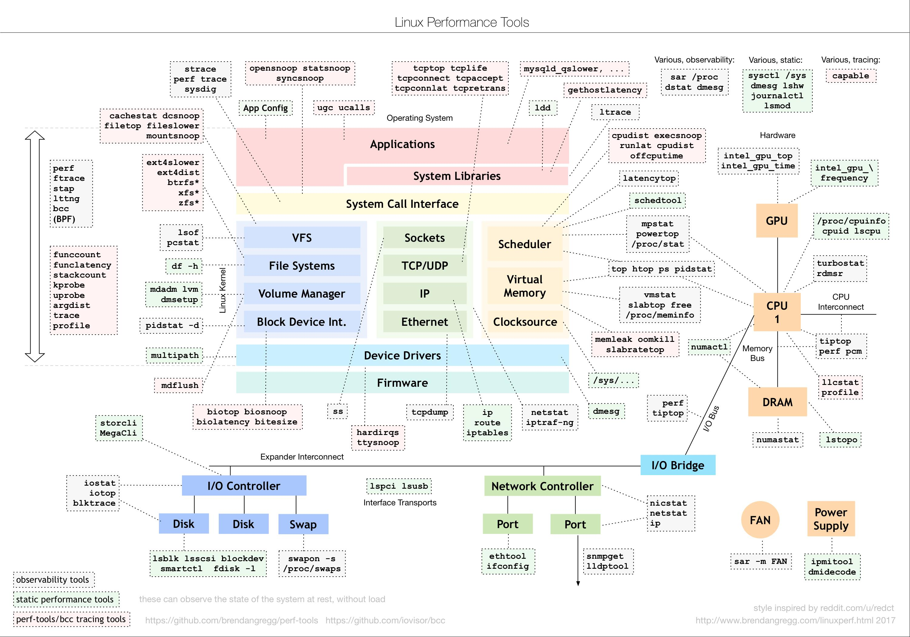

# 测试工具

1. 测试工具
    1. ab
    2. hping3
    3. dd 磁盘和文件拷贝工具
2. 性能工具
    1. cachestat
    2. cachetop
    3. pcstat
    4. bcc 软件包 性能分析工具
    5. strace 分析系统调用情况
    6. pmap 查看进程的内存分布
    7. memleak 可以跟踪系统或指定进程的内存分配、释放请求
3. cpu角度分析的流程是:
    1.  1.top 看到了%iowait升高
    2.  2.dstat 看到了wait升高时 read同步升高. 说明跟磁盘相关
    3.  3.$ perf record -g ;
    4.  $ perf report 定位到了跟磁盘相关的系统调用
 sys_read(). new_sync_read 和 blkdev_direct_IO 定位到了跟直接读有关系.
    5. 4.查看代码 找到了跟磁盘相关的系统调用 open.
4. 缓存角度分析的流程是:
    1. 1.进程5秒缓存命中率100%,但是只命中了1024次,推算使用缓存4MB.实际每秒0.8MB
    2. 2.看日志知道每次读取的是32MB.[实际也可以通过dstat vmstat等工具粗略推算出该值]
    3. 3.预期的32M与实际的0.8M相差甚远. 来找原因.
    4. 4.strace 查看系统调用 定位到了openat 及 直接给出了调用参数 O_DIRECT
    5. 5.查看代码 找到了跟磁盘相关的系统调用 open.
5. 磁盘io导致性能问题 -> 查看系统调用 -> 定位大致原因 -> 查看源码 -> 确定问题
6. 内存泄露问题，需要监控内存的变化趋势，此时使用vmstat更好
