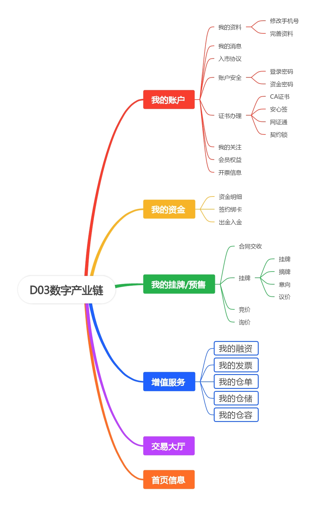
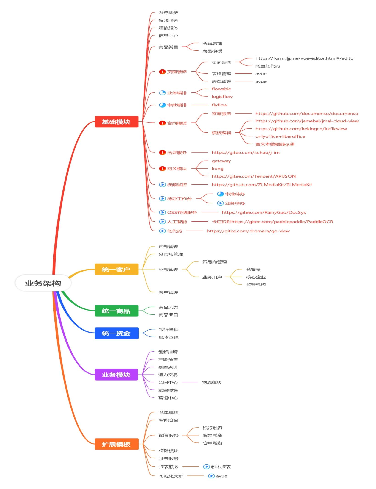
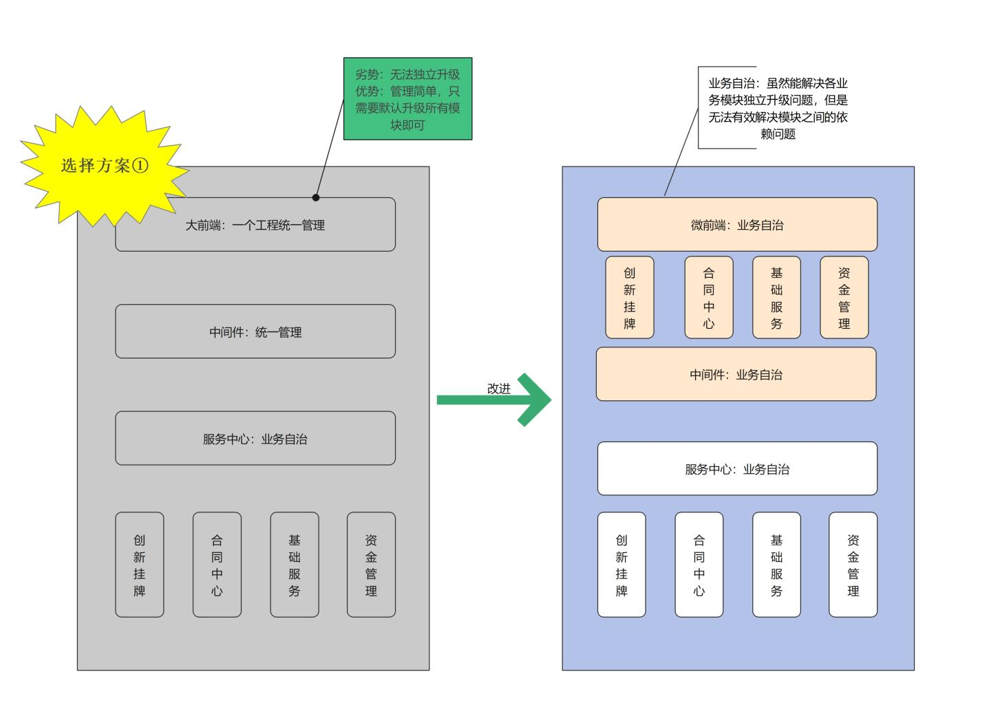
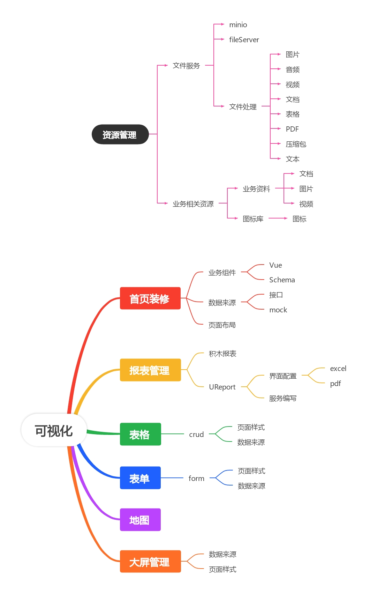

# 技术经理申报材料

## 什么是企业数字化转型
企业数字化转型转的内容包括以下方面：

### 1 1.技术应用：
- 云计算：企业利用云计算平台来存储和处理大量数据，实现资源的灵活调配和高效利用，降低硬件成本和维护难度，例如将企业的业务系统部署到云服务器上。

- 大数据：通过收集、存储和分析海量数据，挖掘有价值的信息，为企业决策提供依据，比如分析用户行为数据来优化产品和服务。

- 人工智能与机器学习：应用于智能客服、自动化流程、预测分析等领域，提高业务效率和准确性，如利用机器学习算法预测市场需求。

- 物联网：将设备、产品等通过传感器连接起来，实现智能化监控和管理，例如制造业中对生产设备的实时监测和维护。

- 区块链：保证数据的安全性、透明性和不可篡改，在供应链金融等领域有应用前景，可用于验证交易的真实性和可靠性。

### 2 2.业务流程优化与创新：
- 流程自动化：借助数字化工具和技术，将重复性、规律性的业务流程自动化处理，减少人工操作和错误，提高效率，像财务报销流程的自动化。

- 跨部门协作优化：打破部门之间的信息壁垒，实现数据共享和协同工作，提升整体运营效率，例如通过数字化平台让销售、生产、采购等部门实时共享信息。

- 业务模式创新：基于数字化技术探索新的业务模式和盈利增长点，如电商企业开展线上线下融合的新零售模式。

### 3 3.数据管理与利用：
- 数据收集与整合：从企业内外部多渠道收集数据，并进行整合，确保数据的全面性和准确性，涵盖销售数据、客户信息、市场动态等。

- 数据治理：建立数据标准、质量控制和安全管理机制，保证数据的可用性、可靠性和安全性，防止数据泄露和滥用。

- 数据分析与洞察：运用数据分析工具和技术，挖掘数据中的潜在价值和规律，为决策提供支持，如通过分析销售数据制定精准营销策略。

- 数据驱动决策：将数据分析结果应用于企业的战略规划、运营管理等决策过程，实现科学决策和精细化管理。

### 4 4.客户体验提升：
- 全渠道客户互动：通过多种渠道（如网站、移动应用、社交媒体等）与客户进行互动，提供一致的客户体验，满足客户随时随地的需求。

- 个性化服务：利用客户数据实现个性化推荐、定制化产品或服务，提高客户满意度和忠诚度，比如根据客户的浏览历史和购买记录进行个性化推荐。

- 客户反馈与响应：及时收集客户反馈，快速响应客户需求和问题，优化产品和服务，例如通过在线客服系统实时解答客户疑问。

### 5 5.组织与人才变革：
- 组织架构调整：适应数字化转型需求，优化组织架构，可能成立专门的数字化部门或团队，明确职责和分工，提高决策和执行效率。

- 人才培养与引进：培养和引进具备数字化技能和思维的人才，包括数据分析师、数字化营销专家、技术开发人员等，提升员工整体数字素养。

- 企业文化塑造：营造鼓励创新、勇于尝试的企业文化氛围，让员工积极参与数字化转型，适应变革和发展。

## 企业数字化转型目的：
### 6 提高运营效率
优化业务流程

提升决策速度和准确性

### 7 增强竞争力
创新产品和服务

提升客户体验

### 8 **降低成本**
节约人力成本

降低运营成本

### 9 适应市场变化
快速响应市场需求

拓展市场空间

## 如何实现数字化转型：
### 10 主要成员
三驾马车，项目经理+产品主官+测试主官，缺少核心开发人员，容易出现外行领导内行情况，难以服众，建议增加一个技术leader，确保技术选型的准确性，或者公司层面安排技术总监

**项目经理**的能力一定是要最全面的，可以不是最好的，但一定要懂产品，懂技术。

**产品主官**的维度一定要高，确保产品尽量不走弯路，或者少走弯路，引导客户而不是被客户引导。

**测试主官**原则性要强，坚守底线，保证产品质量，确保开发出来的功能是符合产品设计，符合客户需求的。

### 11 产品分析

### 12 目前问题
#### 整体问题及解决思路：
1. 没有统一的技术架构，各产品线相同的功能重复开发，对资源是一种负担和浪费（公司层面）

解决思考：公司层面一定要重视基础技术框架的规范和研发，比如前端UI，审批流，流程编排，IM洽谈，文件服务，资源库，报表中心，页面装修，AI，企业微信对接，等保测评等，最好可以成立技术小组，由公司领导牵头，逐个突破。

1. 流程过于繁琐，有时候因为一个样式或者一个客户临时改动，就需要至少4个人到公司花费1天时间才能搞定；给客户的感觉响应速度慢，不及时，感受比较差（公司层面）。

解决思考：根据项目的具体情况做出不同的管理，方便开发人员临时调整，比如对于需求经常变动的客户外网开发界面；或者由技术小组从技术角度提出解决思路，例如低代码开发，页面装修等。

1. 项目组和商务之间沟通过于少，有时候项目组成员不清楚开发这个功能的原始需求，也不明白能给产品带来什么竞争力（公司层面）

解决思考：项目组核心人员多和商务沟通，确保明白需求怎么来的，能给产品带来什么竞争力；商务也可以主动和项目组联系，把客户的真实需求传递给项目组。

#### 项目组问题及解决思路：
##### 遇到的问题：
1. 项目组开发人员变成救火队员，在客户需求开发中疲于奔命，没有更多的精力优化和提升产品竞争力（项目组）

1. 产品竞争力不强，缺少核心功能，和第三方互联互通太少（比如企业微信，抖音等）（项目组）

1. 部分项目周期长，导致验收困难，无法为公司带来收益，也影响员工的绩效（项目组）

1. 客户对产品不满意，不愿意升级新功能

##### 怎么解决：
1. 团队建设，根据成员的能力，赋予不同的职责
2. 建立负责人机制，确保客户遇到的页面都能找到相关的负责人，有其统一协调解决，比如首页李哲，挂牌张昊敬，祝孔政，合同黄静，证书冯焕，等保张锋等
3. 竞品分析，分析出产品中缺少的核心功能，根据紧急程度和改善效果上做出优先级排列

选择业界做的比较好的竞品进行深度分析

1. 列出现有系统中还缺少的所有核心功能，进行优先级排序
2. 统一团队技术开发规范，产品规范
3. 建立代码走审机制，例如每周检查下代码的合规性，设计文档是否齐全等；开发流程中关键节点，核心人员进行评审分析，必须需求评审，设计评审
4. 建立客户沟通机制，比如云文档方方便客户实时更新反馈系统使用情况，也方便项目组跟踪进度，并更新项目情况，确保客户能及时了解项目进度。

### 13 产品质量
#### 14 减少系统的复杂性
优化系统的，比如开发模型的考量。

#### 15 自动化测试
减少由于测试覆盖不全，导致的系统bug问题

1. 单元测试
2. Apifox接口测试
3. Jmeter压力测试
4. selenium自动化测试

### 16 项目成果
在项目管理中，把握各阶段成果的展现与管理可以从以下几个方面入手：

#### 一、明确阶段目标和成果标准
制定项目计划时，明确各个阶段的目标和预期成果。这些目标和成果应该是具体、可衡量、可达成、相关联和有时限的（SMART 原则）。

为每个阶段的成果确定明确的标准和验收指标，以便在项目进行过程中能够准确地评估成果的质量和完成度。

| 立项阶段： | 项目合同；项目成员表 |
| --- | --- |
| 需求阶段： | 明确的需求文档；可指导开发的原型 |
| 设计阶段： | 具体的表结构设计，概要的接口文档和系统交互图 |
| 开发阶段： | 可运行的项目，详细接口文档，系统交互图 |
| 测试阶段： | 完整的测试用力，可部署的项目 |
| 监控阶段： | 项目进度甘特图，沟通计划 |

#### 二、建立成果展现机制
##### 定期报告
制定定期报告制度，如每周、每月或每阶段结束时，向项目相关方提交项目进展报告。报告内容应包括阶段目标的完成情况、主要成果的展示、存在的问题及解决方案等。

报告可以采用书面报告、幻灯片演示或在线报告工具等形式，根据项目的规模和需求选择合适的方式。

##### 成果演示
在关键阶段或重要成果完成后，组织成果演示活动。邀请项目相关方，如客户、领导、团队成员等参加，展示项目的阶段性成果。

成果演示可以采用现场演示、视频演示或虚拟演示等形式，让相关方能够直观地了解项目的进展和成果。

##### 数据可视化
利用数据可视化工具，将项目的关键指标和成果以图表、图形等形式展示出来。例如，使用进度条展示项目的完成进度、用柱状图展示任务的完成情况等。

数据可视化可以帮助项目相关方快速了解项目的状态和成果，便于做出决策和调整。

#### 三、**成果**管理
##### 成果验收
在每个阶段结束时，按照预先确定的成果标准和验收指标进行成果验收。验收可以由项目团队内部进行，也可以邀请客户或相关专家参与。

对于验收不合格的成果，要及时进行整改和完善，确保项目能够按照计划顺利进行。

##### 成果归档
对每个阶段的成果进行归档管理，包括文档、数据、报告、演示材料等。建立完善的成果档案库，便于项目的回顾、总结和后续使用。

成果归档可以采用电子档案管理系统或纸质档案管理相结合的方式，确保成果的安全和可追溯性。

#### **四、成果分享与复用**
鼓励项目团队成员分享项目成果和经验教训，促进知识的传播和共享。可以通过内部培训、经验交流会、知识库等方式进行成果分享。

对于具有通用性的成果，可以进行复用和推广，提高项目管理的效率和质量。例如，开发的项目管理工具、模板等可以在其他项目中使用。

总之，在项目管理中，要通过明确阶段目标和成果标准、建立成果展现机制和加强成果管理等措施，把握好各阶段成果的展现与管理，确保项目能够顺利完成并取得预期的成果。

### 17 技术管理
1. 形成统一的技术栈，避免由于过度引入新技术导致的维护成本增加
2. 修改别人开发的功能模块时，一定要先了解原来的需求，不能因为看不懂或者觉得维护困难，就重新开发，只会导致看不懂的越来越多
3. 代码格式化规范尽量保持一致，比如tab和空格问题
4. Sonar扫描确保开发人员的代码时可维护的
5. 形成统一的技术组件库，增加复用程度，提高开发效率

#### 如何形成组件
##### 功能分析
确定需要封装成组件的功能模块。

分析该功能模块的独立性、通用性和可复用性，确保其适合作为组件进行开发。

##### 设计与开发
进行组件的设计，包括接口设计、数据结构设计、算法设计等。

采用良好的编程规范和设计模式，提高组件的质量和可维护性。

使用合适的开发工具和技术，确保组件的性能和兼容性。

##### 测试与优化
对开发完成的组件进行测试，验证其功能的正确性和稳定性。

根据测试结果进行优化，提高组件的性能和质量。

##### 封装与发布
将组件进行封装，使其可以方便地被其他项目引用。

发布组件，可以通过内部的组件库、开源平台等方式进行发布，以便更多的人使用和贡献。

#### 如何计算功能点值
##### 点值来源
1. 新功能
2. 维护功能
3. 外网排查问题

##### 功能类型
1. 需求开发
2. 表结构设计
3. 接口开发
4. 页面开发

##### 点值标准
国际功能点用户组（IFPUG）标准

基本概念

IFPUG 功能点分析方法将软件功能分为五种类型：外部输入（EI）、外部输出（EO）、外部查询（EQ）、内部逻辑文件（ILF）和外部接口文件（EIF）。

每个功能类型根据其复杂性分为低、中、高三个级别，分别对应不同的功能点值。

评估过程

确定软件的功能范围，识别出所有的功能类型。

对于每个功能类型，评估其复杂性级别。考虑因素包括输入数据的数量和复杂性、处理逻辑的复杂程度、输出结果的格式和复杂性等。

根据功能类型和复杂性级别，查找 IFPUG 功能点值表，确定每个功能的功能点值。

将所有功能的功能点值相加，得到软件的总功能点值。

### 18 团队管理
合理划分团队大小，可以形成部门+多产品的模式；人员不易过多，不方便管理，同时也增加了项目的沟通成本。应该强关联的项目组成员在一起开早会，一起团建。

#### 确定清晰的目标
与团队成员共同制定明确、具体、可衡量的项目目标。这些目标应该与公司的战略目标相一致，并能够为团队成员提供明确的方向。

例如，在开发一款新的软件产品时，目标可以是在特定时间内完成产品的开发、测试和上线，并达到一定的用户满意度指标

#### 明确岗位需求
根据项目的需求和团队的目标，确定所需的技能和经验。制定详细的岗位描述，明确岗位职责和要求。

例如，对于一个前端开发岗位，需要具备 HTML、CSS、JavaScript 等技术技能，以及良好的用户体验设计能力和团队合作精神

#### 定期团队会议
定期召开团队会议，让成员了解项目的进展情况、分享经验和解决问题。会议可以包括项目进度汇报、技术分享、问题讨论等环节。

例如，每周召开一次团队会议，让成员汇报各自的工作进展，讨论遇到的问题和解决方案，分享新的技术和经验。

#### 鼓励开放沟通
营造开放、包容的沟通氛围，鼓励团队成员提出问题、分享想法和建议。建立良好的反馈机制，及时回应成员的意见和建议。

例如，设立意见箱或在线反馈平台，让成员可以匿名提出意见和建议。对于好的建议要及时采纳并给予奖励，对于问题要及时解决并给予反馈。

#### 定期聚餐团建
定期进行团队聚餐团建，增加项目组成员联系，破除隔阂，在放松的环境下进行沟通工作。

#### 避免长期加班
避免长期进行无效加班，浪费公司资源，也形成人员内耗造成开发效率下降，不应该以加班时长评价员工是否优秀。而应该以开发人员完成的工作多少为依据。

#### 明确团队角色和职责
根据项目的需求和团队成员的技能，明确每个成员的角色和职责。确保每个成员都清楚自己的工作任务和目标，以及与其他成员的协作关系。

例如，在一个软件开发项目中，可以设立项目经理、开发工程师、测试工程师、设计师等角色，明确每个角色的职责和工作范围。

#### 提供培训和学习机会
为团队成员提供各种培训和学习机会，如技术培训、管理培训、行业研讨会等。帮助成员不断提升自己的技能和知识水平，适应不断变化的市场需求。

例如，定期组织内部技术培训课程，邀请外部专家进行讲座和培训，鼓励成员参加行业研讨会和学术会议等。

## 数字化开始第一步：
用较少的成本解决对产品帮助比较大的功能

1. 确定各流程负责人
2. 系统整体导航页
3. 前端门户缓存梳理
4. 各模块负责人对业务流程和接口数据
5. 了解B2B行业大家都在干什么
