# 早期计算机

有人问：最初的电脑是如何编程的？这个问法其实有些笼统，这样问，给人的感觉像是在说：有了电脑才有的编程，编程是在电脑的基础上诞生的。但其实**程序代码最初并不是在电脑上运行的**。

电脑跟计算机的概念还是有一定区别的：我们可以把电脑称为计算机，但不能把计算机都叫电脑（至少在以前不能）。要讲编程的最初是怎么使用的，就必须结合计算机的发展。因为现在，编程跟计算机确实是密不可分的整体。

*图：早期计算机发展关键节点（示意）*

<svg xmlns="http://www.w3.org/2000/svg" viewBox="0 0 720 190" font-family="'Microsoft YaHei','PingFang SC',sans-serif">
  <defs>
    <marker id="arw" markerWidth="8" markerHeight="8" refX="7" refY="3" orient="auto">
      <path d="M0,0 L7,3 L0,6 Z" fill="#94a3b8"/>
    </marker>
  </defs>
  <rect x="20" y="30" width="140" height="44" rx="8" fill="#eff6ff" stroke="#2563eb" stroke-width="1.5"/>
  <text x="90" y="48" text-anchor="middle" font-size="13" fill="#1e293b">花本提花机</text>
  <text x="90" y="66" text-anchor="middle" font-size="12" fill="#475569">东汉 公元25年—220年</text>
  <line x1="160" y1="52" x2="195" y2="52" stroke="#94a3b8" stroke-width="1.5" marker-end="url(#arw)"/>
  <rect x="200" y="30" width="140" height="44" rx="8" fill="#eff6ff" stroke="#2563eb" stroke-width="1.5"/>
  <text x="270" y="48" text-anchor="middle" font-size="13" fill="#1e293b">差分机</text>
  <text x="270" y="66" text-anchor="middle" font-size="12" fill="#475569">1822</text>
  <line x1="340" y1="52" x2="375" y2="52" stroke="#94a3b8" stroke-width="1.5" marker-end="url(#arw)"/>
  <rect x="380" y="30" width="140" height="44" rx="8" fill="#eff6ff" stroke="#2563eb" stroke-width="1.5"/>
  <text x="450" y="48" text-anchor="middle" font-size="13" fill="#1e293b">分析机</text>
  <text x="450" y="66" text-anchor="middle" font-size="12" fill="#475569">1834</text>
  <line x1="520" y1="52" x2="555" y2="52" stroke="#94a3b8" stroke-width="1.5" marker-end="url(#arw)"/>
  <rect x="560" y="30" width="140" height="44" rx="8" fill="#fffbeb" stroke="#d97706" stroke-width="1.5"/>
  <text x="630" y="48" text-anchor="middle" font-size="13" fill="#1e293b">图灵机</text>
  <text x="630" y="66" text-anchor="middle" font-size="12" fill="#475569">1936 可计算性</text>
  <path d="M630,74 L630,97 L90,97 L90,116" fill="none" stroke="#94a3b8" stroke-width="1.5" marker-end="url(#arw)"/>
  <rect x="20" y="120" width="140" height="44" rx="8" fill="#eff6ff" stroke="#2563eb" stroke-width="1.5"/>
  <text x="90" y="138" text-anchor="middle" font-size="13" fill="#1e293b">Z-1 计算机</text>
  <text x="90" y="156" text-anchor="middle" font-size="12" fill="#475569">1938</text>
  <line x1="160" y1="142" x2="195" y2="142" stroke="#94a3b8" stroke-width="1.5" marker-end="url(#arw)"/>
  <rect x="200" y="120" width="140" height="44" rx="8" fill="#eff6ff" stroke="#2563eb" stroke-width="1.5"/>
  <text x="270" y="138" text-anchor="middle" font-size="13" fill="#1e293b">ABC 计算机</text>
  <text x="270" y="156" text-anchor="middle" font-size="12" fill="#475569">1942 电子专用</text>
  <line x1="340" y1="142" x2="375" y2="142" stroke="#94a3b8" stroke-width="1.5" marker-end="url(#arw)"/>
  <rect x="380" y="120" width="140" height="44" rx="8" fill="#eff6ff" stroke="#2563eb" stroke-width="1.5"/>
  <text x="450" y="138" text-anchor="middle" font-size="13" fill="#1e293b">冯·诺依曼体系</text>
  <text x="450" y="156" text-anchor="middle" font-size="12" fill="#475569">1945 存储程序</text>
  <line x1="520" y1="142" x2="555" y2="142" stroke="#94a3b8" stroke-width="1.5" marker-end="url(#arw)"/>
  <rect x="560" y="120" width="140" height="44" rx="8" fill="#f0fdf4" stroke="#16a34a" stroke-width="1.5"/>
  <text x="630" y="138" text-anchor="middle" font-size="13" fill="#1e293b">ENIAC</text>
  <text x="630" y="156" text-anchor="middle" font-size="12" fill="#475569">1946 首台通用</text>
</svg>

## 一、计算机的早期形式和雏形

> 计算机就是用来计算数据的，指算、算筹、算盘、星盘、计算尺等计算工具都算是计算机的“祖先”。

### 1. 早：指算、算筹、算盘等计算工具

计算机就是用来计算数据的，所以往前追溯，指算、算筹、算盘、星盘、计算尺等计算工具都算是计算机的“祖先”。

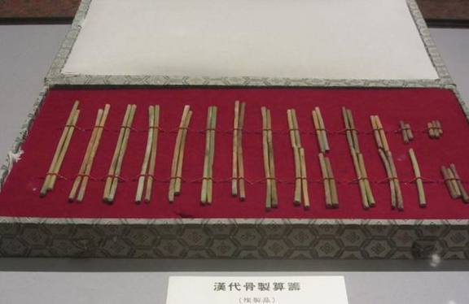

### 2. 计：计算尺

1620~1630年期间，计算尺被发明，可以进行乘除法运算，经过后续被多人多次改良后，达到了可以进行求根和幂、三角函数、对数和指数等高级运算的境界，被广泛采用，19世纪末叶以来成为科学工作者特别是工程技术人员不可或缺的计算工具。**计算尺实际上是现在所使用的计算器的前身**，这是它与机械式计算机最直接的区别。

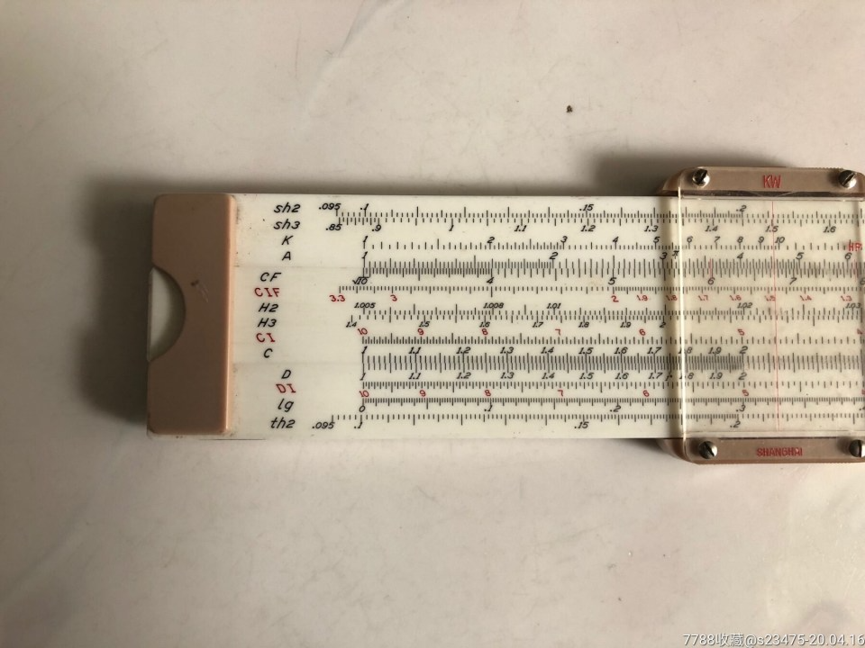

### 3. 机：机械计算机

与计算尺同时，17世纪另一项重大发明是机械计算机。第一个提出近代的机械式计算机的设计思想的是德国数学家席卡德，他在1623年到1624年间设计了机械式计算机，可以进行四则运算，用齿轮传动，不过它没有制造出机器来。

#### （1）加法机

1942年，第一台能算加、减法的计算机是法国数学家布莱士·帕斯卡（就是“压强”的那个帕斯卡）发明。**帕斯卡的加法机是目前公认的世界上第一台机械式计算机**。

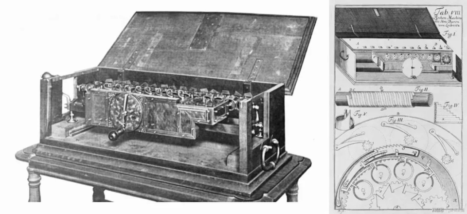

#### （2）步进计算器

1672年，德国数学家莱布尼兹（就是“微积分”的那个莱布尼兹）根据帕斯卡的加法器发明能做加、减、乘（加法的不断叠加）、除（减法的不断递减）的计算机。不断地加，步步递进，因此叫“步进”。

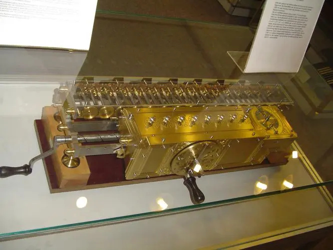

自此以后，许多人在这方面做了大量的工作。特别是经过L.H.托马斯、W.奥德内尔等人的改良之后，生产出多种手摇台式计算机，风行于全世界。

### 4. 差：差分机

1822年，英国数学家巴贝吉制成了一台能够执行计算程序的差分机……

好的，到这儿，我们要从编程的起源讲起，因为计算机和编程的不解之缘便是这个时候开始交汇的。

## 二、编程的起源（结合计算机的发展）

> “编程”的“程”就是“程序”的意思，但要规范谈论“编程”的起源，还得从它被人为应用到工具或机器上说起。

“编程”的“程”就是“程序”的意思，所以，广义来说，编程自人类有自主意识以来就在进行，“先干什么”“后干什么”这些就是编程的思路。但要规范谈论“编程”的起源，还得从它被人为应用到工具或机器上说起。

### 1. 花：花本式提花机

编程最早可以追溯到提花机，我国古代人为了在衣服上设计出美丽的图案，发明了花本式提花机（东汉时期，公元25年—220年）。

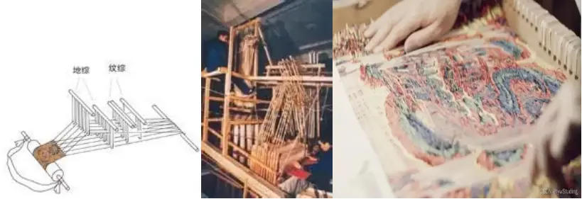

**说明**：纺织工人提前把要编织的图案设计在花本里，如果把这个过程比作程序员的编程，那么织布用的线就是现在的编程语言，花本就是编写出来的程序，而纺织工人就是程序员。在11~12世纪的时候提花机通过丝绸之路传到了欧洲。

### 2. 二：二进制的发明

1679年，德国数理哲学大师莱布尼茨受中国《周易》和八卦中“阴”与“阳”的启发，发明了二进制。

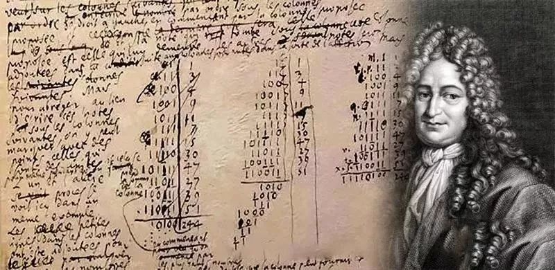

### 3. 穿：穿孔纸带提花机

1725年，法国织布工人巴西尔·布尚根据花本提花机的原理发明了穿孔纸带提花机，**穿孔纸带是历史上最早的的数据存储介质之一**。但当时的穿孔纸带提花机因提花机针数不足无法满足编制要求而未被广泛采用。

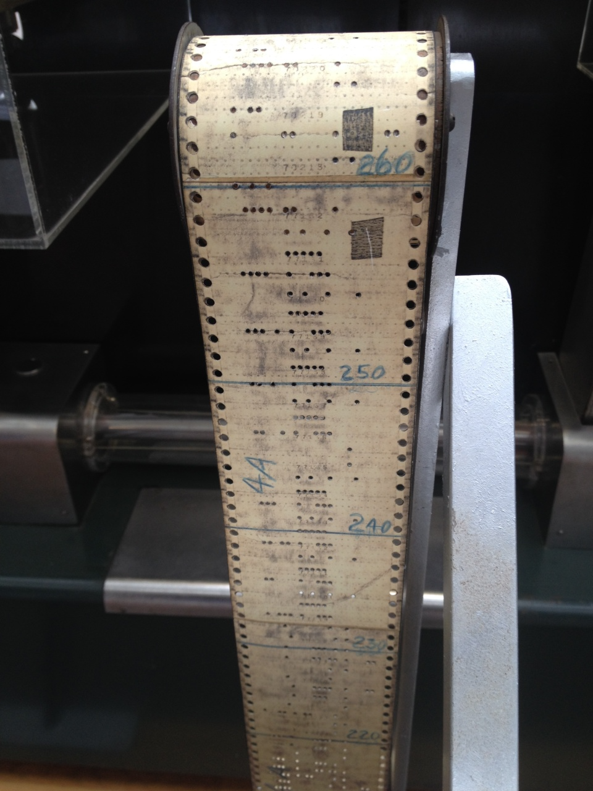

### 4. 贾：贾卡提花机

1800年前后，法国织布工人贾卡在巴西尔·布尚发明的基础上对早期纺织机进行了改良，实现了更加高效的自动化编织复杂的图案，大大提高了编织效率和质量。

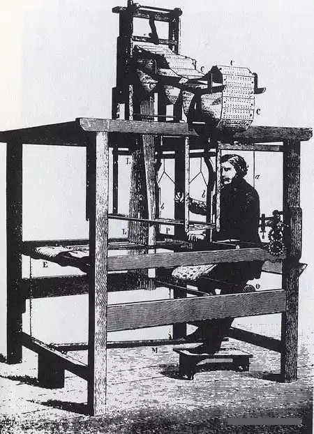

**说明**：这种成熟的机器后来被称为贾卡（提花）机。贾卡（提花）机的发明影响深远，不仅推动了纺织业的发展，还为计算机诞生提供了启示，**这种根据需要进行制作穿孔纸带的工作也被视为现代 “编程” 的起源**。

### 5. 差：差分机

1822年，英国数学家查尔斯·巴贝奇（被称为“通用计算机之父”）从贾卡提花机获得灵感，研制出了可以按照设计者意图自动处理不同函数（即能够执行计算程序）的机械式计算机——差分机。

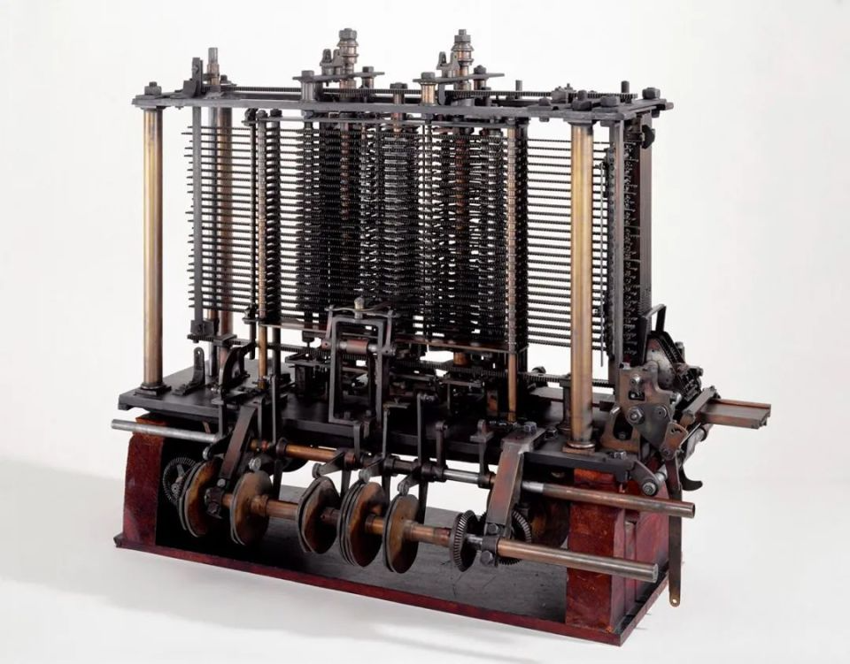

### 6. 分：分析机

1834年，巴贝吉又构思了一台完全程序控制的机械式计算机——分析机。**分析机算得上是世界上第一台计算机**，但因当时技术条件限制，它没能制造出来，但巴贝吉的设计思想是不朽的，它与现代电子计算机的理念完全吻合。

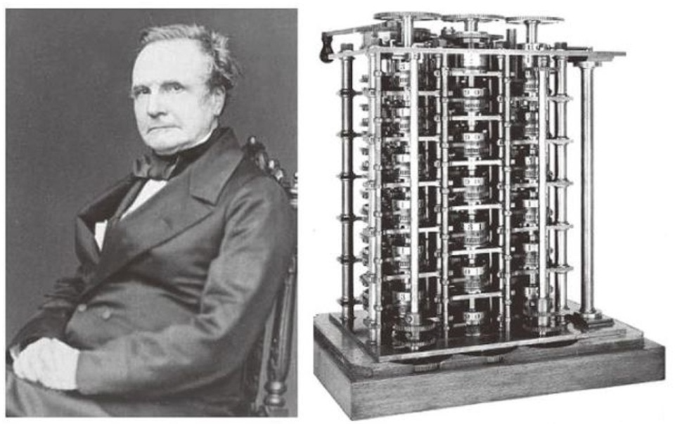

### 7. 阿：阿达与世界上第一个计算机程序

在1842年与1843年其间，阿达花了9个月的时间翻译意大利数学家路易吉·米那比亚对巴贝奇最新的计算机设计书（即分析机概论）评价所留下的备忘录。

在这部译文里，她附加了许多注释，内容详细说明用计算机进行伯努利数的运算方式。在译文附注G的开篇提到了世界上第一个计算机程序，举例说明了阿达意识到巴贝奇的设计是多么的意义深远。

**作为世界上第一个计算机程序的作者，她被公认为是有史以来第一位程序员**，还是一位女程序员。

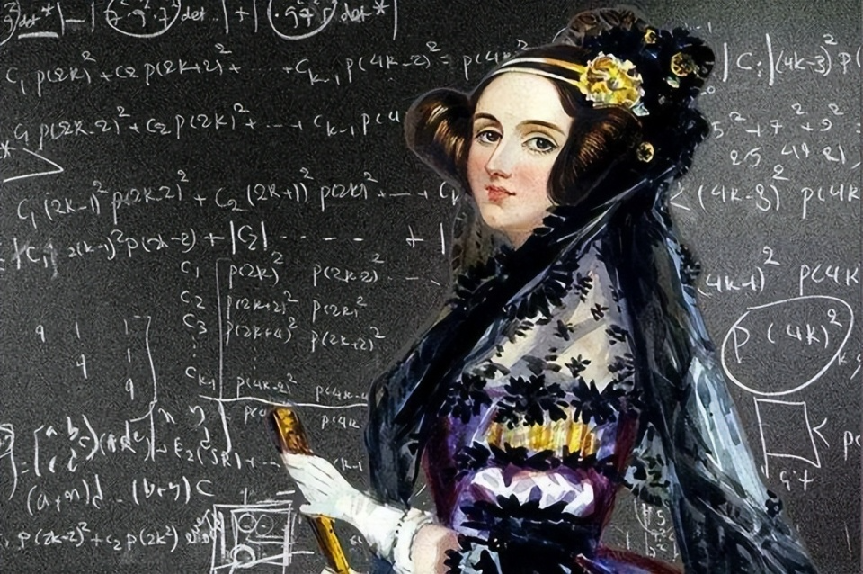

### 8. 穿：穿孔制表机

1888年，美国统计学家赫曼·霍列瑞斯在面对用手摇计算机处理美国人口普查5000余万美国人登记造册的庞大难题时设计发明了用于人口统计的穿孔制表机。

**制表机穿孔卡第一次把数据转变成二进制信息**，这种方式成为之后计算机系统里输入数据的方法一直沿用到20世纪70年代。

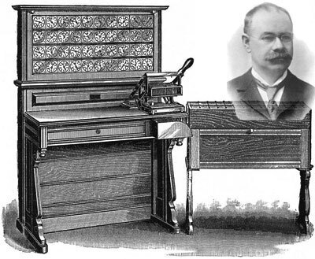

### 9. 图：图灵与可计算性理论

1936年，图灵（被称为“计算机科学之父”）以数学领域的布尔代数为基础，将逻辑领域中的任意命题（可转化为数学符号）都用一种通用的机器来表示和演算，并且能按照一定的规则推导出结论，即：将论据（输入）基于某种规则（指令集）来进行论证（计算）之后就肯定能得到结论（输出）。

**这就是可计算性理论**，是一种严格的逻辑和数学框架，限定了什么样的问题是可以求解的，什么样的问题是无法求解的。也就是所谓的**图灵完备**。

图灵机是实现图灵完备的演算机器，能制作图灵机的数学问题，它必然有解。

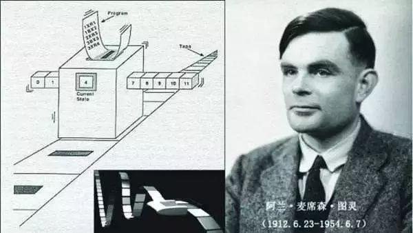

### 10. Z：楚泽与 Z 系列计算机

1938年，德国工程师康拉德·楚泽完成了第一台可编程使用二进制的数字计算机Z-1。

第二年，楚泽的朋友给了他一些电话公司废弃的继电器，楚泽用它们组装了第二台电磁式计算机Z-2， 这台机器已经可以正常工作。

1941年，第三台电磁式计算机Z-3完成，正常工作了3年。1944年，美军对柏林实施空袭，楚泽的住宅连同Z-3计算机一起被炸得支离破碎。

楚泽于1945年又建造了一台比Z-3更先进的电磁式Z-4计算机，受第二次世界大战影响，几经辗转，稳定运行到1958年才结束它的寿命。

楚泽创办了“楚泽计算机公司”，1958年研制出电子管通用计算机Z-22R。

电脑史学家认为，如果楚泽不是生活在法西斯统治下的德国，他可能早就把Z型计算机系列升级为电子计算机，世界计算机的历史将会改写。值得欣慰的是，**全世界都已经承认他是“数字计算机之父”**。

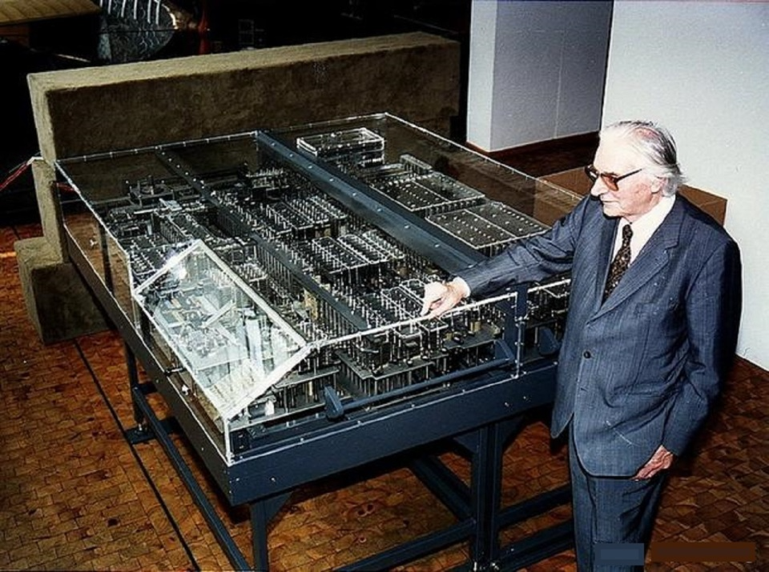

### 11. A：阿塔纳索夫-贝瑞计算机（ABC）

1942年，美国工程师约翰·阿塔纳索夫（被称为“电子计算机之父”）和克利福特·贝瑞基于图灵机的理论基础设计并研制了世界上第一台专用电子计算机——阿塔纳索夫-贝瑞计算机（Atanasoff-Berry Computer），简称 ABC 计算机。

ABC计算机不可编程，图灵不完备，不能通用，只能通过固定程序实现特定功能，所以叫做“专用”。虽然如此，但是它是“电子计算机”。

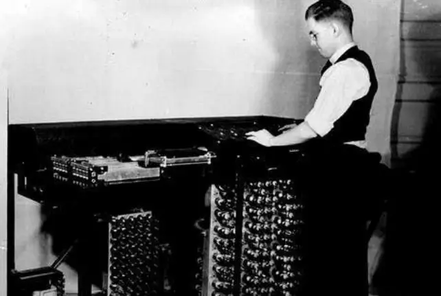

### 12. 冯：冯·诺依曼体系结构

1945 年，冯·诺依曼（被称为“现代计算机之父”）在论文《First Draft of Report o the EDVAC》（第一份草案）中提出了冯·诺依曼体系结构（又称“存储程序计算机”），**中心思想为：程序本身是存储在主机内存中的，可以通过加载不同的程序来解决不同的问题**。

**说明**：冯·诺依曼体系结构奠定了现代计算机的体系结构，它包含 5 大计算机组成部分，我们现在也习惯称之为主机和外设。

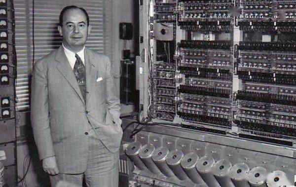

### 13. 世：世界第一台通用计算机 ENIAC

1946 年 2 月 14 日，**世界上第一台通用计算机 ENIAC**（Electronic Numerical Integrator And Computer，电子数值积分计算机）于美国宾夕法尼亚大学诞生，发明人是美国人莫克利和艾克特。

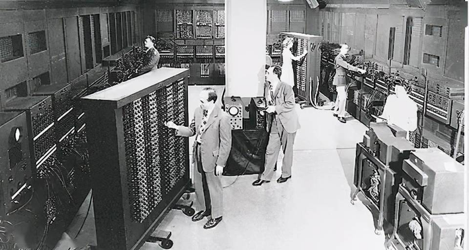

**说明**：ENIAC 是第一代电子管计算机，是图灵完备的，并且能够重新编程以解决各种计算问题。当时使用的还是穿孔卡片进行数据输入。所谓的穿孔卡片也就是一条纸带，上面充满了0和1的序列，机器语言就是由0和1两种元素组成，**机器语言也就成为了第一代计算机语言**。

### 14. 第：第一个汇编语言

凯瑟琳·布斯教授是英国早期的计算机先驱之一，她不仅写出了第一个汇编语言，还完成了机器翻译的奠基工作。**第一个计算机系统的汇编语言和代码就是出自她之手**，时间是在1950年前后。

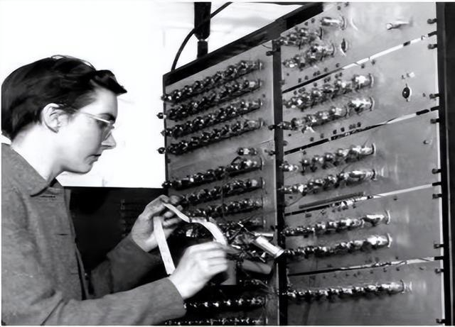

### 15. 第：第一套高阶电脑语言 FORTRAN

1957年4月，约翰·巴克斯所领导13人小组推出全世界第一套高阶电脑语言：**FORTRAN语言**。由此开启了第三代计算机语言的时代。
