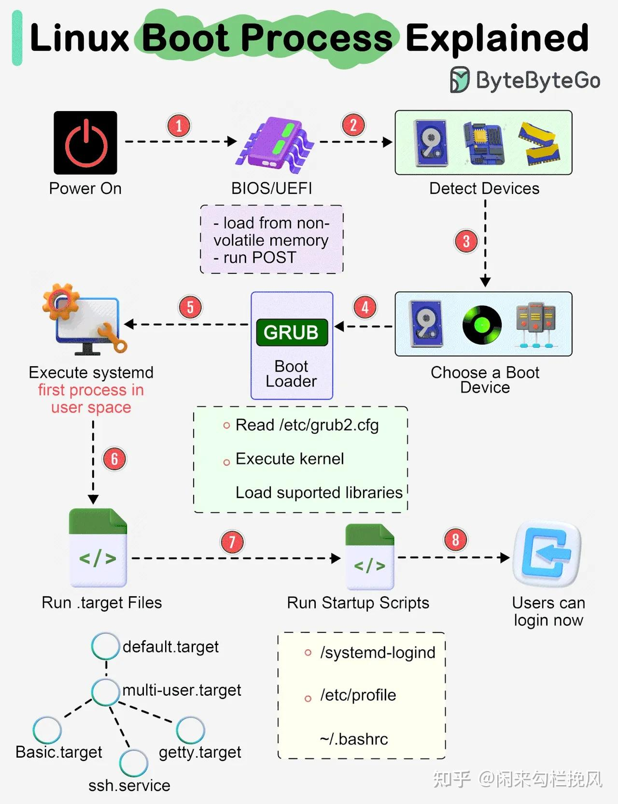

# 计算机启动

*图：计算机启动流程（示意）*

<svg xmlns="http://www.w3.org/2000/svg" viewBox="0 0 720 190" font-family="'Microsoft YaHei','PingFang SC',sans-serif">
  <defs>
    <marker id="arw" markerWidth="8" markerHeight="8" refX="7" refY="3" orient="auto">
      <path d="M0,0 L7,3 L0,6 Z" fill="#94a3b8"/>
    </marker>
  </defs>
  <rect x="20" y="30" width="150" height="44" rx="8" fill="#eff6ff" stroke="#2563eb" stroke-width="1.5"/>
  <text x="95" y="48" text-anchor="middle" font-size="13" fill="#1e293b">按下电源</text>
  <text x="95" y="66" text-anchor="middle" font-size="12" fill="#475569">步骤 1</text>
  <line x1="170" y1="52" x2="185" y2="52" stroke="#94a3b8" stroke-width="1.5" marker-end="url(#arw)"/>
  <rect x="190" y="30" width="150" height="44" rx="8" fill="#eff6ff" stroke="#2563eb" stroke-width="1.5"/>
  <text x="265" y="48" text-anchor="middle" font-size="13" fill="#1e293b">BIOS/UEFI 加载</text>
  <text x="265" y="66" text-anchor="middle" font-size="12" fill="#475569">执行 POST 上电自检</text>
  <line x1="340" y1="52" x2="355" y2="52" stroke="#94a3b8" stroke-width="1.5" marker-end="url(#arw)"/>
  <rect x="360" y="30" width="150" height="44" rx="8" fill="#eff6ff" stroke="#2563eb" stroke-width="1.5"/>
  <text x="435" y="48" text-anchor="middle" font-size="13" fill="#1e293b">检测系统设备</text>
  <text x="435" y="66" text-anchor="middle" font-size="12" fill="#475569">CPU、RAM、存储</text>
  <line x1="510" y1="52" x2="525" y2="52" stroke="#94a3b8" stroke-width="1.5" marker-end="url(#arw)"/>
  <rect x="530" y="30" width="150" height="44" rx="8" fill="#eff6ff" stroke="#2563eb" stroke-width="1.5"/>
  <text x="605" y="48" text-anchor="middle" font-size="13" fill="#1e293b">选择启动设备</text>
  <text x="605" y="66" text-anchor="middle" font-size="12" fill="#475569">硬盘 / 网络 / 光盘</text>
  <path d="M605,74 L605,97 L95,97 L95,116" fill="none" stroke="#94a3b8" stroke-width="1.5" marker-end="url(#arw)"/>
  <rect x="20" y="120" width="150" height="44" rx="8" fill="#eff6ff" stroke="#2563eb" stroke-width="1.5"/>
  <text x="95" y="138" text-anchor="middle" font-size="13" fill="#1e293b">运行引导加载程序</text>
  <text x="95" y="156" text-anchor="middle" font-size="12" fill="#475569">GRUB 菜单</text>
  <line x1="170" y1="142" x2="185" y2="142" stroke="#94a3b8" stroke-width="1.5" marker-end="url(#arw)"/>
  <rect x="190" y="120" width="150" height="44" rx="8" fill="#eff6ff" stroke="#2563eb" stroke-width="1.5"/>
  <text x="265" y="138" text-anchor="middle" font-size="13" fill="#1e293b">内核准备就绪</text>
  <text x="265" y="156" text-anchor="middle" font-size="12" fill="#475569">切换到用户空间</text>
  <line x1="340" y1="142" x2="355" y2="142" stroke="#94a3b8" stroke-width="1.5" marker-end="url(#arw)"/>
  <rect x="360" y="120" width="150" height="44" rx="8" fill="#fffbeb" stroke="#d97706" stroke-width="1.5"/>
  <text x="435" y="138" text-anchor="middle" font-size="13" fill="#1e293b">systemd 启动</text>
  <text x="435" y="156" text-anchor="middle" font-size="12" fill="#475569">进程 · 服务 · 文件系统</text>
  <line x1="510" y1="142" x2="525" y2="142" stroke="#94a3b8" stroke-width="1.5" marker-end="url(#arw)"/>
  <rect x="530" y="120" width="150" height="44" rx="8" fill="#f0fdf4" stroke="#16a34a" stroke-width="1.5"/>
  <text x="605" y="138" text-anchor="middle" font-size="13" fill="#1e293b">登录窗口</text>
  <text x="605" y="156" text-anchor="middle" font-size="12" fill="#475569">系统准备就绪</text>
</svg>

## 从按下电源到登录窗口的 8 个步骤

**步骤1** - 当我们[启动电源](https://www.zhihu.com/search?q=%E5%90%AF%E5%8A%A8%E7%94%B5%E6%BA%90&search_source=Entity&hybrid_search_source=Entity&hybrid_search_extra=%7B%22sourceType%22%3A%22article%22%2C%22sourceId%22%3A%22670742766%22%7D)时，BIOS（基本输入/输出系统）或[UEFI](https://www.zhihu.com/search?q=UEFI&search_source=Entity&hybrid_search_source=Entity&hybrid_search_extra=%7B%22sourceType%22%3A%22article%22%2C%22sourceId%22%3A%22670742766%22%7D)（统一可扩展固件接口）固件从[非易失性存储器](https://www.zhihu.com/search?q=%E9%9D%9E%E6%98%93%E5%A4%B1%E6%80%A7%E5%AD%98%E5%82%A8%E5%99%A8&search_source=Entity&hybrid_search_source=Entity&hybrid_search_extra=%7B%22sourceType%22%3A%22article%22%2C%22sourceId%22%3A%22670742766%22%7D)加载，并执行**POST（上电自检）**。

**步骤2** - BIOS/UEFI检测连接到系统的设备，包括CPU、[RAM](https://www.zhihu.com/search?q=RAM&search_source=Entity&hybrid_search_source=Entity&hybrid_search_extra=%7B%22sourceType%22%3A%22article%22%2C%22sourceId%22%3A%22670742766%22%7D)和存储。

**步骤3** - 选择一个[启动设备](https://www.zhihu.com/search?q=%E5%90%AF%E5%8A%A8%E8%AE%BE%E5%A4%87&search_source=Entity&hybrid_search_source=Entity&hybrid_search_extra=%7B%22sourceType%22%3A%22article%22%2C%22sourceId%22%3A%22670742766%22%7D)以从中引导操作系统。这可以是硬盘、[网络服务器](https://www.zhihu.com/search?q=%E7%BD%91%E7%BB%9C%E6%9C%8D%E5%8A%A1%E5%99%A8&search_source=Entity&hybrid_search_source=Entity&hybrid_search_extra=%7B%22sourceType%22%3A%22article%22%2C%22sourceId%22%3A%22670742766%22%7D)或光盘驱动器。

**步骤4** - BIOS/UEFI运行引导加载程序（[GRUB](https://www.zhihu.com/search?q=GRUB&search_source=Entity&hybrid_search_source=Entity&hybrid_search_extra=%7B%22sourceType%22%3A%22article%22%2C%22sourceId%22%3A%22670742766%22%7D)），该加载程序提供一个菜单，用于选择操作系统或内核功能。

**步骤5** - 内核准备好后，我们现在切换到用户空间。内核启动[systemd](https://www.zhihu.com/search?q=systemd&search_source=Entity&hybrid_search_source=Entity&hybrid_search_extra=%7B%22sourceType%22%3A%22article%22%2C%22sourceId%22%3A%22670742766%22%7D)**作为第一个用户空间进程**，它管理进程和服务，探测所有剩余的硬件，挂载[文件系统](https://www.zhihu.com/search?q=%E6%96%87%E4%BB%B6%E7%B3%BB%E7%BB%9F&search_source=Entity&hybrid_search_source=Entity&hybrid_search_extra=%7B%22sourceType%22%3A%22article%22%2C%22sourceId%22%3A%22670742766%22%7D)，并运行桌面环境。

**步骤6** - systemd默认在[系统引导](https://www.zhihu.com/search?q=%E7%B3%BB%E7%BB%9F%E5%BC%95%E5%AF%BC&search_source=Entity&hybrid_search_source=Entity&hybrid_search_extra=%7B%22sourceType%22%3A%22article%22%2C%22sourceId%22%3A%22670742766%22%7D)时激活默认的.target单元。其他分析单元也会被执行。

**步骤7** - 系统运行一系列启动脚本并配置环境。

**步骤8** - 用户被呈现出[登录](https://www.zhihu.com/search?q=%E7%99%BB%E5%BD%95&search_source=Entity&hybrid_search_source=Entity&hybrid_search_extra=%7B%22sourceType%22%3A%22article%22%2C%22sourceId%22%3A%22670742766%22%7D)窗口。**系统现在已经准备就绪**。

作者：闲来勾栏挽风
链接：https://zhuanlan.zhihu.com/p/670742766
来源：知乎
著作权归作者所有。商业转载请联系作者获得授权，非商业转载请注明出处。
