# 数字电路

**1、数字电路是什么？**

数字电路是利用电源电压的高电平和低电平分别表示1和0，进而实现信息的表达。模拟信号：随时间连续变化的信号。处理模拟信号的电路就是模拟电路。数字信号：随时间不连续变化的信号，离散变化。处理数字信号的电路就是数字电路。

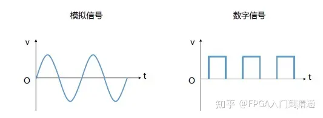

**2、数值表达**

我们常用的数值表达方式是十进制，但在数字电路中采用的是二进制，如下图所示：

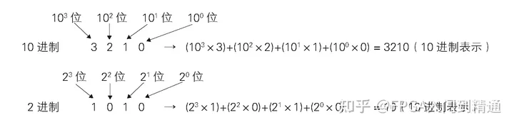

有符号二进制：

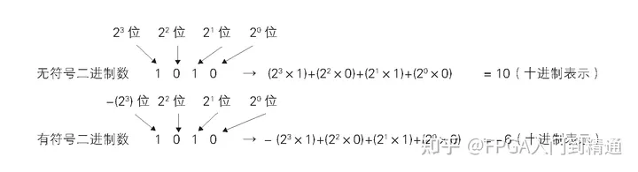

**3、比特和字节**

比特：二进制中的一个数字位称为 binary digit，用bit表示，常简写为“b”。

字节：1字节等于8比特，用byte表示，常简写为“B”。

**4、1K 字节理解的差异**

K、M、G、T 是表示大数据量时常用的单位。1K 的大小有 1000（10 的 3 次方）和 1024（2 的 10 次方）两种计数方法。

通常，衡量计算机内存和网络数据包大小时，1K 相当于 1024 比特。而在硬盘等存储器的标签上记述的尺寸或物理学中的 1K 相当于 1000。

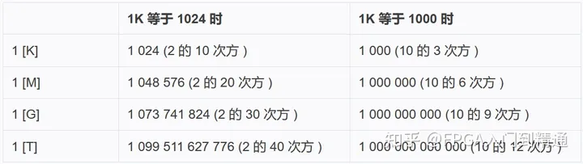

**5、反码与补码**

反码 = 原码所有bit位取反

补码 = 反码+1

比如原码=0101，则反码=1010，补码=1011

**6、MOSFET 的结构**

目前数字电路基本上都是由 MOSFET 场效应管构成的。MOSFET 是一种在施加电压后可以像开关一样工作的半导体器件。MOSFET 有 P 型 MOSFET 和 N 型 MOSFET 两种，如下图所示。

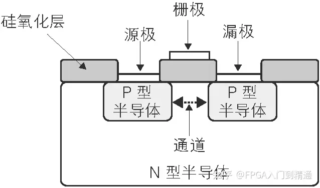

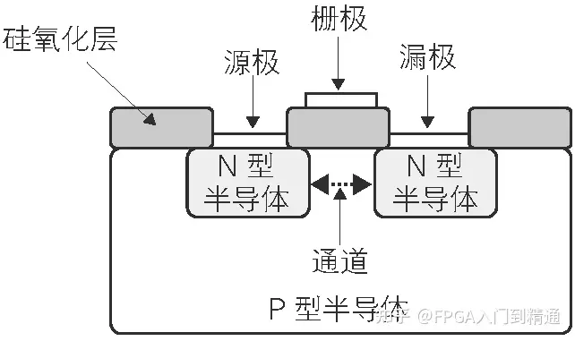

**7、逻辑运算与基本逻辑门电路**

（1）逻辑运算使用 AND（逻辑与）、OR（逻辑或）、NOT（逻辑非）三种基本运算组合来实现各种运算。

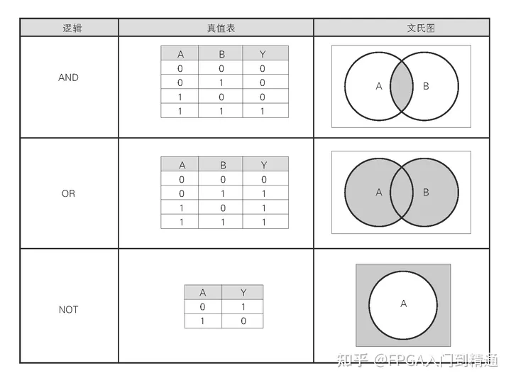

（2）CMOS 基本逻辑门电路

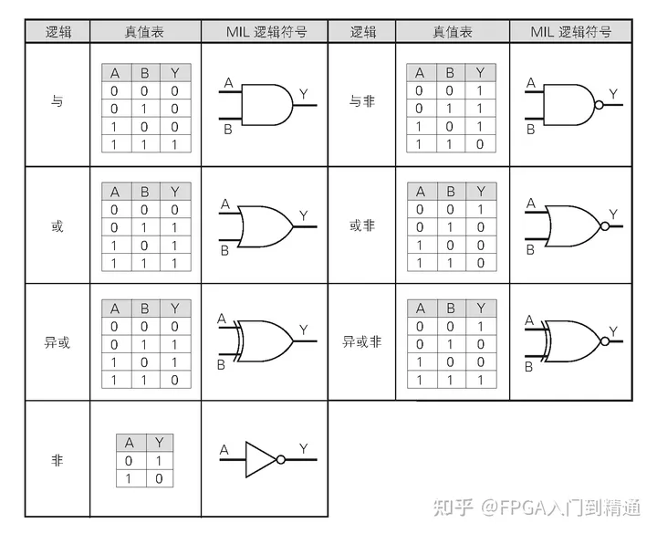

**8、存储元件**

锁存器（Latch）就是一种存储元件，具有像闩锁一样锁住并维持数据的特性，通过组合基本的逻辑门可以实现。

（1）最简单的锁存器由一个2输入的AND门组成，将一路输入与输出连接形成回路。

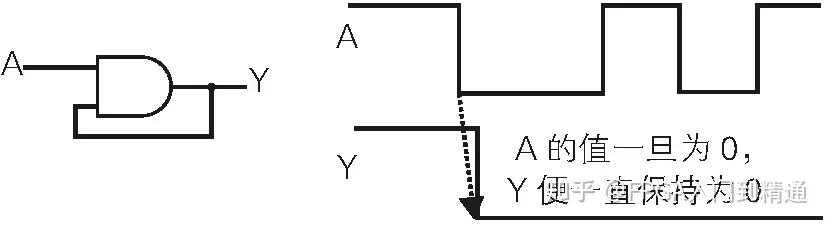

（2）D锁存器（Data Latch，D-Latch，数据锁存器）

结构组成：由4个NAND组成，输入信号有D（DATA）和E（ENABLE），输出信号有Q和/Q。

工作逻辑：E 为 0 时保持前一个数据，E 为 1 时将输入 D 的数据输出到 Q。E为1时输入的 D 直接通过 Q 输出。

D锁存器构成以及电路组成如下：

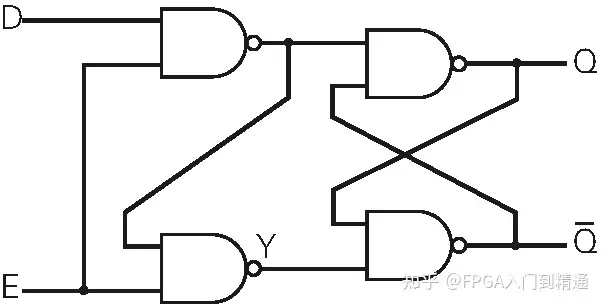

真值表：

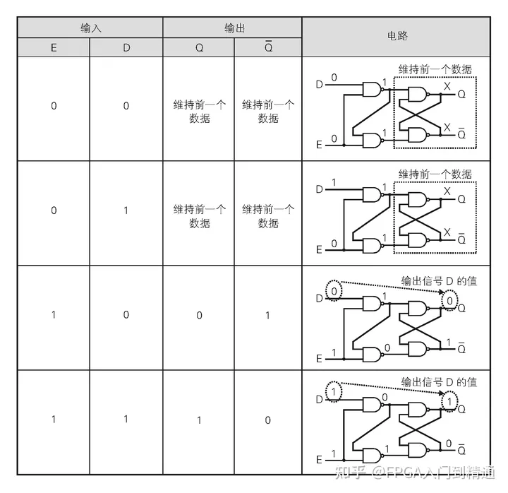

（3）D触发器

D 锁存器和 NOT 门组合，可以实现依据时钟信号同步并保存数据的D 触发器。

D 触发器有 D（Data） 和 C（Clock） 两个输入信号，Q 和/Q两个输出信号。

D触发器电路组合如下图所示：

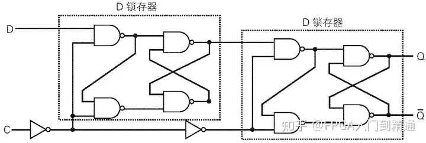

D触发器的电路符号：

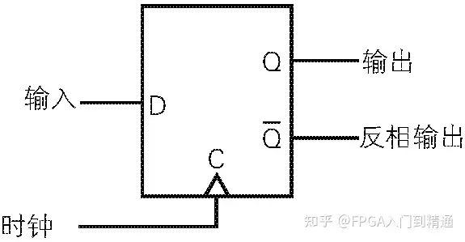

工作逻辑：当 D 触 发器的 C 为 0 时，前端 D 锁存器输出信号 D 的值，后端 D 锁存器保持之前的数据。当 C 为 1 时，前端 D 锁存器保持之前的数据，后端 D 锁存器将前端 D 锁存器保持的数据直接通过 Q 输出。

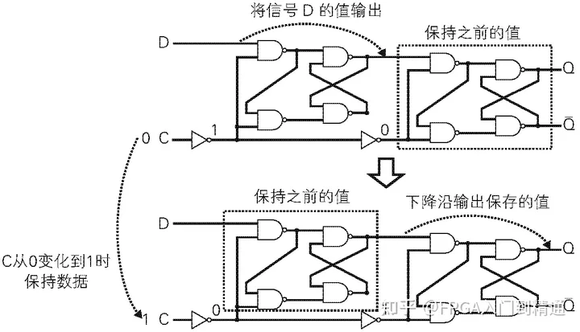

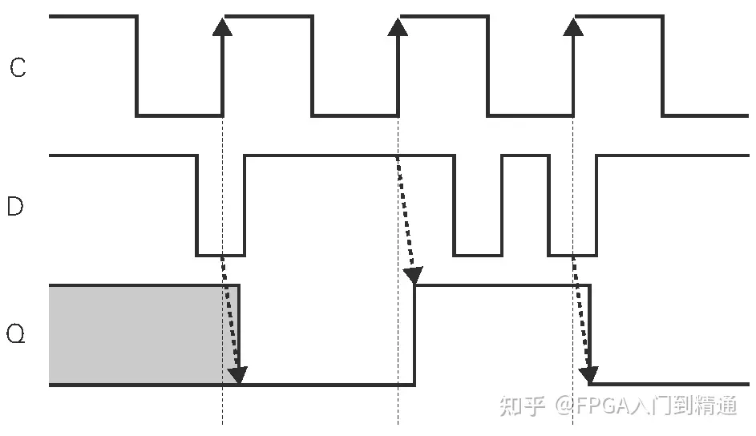

D触发器由于原理和构造简单，广泛应用于同步电路。

**扩展知识：《建立时间与保持时间》**

D触发器是由时钟信号的边沿来触发数据的存储动作的。因此，需要在时钟沿前后一段时间内将输入信号稳定下来。如果在时钟变化时输入信号也在变化，很可能无法正确存储数据。因此，为了让 D 触发器正确存储数据，需要有建立时间（setup time）和保持时间（hold time）两个基本条件。

建立时间是在时钟变化前必须稳定输入信号的时间，而保持时间是时钟变化后必须稳定输入信号的时间。

同时遵守建立时间和保持时间，就可以让 D 触发器正确的存储数据。具体的时序图如下所示：

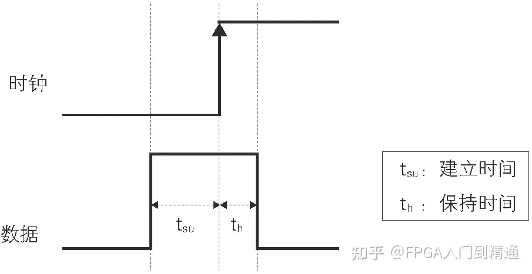

**9、组合逻辑电路和时序逻辑电路**

数字电路可以分为组逻辑合电路和时序逻辑电路两种。（1）组合逻辑电路

组合逻辑电路是指输出值仅由输入信号的状态决定的电路，不依赖于过去的输入。从电路组成上来看，只包含门电路，不包含存储元件。如下图所示就是一个组合逻辑电路。

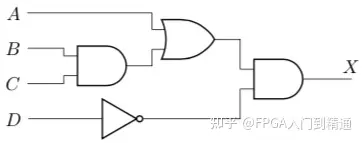

（2）时序逻辑电路

时序逻辑电路是指输出值同时依赖于现在和过去输入信号的逻辑电路。

从电路组成上来看，时序逻辑电路等于组合逻辑电路+存储电路。

从工作逻辑上来看，输出状态必须反馈到输入端，与输入信号共同决定组合逻辑的输出。

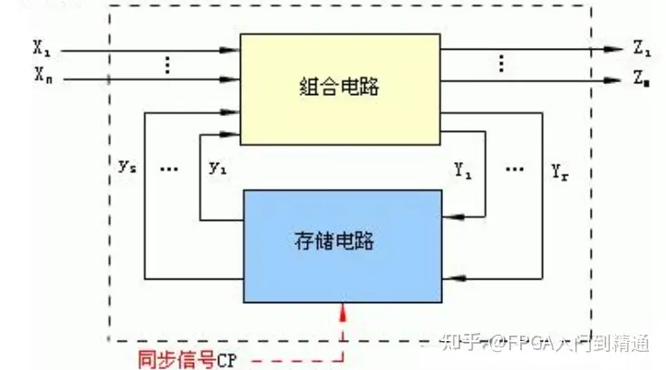

—————————————————————————————
