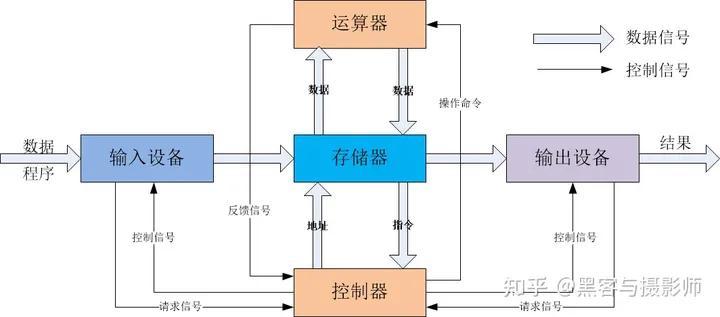
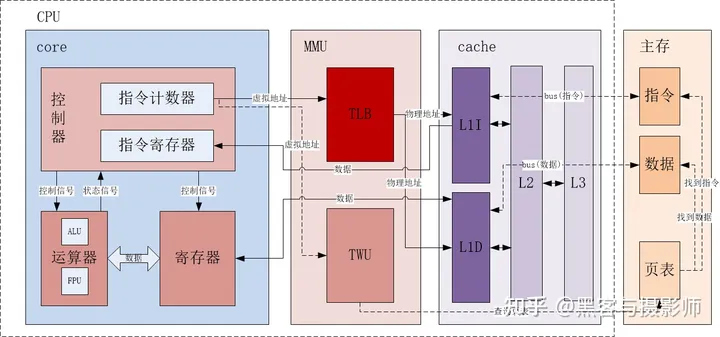
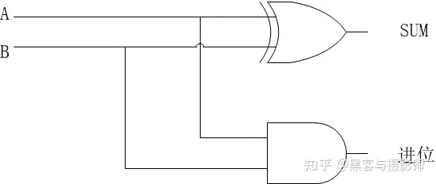
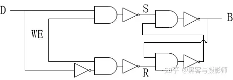
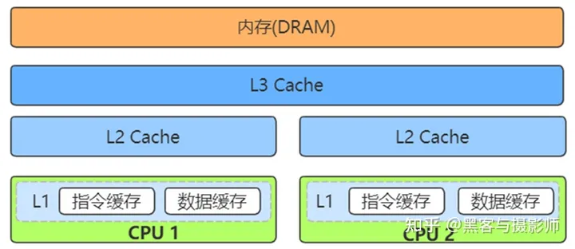
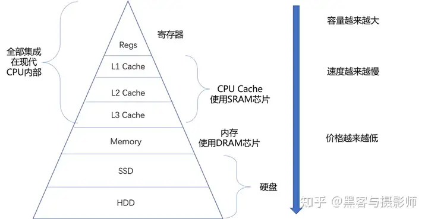
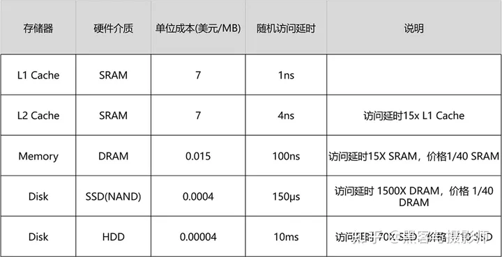
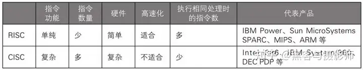
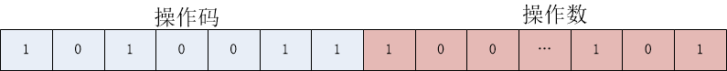

# 硬件解说OS

作者：黑客与摄影师
链接：https://www.zhihu.com/question/21717789/answer/2792032027
来源：知乎
著作权归作者所有。商业转载请联系作者获得授权，非商业转载请注明出处。

简单来讲，cpu就是由[二极管](https://www.zhihu.com/search?q=%E4%BA%8C%E6%9E%81%E7%AE%A1&search_source=Entity&hybrid_search_source=Entity&hybrid_search_extra=%7B%22sourceType%22%3A%22answer%22%2C%22sourceId%22%3A%222792032027%22%7D)、三极管、电容等，搭建起来的与、或、非门组合起来的，具有逻辑功能的电路。

接下来，会从CPU的起源（[冯·诺依曼结构](https://www.zhihu.com/search?q=%E5%86%AF%C2%B7%E8%AF%BA%E4%BE%9D%E6%9B%BC%E7%BB%93%E6%9E%84&search_source=Entity&hybrid_search_source=Entity&hybrid_search_extra=%7B%22sourceType%22%3A%22answer%22%2C%22sourceId%22%3A%222792032027%22%7D)），CPU的框架与模块组成，CPU的运行过程（取指、译码、执行、访存、写回）三个维度展开讲讲cpu的工作原理是什么。

## 1，冯·诺依曼结构
要了解CPU就绕不开冯·诺依曼结构。其实，在第一个计算机诞生的时候，虽然采取了最先进的电子技术，但缺少设计思想上的指导，导致很多逻辑都是硬化在电路板上，软硬件耦合严重。这会造成一旦修改程序，就要重新组装电路板，这样的编程效率很低。这时冯·诺依曼提出了一个至关重要的设计思路：计算机的逻辑结构，将软硬件分离，要求CPU顺序地从存储器中取出指令和数据，然后进行相应的计算，主要的思想：

+ 二进制：程序、数据的最终形态都是二进制编码、存储在存储器中，二进制编码也是CPU能够识别、执行的编码；
+ 指令、数据可存储：指令序列和数据存在主（内）存储器中，以便于CPU在工作时，能够高速地从存储器中提取指令，并加以分析和执行；
+ [计算机组成](https://www.zhihu.com/search?q=%E8%AE%A1%E7%AE%97%E6%9C%BA%E7%BB%84%E6%88%90&search_source=Entity&hybrid_search_source=Entity&hybrid_search_extra=%7B%22sourceType%22%3A%22answer%22%2C%22sourceId%22%3A%222792032027%22%7D)：确定了计算机的五个基本组成部分：运算器、控制器、存储器、输入设备、输出设备；

冯·诺依曼的结构框图如下：

冯·诺依曼体系结构

其实，冯·诺依曼体系结构存在一些问题，但是人们并没有完全抛弃这种体系结构，而是在它之上做了改进：

+ 指令、数据公用内存：指令和数据都存储在一个存储器上，并且通过一个系统总线进行访问。当前主存的读写速度是跟不上cpu运行速度的，所以为了解决这个问题，在cpu和主存间增加了高速缓存，并且在L1高速缓存上，还区分了[指令缓存](https://www.zhihu.com/search?q=%E6%8C%87%E4%BB%A4%E7%BC%93%E5%AD%98&search_source=Entity&hybrid_search_source=Entity&hybrid_search_extra=%7B%22sourceType%22%3A%22answer%22%2C%22sourceId%22%3A%222792032027%22%7D)和数据缓存，并进一步提升系统总线的访问速度。另外，为了解决指令和数据共用系统总线，带来的速度慢的问题，又提出了哈佛架构，将指令和数据分别存放在不同的主存上，可以并行访问，这提高了运行速度。但是哈佛架构结构复杂，不适合外部主存的扩展，所以[哈佛结构](https://www.zhihu.com/search?q=%E5%93%88%E4%BD%9B%E7%BB%93%E6%9E%84&search_source=Entity&hybrid_search_source=Entity&hybrid_search_extra=%7B%22sourceType%22%3A%22answer%22%2C%22sourceId%22%3A%222792032027%22%7D)并未得到广泛应用；
+ [指令顺序指令](https://www.zhihu.com/search?q=%E6%8C%87%E4%BB%A4%E9%A1%BA%E5%BA%8F%E6%8C%87%E4%BB%A4&search_source=Entity&hybrid_search_source=Entity&hybrid_search_extra=%7B%22sourceType%22%3A%22answer%22%2C%22sourceId%22%3A%222792032027%22%7D)：指令只能顺序，在一个pipe上运行。为了提升指令运行速度增加了，乱序执行、多级流水线、[分支预测](https://www.zhihu.com/search?q=%E5%88%86%E6%94%AF%E9%A2%84%E6%B5%8B&search_source=Entity&hybrid_search_source=Entity&hybrid_search_extra=%7B%22sourceType%22%3A%22answer%22%2C%22sourceId%22%3A%222792032027%22%7D)等功能；

在冯·诺依曼体系结构设计思想指导下，并伴随着[摩尔定律](https://www.zhihu.com/search?q=%E6%91%A9%E5%B0%94%E5%AE%9A%E5%BE%8B&search_source=Entity&hybrid_search_source=Entity&hybrid_search_extra=%7B%22sourceType%22%3A%22answer%22%2C%22sourceId%22%3A%222792032027%22%7D)下的芯片制作工艺提升，现在的CPU越来越强大，在功能、算力不断提升的同时，功耗、面积也在不停的减少。得益于芯片技术的发展，我们现在不仅有更轻便，容易携带的笔记本，还有各种方便携带的[嵌入式产品](https://www.zhihu.com/search?q=%E5%B5%8C%E5%85%A5%E5%BC%8F%E4%BA%A7%E5%93%81&search_source=Entity&hybrid_search_source=Entity&hybrid_search_extra=%7B%22sourceType%22%3A%22answer%22%2C%22sourceId%22%3A%222792032027%22%7D)使用，比如：智能手机、智能手表、蓝牙耳机等。可以预见，随着技术的发展，后面将会有更丰富的产品出现，这无不彰显科学技术就是第一生产力。接下来，我们重点关注当代CPU的工作原理，通过对CPU工作原理的了解，为以后工作中更好地进行功能开发、性能优化、功耗优化做铺垫。

## 2，CPU的框架

CPU+外存框架

为了讲述的方便，上面画了CPU+主存的框架。这基本上是现在复杂CPU的主流做法，CPU内部包含控制器、运算器、寄存器，使用[虚拟地址](https://www.zhihu.com/search?q=%E8%99%9A%E6%8B%9F%E5%9C%B0%E5%9D%80&search_source=Entity&hybrid_search_source=Entity&hybrid_search_extra=%7B%22sourceType%22%3A%22answer%22%2C%22sourceId%22%3A2790795832%7D)，经过MMU可以转化成[物理地址](https://www.zhihu.com/search?q=%E7%89%A9%E7%90%86%E5%9C%B0%E5%9D%80&search_source=Entity&hybrid_search_source=Entity&hybrid_search_extra=%7B%22sourceType%22%3A%22answer%22%2C%22sourceId%22%3A%222792032027%22%7D)。其中MMU里面有一个[页表高速缓存表](https://www.zhihu.com/search?q=%E9%A1%B5%E8%A1%A8%E9%AB%98%E9%80%9F%E7%BC%93%E5%AD%98%E8%A1%A8&search_source=Entity&hybrid_search_source=Entity&hybrid_search_extra=%7B%22sourceType%22%3A%22answer%22%2C%22sourceId%22%3A2790795832%7D)（Table Lookup Buffer，简称TLB）和[页表遍历单元](https://www.zhihu.com/search?q=%E9%A1%B5%E8%A1%A8%E9%81%8D%E5%8E%86%E5%8D%95%E5%85%83&search_source=Entity&hybrid_search_source=Entity&hybrid_search_extra=%7B%22sourceType%22%3A%22answer%22%2C%22sourceId%22%3A2790795832%7D)（Table Walk Unit，简称TWU），当TLB中缓存着要访问的虚拟地址到物理地址的转换关系的时候，就可以直接找到的物理地址，通过该物理地址在L1 cache中查找数据。如果TLB中没有缓存要访问虚拟地址对应的物理地址，这时会通过TWU模块遍历主存中的页表，查找相应的物理地址，找到后再通过这个物理地址访问[L1 cache](https://www.zhihu.com/search?q=L1%20cache&search_source=Entity&hybrid_search_source=Entity&hybrid_search_extra=%7B%22sourceType%22%3A%22answer%22%2C%22sourceId%22%3A%222792032027%22%7D)。如果L1 cache中存在着要访问的物理地址对应的内容，直接返回给相应的寄存器。如果L1 cache中没找到相应的数据，就依次从L2、L3 cache中查找，如果在所有层级的cache中都没查找到有效的数据，就会直接访问主存，取出物理地址对应的数据，然后分别给到寄存器和L1 cache。

其中实线部分是命中TLB及cache的数据访问方式，虚线部分是没有命中TLB及cache，通过TWU和页表访问主存获取数据的方式。这个框架相对于冯·诺依曼体系结构多了MMU及cache，这两个单元主要是为了解决两个问题，一个是[地址空间](https://www.zhihu.com/search?q=%E5%9C%B0%E5%9D%80%E7%A9%BA%E9%97%B4&search_source=Entity&hybrid_search_source=Entity&hybrid_search_extra=%7B%22sourceType%22%3A%22answer%22%2C%22sourceId%22%3A%222792032027%22%7D)保护、内存使用效率低的问题，另一个是冯·诺依曼体系结构访问指令、数据共用存储器慢的问题。接下来，我们分别看看各个模块的功能。

### 2.1 CORE
CPU CORE是一种根据指令进行各种处理的[电子电路](https://www.zhihu.com/search?q=%E7%94%B5%E5%AD%90%E7%94%B5%E8%B7%AF&search_source=Entity&hybrid_search_source=Entity&hybrid_search_extra=%7B%22sourceType%22%3A%22answer%22%2C%22sourceId%22%3A%222792032027%22%7D)。一般由控制器、运算器、寄存器组成。后面会专门写篇文章，详细分析一款[ARM核](https://www.zhihu.com/search?q=ARM%E6%A0%B8&search_source=Entity&hybrid_search_source=Entity&hybrid_search_extra=%7B%22sourceType%22%3A%22answer%22%2C%22sourceId%22%3A%222792032027%22%7D)的[微架构](https://www.zhihu.com/search?q=%E5%BE%AE%E6%9E%B6%E6%9E%84&search_source=Entity&hybrid_search_source=Entity&hybrid_search_extra=%7B%22sourceType%22%3A%22answer%22%2C%22sourceId%22%3A%222792032027%22%7D)。接下来，我们分别看一下各模块的功能。

1） 控制器

控制器又称为控制单元（Control Unit，简称CU），是计算机的指挥中心，只有在它的控制下，整个CPU才能够有条不紊地工作、自动执行程序。CU包括[指令寄存器](https://www.zhihu.com/search?q=%E6%8C%87%E4%BB%A4%E5%AF%84%E5%AD%98%E5%99%A8&search_source=Entity&hybrid_search_source=Entity&hybrid_search_extra=%7B%22sourceType%22%3A%22answer%22%2C%22sourceId%22%3A%222792032027%22%7D)、[指令计数器](https://www.zhihu.com/search?q=%E6%8C%87%E4%BB%A4%E8%AE%A1%E6%95%B0%E5%99%A8&search_source=Entity&hybrid_search_source=Entity&hybrid_search_extra=%7B%22sourceType%22%3A%22answer%22%2C%22sourceId%22%3A2790795832%7D)，其中指令寄存器存放当前正在执行的指令，指令计数器总是指向下一条要执行指令的地址。CU的工作流程为：从内存中取指令、翻译指令、分析指令。然后根据指令的含义，向有关部件发送控制命令，控制相关部件执行指令所包含的操作。具体的指令执行过程如下：CU通过指令计数器获取下一条将要执行指令的地址，通过该地址获取具体的指令，存放在指令寄存器，然后对该指令解码，如果是一个add（[加法指令](https://www.zhihu.com/search?q=%E5%8A%A0%E6%B3%95%E6%8C%87%E4%BB%A4&search_source=Entity&hybrid_search_source=Entity&hybrid_search_extra=%7B%22sourceType%22%3A%22answer%22%2C%22sourceId%22%3A2790795832%7D)），会通过将寄存器中的值加载到运算器，其中寄存器中的值是从cache或者主存中获取的，经过运算器的运算产生进位、溢出等信号反馈给控制器，产生的结果也存放在寄存器中。

2） 运算器

运算器是一个负责[算术运算](https://www.zhihu.com/search?q=%E7%AE%97%E6%9C%AF%E8%BF%90%E7%AE%97&search_source=Entity&hybrid_search_source=Entity&hybrid_search_extra=%7B%22sourceType%22%3A%22answer%22%2C%22sourceId%22%3A2790795832%7D)和[逻辑运算](https://www.zhihu.com/search?q=%E9%80%BB%E8%BE%91%E8%BF%90%E7%AE%97&search_source=Entity&hybrid_search_source=Entity&hybrid_search_extra=%7B%22sourceType%22%3A%22answer%22%2C%22sourceId%22%3A%222792032027%22%7D)的模块，主要包含算术逻辑单元（Arithmetic Logic Unit，简称ALU）和[浮点运算单元](https://www.zhihu.com/search?q=%E6%B5%AE%E7%82%B9%E8%BF%90%E7%AE%97%E5%8D%95%E5%85%83&search_source=Entity&hybrid_search_source=Entity&hybrid_search_extra=%7B%22sourceType%22%3A%22answer%22%2C%22sourceId%22%3A2790795832%7D)（Floating Point Unit，简称FPU）。ALU的主要功能：在控制信号的作用下，完成加、减、乘、除等算术运算，以及与、或、非、异或等逻辑运算以及移位、补位等运算。通常ALU由两个输入端和一个输出端（两个值输入，一个结果输出）。FPU主要负责浮点运算和高精度整数运算。有些FPU还具有[向量运算](https://www.zhihu.com/search?q=%E5%90%91%E9%87%8F%E8%BF%90%E7%AE%97&search_source=Entity&hybrid_search_source=Entity&hybrid_search_extra=%7B%22sourceType%22%3A%22answer%22%2C%22sourceId%22%3A2790795832%7D)的功能，另外一些则有专门的向量处理单元。

运算器是用与、或、[非逻辑门电路](https://www.zhihu.com/search?q=%E9%9D%9E%E9%80%BB%E8%BE%91%E9%97%A8%E7%94%B5%E8%B7%AF&search_source=Entity&hybrid_search_source=Entity&hybrid_search_extra=%7B%22sourceType%22%3A%22answer%22%2C%22sourceId%22%3A2790795832%7D)搭建起来的，比如，带进位的[二进制加法电路](https://www.zhihu.com/search?q=%E4%BA%8C%E8%BF%9B%E5%88%B6%E5%8A%A0%E6%B3%95%E7%94%B5%E8%B7%AF&search_source=Entity&hybrid_search_source=Entity&hybrid_search_extra=%7B%22sourceType%22%3A%22answer%22%2C%22sourceId%22%3A%222792032027%22%7D)：

二进制加法器

运算器主要的处理对象是数据，所以数据的长度以及数据的表示方法，对运算器的影响很大。大多数通用CPU是以16、32、64位数据作为运算器一次处理数据的长度。能够一次性对一个数据的所有位，同时处理的运算器称为[并行运算器](https://www.zhihu.com/search?q=%E5%B9%B6%E8%A1%8C%E8%BF%90%E7%AE%97%E5%99%A8&search_source=Entity&hybrid_search_source=Entity&hybrid_search_extra=%7B%22sourceType%22%3A%22answer%22%2C%22sourceId%22%3A2790795832%7D)，一次只能对数据的一个位处理的运算器称为[串行运算器](https://www.zhihu.com/search?q=%E4%B8%B2%E8%A1%8C%E8%BF%90%E7%AE%97%E5%99%A8&search_source=Entity&hybrid_search_source=Entity&hybrid_search_extra=%7B%22sourceType%22%3A%22answer%22%2C%22sourceId%22%3A%222792032027%22%7D)。我们通常所说的“CPU是几位的”就是指ALU一次所能处理的数据的位数。

运算器与其他部分的关系：计算机运算时，运算器的操作对象和操作种类由控制器决定。运算器操作的数据从cache或内存中读取，处理的结果再写入内存（或者暂时存放在内部寄存器中），而且运算器对内存数据的读写，是由控制器来进行的。

3） 寄存器

寄存器的主要功能是存储数据、地址及指令，并且能够高速、自动地完成数据的存储。寄存器是有记忆功能的器件，而且采用两种稳定状态0或1来记录数据信息，所以CPU中的程序和数据，都要转换为二进制才可以存储和操作。寄存器也是由与、或、非逻辑门电路组成的，下面就展示1bit的存储，32个bit存储电路就是32个重复的1bit电路。

寄存器1bit电路

其中D为寄存器中一个bit输入，B为当前寄存器的一个bit。当WE（Write Enable）为0时，B保持不变，不受D的变化影响。当WE为1时，这时候D为0时，B为0，并将该值存到电路中，当D为1时，B为1，并将该值存到电路中。

### 2.2 MMU
内存映射单元（Memory Map Unit，简称MMU），指的是将虚拟地址转化成物理地址的模块。MMU包含了两个模块：[页表查找表](https://www.zhihu.com/search?q=%E9%A1%B5%E8%A1%A8%E6%9F%A5%E6%89%BE%E8%A1%A8&search_source=Entity&hybrid_search_source=Entity&hybrid_search_extra=%7B%22sourceType%22%3A%22answer%22%2C%22sourceId%22%3A%222792032027%22%7D)（Table Lookup Buffer，简称TLB）和页表遍历单元（Table Walk Unit，简称TWU）。TLB是一个高速缓存，用于缓存页表转换的结果，从而减少页表查询的时间。一个完整的页表翻译和查找的过程叫做[页表查询](https://www.zhihu.com/search?q=%E9%A1%B5%E8%A1%A8%E6%9F%A5%E8%AF%A2&search_source=Entity&hybrid_search_source=Entity&hybrid_search_extra=%7B%22sourceType%22%3A%22answer%22%2C%22sourceId%22%3A2790795832%7D)，页表查询是通过硬件模块TWU自动完成的，但是页表的维护需要软件来完成，且存放在主存中，因此页表查询是一个耗时的过程。当TLB未命中时，MMU才会通过TWU查询页表，从而得到翻译后的物理地址，这个虚拟地址及物理地址的映射也会存储在TLB中。

对于ARM这样的处理器，CPU看到的都是虚拟地址，需要经过MMU转化为物理地址，才能访问cache或者内存，拿到物理地址中的内容。你可能会疑问，为什么需要[虚拟内存](https://www.zhihu.com/search?q=%E8%99%9A%E6%8B%9F%E5%86%85%E5%AD%98&search_source=Entity&hybrid_search_source=Entity&hybrid_search_extra=%7B%22sourceType%22%3A%22answer%22%2C%22sourceId%22%3A%222792032027%22%7D)，直接用物理内存不行吗？是的，不行。为了做进程地址空间的隔离及提升内存的使用效率，使用虚拟内存是很有必要的。后面会专门写一篇文章专门讲述MMU。

### 2.3 cache
由于CPU与内存之间存在很大的速度差（两者相差上百倍），同时又因为程序的加载有时间及空间局部性的特点，也就是说程序的一个内存位置被访问了，附近的位置很快也会被访问到。那么我们可以把内存中的部分代码提前加载到访问更快的Cache里面。既然Cache的主要作用是CPU与主存的缓冲层，那么Cache的速度应该接近于CPU，基本上是与CPU同频运作。一般缓存都集成在CPU芯片上，L1 cache分为L1D和L1I cache，L1D、L1I和L2 cache在同一个cpu上，L3 cache一般是多个cpu间共享。既然cache的访问速度这么快是不是越大越好，其实并不是，单拿成本和die的面积来说，cache就不能做的太大。后面会专门写一篇文章专门讲述cache。

CPU上cache的分布

现代计算机或[嵌入式系统](https://www.zhihu.com/search?q=%E5%B5%8C%E5%85%A5%E5%BC%8F%E7%B3%BB%E7%BB%9F&search_source=Entity&hybrid_search_source=Entity&hybrid_search_extra=%7B%22sourceType%22%3A%22answer%22%2C%22sourceId%22%3A2790795832%7D)的存储设备一般有 Cache、内存、SSD、HDD硬盘。这些存储设备越靠近 CPU 速度越快，容量越小，价[格越](https://www.zhihu.com/search?q=%E6%A0%BC%E8%B6%8A&search_source=Entity&hybrid_search_source=Entity&hybrid_search_extra=%7B%22sourceType%22%3A%22answer%22%2C%22sourceId%22%3A2790795832%7D)贵。

+ 寄存器(Register)：寄存器与其说是存储器，其实更像是 CPU 本身的一部分，只能存放极其有限的信息，但是速度非常快，和CPU同步。
+ 高速缓存(CPU Cache)：使用静态随机存取存储器（Static Random-Access Memory，简称SRAM）的芯片。
+ 内存(DRAM)：使用动态随机存取存储器（Dynamic Random Access Memory，简称DRAM）的芯片，比起 SRAM 来说，它的密度更高，有更大的容量，而且它也比 SRAM 芯片便宜不少。
+ 硬盘：如固态硬盘(Solid-state drive 或 Solid-state disk，简称SSD)、硬盘(Hard Disk Drive，简称HDD)。

存储金字塔

每一种存储器设备只和它相邻的存储设备打交道。比如，CPU Cache是从内存里加载而来的，或者需要写回内存，并不会直接写回数据到硬盘，也不会直接从硬盘加载数据到CPU Cache中，而是先加载到内存，再从内存加载到Cache中。

可以看出，越是速度快的设备，容量就越小。这里一共 10M 的 Cache，成本只是几十美元。而 8GB 的内存、128G 的 SSD 以及 1T 的 HDD，大概零售价格加在一起，也就和我们的高速缓存的价格差不多。

各存储器成本、延时对比

### 2.4 主存
主存里分别存储了各种数据，包括代码段、数据段、字符串、地址等。它的读写速度相对寄存器、cache慢了很多，但是单位成本却低了很多。通过系统中的存储金字塔设计，利用程序的时间及空间[局部性原理](https://www.zhihu.com/search?q=%E5%B1%80%E9%83%A8%E6%80%A7%E5%8E%9F%E7%90%86&search_source=Entity&hybrid_search_source=Entity&hybrid_search_extra=%7B%22sourceType%22%3A%22answer%22%2C%22sourceId%22%3A%222792032027%22%7D)，可以很好地利用主存的价格优势，弥补读写时间慢的问题。后面会专门写一篇文章讲解主存。

### 2.5 BUS
虽然从上面的框图上不能直观地看到BUS总线的存在，但是地址、数据的传输都是依赖总线完成的。它就像一条高速公路，快速完成各个单元间的数据交换，也是数据从内存流进和流出CPU的地方。CPU总线（前端总线）传输速率决定着CPU与内存之间传输数据的速度快慢。CPU总线速率越高，CPU从内存取指令和数据的等待时间越少，运行程序速度越快。总线又细分成数据总线、地址总线和控制总线。后面会专门写一篇文章讲解总线相关的知识。

## 3，CPU的运行过程
### 3.1 指令集
[指令集架构](https://www.zhihu.com/search?q=%E6%8C%87%E4%BB%A4%E9%9B%86%E6%9E%B6%E6%9E%84&search_source=Entity&hybrid_search_source=Entity&hybrid_search_extra=%7B%22sourceType%22%3A%22answer%22%2C%22sourceId%22%3A%222792032027%22%7D)（Instruction Set Architecture，简称ISA）是CPU和软件之间的桥梁。ISA包含指令集、特权级、寄存器、执行模式、安全扩展、性能加速扩展等方面。其中，指令集是ISA的重要组成部分，通常包含一系列不同功能的指令，用于数据搬移、计算、内存访问、过程调用等。CPU在运行操作系统或者应用程序的时候，实际上是在执行它被编译后所包含的指令。根据执行指令的特征，CPU分为[精简指令集计算机](https://www.zhihu.com/search?q=%E7%B2%BE%E7%AE%80%E6%8C%87%E4%BB%A4%E9%9B%86%E8%AE%A1%E7%AE%97%E6%9C%BA&search_source=Entity&hybrid_search_source=Entity&hybrid_search_extra=%7B%22sourceType%22%3A%22answer%22%2C%22sourceId%22%3A%222792032027%22%7D)（Reduced Instruction Set Conputer，简称RISC）和复杂指令集计算机（Complex Instruction Set Conputer，简称CISC）。

RISC 与CISC的对比

RISC类CPU的指令功能单纯，种类少。相对地，CISC类CPU指令功能复杂，种类繁多。RISC指令精简的好处是，CPU内部构造可以简化，适合高速操作，但是在进行相同的操作时，由于每条指令功能单纯，所以与CISC相比，RISC需要使用更多的指令数量。虽然CISC的内部构造复杂不适合高速操作，但进行相同处理时指令数比RISC要少。

RISC架构最大的特点是，只使用载入和存储指令访问内存，这种架构成为载入存储架构。这样做的好处是可以简化指令集和流水线的设计，在这种架构下，运算指令只能对寄存器中的数据进行操作。RISC和CISC两种架构各有所长，在追求高速运行的CPU领域中，RISC被认为更具优势。虽然这些年，Intel和AMD两家公司的CPU指令集依然是CISC的，但内部却将复杂指令分解成简单指令，使得内部像RISC一样工作。

### 3.2 CPU一般运行过程
CPU从cache或主存中取出指令，然后放入指令寄存器，控制器对该指令进行译码。最终把指令分解成一系列的微操作，然后发出各种控制命令，执行微操作序列，从而完成一条指令的执行。指令是CPU规定执行操作的类型和操作数的基本命令。指令是由一个字节或者多个字节组成（对于arm64，指令长度是4个字节），其中包括操作码字段、一个或多个有关操作数地址的字段以及一些表征机器状态的状态字以及特征码。有的指令中也直接包含操作数本身，且用二进制序列表示。指令的构造如下：

指令构造

1）取指

取指令（Instruction Fetch，简称IF）阶段是将一条指令从cache或主存中获取指令到指令寄存器的过程。CPU中有一个[程序计数器](https://www.zhihu.com/search?q=%E7%A8%8B%E5%BA%8F%E8%AE%A1%E6%95%B0%E5%99%A8&search_source=Entity&hybrid_search_source=Entity&hybrid_search_extra=%7B%22sourceType%22%3A%22answer%22%2C%22sourceId%22%3A%222792032027%22%7D)(Program Counter，简称PC)寄存器，其中保存着将要执行指令的地址。指令读取是通过将PC寄存器的值，输出给cache或者内存，然后由cache或内存返回该值对应地址中的指令。当一条指令被取出后，PC中的数值将根据指令字长度自动递增。

2） 译码

取出指令后，CPU会立即进入指令译码（Instruction Decode，简称ID）阶段。在指令译码阶段，[指令译码器](https://www.zhihu.com/search?q=%E6%8C%87%E4%BB%A4%E8%AF%91%E7%A0%81%E5%99%A8&search_source=Entity&hybrid_search_source=Entity&hybrid_search_extra=%7B%22sourceType%22%3A%22answer%22%2C%22sourceId%22%3A%222792032027%22%7D)按照预定的指令格式，对取回的指令进行拆分和解释，识别区分出不同的指令类别以及各种获取操作数的方法。指令有很多种，有进行各种运算的指令、控制下一条命令的指令、对内存进行读写的命令，还有对CPU进行控制的指令。

3） 执行

在取指令和指令译码阶段之后，接着进入执行指令（Execute，简称EX）阶段。此阶段的任务是完成指令所规定的各种操作，实现具体指令的功能。为此，CPU的不同部分的组件被连接起来，以执行所需的操作。例如，执行一个加法运算，ALU将会连接到一组输入和一组输出。输入提供了要进行相加运算的数值，而输出求和后的结果。如果加法运算产生一个对该CPU处理而言过大的结果，在标志暂存器里，运算溢出(Arithmetic Overflow，简称AO)标志可能会被设置。

4） 访存

根据指令需要，有可能要访问主存，读取操作数，这样就进入了访存取数的阶段。此阶段的任务是：根据指令中的地址码，经过MMU将虚拟地址转化成物理地址，根据物理地址得到操作数在cache或主存中的地址，并从cache或主存中读取该操作数用于运算。

5） 写回

结果写回（Write Back，简称WB）阶段，一般把执行指令阶段的运行结果数据，写回到内部寄存器中，以便被后续的指令快速地存取。在有些情况下，结果数据也可被写入相对较慢、但较廉价且容量较大的主存。许多指令还会改变程序状态寄存器中标志位的状态，这些标志位标识着不同的操作结果，可被用来影响程序的动作。在指令执行完毕、结果数据写回之后，若无意外事件（如结果溢出等）发生，CPU就接着从程序计数器PC中取得下一条指令地址，开始新一轮的循环，下一个[指令周期](https://www.zhihu.com/search?q=%E6%8C%87%E4%BB%A4%E5%91%A8%E6%9C%9F&search_source=Entity&hybrid_search_source=Entity&hybrid_search_extra=%7B%22sourceType%22%3A%22answer%22%2C%22sourceId%22%3A%222792032027%22%7D)将顺序取出下一条指令。

### 3.3 CPU中断流程
在正常情况下，CPU 可以顺序执行，也可以分支执行，这些总归是按照既定顺序去执行。现实中，有时需要暂时中断CPU的当前执行流，让CPU去做点其他的工作，再回头来继续原来的执行流。因此CPU硬件提供了一种[中断机制](https://www.zhihu.com/search?q=%E4%B8%AD%E6%96%AD%E6%9C%BA%E5%88%B6&search_source=Entity&hybrid_search_source=Entity&hybrid_search_extra=%7B%22sourceType%22%3A%22answer%22%2C%22sourceId%22%3A%222792032027%22%7D)，可以先让CPU停下，等异常或[中断服务程序](https://www.zhihu.com/search?q=%E4%B8%AD%E6%96%AD%E6%9C%8D%E5%8A%A1%E7%A8%8B%E5%BA%8F&search_source=Entity&hybrid_search_source=Entity&hybrid_search_extra=%7B%22sourceType%22%3A%22answer%22%2C%22sourceId%22%3A%222792032027%22%7D)执行完后，再切回来：

+ 保存PC：保存当前的 PC 的值到内存的某个位置
+ 修改PC：修改 PC 的值，让执行其他执行流
+ 回原PC：其他执行流执行结束之后，通过将刚才保存的 PC 值恢复到 PC 寄存器
+ 继续原执行流：继续中断前的执行流
