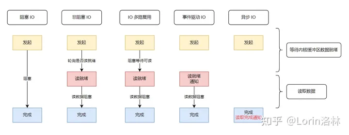
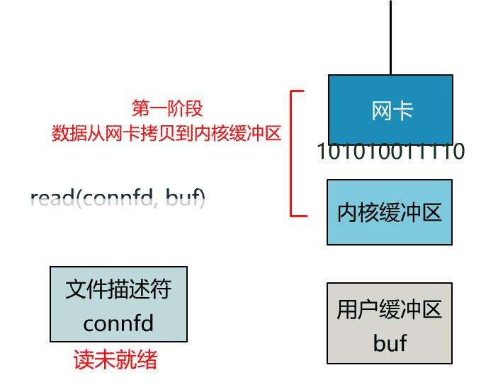
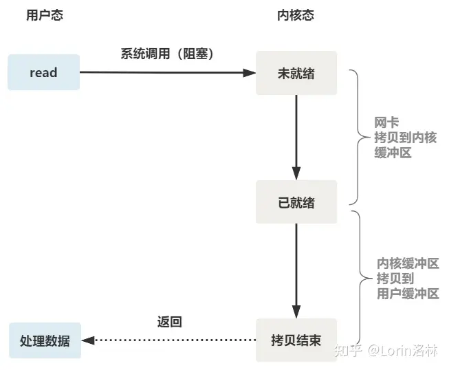
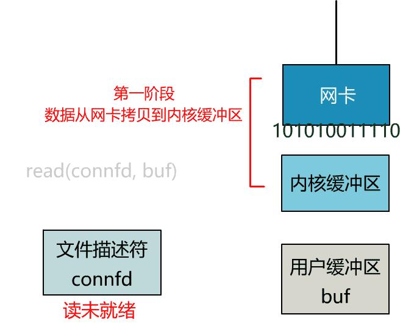
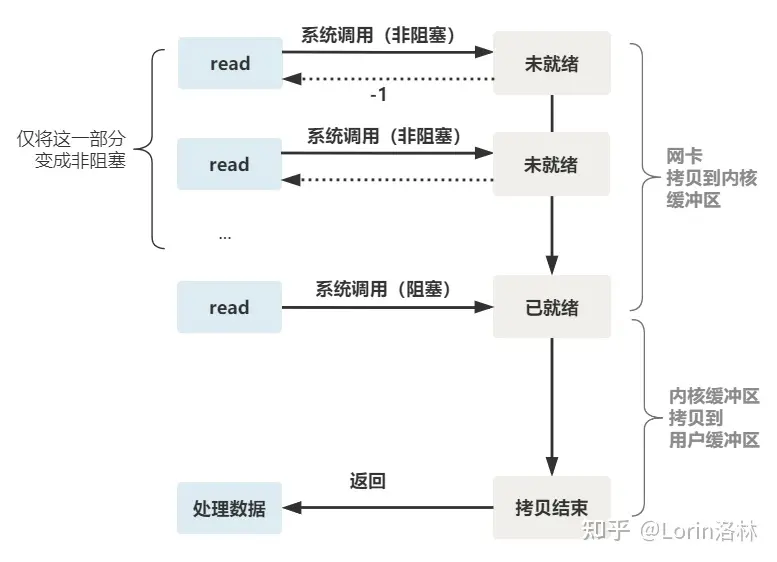
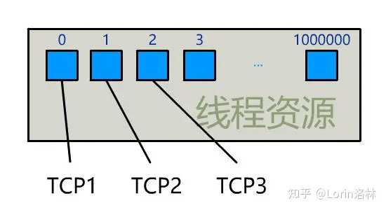
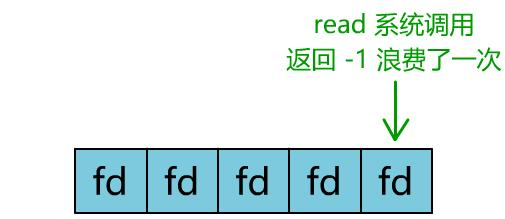
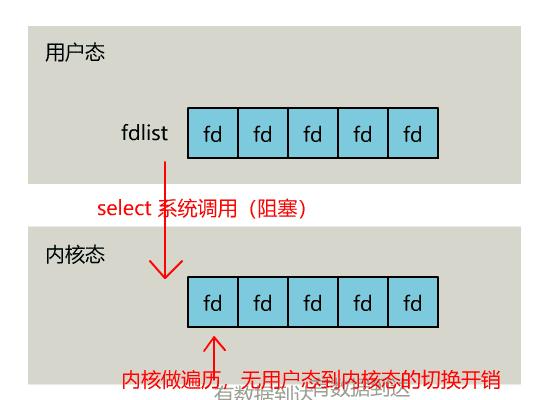
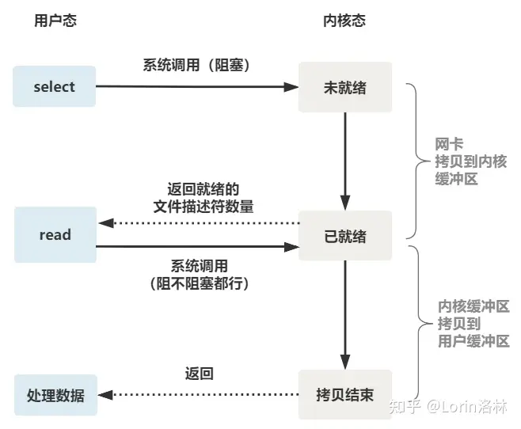
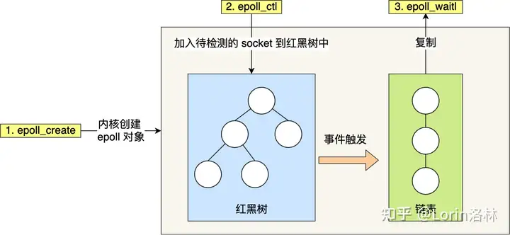

# IO模型

## 序言
+ 计算机编程中，IO模型是描述程序与输入/输出操作之间交互方式的抽象概念。不同的IO模型可以影响程序的性能、可扩展性和资源利用效率。我们常见有五种 IO 模型：阻塞式 IO、非阻塞式 IO 、IO 多路复用、信号驱动 IO、异步 IO。



## 阻塞式 IO
### 服务端如何处理客户端请求
+ 服务端为了处理客户端的连接和数据处理，可以按照以下伪代码实现:

```java
listenfd = socket(); // 打开一个网络通信套接字
bind(listenfd); // 绑定
listen(listenfd); // 监听
while(1) {
  connfd = accept(listenfd); // 阻塞 等待建立连接
 int n = read(connfd, buf); // 阻塞 读数据
  doSomeThing(buf); // 处理数据
  close(connfd); // 关闭连接
}
```

+ 从上面的伪代码中我们可以看出，服务端处理客户端的请求阻塞在两个地方，一个是 accept、一个是 read ，我们这里主要研究 read 的过程，可以分为两个阶段：等待读就绪（等待数据到达网卡 & 将网卡的数据拷贝到内核缓冲区）、读数据。



### 阻塞式 IO
+ 上述场景中，两个阶段都是阻塞的，这就是我们常说的阻塞式 IO :



## 非阻塞式 IO
### 伪非阻塞（多线程）
+ 为了让上面操作中的读操作 read 不在主线程中阻塞，我们可以使用多线程实现非阻塞：

```java
listenfd = socket(); // 打开一个网络通信套接字
bind(listenfd); // 绑定
listen(listenfd); // 监听
while(1) {
  connfd = accept(listenfd); // 阻塞 等待建立连接
  newThreadDeal(connfd) // 当有新连接建立时创建一个新线程处理连接
}

newThreadDeal(connfd){
 int n = read(connfd, buf); // 阻塞 读数据
  doSomeThing(buf); // 处理数据
  close(connfd); // 关闭连接 
}
```

### 真正的非阻塞式 IO
+ 伪非阻塞（多线程）实现方案只是创建多线程的方式，通过创建不同的线程来处理不同的连接从而避免主线程阻塞，但实际上子线程内部读操作 read 还是阻塞的，这只是用户层的小把戏。
+ 真正实现非阻塞式 IO 我们应该让操作系统提供一个非阻塞的 read() 函数，当第一阶段读未就绪时返回 -1 ，当读已就绪时才进行数据的读取。



```java
arr = new Arr[];
listenfd = socket(); // 打开一个网络通信套接字
bind(listenfd); // 绑定
listen(listenfd); // 监听
while(1) {
  connfd = accept(listenfd); // 阻塞 等待建立连接
  arr.add(connfd);
}

// 异步线程检测 连接是否可读
new Thread(){
 for(connfd : arr){
 // 非阻塞 read 最重要的是提供了我们在一个线程内管理多个文件描述符的能力
 int n = read(connfd, buf); // 检测 connfd 是否可读
 if(n != -1){
       newThreadDeal(buf); // 创建新线程处理
       close(connfd); // 关闭连接 
       arr.remove(connfd); // 移除已处理的连接
 }
 }
}

newThreadDeal(buf){
  doSomeThing(buf); // 处理数据
}
```

+ 从上面我们可以看出：所谓非阻塞 IO 只是将第一阶段的等待读就绪改为非阻塞，但是第二阶段的数据读取还是阻塞的，非阻塞 read 最重要的是提供了我们在一个线程内管理多个文件描述符的能力。
+ 非阻塞式 IO 流程图：



## IO 多路复用


上面服务端通过多线程的方式处理客户端请求实现了主线程的非阻塞，使用不同线程处理不同的连接请求，但是我们并没有那么多的线程资源，并且等待读就绪的过程是耗时最多的，那么有没有什么办法可以将连接保存起来，等读已就绪时我们再进行处理。

+ 基于非阻塞式 IO ，一些聪明的小伙伴可能会这样实现（即上文的示例）：

```java
arr = new Arr[];
listenfd = socket(); // 打开一个网络通信套接字
bind(listenfd); // 绑定
listen(listenfd); // 监听
while(1) {
  connfd = accept(listenfd); // 阻塞 等待建立连接
  arr.add(connfd);
}

// 异步线程检测 连接是否可读
new Thread(){
 for(connfd : arr){
 int n = read(connfd, buf); // 检测 connfd 是否可读
 if(n != -1){
       newThreadDeal(buf); // 创建新线程处理
       close(connfd); // 关闭连接 
       arr.remove(connfd); // 移除已处理的连接
 }
 }
}

newThreadDeal(buf){
  doSomeThing(buf); // 处理数据
}
```

+ 上面的实现看着很不错，但是却存在一个很大的问题，我们需要不断的调用 read() 进行系统调用，这里的系统调用我们可以理解为分布式系统的 RPC 调用，性能损耗十分严重，因为这依然是用户层的一些小把戏。



+ 这时我们自然而然就会想到把上述循环检测连接（文件描述符）可读的过程交给操作系统去做，从而避免频繁的进行系统调用。当然操作系统给我们提供了这样的函数：select、poll、epoll。

### select
+ select 是操作系统提供的系统函数，通过它我们可以将文件描述符发送给系统，让系统内核帮我们遍历检测是否可读，并告诉我们进行读取数据。



```java
arr = new Arr[];
listenfd = socket(); // 打开一个网络通信套接字
bind(listenfd); // 绑定
listen(listenfd); // 监听
while(1) {
  connfd = accept(listenfd); // 阻塞 等待建立连接
  arr.add(connfd);
}

// 异步线程检测 通过 select 判断是否有连接可读
new Thread(){
 while(select(arr) > 0){
 for(connfd : arr){
 if(connfd can read){
 // 如果套接字可读 创建新线程处理
        newThreadDeal(connfd);
        arr.remove(connfd); // 移除已处理的连接
 }
 }
 }
}

newThreadDeal(connfd){
 int n = read(connfd, buf); // 阻塞读取数据
    doSomeThing(buf); // 处理数据
    close(connfd); // 关闭连接 
}
```

+ 从上面我们可以看出 select 运行的整个流程：



#### 减少大量系统调用但也存在一些问题
+ 每次调用需要在用户态和内核态之间拷贝文件描述符数组，但高并发场景下这个拷贝的消耗是很大的。
+ 内核检测文件描述符可读还是通过遍历实现，当文件描述符数组很长时，遍历操作耗时也很长。
+ 内核检测完文件描述符数组后，当存在可读的文件描述符数组时，用户态需要再遍历检测一遍。

### poll
+ poll 和 select 原理基本一致，最大的区别是去掉了最大 1024 个文件描述符的限制。
+ select 使用固定长度的 BitsMap，表示文件描述符集合，而且所支持的文件描述符的个数是有限制的，在 Linux 系统中，由内核中的 FD_SETSIZE 限制， 默认最大值为 1024，只能监听 0~1023 的文件描述符。
+ poll 不再用 BitsMap 来存储所关注的文件描述符，取而代之用动态数组，以链表形式来组织，突破了 select 的文件描述符个数限制，当然还会受到系统文件描述符限制。

### epoll
+ 大家还记得上面 select/poll 存在的三个问题？epoll 主要优化了上面三个问题实现。

```java
- 每次调用需要在用户态和内核态之间拷贝文件描述符数组，但高并发场景下这个拷贝的消耗是很大的。
方案：内核中保存一份文件描述符，无需用户每次传入，而是仅同步修改部分。

- 内核检测文件描述符可读还是通过遍历实现，当文件描述符数组很长时，遍历操作耗时也很长。
方案：通过事件唤醒机制唤醒替代遍历。

- 内核检测完文件描述符数组后，当存在可读的文件描述符数组时，用户态需要再遍历检测一遍。
方案：仅将可读部分文件描述符同步给用户态，不需要用户态再次遍历。
```

+ epoll 基于高效的红黑树结构，提供了三个核心操作，主要流程如下所示：



+ 伪代码：

```java
listenfd = socket(); // 打开一个网络通信套接字
bind(listenfd); // 绑定
listen(listenfd); // 监听
int epfd = epoll_create(...); // 创建 epoll 对象
while(1) {
  connfd = accept(listenfd); // 阻塞 等待建立连接
  epoll_ctl(connfd, ...); // 将新连接加入到 epoll 对象
}

// 异步线程检测 通过 epoll_wait 阻塞获取可读的套接字
new Thread(){
 while(arr = epoll_wait()){
 for(connfd : arr){
 // 仅返回可读套接字
        newThreadDeal(connfd);
 }
 }
}

newThreadDeal(connfd){
 int n = read(connfd, buf); // 阻塞读取数据
    doSomeThing(buf); // 处理数据
    close(connfd); // 关闭连接 
}
```

### 边缘触发和水平触发
+ select/poll 只有水平触发模式，epoll 支持两种事件触发模式，分别是边缘触发（edge-triggered，ET）和水平触发（level-triggered，LT），epoll 默认的触发模式是水平触发。

#### 边缘触发
+ 使用边缘触发模式时，当被监控的 Socket 描述符上有可读事件发生时，服务器端只会从 epoll_wait 中苏醒一次，即使进程没有调用 read 函数从内核读取数据，也依然只苏醒一次，因此我们程序要保证一次性将内核缓冲区的数据读取完。

#### 水平触发
+ 使用水平触发模式时，当被监控的 Socket 上有可读事件发生时，服务器端不断地从 epoll_wait 中苏醒，直到内核缓冲区数据被 read 函数读完才结束，目的是告诉我们有数据需要读取。

## 事件驱动 IO
+ 发起读请求后，等待读就绪事件通知再进行数据读取。

## 异步 IO
+ 发起读请求后，等待操作系统读取完成后通知，完全将功能交给操作系统实现。

## 总结
+ IO 分为等待读就绪和读取数据两个阶段，阻塞和非阻塞指的是等待读就绪阶段。
+ IO 模型发展从阻塞 read 函数开始，它整个过程都是阻塞的，为了解决这个问题，我们在用户态通过异步线程实现主线程的非阻塞，但是子线程的 read 过程还是阻塞的，但是线程资源是有限的，且等待读就绪的过程是耗时最多的环节，因此我们在一个线程内通过 while 和非阻塞 read 的能力避免等待读就绪过程中线程资源占用，后来操作系统发现这个场景比较多，便提供了 select、poll、epoll 函数实现上述功能来减少系统调用。我们会发现，包括后面的异步 IO 我们其实是把更多的功能交给了操作系统实现。
+ 比如大家常说的 IO 多路复用效率之所以高是因为可以通过一个线程管理多个文件描述符，当然这也是其中一个原因，另外一个原因是因为减少了大量的系统调用。
