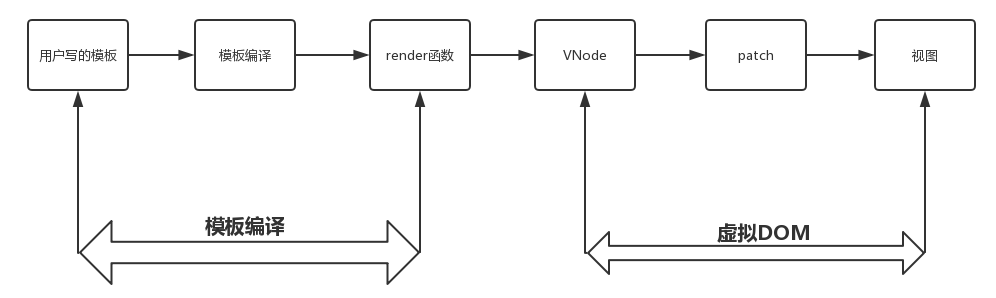

# Vue源码系列

## 变化侦测篇
```javascript
let car = {}
let val = 3000
Object.defineProperty(car, 'price', {
  enumerable: true,
  configurable: true,
  get(){
    console.log('price属性被读取了')
    return val
  },
  set(newVal){
    console.log('price属性被修改了')
    val = newVal
  }
})
```

### 依赖收集
下面我们分析Watcher类的代码实现逻辑：

1. 当实例化Watcher类时，会先执行其构造函数；
2. 在构造函数中调用了this.get()实例方法；
3. 在get()方法中，首先通过window.target = this把实例自身赋给了全局的一个唯一对象window.target上，然后通过let value = this.getter.call(vm, vm)获取一下被依赖的数据，获取被依赖数据的目的是触发该数据上面的getter，上文我们说过，在getter里会调用dep.depend()收集依赖，而在dep.depend()中取到挂载window.target上的值并将其存入依赖数组中，在get()方法最后将window.target释放掉。
4. 而当数据变化时，会触发数据的setter，在setter中调用了dep.notify()方法，在dep.notify()方法中，遍历所有依赖(即watcher实例)，执行依赖的update()方法，也就是Watcher类中的update()实例方法，在update()方法中调用数据变化的更新回调函数，从而更新视图。

## 虚拟DOM篇
所谓虚拟DOM，就是用js对象描述一个DOM节点

```javascript
<div class="a" id="b">我是内容</div>

{
  tag:'div',        // 元素标签
  attrs:{           // 属性
    class:'a',
    id:'b'
  },
  text:'我是内容',  // 文本内容
  children:[]       // 子元素
}
```

### Vue中的DOM-Diff
+ 创建节点：新的VNode中有而旧的oldVNode中没有，就在旧的oldVNode中创建。
+ 删除节点：新的VNode中没有而旧的oldVNode中有，就从旧的oldVNode中删除。
+ 更新节点：新的VNode和旧的oldVNode中都有，就以新的VNode为准，更新旧的oldVNode

## 模板编译篇
所有属性最终都会被绑定到实例上，这也就是我们为什么可以使用this.xxx来访问任意属性。同时正是因为这一点，这5个选项中的所有属性名都不应该有所重复，这样会造成属性之间相互覆盖。



### 抽象语法树AST
## 生命周期篇
```javascript
export function initMixin (Vue) {
  Vue.prototype._init = function (options) {
    const vm = this
    vm.$options = mergeOptions(
        resolveConstructorOptions(vm.constructor),
        options || {},
        vm
    )
    vm._self = vm
    initLifecycle(vm)       // 初始化生命周期
    initEvents(vm)        // 初始化事件
    initRender(vm)         // 初始化渲染
    callHook(vm, 'beforeCreate')  // 调用生命周期钩子函数
    initInjections(vm)   //初始化injections
    initState(vm)    // 初始化props,methods,data,computed,watch
    initProvide(vm) // 初始化 provide
    callHook(vm, 'created')  // 调用生命周期钩子函数

    if (vm.$options.el) {
      vm.$mount(vm.$options.el)
    }
  }
}
```

### callHook函数如何触发钩子函数
```javascript
export function callHook (vm: Component, hook: string) {
  const handlers = vm.$options[hook]
  if (handlers) {
    for (let i = 0, j = handlers.length; i < j; i++) {
      try {
        handlers[i].call(vm)
      } catch (e) {
        handleError(e, vm, `${hook} hook`)
      }
    }
  }
}
```

```javascript
export function updateComponentListeners (
  vm: Component,
  listeners: Object,
  oldListeners: ?Object
) {
  target = vm
  updateListeners(listeners, oldListeners || {}, add, remove, vm)
  target = undefined
}

function add (event, fn, once) {
  if (once) {
    target.$once(event, fn)
  } else {
    target.$on(event, fn)
  }
}

function remove (event, fn) {
  target.$off(event, fn)
}
```

## 全局API篇
### Vue.nextTick
在下次 DOM 更新循环结束之后执行延迟回调。在修改数据之后立即使用这个方法，获取更新后的 DOM。
