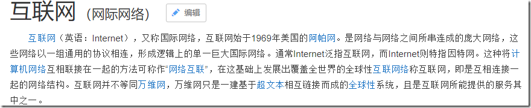
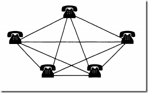
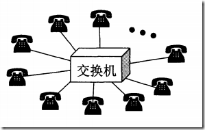
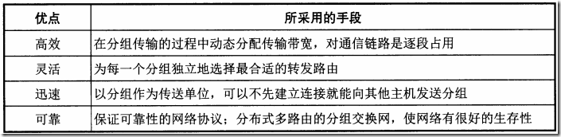
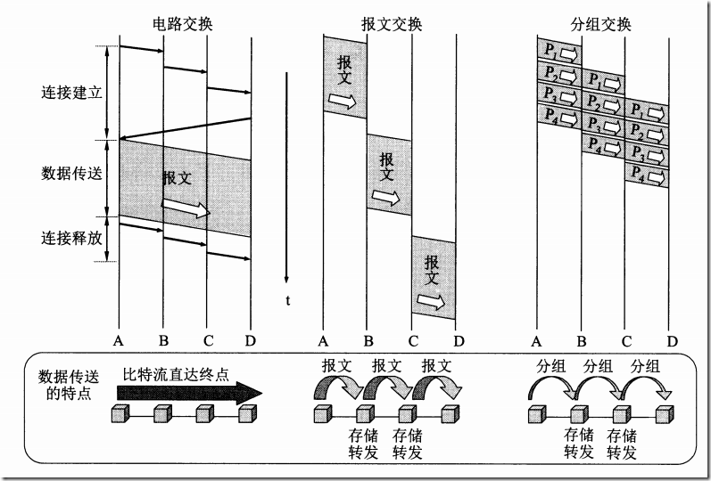
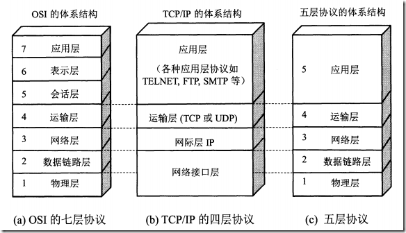
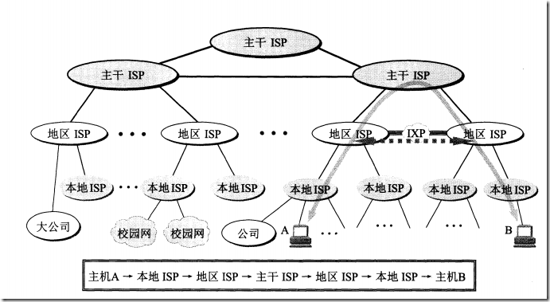
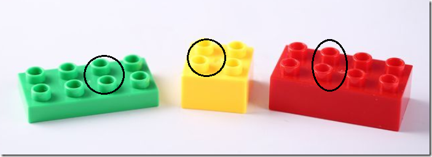

# 网络发展史

"上网"这个有些口语化的词汇，想必没人会觉得陌生，可是"网"到底是什么？

原文地址:[计算机网络起源 网络发展简介（一）](https://www.cnblogs.com/noteless/p/10218446.html#9)

## 互联网概念

截图自百度百科：[https://baike.baidu.com/item/%E4%BA%92%E8%81%94%E7%BD%91/199186](https://baike.baidu.com/item/%E4%BA%92%E8%81%94%E7%BD%91/199186)

**互联网发展编年史**

互联网发展史是从20世纪50年代到90年代，按编年体的形式，详细历数了互联网一步步走向成熟的发展过程，由美国国防部编制。

百度百科链接：

[https://baike.baidu.com/item/%E4%BA%92%E8%81%94%E7%BD%91%E5%8F%91%E5%B1%95%E5%8F%B2/4635625](https://baike.baidu.com/item/%E4%BA%92%E8%81%94%E7%BD%91%E5%8F%91%E5%B1%95%E5%8F%B2/4635625)

*图：互联网发展关键节点时间线（示意）*

<svg xmlns="http://www.w3.org/2000/svg" viewBox="0 0 720 180" font-family="'Microsoft YaHei','PingFang SC',sans-serif">
  <defs>
    <marker id="arw" markerWidth="8" markerHeight="8" refX="7" refY="3" orient="auto">
      <path d="M0,0 L7,3 L0,6 Z" fill="#94a3b8"/>
    </marker>
  </defs>
  <rect x="10" y="40" width="110" height="86" rx="8" fill="#eff6ff" stroke="#2563eb" stroke-width="1.5"/>
  <text x="65" y="62" text-anchor="middle" font-size="14" font-weight="bold" fill="#1e293b">1957</text>
  <text x="65" y="84" text-anchor="middle" font-size="12" fill="#475569">苏联发射Sputnik</text>
  <text x="65" y="102" text-anchor="middle" font-size="12" fill="#475569">美国组建ARPA</text>
  <line x1="120" y1="83" x2="128" y2="83" stroke="#94a3b8" stroke-width="1.5" marker-end="url(#arw)"/>
  <rect x="128" y="40" width="110" height="86" rx="8" fill="#fffbeb" stroke="#d97706" stroke-width="1.5"/>
  <text x="183" y="62" text-anchor="middle" font-size="14" font-weight="bold" fill="#1e293b">1969</text>
  <text x="183" y="84" text-anchor="middle" font-size="12" fill="#475569">阿帕网四节点</text>
  <text x="183" y="102" text-anchor="middle" font-size="12" fill="#475569">正式投入运行</text>
  <line x1="238" y1="83" x2="246" y2="83" stroke="#94a3b8" stroke-width="1.5" marker-end="url(#arw)"/>
  <rect x="246" y="40" width="110" height="86" rx="8" fill="#eff6ff" stroke="#2563eb" stroke-width="1.5"/>
  <text x="301" y="62" text-anchor="middle" font-size="14" font-weight="bold" fill="#1e293b">1970</text>
  <text x="301" y="84" text-anchor="middle" font-size="12" fill="#475569">NCP</text>
  <text x="301" y="102" text-anchor="middle" font-size="12" fill="#475569">网络控制协议</text>
  <line x1="356" y1="83" x2="364" y2="83" stroke="#94a3b8" stroke-width="1.5" marker-end="url(#arw)"/>
  <rect x="364" y="40" width="110" height="86" rx="8" fill="#eff6ff" stroke="#2563eb" stroke-width="1.5"/>
  <text x="419" y="62" text-anchor="middle" font-size="14" font-weight="bold" fill="#1e293b">1973</text>
  <text x="419" y="84" text-anchor="middle" font-size="12" fill="#475569">卡恩、瑟夫</text>
  <text x="419" y="102" text-anchor="middle" font-size="12" fill="#475569">开始设计 TCP/IP</text>
  <line x1="474" y1="83" x2="482" y2="83" stroke="#94a3b8" stroke-width="1.5" marker-end="url(#arw)"/>
  <rect x="482" y="40" width="110" height="86" rx="8" fill="#eff6ff" stroke="#2563eb" stroke-width="1.5"/>
  <text x="537" y="62" text-anchor="middle" font-size="14" font-weight="bold" fill="#1e293b">1983</text>
  <text x="537" y="80" text-anchor="middle" font-size="12" fill="#475569">NCP 停用</text>
  <text x="537" y="96" text-anchor="middle" font-size="12" fill="#475569">TCP/IP 成为</text>
  <text x="537" y="112" text-anchor="middle" font-size="12" fill="#475569">因特网共同协议</text>
  <line x1="592" y1="83" x2="600" y2="83" stroke="#94a3b8" stroke-width="1.5" marker-end="url(#arw)"/>
  <rect x="600" y="40" width="110" height="86" rx="8" fill="#f0fdf4" stroke="#16a34a" stroke-width="1.5"/>
  <text x="655" y="62" text-anchor="middle" font-size="14" font-weight="bold" fill="#1e293b">1984</text>
  <text x="655" y="80" text-anchor="middle" font-size="12" fill="#475569">美国国防部将</text>
  <text x="655" y="96" text-anchor="middle" font-size="12" fill="#475569">TCP/IP 作为</text>
  <text x="655" y="112" text-anchor="middle" font-size="12" fill="#475569">计算机网络标准</text>
  <text x="360" y="160" text-anchor="middle" font-size="12" fill="#475569">阿帕网是开端，形成了以IP为标识，以线路为联通，以网络设备为中介，以协议为纲领的计算机网络</text>
</svg>

## ARPANET（阿帕）

**互联网始于1969年美国的"阿帕网"**

"阿帕网"又是什么？"阿帕"（ARPA），是美国高级研究计划署（Advanced  Research  Project  Agency）的简称。

1957 苏联发射了人类第一颗人造地球卫星Sputnik。作为响应，美国国防部(DoD)组建了高级研究计划局(ARPA)，开始将科学技术应用于军事领域 。他的核心机构之一是信息处理处（IPTO  Information  Processing  Techniques  Office），一直在关注电脑图形、网络通讯、超级计算机等研究课题。

在美国，20世纪60年代是一个很特殊的时代。60年代初，古巴核导弹危机发生，美国和原苏联之间的冷战状态随之升温，核毁灭的威胁成了人们日常生活的话题。在美国对古巴封锁的同时，越南战争爆发，许多第三世界国家发生政治危机。由于美国联邦经费的刺激和公众恐惧心理的影响，"实验室冷战"也开始了。鉴于此，**苏联发射卫星与成立ARPA的直接关系应该很容易理解**。

1962年，J.C.R.Licklider离开MIT，加入ARPA，并在后来成为IPTO的首席执行官。也就是他在任期间将办公室名称从命令控制研究（Command  and  Control  Research）改为IPTO。也就是在他任职期间，据估计，**整个美国计算机科学领域研究的70%由ARPA赞助**。在许多人看来与一个严格意义上的军事机构相去甚远，并给许多研究者自由领域来实验。结果ARPA不仅成为网络诞生地，同样也是电脑图形、平行过程、计算机模拟飞行等重要成果的诞生地。

约瑟夫·利克莱德是全球互联网公认的开山领袖之一，是麻省理工学院(MIT)的心理学和人工智能专家J.C.R.Licklider(约瑟夫·利克莱德)教授。

## 阿帕网起源

美国国防部认为：如果仅有一个集中的军事指挥中心，万一这个中心被原苏联的核武器摧毁，全国的军事指挥将处于瘫痪状态，其后果将不堪设想。因此有必要设计这样一个分散的指挥系统——它由一个个分散的指挥点组成，当部分指挥点被摧毁后其它点仍能正常工作，而这些分散的点又能通过某种形式的通讯网取得联系。

以上来自于百度百科中阿帕网词条的释义

[https://baike.baidu.com/item/arpanet/3562284?fr=aladdin](https://baike.baidu.com/item/arpanet/3562284?fr=aladdin)

1964年伊凡·沙日尔兰德（Ivan  Sutherland）继任担任该处处长。两年后的鲍勃·泰勒（Bob  Taylor）上任，他在任职期间萌发了新型计算机网络的想法，并筹集资金启动试验。在鲍勃·泰勒的一再邀请下，日后成为"阿帕网之父"的拉里·罗伯茨出任信息处理处处长。

1967年，罗伯茨来到高级研究计划署ARPA，着手筹建"分布式网络"。人员调度和工程设计很顺利，不到一年，就提出阿帕网的构想。1968年，罗伯茨提交研究报告《资源共享的计算机网络》，其中着力阐发的就是让"阿帕"的电脑达到互相连接，从而使大家分享彼此的研究成果。根据这份报告组建的国防部"高级研究计划网"，就是著名的"阿帕网"，**拉里·罗伯茨也就成为"阿帕网之父"**。

## 分组交换的发展

1948年 **香农** 在 《通信的数学理论》中写道: 通信的基本问题是在一点精确地或者近似的复现在另一个点所选取的讯息,这些讯息往往都是有意义的 。

通信的本质是数据交换，只有实现了数据的交换，才能证明线路的连通性。从电话发明之初，人们就发现想要所有的电话机都进行两两连接是不现实的，因为这种方式的电路连接将需要大量的电话线。

于是人们借助于电话交换机将电话连接起来，每一部电话都连接到交换机上。电路交换机使用交换的方法，让电话用户彼此之间进行通信。

在使用电路交换前，必须先拨号请求连接，当被叫用户接收到交换机送来的振铃声，并接听时，主叫端到被叫端就建立起来了一条连接，也就是一条专用的物理通路，这条连接保证了双方通话需要的所有资源，这些资源在双方通信时不会被其他用户占用。这种必须经过"建立连接"（占用资源）--->"通话"（一直占用资源）--->"释放连接"（释放资源）三个步骤的交换方式称之为**电路交换**。

**通话的全部时间内，通话的两个用户始终占用端到端的通信资源。电路交换的实时性好，稳定性高，但是由于通话双方独占通信资源，线路的利用率很低。**

再后来出现了**分组交换**。学术界公认分组交换技术是英国人Donald Watts Davies(唐纳德·戴维斯)和美国人Paul Baran(保罗·巴兰)在20世纪60年代早期分别独立发明的。**分组交换采取存储转发技术**。通常把要发送的整块数据称之为一个报文，在发送报文之前，把一个报文划分为几个分组后再进行传送。在传送数据之前，**不需要提前建立连接，也不会持续占用通信链路**，在哪段链路传输，就占用哪段的资源。

其实从本质上讲，分组交换这种分段存储转发原理并不是全新的理念。自古就有邮政通信，本质理念也是存储转发，而且，电报通信也是基于存储转发原理。在交换中心，一份完整的报文被全部接收后，再进行转发，这就叫做报文交换。

- **电路交换**—**整个报文的比特流连续地从源点直达终点，好像在一个管道中传送。**
- **报文交换**—**整个报文先传送到相邻结点，全部存储下来后查找转发表，转发到下一个结点。**
- **分组交换**—**单个分组(这只是整个报文的一部分)传送到相邻结点，存储下来后查找转发表，转发到下一个结点。**

## 阿帕网的连接实现

既然提出了阿帕网的构想，那么下一步就是进行实现。阿帕网是建立在"**包交换理论**"基础之上的一个去中心化的，或者叫做分布式的网络系统（DistributedNetworks）。

最初的阿帕网有四个节点：洛杉矶的加利福尼亚州大学洛杉矶分校、加州大学圣巴巴拉分校、斯坦福大学、犹他州大学四所大学的4台大型计算机。ARPA网采用两类通信处理机：交换处理机(IMP)和终端交换处理机(TIP)，**IMP其实就是路由器的前身**。

1968年 Bolt Beranek and Newman、Inc.公司(**BBN**)获得建立**接口消息处理机(IMP)**中的包交换部分的合同。IMP是一种专用于通信的计算机，有些IMP之间直接相连，有些IMP之间必须经过其他的IMP间接相连。当IMP收到一个报文后要根据报文的目标地址决定把该报文提交给与它相连的主机还是转发到下一个IMP，这种通信方式叫做存储-转发通信。

1969年 使用BBN公司开发的接口消息处理器IMP建立节点(配有12K存储器的Honeywell DDP-516小型计算机)；AT&T公司提供速率为50kbps的通信线路。总之最初的阿帕网就是这四个节点，通过通信处理机和通信链路构成的一个"局域网"。

1969年底，阿帕网正式投入运行。从军事要求上是置于美国国防部高级机密的保护之下，从技术上它还不具备向外推广的条件。

## 通信协议

在阿帕网（ARPA）产生运作之初，通过接口信号处理机实现互联的电脑并不多，大部分电脑相互之间不兼容。在一台电脑上完成的工作，很难拿到另一台电脑上去用，想让硬件和软件都不一样的电脑联网，也有很多困难。当时美国的状况是：陆军用的电脑是DEC系列产品，海军用的电脑是Honeywell中标机器，空军用的是IBM公司中标的电脑。每一个军种的电脑在各自的系里都运行良好，但却有一个大弊病：**不能共享资源**。

正是因为底层软硬件之间的差异，所以才需要一个适用于网络传输的统一的规则。也就是不管有何差别，只要大家遵循统一的网络通信协议，就能够实现通信。

1970年12月制定出来了最初的通信协议---由卡恩开发、瑟夫参与的"网络控制协议"（NCP）。

卡恩  Bob Kahn  [https://en.wikipedia.org/wiki/Bob_Kahn](https://en.wikipedia.org/wiki/Bob_Kahn)

在自己研究的基础上，认识到只有深入理解各种操作系统的细节才能建立一种对各种操作系统普适的协议。73年卡恩请 瑟夫Vint Cerf [https://en.wikipedia.org/wiki/Vint_Cerf](https://en.wikipedia.org/wiki/Vint_Cerf)一起考虑这个协议的各个细节。

他们这次合作的结果产生了在开放系统下的所有网民和网管人员都在使用的"传输控制协议"（TCP，Transmission-Control Protocol）和"因特网协议"（IP，Internet Protocol）。也就是TCP/IP协议，也就是至今为人们所熟知的TCP、IP。这个体系结构在它的两个主要协议出现以后被称为TCP/IP参考模型(TCP/IP Reference Model)。

这一网络协议共分为四层：网络接口层、互联网层、传输层和应用层。**TCP/IP不是一个协议，而是一个协议族的统称**。

1983年1月1日，运行较长时期曾被人们习惯了的NCP被停止使用，**TCP/IP协议作为因特网上所有主机间的共同协议，从此以后被作为一种必须遵守的规则被肯定和应用**。1984年，美国国防部将TCP/IP作为所有计算机网络的标准。

## IP地址

TCP/IP有四个版本被开发出来——TCP v1、TCP v2、在1978年春天分成TCP v3和IP v3的版本，后来就是稳定的TCP/IP v4——因特网仍然使用的标准协议。IPv4，是互联网协议（Internet Protocol，IP）的第四版，也是第一个被广泛使用，构成现今互联网技术的基石的协议。1981年Jon Postel 在RFC791中定义了IP。

IP地址被用来给Internet上的电脑一个编号。大家日常见到的情况是每台联网的PC上都需要有IP地址，才能正常通信。IP地址（英语：Internet Protocol Address）是一种在Internet上的给主机编址的方式，也称为网络协议地址。

常见的IP地址，分为IPv4与IPv6两大类。简言之就是一串数字标识一个网络上的主机。**IP地址是计算机网络世界中，如同现实世界中门牌号地址一般的存在**。

## RFC

Request for comments  请求评论，是一系列以编号排定的文件。RFC文件格式最初作为ARPA网计划的基础起源于1969年。如今，它已经成为IETF、Internet Architecture Board (IAB）还有其他一些主要的公共网络研究社区的正式出版物发布途径。这是互联网标准化的工作相关的文件。

在Internet上，任何一个用户都可以对Internet某一领域的问题提出自己的解决方案或规范，作为Internet草案。目前有以下两个阶段：

- 建议标准(Proposed Standard)—从这个阶段开始就成为RFC文档
- 互联网标准(Internet Standard)—达到正式标准后，每个标准就分配到一个编号

RFC文件只有新增，不会有取消或中途停止发行的情形。但是对于同一主题而言，新的RFC文件可以声明取代旧的RFC文件。简言之，**RFC就是互联网标准的讨论以及最终确定的会议记录**。

## 分层的网络结构

相互通信的计算机必须高度协调才能够进行通信，仅仅一条线路是不可能的。为了处理这些复杂的网络问题，早在最初的阿帕网中，就提出了分层的方法。分层将庞大复杂的问题，转换成若干个局部较小的问题，较小的问题就更加易于研究分析。

比如，唐僧取经，西天路途遥远，如果整体的看待出行问题，势必非常复杂。如果将整条路拆分为多个小段，这一段适合坐船，那一段适合骑马，这样就能够更好地解决问题。

通过分层，各层之间相互独立，整体功能进行分解，每层实现独立功能。灵活性很好，易于实现和维护，当一层发生变化，不会影响另一层，只要他们之间的协作接口不变。**其实就是软件开发中的解耦**。

关于通信协议的分层，有下面三种形式。其实只有中间的TCP、IP是有用的。OSI理论虽然很完备，但是没有赶上互联网的发展，而且实现过于复杂。**TCP/IP协议才是真正使用的协议**。第三个则是一般的教科书中为了研究学习,结合两者"造"出来的一种层次结构。

## 现代网络

从上面的简单介绍可以看得出来，为什么说互联网始于阿帕网了。阿帕网借助于通信处理机以及通信链路，通过TCP/IP协议进行数据传输，形成了现代计算机发展的雏形。

现在的计算机网络，从当初的阿帕网已经发展到世界上最大的覆盖全球的计算机网络了，是一个多层次的ISP结构的互联网。ISP 互联网服务提供者 Internet Service Provider。

网络互连，需要借助于通信链路以及路由器(通信处理机的今生)，此时此刻的你与大洋彼岸的另一台电脑主机之间，中间隔着很多的通信链路。这些网络设备都是需要费用和维护的，所以就催生出来了ISP（最初互联网是由政府管理的）。比如，中国电信，中国移动，中国联通。

所有的用户主机属于网络的边缘部分，大量的网络和连接网络的路由器构成了互联网的核心部分，ISP就是管理维护了这些核心部分，为边缘部分提供网络的联通以及交换。

简单地说就是，终端主机通过路由器与其他的终端进行连接，形成网络，网络与网络之间又通过路由器或者其他网络设备进行连接。就这样，**网络，网络的网络，网络的网络的网络........就形成了目前世界上最大的覆盖全球的互联网**。

## 小结

本文介绍了网络发展的最初动机、起源，对阿帕网简单地进行了介绍，并且就网络中的一些概念进行了简单的介绍。从最初的几台计算机，借助于接口消息处理机，然后通过通信线路以及一些软件，实现了最原始的网络互连，此后是在此基础上不断地发展的。

计算机网络互连的发展并不是一蹴而就的，而是在实现中不断完善的，理论也是在实际中不断成熟起来的，计算机网络的发展绝对不存在某些学科中从"成熟的理论"到"完美的实践"这种过程。

计算机网络是基于分组交换的，通过设备连接起来的一个个局域网，又借助于设备相互连接，构成了如今的网络（注：本文的网络侧重于网络的联通，而不是指常说的web）。分组交换是通信抽象的根本，借助于分层的设计理念，在不同的层次可以使用最合适的技术进行联通。

从网卡、驱动、计算机、操作系统，到出口路由器，交换机等等整个通信过程中所有的过程全部都是以分组交换为基础，然后以网络协议为契约，整个线路的联通以及数据的正确交换，每一段线路（范围）以及运行的协议，就如同积木的每一块以及其上的卡扣一样，一环扣一环紧密的结合在一起，组装成了通信的线路。

计算机网络的实现细节纵然很复杂，但是他想要完成的目标是很简单的，**就是分组将数据从一个位置借助于网络转移到另一个位置**。就好比有序的十个包裹，从南京到北京，经过无数个快递员的手，大家都按照约定好的规则，默默地干活，最终成功的将包裹发送到收件人手中。

如下图所示，每个积木模块相当于计算机、网络设备，积木模块上的凸起卡扣，相当于网线、网络协议。

类似地铁的修建，有"洞通"、"轨通"、"电通"、"车通"等步骤。计算机通过设备进行连接实现了物理上的连接，但是想要实现数据交互传递，还需要协议的实现。有路有车（计算机、网线、网络设备），并不代表快递公司就可以正常运转，还需要良好的运行规范步骤（各种协议）。

所以，想要了解计算机网络，就是要了解到底有多少块积木，每个积木的连接方式。而对于网络中的协议，现代计算机网络一套成熟的协议体系就是TCP/IP协议族，协议族指的是一族，而不是一个。

**阿帕网是开端，形成了以IP为标识，以线路为联通，以网络设备为中介，以协议为纲领的计算机网络**。**网络的发展又依赖于RFC不断地标准规范**。

最后附上一张照片，克劳德·艾尔伍德·香农（Claude Elwood Shannon ，1916年4月30日—2001年2月24日）。作为CS学科的人，你不应该不认识他，他对计算机的发展有巨大贡献，信息论及数字通信时代的奠基人。

