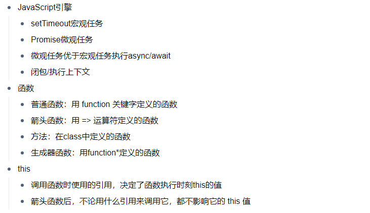
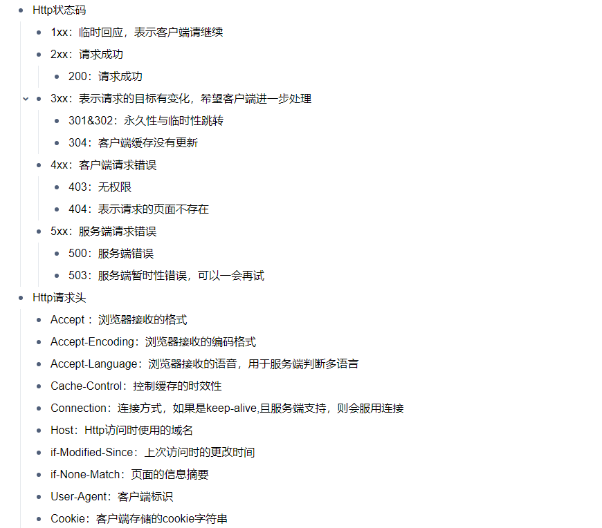

# 重学前端winter

## 03.JavaScript对象分类
 

## 04.JavaScript执行

## 05.CSS语法@规则
+ @charset CSS 文件使用的字符编码
+ @import 用于引入一个 CSS 文件
+ @media 能够对设备的类型进行一些判断
+ @page  用于分页媒体访问网页时的表现设置
+ @counter-style 用于定义列表项的表现
+ @key-frames 用于定义动画关键帧
+ @fontface 用于定义一种字体
+ @support 检查环境的特性
+ @namespace 用于跟 XML 命名空间配合的一个规则
+ @viewport 用于设置视口的一些特性

## 06.复杂选择器连接符
+ 空格 后代
+  子代
+ ~      后继
+ +      直接后继
+ ||      列选择器

## 07.浏览器实现原理

