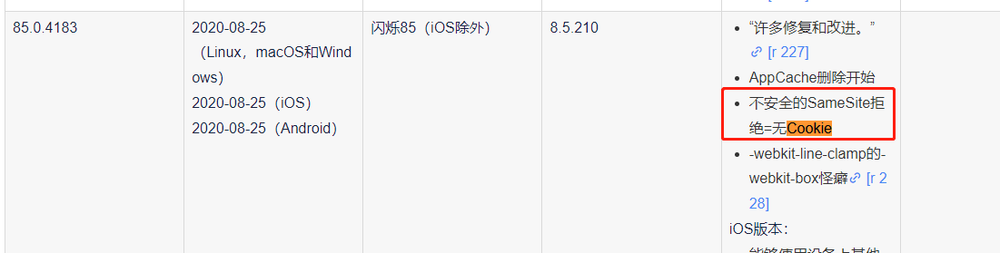
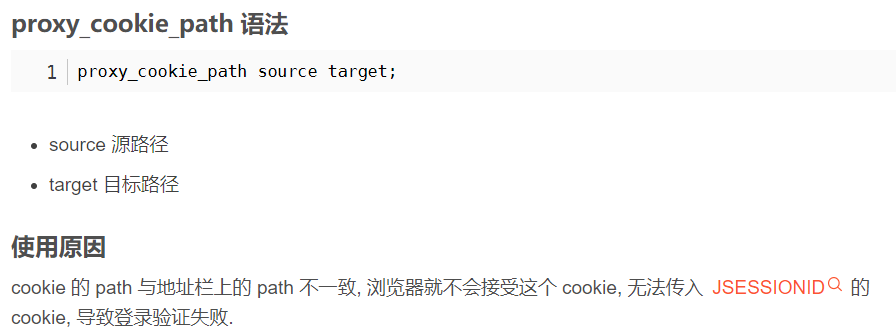

# 浏览器cookie理解

chrome浏览器由于安全机制的考虑，有时候会拒绝cookie的写入，具体情况有

1. 使用https域名访问，**正常**
2. 使用http域名访问，**异常**
3. 使用ip地址访问，**正常**
4. 跨域访问,**异常**

**浏览器**与后端接口交互获取cookie时，只要是相同域名或者ip的就都可以获取，不区分端口，但是区分路径

如果是/，则所有路径都获取该cookie。

## nginx的cookie理解

**为了确保可以获取到OOO_SSO_TOKEN则需要设置portal的cookie为/；**

**各模式的cookie还是为各模式；/w_1008_mg  /w_1008_mg**
