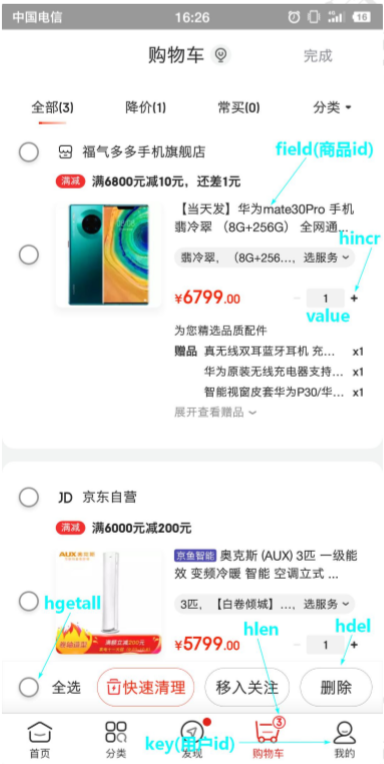
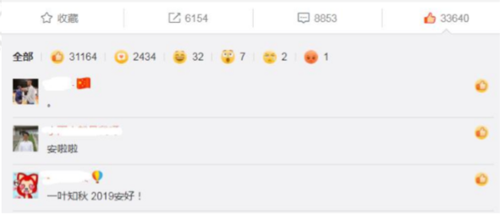
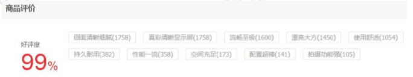
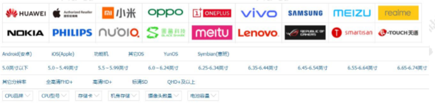
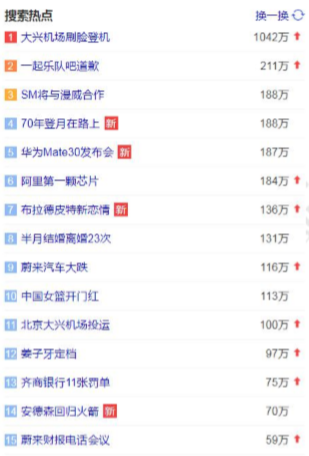

# Redis 常见使用场景

[**阅读原文**](https://mp.weixin.qq.com/s/sVksgUKNL_d70L1Vm_T9hA)

**目录**

+ 缓存
+ 数据共享分布式
+ 分布式锁
+ 全局ID
+ 计数器
+ 限流
+ 位统计
+ 购物车
+ 用户消息时间线timeline
+ 消息队列
+ 抽奖
+ 点赞、签到、打卡
+ 商品标签
+ 商品筛选
+ 用户关注、推荐模型
+ 排行榜

## **1、缓存**
String类型

例如：热点数据缓存（例如报表、明星出轨），对象缓存、全页缓存、可以提升热点数据的访问速度。

## **2、数据共享分布式**
String 类型，因为 Redis 是分布式的独立服务，可以在多个应用之间共享

例如：分布式Session

```plain
<dependency> 
 <groupId>org.springframework.session</groupId> 
 <artifactId>spring-session-data-redis</artifactId> 
</dependency>
```

## **3、分布式锁**
String 类型setnx方法，只有不存在时才能添加成功，返回true

## **4、全局ID**
int类型，incrby，利用原子性

incrby userid 1000

分库分表的场景，一次性拿一段

## **5、计数器**
int类型，incr方法

例如：文章的阅读量、微博点赞数、允许一定的延迟，先写入Redis再定时同步到数据库

## **6、限流**
int类型，incr方法

以访问者的ip和其他信息作为key，访问一次增加一次计数，超过次数则返回false

## **7、位统计**
String类型的bitcount（1.6.6的bitmap数据结构介绍）

字符是以8位二进制存储的

例如：在线用户统计，留存用户统计

支持按位与、按位或等等操作

计算出7天都在线的用户

## **8、购物车**
String 或hash。所有String可以做的hash都可以做



+ key：用户id；field：商品id；value：商品数量。
+ +1：hincr。-1：hdecr。删除：hdel。全选：hgetall。商品数：hlen。

## **9、用户消息时间线timeline**
list，双向链表，直接作为timeline就好了。插入有序

## **10、消息队列**
List提供了两个阻塞的弹出操作：blpop/brpop，可以设置超时时间

+ blpop：blpop key1 timeout 移除并获取列表的第一个元素，如果列表没有元素会阻塞列表直到等待超时或发现可弹出元素为止。
+ brpop：brpop key1 timeout 移除并获取列表的最后一个元素，如果列表没有元素会阻塞列表直到等待超时或发现可弹出元素为止。

上面的操作。其实就是java的阻塞队列。学习的东西越多。学习成本越低

+ 队列：先进先出：rpush blpop，左头右尾，右边进入队列，左边出队列
+ 栈：先进后出：rpush brpop

## **11、抽奖**
自带一个随机获得值

## **12、点赞、签到、打卡**


假如上面的微博ID是t1001，用户ID是u3001

用 like:t1001 来维护 t1001 这条微博的所有点赞用户

+ 点赞了这条微博：sadd like:t1001 u3001
+ 取消点赞：srem like:t1001 u3001
+ 是否点赞：sismember like:t1001 u3001
+ 点赞的所有用户：smembers like:t1001
+ 点赞数：scard like:t1001

是不是比数据库简单多了。

## **13、商品标签**


老规矩，用 tags:i5001 来维护商品所有的标签。

+ sadd tags:i5001 画面清晰细腻
+ sadd tags:i5001 真彩清晰显示屏
+ sadd tags:i5001 流畅至极

## **14、商品筛选**


假如：iPhone11 上市了

筛选商品，苹果的、ios的、屏幕在6.0-6.24之间的，屏幕材质是LCD屏幕

## **15、用户关注、推荐模型**
follow 关注 fans 粉丝

相互关注：

+ sadd 1:follow 2
+ sadd 2:fans 1
+ sadd 1:fans 2
+ sadd 2:follow 1

我关注的人也关注了他(取交集)：

+ sinter 1:follow 2:fans

可能认识的人：

+ 用户1可能认识的人(差集)：sdiff 2:follow 1:follow
+ 用户2可能认识的人：sdiff 1:follow 2:follow

## **16、排行榜**
id 为6001 的新闻点击数加1：zincrby hotNews:20190926 1 n6001

获取今天点击最多的15条：zrevrange hotNews:20190926 0 15 withscores


