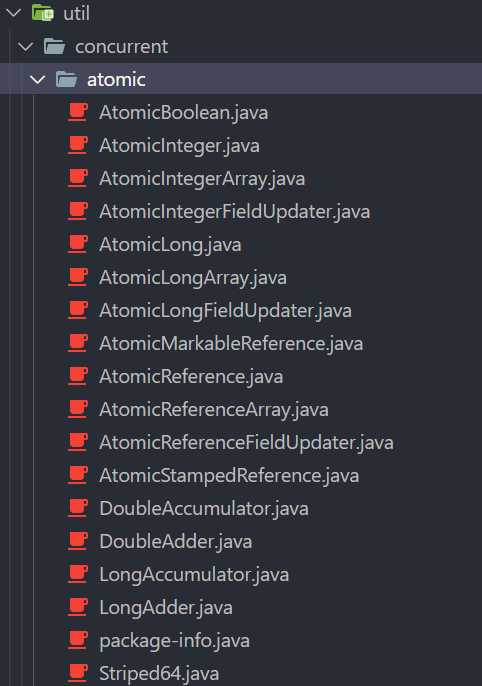
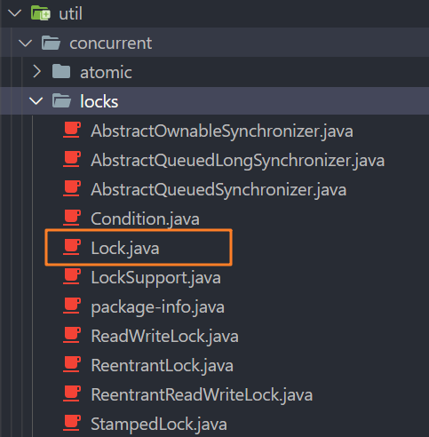
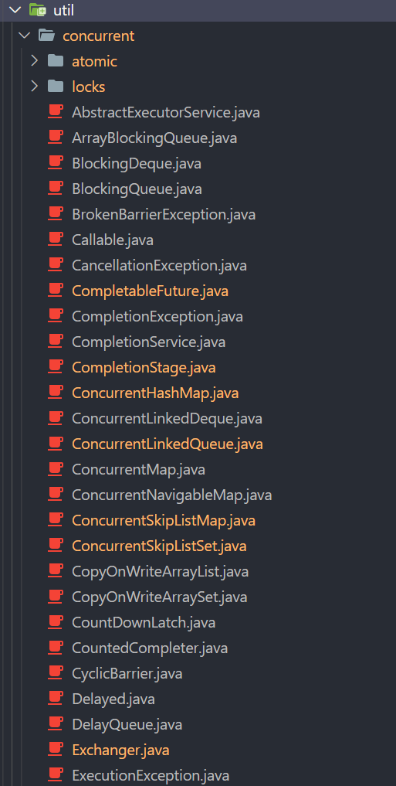

# 多线程世界观

[阅读原文](https://mp.weixin.qq.com/s/YcUucEZ4sBWeZTzCnfGxDQ)

关于这篇文章我很早就想写了，也一直不敢写，一方面是早先知识储备不足，另一方面主要是多线程这部分内容确实比较高深而且每个知识点之间比较零散，让人摸不着头脑，不知道该从哪里下手。而且对于我们学生群体来讲，很少有机会接触到高并发这方面的真实场景，平常自己敲代码也基本不会用到，所以也导致我们大部分同学都是面向面经学习，你问 synchronized，叭叭叭我能说一堆，你问 volatile，叭叭叭我也能说一堆，但总感觉差点意思，就是这些知识点是零散的，没有那么一根线把它们很好的串联起来。

所以今天我斗胆造一根线，站在小白的角度，**讲讲多线程这部分我们到底要学啥，按照什么样的顺序去学**，帮助各位建立一个比较完善的知识体系，形成正确的多线程世界观。后续的文章我也基本上会按照这根线写下来。

然后，我目前也没有踏入工作岗位，也没有实际的高并发经验，所以只是在纸上谈兵，学识尚浅，大佬们若觉得有问题恳请评论区或者私聊我指正，晚辈感激不尽（抱拳）。

*图：多线程修炼路线：从炼气到大乘（示意）*

<svg xmlns="http://www.w3.org/2000/svg" viewBox="0 0 720 150" font-family="'Microsoft YaHei','PingFang SC',sans-serif">
  <defs>
    <marker id="arw1" markerWidth="8" markerHeight="8" refX="7" refY="3" orient="auto">
      <path d="M0,0 L7,3 L0,6 Z" fill="#94a3b8"/>
    </marker>
  </defs>
  <rect x="8" y="24" width="128" height="76" rx="8" fill="#eff6ff" stroke="#2563eb" stroke-width="1.5"/>
  <text x="72" y="46" text-anchor="middle" font-size="14" font-weight="bold" fill="#1e293b">炼气</text>
  <text x="72" y="66" text-anchor="middle" font-size="11" fill="#475569">线程/进程、并行并发</text>
  <text x="72" y="82" text-anchor="middle" font-size="11" fill="#475569">为啥要用多线程</text>
  <line x1="136" y1="62" x2="152" y2="62" stroke="#94a3b8" stroke-width="1.5" marker-end="url(#arw1)"/>
  <rect x="152" y="24" width="128" height="76" rx="8" fill="#eff6ff" stroke="#2563eb" stroke-width="1.5"/>
  <text x="216" y="46" text-anchor="middle" font-size="14" font-weight="bold" fill="#1e293b">筑基</text>
  <text x="216" y="66" text-anchor="middle" font-size="11" fill="#475569">三种创建线程方式</text>
  <text x="216" y="82" text-anchor="middle" font-size="11" fill="#475569">六种状态 / Thread 方法</text>
  <line x1="280" y1="62" x2="296" y2="62" stroke="#94a3b8" stroke-width="1.5" marker-end="url(#arw1)"/>
  <rect x="296" y="24" width="128" height="76" rx="8" fill="#eff6ff" stroke="#2563eb" stroke-width="1.5"/>
  <text x="360" y="46" text-anchor="middle" font-size="14" font-weight="bold" fill="#1e293b">金丹</text>
  <text x="360" y="66" text-anchor="middle" font-size="11" fill="#475569">JMM 与三大性质</text>
  <text x="360" y="82" text-anchor="middle" font-size="11" fill="#475569">happens-before</text>
  <line x1="424" y1="62" x2="440" y2="62" stroke="#94a3b8" stroke-width="1.5" marker-end="url(#arw1)"/>
  <rect x="440" y="24" width="128" height="76" rx="8" fill="#fffbeb" stroke="#d97706" stroke-width="1.5"/>
  <text x="504" y="46" text-anchor="middle" font-size="14" font-weight="bold" fill="#1e293b">渡劫</text>
  <text x="504" y="66" text-anchor="middle" font-size="11" fill="#475569">volatile / synchronized</text>
  <text x="504" y="82" text-anchor="middle" font-size="11" fill="#475569">CAS、AQS、各种锁</text>
  <line x1="568" y1="62" x2="584" y2="62" stroke="#94a3b8" stroke-width="1.5" marker-end="url(#arw1)"/>
  <rect x="584" y="24" width="128" height="76" rx="8" fill="#f0fdf4" stroke="#16a34a" stroke-width="1.5"/>
  <text x="648" y="46" text-anchor="middle" font-size="14" font-weight="bold" fill="#1e293b">大乘</text>
  <text x="648" y="66" text-anchor="middle" font-size="11" fill="#475569">并发集合、线程池</text>
  <text x="648" y="82" text-anchor="middle" font-size="11" fill="#475569">工具类、ThreadLocal</text>
  <text x="360" y="126" text-anchor="middle" font-size="12" fill="#475569">知识点由浅入深，后续文章基本按照这条线展开</text>
</svg>

## 炼气：线程、进程与基础概念

首先，学习多线程，你肯定得知道**线程**是啥吧，包括线程的一些基础概念（比如**上下文切换**），那么说到线程，肯定离不开**进程**。

OK，进程和线程这两个概念其实我们在操作系统这门课中都接触过，当然**并行和并发**、**同步与异步**等这种基本概念咱也默认你学过，那么你还需要去了解一下 **Java 线程和操作系统的线程有啥区别**。

另外，容易被大家忽视的一点是，一项技术的出现必定不是凭空捏造的，他一定是为了某个目的而来，在某个成熟的时机应运而生。因此，你需要知道**我们为啥要使用多线程，多线程的出现解决了什么问题**。

掌握上面这一步，我们称之为炼气，所谓炼精化气，起步阶段需一心一意、沉心静气。

## 筑基：线程的创建、状态与控制方法

现在我们已经知道线程是啥了，那在 Java 中如何创建线程呢？为此你会接触到**三种创建线程（Thread）的方式**：

- 直接使用 Thread
- Thread + Runnable
- Thread + Callable + FutureTask

学会了如何创建线程，我们去翻一翻 Thread 类的源码，你会发现其中定义了 **Java 线程的六种状态**，也就是所谓的生命周期，**它和操作系统中线程的五态模型又有啥区别和联系呢**？

既然都翻了 Thread 源码，岂有不深究的道理？我们接下来去学习一下 Thread 类给我们提供了哪些控制线程的方法，它们分别能干啥，怎样影响了线程的状态：

- start / run
- sleep / yield
- join / join(long n)
- interrupt
- setDaemon 守护线程

这一阶段的学习，也就是入门阶段后的第一步，我们称之为筑基。基础不牢，地动山摇。

## 金丹：JMM 与线程安全三大性质

诚然，一个程序顺序的运行多个线程本身是没有问题的，但是如果多个线程同时访问了某个共享资源，就可能会发生不可预知的现象，也就是我们常说的**线程安全**问题，要了解这些问题产生的根本原因，我们就需要去深刻的了解 Java 内存模型（Java Memory Model，JMM）。

为此，我们会学习到和线程安全息息相关的三大性质：

1）**原子性**：一个操作是不可中断的，要么全部执行成功要么全部执行失败（也可以说是提供互斥访问，同一时刻只能有一个线程对数据进行操作）

2）**可见性**：当一个线程修改了共享变量后，其他线程能够立即得知这个修改

3）**有序性**（或者说**重排序**）：重排序是编译器和处理器为了优化程序性能而对指令序列进行重新排序的一种手段。由于重排序的存在，可能导致多线程环境下程序运行结果出错的问题。

那么编译器和处理器在重排序时会遵守什么原则呢？为此你会了解到**数据依赖性**和 **as-if-serial**，这里简单介绍一下这两个概念：

- 编译器和处理器在重排序时，会遵守数据依赖性，它们不会改变存在数据依赖性关系的两个操作的执行顺序
- as-if-serial 语义的意思是：不管怎么重排序，程序的执行结果不能被改变。编译器，runtime 和处理器都必须遵守 as-if-serial 语义

事实上，可见性和有序性其实是互相矛盾的两点。一方面，对于程序员来说，我们希望内存模型易于理解、易于编程，为此 JMM 的设计者要为程序员提供足够强的内存可见性保证，专业术语称之为 “**强内存模型**”。而另一方面，编译器和处理器则希望内存模型对它们的束缚越少越好，这样它们就可以做尽可能多的优化（比如重排序）来提高性能，因此 JMM 的设计者对编译器和处理器的限制要尽可能地放松，专业术语称之为 “**弱内存模型**”。

当然，对于这个问题，JMM 的设计者找到了一个很好的平衡点，那就是 **happens-before**，这是 JMM 最核心的概念！理解 happens-before 是理解 JMM 的关键。

知其然而知其所以然，这一阶段，我们称为金丹。

## 渡劫：Java 如何保证线程安全（volatile、锁与 AQS）

具体到 Java 语言层面，是怎么保证线程安全的呢？也就是如何保证原子性、可见性和有序性呢？（保证有序性上文已经说过了，就是使用 happens-before 原则）。

1）对于可见性，可以使用 **volatile 关键字**来保证。不仅如此，volatile 还能起到禁止指令重排的作用；

2）对于原子性，我们可以使用 **锁** 和 java.util.concurrent.atomic 包中的原子类来保证。（给萌新解释一下，java.util.concurrent，简称 J.U.C，就是一个包，也称为并发包。现在网上大部分博客都会直接说 JUC，对萌新不是很友好），我们可以看看 juc.atomic 中有哪些类：

当然， atomic 包下这些原子操作类保证原子性最关键的原因还是因为它们使用了 **CAS 操作**，于是，你需要先去深入学习一下 CAS，了解 CAS 存在的三个问题，然后再去挖一挖这些原子类的底层原理。

另外，上面我们提到的锁这个话题其实又是一个非常核心的知识点，在深入学习之前，你需要了解一下各种锁的概念：

- **悲观锁和乐观锁**
- **重量级锁和轻量级锁**
- **自旋锁**
- **偏向锁**
- **重入锁和不可重入锁**
- **公平锁和非公平锁**
- **共享锁和排他锁**

另外，与锁相关的概念的还有**临界区**、**竞态条件**等，这些你都是要去了解的。

那么锁在 Java 中具体是怎么实现的呢？早先 Java 程序是靠 **synchronized 关键字**实现锁功能的，在我们掌握了 synchronized 的使用方式以及底层原理后，你还会接触到与 synchronized 配套的 wait/notify/notifyAll 方法。

在 Java SE 5 之后，并发包 JUC 中新增了 **Lock 接口**以及相关实现类（放在 java.util.concurrent.locks 包下）也可以用来实现锁功能。

为什么会新增这样一个 Lock 接口及其相关实现类呢？因为使用 synchronized 关键字会隐式地获取锁，但是它将锁的获取和释放固化了，也就是先获取再释放。当然，这种方式简化了同步的管理，可是扩展性没有显示的锁获取和释放来的好。

例如，针对一个场景，手把手进行锁获取和释放，先获得锁 A，然后再获取锁 B，当锁 B 获得后，释放锁 A 同时获取锁 C，当锁 C 获得后，再释放 B 同时获取锁 D，以此类推。这种场景下，如果使用 synchronized 关键字就不那么容易实现了，而使用 Lock 却容易许多。

它提供了与 synchronized 关键字类似的同步功能，只是在使用时需要显式地获取和释放锁。虽然它缺少了隐式获取释放锁的便捷性，但是却拥有了锁获取与释放的可操作性、可中断的获取锁以及超时获取锁等多种 synchronized 关键字所不具备的同步特性。

另外，还有一点非常重要的是！我们可以去翻一翻实现了 Lock 接口的类，比如 ReentrantLock（大部分文章都会直接把它翻译成重入锁），你会惊讶的发现它并没有多少代码，基本所有的方法都是调用了其静态内部类 Sync 中的方法，而 Sync 类继承了 **AbstractQueuedSynchronizer** 类（也就是大名鼎鼎的 **AQS**，译为队列同步器，简称同步器）。

可以把 AQS 理解为一个用来构建锁和同步器（工具类）的框架，locks 包中的各种锁以及接下来我们会学习的 JUC 中的工具类都是基于 AQS 来实现的。

OK，关于 AQS 这篇文章就不再多说了。上面我们提到了两个**并发关键字**，synchronized 和 volatile，其实还有一个，那就是 final，可能很多小伙伴都不知道，啥？final 和并发有啥关系？当然，这些，后续文章都会写的。

本阶段的知识非常重要，并且相对来说知识点比较多也比较难，因此我们称之为渡劫。

## 大乘：JUC 并发包补强（并发集合、线程池与工具类）

渡劫完毕，走到这一步各位对多线程基本的知识架构已经有了一定的认知，世界观已经初步形成，最后，就是补强的过程了，我们来看看 J.U.C 这个包还有什么东西（下图没有截全）：

JUC 其实可以分为五大类：

- Lock 框架（locks 包）
- 原子类（atomic 包）
- 并发集合
- 线程池
- 工具类

后面三种正是我们在这一阶段需要学习的。并发集合和线程池就没啥好说的了，它们的知识点都比较集中，学习目标也很明确，网络上很容易就能找到一篇条理清晰的文章。

然后常用的工具类还是有必要学习下：

- CountDownLatch
- CyclicBarrier
- Semaphore
- Exchanger

所谓工具类嘛，那一定是封装了某些比较复杂的操作，使我们可以很简单的去完成这些操作。以 CountDownLatch 为例：在多线程协作完成业务功能时，有时候需要等待其他多个线程完成任务之后，主线程才能继续往下执行业务功能，在这种的业务场景下，通常可以使用 Thread 类的 join 方法，让主线程等待被 join 的线程执行完之后，主线程才能继续往下执行。而 Java 并发工具类中为我们提供了这样一个类似 “倒计时” 的工具类 CountDownLatch，可以十分方便的完成这种业务场景。

另外，还有一个比较重要的类，我也不知道怎么给它分类，就是 ThreadLocal，江湖人称线程隔离术，必问高阶考点。

OK，学完了本阶段，多线程世界观已完整形成，我们称之为大乘，忘我之境，全在己心。
