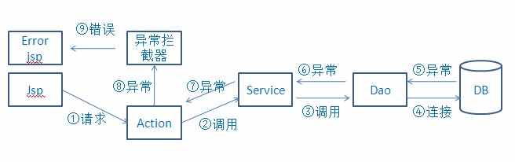
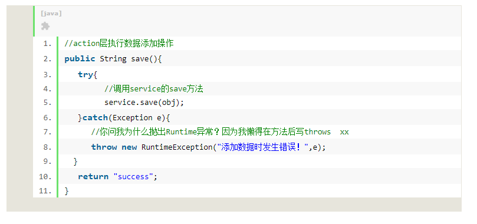
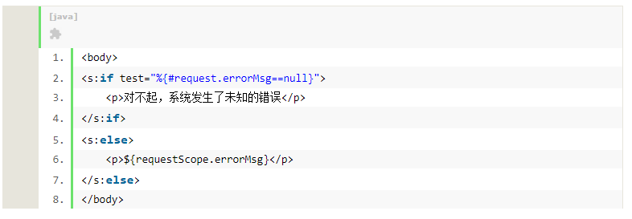
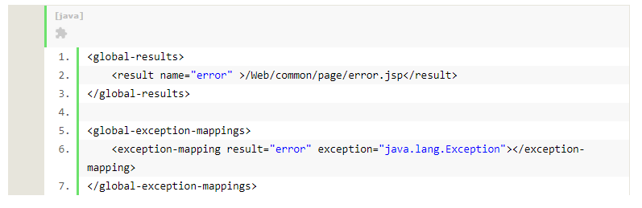
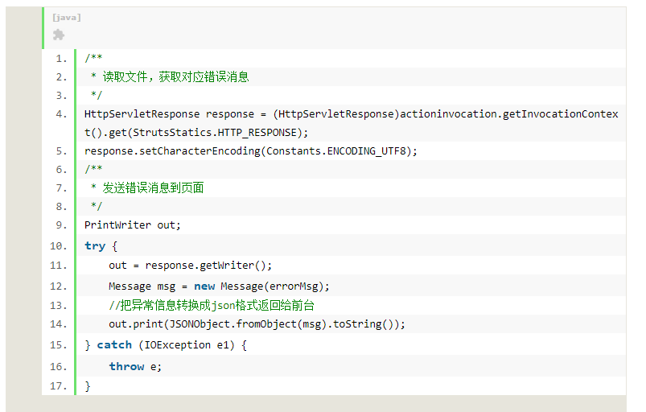

# Java-Web异常处理

## 处理思路：业务层抛出新异常，由拦截器统一处理



首先我的action类、service类和dao类如果有必要捕获异常，我都会try...catch，**catch块内不记录log，通常是抛出一个新异常，并且注明错误信息**：



*图：Java-Web 异常处理流程（示意）*

<svg xmlns="http://www.w3.org/2000/svg" viewBox="0 0 720 180" font-family="'Microsoft YaHei','PingFang SC',sans-serif">
  <defs>
    <marker id="arw1" markerWidth="8" markerHeight="8" refX="7" refY="3" orient="auto">
      <path d="M0,0 L7,3 L0,6 Z" fill="#94a3b8"/>
    </marker>
  </defs>
  <rect x="20" y="30" width="200" height="70" rx="8" fill="#eff6ff" stroke="#2563eb" stroke-width="1.5"/>
  <text x="120" y="55" text-anchor="middle" font-size="14" font-weight="bold" fill="#1e293b">业务代码</text>
  <text x="120" y="77" text-anchor="middle" font-size="12" fill="#475569">Action / Service / DAO</text>
  <text x="120" y="93" text-anchor="middle" font-size="12" fill="#475569">try...catch 后抛出新异常并注明错误信息</text>
  <line x1="220" y1="65" x2="258" y2="65" stroke="#94a3b8" stroke-width="1.5" marker-end="url(#arw1)"/>
  <rect x="260" y="30" width="200" height="70" rx="8" fill="#eff6ff" stroke="#2563eb" stroke-width="1.5"/>
  <text x="360" y="55" text-anchor="middle" font-size="14" font-weight="bold" fill="#1e293b">异常拦截器 intercept</text>
  <text x="360" y="77" text-anchor="middle" font-size="12" fill="#475569">instanceof 判断异常类型（从子到父）</text>
  <text x="360" y="93" text-anchor="middle" font-size="12" fill="#475569">记录 log4j 日志，返回 "error"</text>
  <line x1="360" y1="100" x2="265" y2="120" stroke="#94a3b8" stroke-width="1.5" marker-end="url(#arw1)"/>
  <line x1="360" y1="100" x2="455" y2="120" stroke="#94a3b8" stroke-width="1.5" marker-end="url(#arw1)"/>
  <rect x="170" y="122" width="180" height="46" rx="8" fill="#f0fdf4" stroke="#16a34a" stroke-width="1.5"/>
  <text x="260" y="141" text-anchor="middle" font-size="13" fill="#1e293b">error JSP 页面</text>
  <text x="260" y="159" text-anchor="middle" font-size="12" fill="#475569">显示具体的错误消息</text>
  <rect x="370" y="122" width="180" height="46" rx="8" fill="#fffbeb" stroke="#d97706" stroke-width="1.5"/>
  <text x="460" y="141" text-anchor="middle" font-size="13" fill="#1e293b">ajax（json）请求</text>
  <text x="460" y="159" text-anchor="middle" font-size="12" fill="#475569">错误信息返回给回调函数</text>
  <text x="625" y="145" text-anchor="middle" font-size="12" fill="#475569">拦截器也可用</text>
  <text x="625" y="163" text-anchor="middle" font-size="12" fill="#475569">spring aop / servlet filter 替换</text>
</svg>

## 异常拦截器的代码实现

然后在异常拦截器对异常进行处理，看下面的代码：

```java
public String intercept(ActionInvocation actioninvocation) {
    String result = null; // Action的返回值  
    try {  
        // 运行被拦截的Action,期间如果发生异常会被catch住  
        result = actioninvocation.invoke();  
        return result;  
    } catch (Exception e) {  
        /** 
    * 处理异常 
    */  
        String errorMsg = "未知错误！";  
        //通过instanceof判断到底是什么异常类型  
        if (e instanceof BaseException) {  
            BaseException be = (BaseException) e;  
            be.printStackTrace(); //开发时打印异常信息，方便调试  
            if(be.getMessage()!=null||Constants.BLANK.equals(be.getMessage().trim())){  
                //获得错误信息  
                errorMsg = be.getMessage().trim();  
            }  
        } else if(e instanceof RuntimeException){  
            //未知的运行时异常  
            RuntimeException re = (RuntimeException)e;  
            re.printStackTrace();  
        } else{  
            //未知的严重异常  
            e.printStackTrace();  
        }  
        //把自定义错误信息  
        HttpServletRequest request = (HttpServletRequest) actioninvocation  
                                      .getInvocationContext().get(StrutsStatics.HTTP_REQUEST);  
    
        /** 
    * 发送错误消息到页面 
    */  
        request.setAttribute("errorMsg", errorMsg);  
    
        /** 
    * log4j记录日志 
    */  
        Log log = LogFactory  
            .getLog(actioninvocation.getAction().getClass());  
        if (e.getCause() != null){  
            log.error(errorMsg, e);  
        }else{  
            log.error(errorMsg, e);  
        }  
    
        return "error";  
    }// ...end of catch  
}
```

需要注意的是:**在使用instanceof判断异常类型的时候一定要从子到父依次找**，比如BaseException继承与RuntimeException，则必须首先判断是否是BaseException再判断是否是RuntimeException。

最后在error JSP页面显示具体的错误消息即可：



以上异常拦截器可以使用其它很多技术替换：比如spring aop，servlet filter等，根据项目实际情况处理。

## 【补充】ajax 的异常拦截



【补充】ajax也可以进行拦截，但是因为ajax属于异步操作，action通过response形式直接把数据返回给ajax回调函数，**如果发生异常，ajax是不会执行页面跳转的，所以必须把错误信息返回给回调函数**，我针对json数据的ajax是这样做的：



来源： [http://blog.csdn.net/luqin1988/article/details/7970988](http://blog.csdn.net/luqin1988/article/details/7970988)
