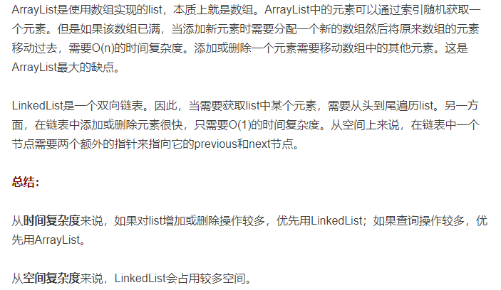
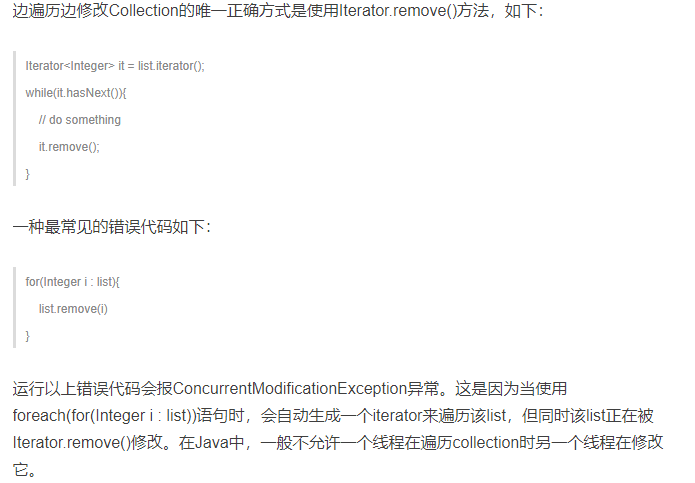
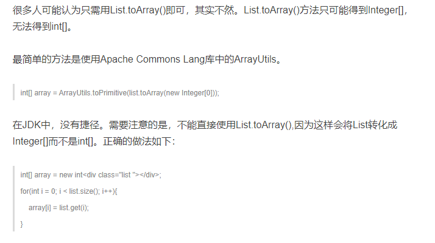
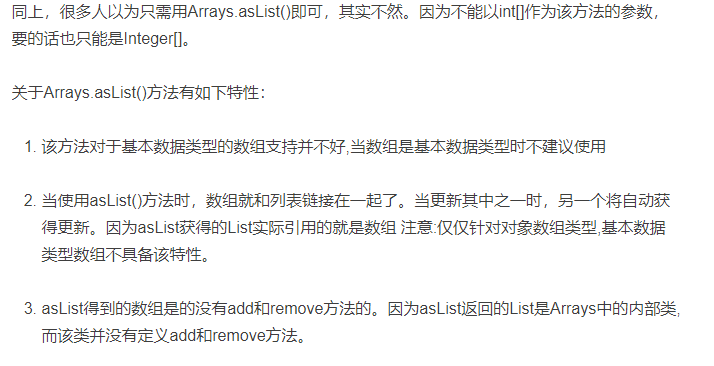
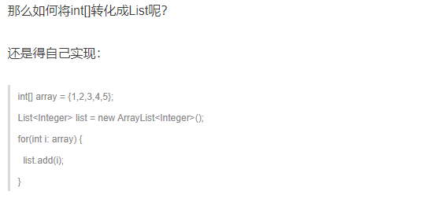
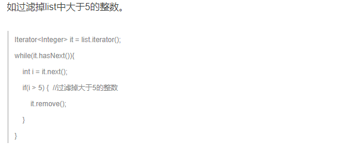
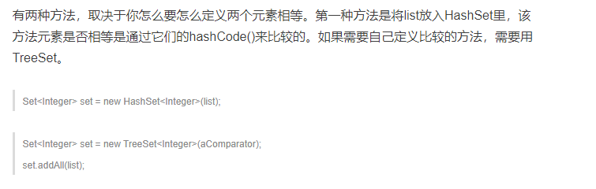
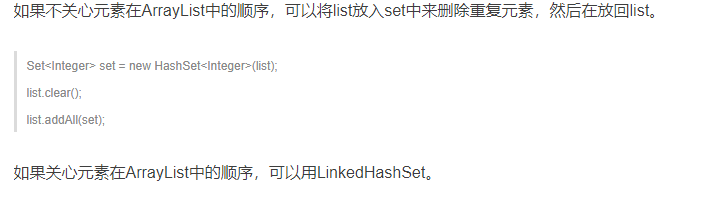
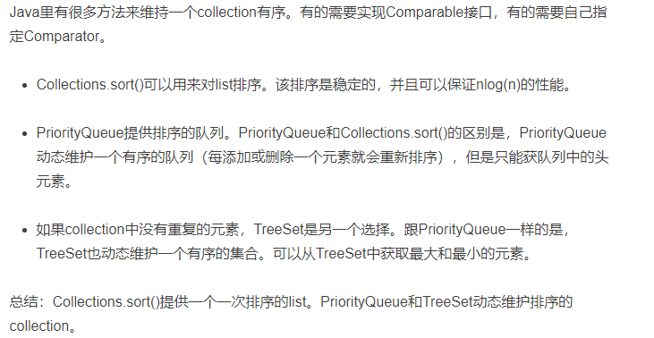
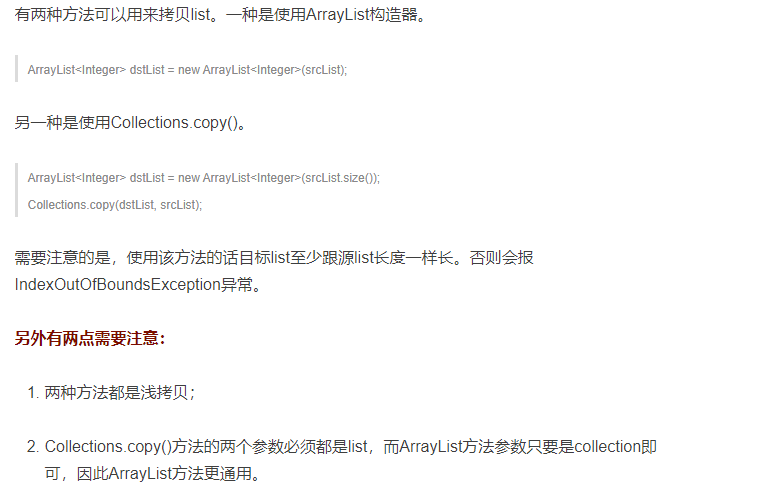

# Java-集合

关键操作：初始化、新增、删除、底层（链表、索引、树、图）

| 名称 | 是否允许空 | 是否允许重复数据 | 是否有序 | 是否线程安全  | 备注 |
| --- | --- | --- | --- | --- | --- |
| ArrayList | 允许 | 允许 | 有序 | 否 | |
| LinkedList | 允许 | 允许 | 有序 | 否 | |
| CopyOnWriteArrayList | 允许 | 允许 | 有序 | 是 | |
| HashMap | Key和value都允许 | Key会覆盖，value重复 | 无序 | 否 | |
| LinkedHashMap | Key和value都允许 | Key会覆盖，value重复 | 有序 | 否 | |
| 红黑树 | Key不允许，value允许 | Key会覆盖，value重复 | 有序 | 否 | |
| 优先队列 | | | | | |
| 阻塞队列 | | | | | |

## 什么时候用LinkedList，什么时候用ArrayList？

## 如何边遍历边移除Collection中的元素

## 如何将List转化成int[]？

## 如何将int[]转化成List？

## 过滤一个Collection最好的方法是什么？

## 将List转化成Set最简单的方法？

## 如何删除ArrayList中重复的元素？

## 有序的collection

## 拷贝list

