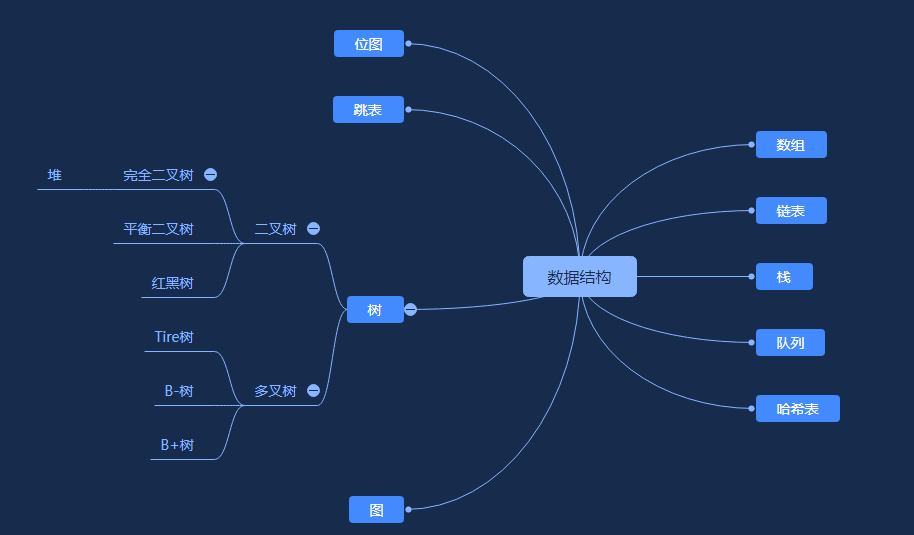
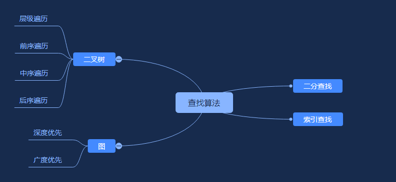
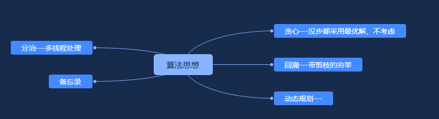

# 数据结构与算法

## 数据结构

## 查找算法

## 排序算法
| 序号 | 算法 | 时间 | 空间 | 稳定 | 应用 |
| --- | --- | --- | --- | --- | --- |
| 1 | 冒泡排序 |  | 原地排序O(1) | 是 |     |
| 2 | 选择排序 |     |     |     |     |
| 3 | 插入排序 |     |     |     |     |
| 4 | 希尔排序 |     |     |     |     |
| 5 | 快速排序 |     |     |     |     |
| 6 | 归并排序 |     |     |     |     |
| 7 | 堆排序 |     |     |     |     |
| 8 | 桶排序 |     |     |     |     |
| 9 | 基数排序 |     |     |     |     |
| 10 | 计数排序 |     |     |     |     |

## 算法思想
1. 贪心：一条路走到黑，就一次机会，只能哪边看着顺眼走哪边
2. 回溯：一条路走到黑，无数次重来的机会，还怕我走不出来 (Snapshot View)
3. 动态规划：拥有上帝视角，手握无数平行宇宙的历史存档， 同时发展出无数个未来 (Versioned Archive View)

