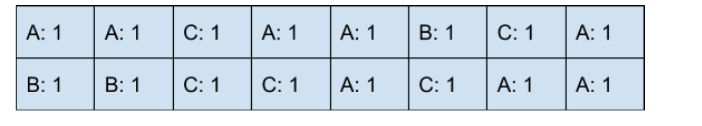

# 数据结构-Log-Structured 结构

## **Log-Structured 结构**
在计算机存储数据结构的发展中，**Log-****S****tructured**** ****结构的诞生为许多文件系统或者是数据库打下了坚实的基础**。比如说，Google 的三驾马车之一，Bigtable 文件系统的底层存储数据结构采用的就是 Log-Structured 结构，还有大家所熟知的 MongoDB 和 HBase 这类的 NoSQL 数据库，它们的底层存储数据结构其实也是 Log-Structured 结构。

而 Log-Structured 结构其实和平衡树有着莫大的关系，因为在这些框架应用里面，通常都会使用平衡树来优化数据的查找速度。在这一讲中，我会先介绍什么是 Log-Structured 结构，而在下一讲中，再详细介绍平衡树数据结构是如何被应用在 Log-Structured 结构中的。

我们先来看看一个常见的问题应用。假设一个视频网站需要一个统计视频观看次数的功能，如果给你来设计的话，会采用哪种数据结构呢？你可能会觉得这并不难，我们可以运用哈希表这个数据结构，以视频的 URL 作为键、观看次数作为值，保存在哈希表里面。所有保存在哈希表里面的初始值都为 0，表示并无任何人观看，而每次有人观看了一个视频之后，就将这个视频所对应的值取出然后加 1。

刚开始的时候，这个设计思路可能运行得很好。可当用户量增大了之后，会发现在更新哈希表的时候必须要加锁，不然的话，大量的这种并行 +1 操作可能会覆盖掉各自的值。比方说，在同一时间，有两个用户都观看了一个视频，它们都根据视频的 URL 在哈希表中取出了观看次数的值 0，在更新操作 +1 了之后，都把 1 这个值保存在了哈希表中，而实际上，哈希表中的值应该是 2。

不难发现，这种操作的瓶颈其实是在更新操作，也就是写操作上。那有没有方法可以不用顾及写操作的高并发问题，同时也可以最终获得一个准确的结果呢？答案就是使用 Log-Structured 结构。

Log-Structured 结构，有时候也会被称作是 Append-only Sequence of Data，因为**所有的写操作都会不停地添加进这个数据结构中，而不会更新原来已有的值**，这也是 Log-Structured 结构的一大特性。

我们来看看在采用了 Log-Structured 结构之后，在上面的统计视频网站观看次数的应用中，底层的数据结构变成怎么样了。

假设现在网站总共有三个视频，URL 分别就是 A、B 和 C，那一个可能的数据结构图就如下图所示：

从上图中可以看到，这样的数据结构其实和数组非常像，数组里的值就保存着 URL 和 1，每次有新用户观看过视频之后，就会将 URL 和 1 加到数组的结尾。在上面的例子中，我们只需要遍历一遍这个数组，然后将不同的 URL 值加起来就可以得到观看的总数，例如 A 的观看总数为 8 次，B 为 3 次，C 为 5 次。

这其实就是 Log-Structured 结构的本质了，不过细心的你应该可以发现了，这样一个最基本的 Log-Structured 结构，其实在应用里会有很多的问题。比如说，一个数组不可能在内存中无限地增长下去，我们要如何处理呢？如果每次想要知道结果，就必须遍历一遍这样的数组，时间复杂度会非常高，那该怎么优化呢？平衡树是如何被应用在里面的呢？所有这些问题的答案我都会在下一讲中为你讲解。

OK，这节课就讲到这里啦，下一课时我将分享“LSM 树在 Apache HBase 等存储系统中的应用”，记得按时来听课哈。
