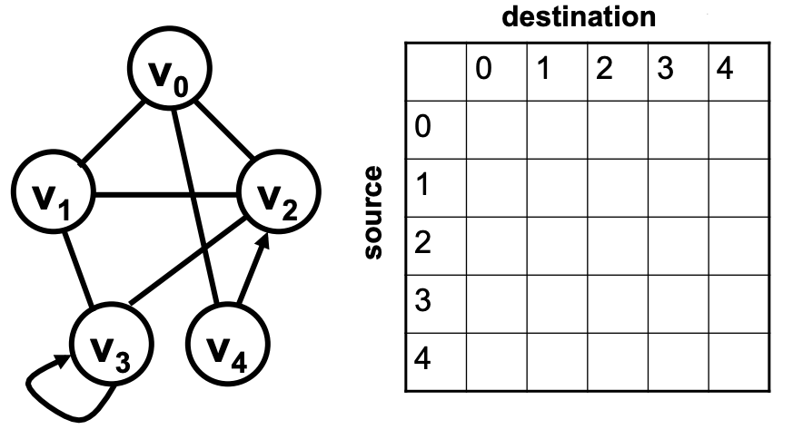
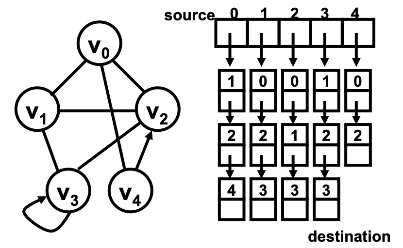

# 算法-邻接矩阵法

1. 邻接矩阵法

使用邻接矩阵法的基本思想是开一个超大的数组，用数组中间元素的 true / false 来表达边。具体什么意思呢？比如你有 V 个节点的图，那么就需要一个 V×V 大小的数组。

我们来看一个例子，下面这个例子中有 V0 - V4 总共 5 个节点，可以看到我们已经画出了一个 5 × 5 的二维数组 G。如果学习了之前数组章节中的二维数组，就知道可以用 G[i][j] 这样的寻址方式来找到第 i 行第 j 列的元素。在这个例子中规定，如果有从 Vi 指向 Vj 的边，那么 G[i][j] = true，反之如果没有边，则 G[i][j] = false。不如一起来看看在这个例子中有哪些数组元素会是 true。

我们首先看看 V4 指向 V2 的边，即 G[4][2] = true；接着再看看 V0 和 V2 之间的边是无向的，也就是说，我们需要 G[0][2] = true，同时 G[2][0] = true；最后看到 V3 有指向自己的边，所以 G[3][3] 也是 true，可以发现邻接矩阵法的实际上存储的是所有的边。

2. 邻接链表法

邻接链表法则是不一样的思路了，它的核心思想是把每一个节点所指向的点给存储起来。

比如还是同样一个图 V0 - V4，如果我们用邻接链表法表达的话，则需要一个含有 5 个元素的数组，用来存储这样 5 个节点；然后每个节点所指向的点都会维护在一个链表中。比如在这个例子中，V0 指向了 V1、V4、V2 三个节点，那么在内存中就会有从 0 指向 1 接着指向 2、4 类似这样的一个链表。同理我们看 V4 指向了 V0 和 V2，则在内存中就要维护一个 4→0→2 的单向链表。

这两种实现方式有什么区别呢？邻接矩阵法因为存储在二维数组中，我们在之前的章节中已经掌握了数组的特点，那就是随机访问快。在这里也一样，邻接矩阵法可以更快地添加和删除边，也可以更快地判断边是否存在，你只需要对 G[i][j] 这个元素操作就行了。

但是邻接矩阵法需要一个 O(V^2) 的内存空间，相对来说更适合边比较多的图，这样就可以更好的利用这些内存。因为邻接矩阵法存储的是边，不管有多少边，它都需要一样的内存。

邻接链表法可以更快地操作一个节点相邻的节点，在一个稀疏的图中也就是边比较少的图中，邻接链表法的效率其实是比较高的。因为每一个单链表都比较短，我们知道修改链表的时间复杂度是 O(n)，同样也适用于邻接链表法。如果邻接链表法的边比较多，则链表就会比较长，进而影响我们的操作效率。邻接链表法的空间复杂度需要 O(|V| + |E|)  的内存空间。
