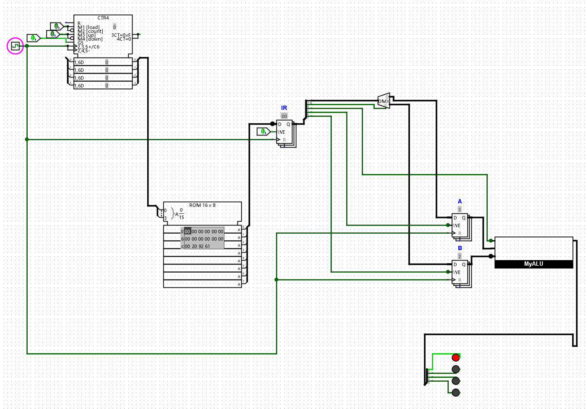

# 4位计算机-logisim

好！你用 **Logisim Evolution 4.1.0** + 已有 **4位ALU**，我直接给你一套**可立即照做、能跑指令的4位计算机完整搭建步骤**（Evolution 专用，连线一次成功）。



## 一、先确认你的 4位ALU 接口（必须有）

- A[3:0]、B[3:0]（4位输入）
- F[3:0]（结果）
- op[1:0] 或 op[2:0]（运算选择）
- Carry-out（可选）

没有的话我可以先帮你补完。

## 二、计算机整体结构（Evolution 4.1.0 标准）

我们做 **极简4位CPU（能跑4条指令）**：

1. **PC（程序计数器）**：Counter 4位
2. **ROM**：16×8bit（存指令）
3. **指令寄存器 IR**：Register 8bit
4. **寄存器 A、B**：各4位
5. **你的ALU**
6. **控制单元（最简）**：少量门/MUX
7. **时钟、LED、开关**

## 三、Step 1：取指周期（PC + ROM + IR）

### 组件（从左侧库拖）

- Memory → **Counter (4位)** → PC
- Memory → **ROM (16×8bit)**
- Memory → **Register (8bit)** → IR
- Wiring → **Clock**
- Wiring → **Splitter (8→4+4)**

### 连线（严格照做）

1. **Clock** → PC 的 Clock
2. PC 输出 [3:0] → ROM 的 **Address[3:0]**
3. ROM 输出 [7:0] → **IR (8位寄存器) 的 D 端**
4. **Clock** → IR 的 Clock（指令锁存）

作用：**每拍：PC+1 → 读ROM → 指令存入IR**

## 四、Step 2：数据通路（A、B、ALU）

### 组件清单

- Memory → **Register (4位)** ×2 → A、B
- 你的 **4位ALU**
- Input/Output → **LED 4位**（显示结果）
- Plexers → **MUX 2选1 (4位)**

### 连线（核心）

1. **A 寄存器 Q → ALU-A**
2. **B 寄存器 Q → ALU-B**
3. **ALU-F → A寄存器 D**（结果写回A）
4. ALU-F → **LED 4位**
5. IR 低4位（IR[3:0]）→ **MUX 输入0**
6. 4位开关 → **MUX 输入1**
7. MUX 输出 → **B寄存器 D**

## 五、Step 3：控制单元（让CPU“懂指令”）

### 指令格式（8位）

```plain
IR[7:4] = 操作码（opcode）
IR[3:0] = 立即数/数据
```

### 4条最简指令（直接用）

- `0000 xxxx` → **LOAD B**（B=立即数）
- `0001 xxxx` → **ADD**（A=A+B）
- `0010 xxxx` → **SUB**（A=A−B）
- `0011 xxxx` → **HALT**（暂停）

### 控制信号（Evolution 直接连线）

1. **IR[7:4] → ALU-op**（直接连）
    - 0001 → ADD
    - 0010 → SUB
2. **IR[7:5] 或简单门** → 控制：
    - `LOAD (0000)` → B寄存器 **WriteEnable=1**
    - `ADD/SUB (0001/0010)` → A寄存器 **WriteEnable=1**
    - `HALT (0011)` → PC **Enable=0**（停止）

> Evolution 小技巧：寄存器的 **Enable/Write** 直接接高/低，或用 opcode 经简单门控制。

## 六、Step 4：全局时钟（同步）

**一个 Clock 同时接：**

- PC Clock
- IR Clock
- A Clock
- B Clock

全部**同拍工作**（标准CPU时序）。

## 七、Step 5：测试程序（直接写入ROM）

在 ROM 地址 0~3 填入：

1. `0000 0001` → B=1
2. `0000 0010` → B=2
3. `0001 0000` → A=A+B
4. `0011 0000` → HALT

运行：

- 第1拍：B=1
- 第2拍：B=2
- 第3拍：A=1+2=**3（LED亮 0011）**
- 第4拍：停机

**你的计算机真正计算 1+2=3 成功！**

## 八、Evolution 4.1.0 常见坑（避坑）

- **位宽不匹配**：用 Splitter 严格 4/8位分开
- **时钟没全连**：PC/IR/A/B 必须同时钟
- **寄存器没使能**：Write Enable 必须为1才写入
- **ALU的op连错**： opcode 直接连 ALU 操作选择
