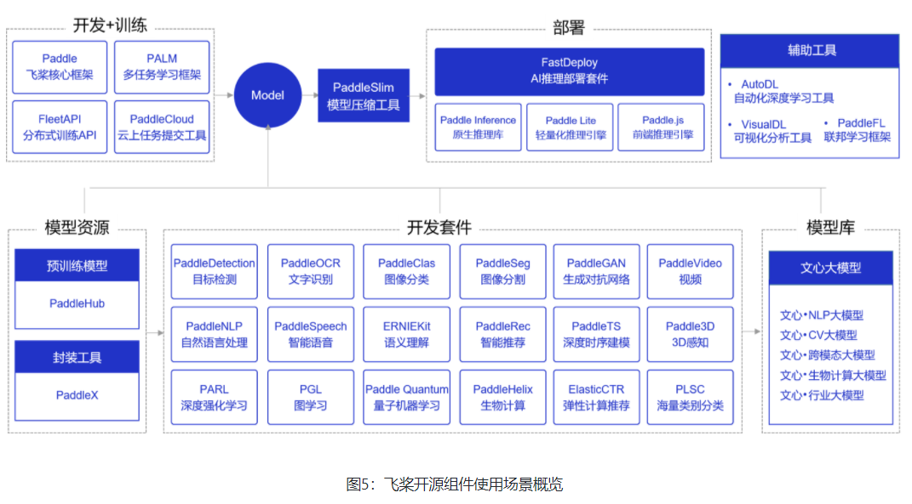
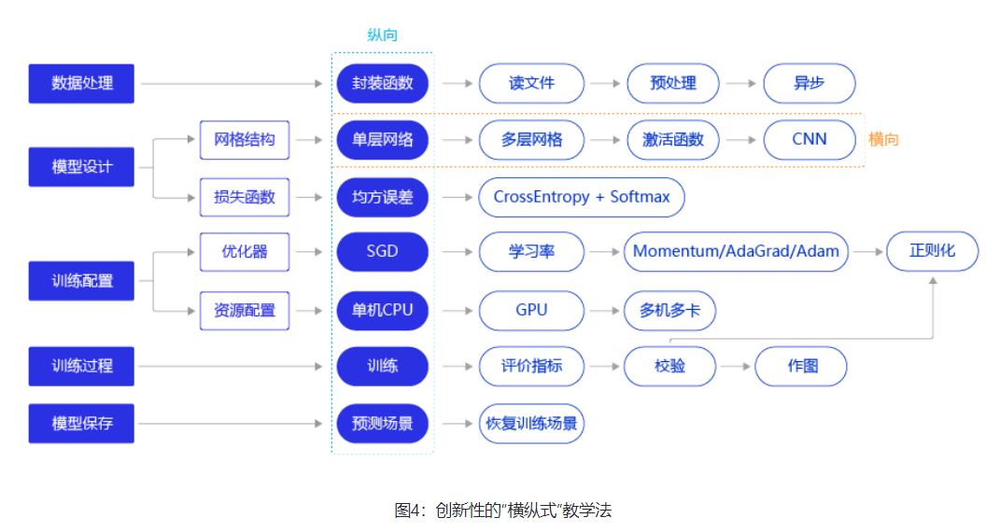

# 飞桨学习笔记

概览图上半部分是从开发、训练到部署的全流程工具；下半部分是预训练模型、封装工具、各领域的开发套件和模型库等模型资源，支持深度学习模型从训练到部署的全流程。

## 模型开发和训练组件

**飞桨核心框架Paddle**支持用户完成基础的模型编写和单机训练功能。除核心框架之外，飞桨还提供了**分布式训练框架FleetAPI**、**云上任务提交工具PaddleCloud**和**多任务学习框架PALM**。

## 模型部署组件

针对不同硬件环境，飞桨提供了丰富的支持方案：

+ **FastDeploy**：FastDeploy面向AI模型产业落地，帮助开发者简单几步即可完成AI模型在对应硬件上的部署，降低部署难度、压缩部署时间成本。支持40多个主流的AI模型在8大类常见硬件上的部署能力。
+ **Paddle Inference**：飞桨原生推理库，用于服务器端模型部署，支持Python、C、C++、Go等语言，可将模型融入业务系统。
+ **Paddle Serving**：飞桨服务化部署框架，用于云端服务化部署，可将模型作为单独的Web服务。
+ **Paddle Lite**：飞桨轻量化推理引擎，用于Mobile、IoT等场景的部署，有着广泛的硬件支持。
+ **Paddle.js**：使用JavaScript（Web）语言部署模型，用于在浏览器、小程序等环境快速部署模型。
+ **PaddleSlim**：模型压缩工具，获得更小体积的模型和更快的执行性能，通常在模型部署前使用。
+ **X2Paddle**：飞桨模型转换工具，将其他框架模型转换成Paddle模型，转换格式后可以方便的使用上述5个工具。

## 其他全研发流程的辅助工具组件

+ **AutoDL**：飞桨自动化深度学习工具，自动搜索最优的网络结构与超参数，实现网络结构设计。免去用户在诸多网络结构中选择困难的烦恼和人工调参的繁琐工作。
+ **VisualDL**：飞桨可视化分析工具，以丰富的图表呈现训练参数变化趋势、模型结构、数据样本、高维数据分布、精度召回曲线等模型关键信息，帮助用户清晰直观地理解深度学习模型训练过程及模型结构，启发优化思路。
+ **PaddleFL**：飞桨联邦学习框架，通过PaddleFL复制和比较不同的联邦学习算法，实现大规模分布式集群部署，并且提供丰富的横向和纵向联邦学习策略及其在计算机视觉、自然语言处理、推荐算法等领域的应用。

## 产业级开源模型库

飞桨提供了产业级开源模型库，覆盖计算机视觉(PaddleCV)、自然语言处理(PaddleNLP)、推荐(PaddleRec)、语音(PaddleSpeech)四大应用领域，包含经过产业实践长期打磨的主流模型以及在国际竞赛中的夺冠模型。同时，飞桨将主流模型按照领域组织成端到端开发套件，助力快速的产业应用。

### 1）预训练模型和封装工具

通过低代码形式，支持企业POC快速验证、快速实现深度学习算法开发及产业部署。

+ **PaddleHub**：飞桨预训练模型应用工具，提供超过350个预训练模型，覆盖文本、图像、视频、语音四大领域。模型即软件，通过Python API或者命令行工具，一行代码完成预训练模型的预测。结合Fine-tune API，10行代码完成迁移学习，是进行原型验证（POC）的首选。
+ **PaddleX**：飞桨全流程开发工具，以低代码的形式支持开发者快速实现深度学习算法开发及产业部署。提供极简Python API和可视化界面Demo两种开发模式，可一键安装。提供CPU、GPU、树莓派等通用硬件高性能部署方案，并通过Maufac  ture SDK支持用户流程化串联部署任务，极大降低部署成本。

### 2）开发套件

针对具体的应用场景提供了全套的研发工具，例如：在图像检测场景不仅提供了预训练模型，还提供了数据增强等工具。开发套件覆盖计算机视觉、自然语言处理、语音、推荐四大主流领域，甚至还包括图神经网络和增强学习。开发套件可以提供一个领域极致优化（State Of The Art）的实现方案，曾有国内团队使用飞桨的开发套件获得了国际建模竞赛的大奖。

+ **PaddleClas**：飞桨图像分类开发套件，提供通用图像识别系统PP-ShiTu，可高效实现高精度车辆、商品等多种识别任务；同时提供37个系列213个高性能图像分类预训练模型，其中包括10万分类预训练模型、PP-LCNet等明星模型；以及SSLD知识蒸馏等先进算法优化策略，可被广泛应用于高阶视觉任务，辅助产业及科研领域快速解决多类别、高相似度、小样本等业界难点。
+ **PaddleDetection**：飞桨目标检测开发套件，内置190个主流目标检测、实例分割、跟踪、关键点检测算法，其中包括服务器端和移动端产业级SOTA模型、冠军方案和学术前沿算法，并提供配置化的网络模块组件、十余种数据增强策略和损失函数等高阶优化支持和多种部署方案，在打通数据处理、模型开发、训练、压缩、部署全流程的基础上，提供丰富的案例及教程，加速算法产业落地应用。
+ **PaddleSeg**：飞桨图像分割套件PaddleSeg，提供语义分割、交互式分割、全景分割、Matting四大图像分割能力，涵盖30+主流分割网络，80+高质量预训练模型。通过模块化的设计，提供了配置化驱动和API调用等两种应用方式，帮助开发者更便捷地完成从训练到部署的全流程图像分割应用，被广泛应用在自动驾驶、遥感、医疗、质检、巡检、互联网娱乐等行业。
+ **PaddleOCR**：飞桨文字识别开发套件，旨在打造一套丰富、领先且实用的OCR工具库，开源了基于PP-OCRv2的实用超轻量中英文OCR模型、通用中英文OCR模型，以及德法日韩等80多种多语言OCR模型，并提供上述模型训练方法和多种预测部署方式。同时开源文本风格数据合成工具Style-Text和半自动文本图像标注工具PPOCRLabel，目前已经成为全球知名的OCR开源项目。
+ **PaddleGAN**：飞桨生成对抗网络开发套件，提供图像生成、风格迁移、超分辨率、影像上色、人脸属性编辑、人脸融合、动作迁移等前沿算法，其模块化设计，便于开发者进行二次研发，同时提供30+预训练模型，助力开发者快速开发丰富的应用。
+ **PaddleVideo**：飞桨视频模型开发套件，具有高指标的模型算法、全流程可部署、更快训练速度和丰富的应用案例、保姆级教程并在体育、安防、互联网、媒体等行业有广泛应用，如：足球/蓝球动作检测、乒乓球动作识别、花样滑冰动作识别、知识增强的大规模视频分类打标签、智慧安防、内容分析等产业实践案例。
+ **ERNIEKit**：飞桨语义理解套件，基于持续学习的知识增强语义理解框架实现，内置业界领先的系列ERNE预训练模型，该套件全面升级飞桨框架v2.2，同时支持动态图和静态图，兼顾了开发的便利性与部署的高性能需求。同时还能够支持各类NLP算法任务Fine-tuning,包含保证极速推理的Fast-inference API，灵活部署的ERNIE Service和轻量化解决方案ERNIE Slim，训练过程所见即所得，支持动态debug同时方便二次开发。
+ **PLSC**：飞桨海量类别分类套件，为用户提供了大规模分类任务从训练到部署的全流程解决方案。提供简洁易用的高层API，通过数行代码即可实现千万类别分类模型的训练，并提供快速部署模型的能力。
+ **ElasticCTR**：飞桨个性化推荐开发套件，可以实现分布式训练CTR预估任务和基于PaddleServing的在线个性化推荐服务。PaddleServing服务化部署框架具有良好的易用性、灵活性和高性能，可以提供端到端的CTR训练和部署解决方案。ElasticCTR具备产业实践基础、弹性调度能力、高性能和工业级部署等特点。
+ **Parakeet**：飞桨语音合成套件，提供了灵活、高效、先进的文本到语音合成工具，帮助开发者更便捷高效地完成语音合成模型的开发和应用。
+ **PGL**：飞桨图学习框架，业界首个提出通用消息并行传递机制，支持万亿级巨图的工业级图学习框架。PGL 原生支持异构图，支持分布式图存储及分布式学习算法，支持 GNNAutoScale实现单卡深度图卷积，覆盖 30+ 图学习模型，并内置 KDDCup 2021 PGL 冠军算法。内置图推荐算法套件 Graph4Rec 以及高效知识表示套件 Graph4KG。历经大量真实工业应用验证，能够灵活、高效地搭建前沿的大规模图学习算法。
+ **PARL**：飞桨深度强化学习框架，夺得NeurIPS强化学习挑战赛三连冠。具有高灵活性、可扩展性和高性能的特点，可支持实现数千台CPU和GPU的高性能并行，实现了数十种主流强化学习算法的示例，覆盖了从单智能体到多智能体，离散决策到连续控制，离线学习到在线学习等多样化的强化学习支持。此外，飞桨还发布了业界首个通用元智能体训练环境MetaGym，提升算法在不同配置智能体和多种环境中的适应能力，目前包含四轴飞行器、电梯调度、四足机器狗、3D迷宫等多个仿真训练环境。
+ **Paddle Quantum**：量桨，基于飞桨的量子机器学习工具集，提供组合优化、量子化学等前沿功能，常用量子电路模型，以及丰富的量子机器学习案例，帮助开发者便捷地搭建量子神经网络，开发量子人工智能应用。
+ **PaddleHelix**：飞桨螺旋桨生物计算平台，面向新药研发、疫苗设计、精准医疗等场景提供AI能力。在新药研发上，提供基于大规模数据预训练的分子表征和蛋白表征模型，助力分子生成、药物筛选、化合物合成等任务，同时提供从分子生成到药物筛选到全流程pipeline。在疫苗设计上，Linear系列算法相比传统方法在RNA折叠上提升了几百上干倍的效率，在mRNA序列设计上其结构紧密性、稳定性、细胞内蛋白表达水平以及动物免疫原性方面超过标准算法设计的基准序列。在精准医疗上,PaddleHelix提供了利用组学信息精准定位药物，进行双药联用提升治愈率的高性能模型。

