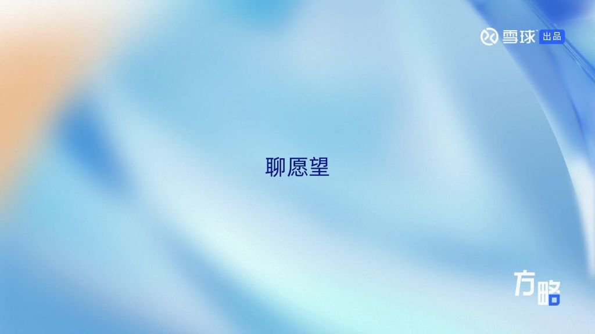
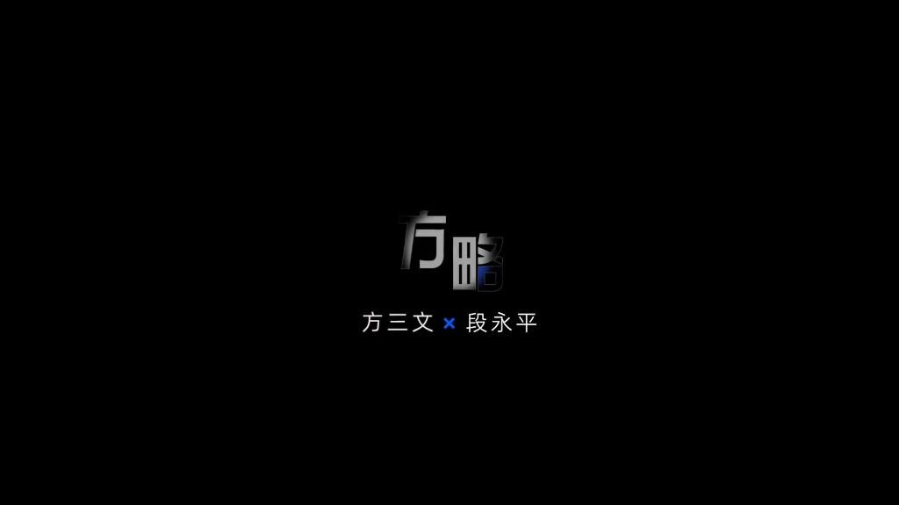

# 段永平对话3小时

以下为AI生成的图文笔记的内容

## 一、陪聊 01:32

### 1. 闲聊用户问题
- 日常活动特点：主要以打球运动为主，球场地点和打球伙伴是主要变化因素，整体生活状态较为规律平淡。

### 2. 成长环境和性格成就 02:10

#### 1）个人成长经历 02:18
- 成长轨迹：
    - 南昌出生，6岁随父母下放江西安福县
    - 在安福县农村搬过5-6个地方
    - 中学时期回到南昌石岗镇
    - 从石岗考入大学，毕业后分配到北京
    - 工作数年后攻读研究生，后南下广东多地发展
- 关键转折：大学毕业后经历北京-广东多地的工作变迁，最终定居现居地

#### 2）家庭环境与父母教育 03:09
- 教育特点：
    - 父母采取宽松教育方式，不强制要求子女
    - 给予充分自由和决策空间
    - 不过度干预子女发展
- 教育影响：
    - 培养了独立决策能力
    - 形成较强的安全感
    - 不畏惧尝试新事物

#### 3）成长环境对性格的影响 04:00
- 性格塑造：
    - 农村生活经历培养了吃苦耐劳品质
    - 频繁搬迁锻炼了适应能力
    - 宽松环境造就了独立思考习惯
- 价值判断：认为父母给予的信任和自由是积极的教育方式

#### 4）对子女的教育方式 04:33
- 教育原则：
    - 不要求子女做自己做不到的事
    - 给予玩耍自由但设定必要边界
    - 注重培养安全感而非强制要求
- 核心理念：安全感是理性发展的基础，边界与信任并重

### 3. 人生目标和胸无大志 05:22
- 目标观：
    - 自称"胸无大志"，无明确人生目标
    - 不追求特殊成就，注重做喜欢的事
    - 以过好日常生活为基本追求
- 生活哲学：不强求非凡成就，重视个人兴趣和日常幸福感

### 4. 老师评价 06:18
- 特殊评价：
    - 中学英语老师曾指出其与众不同
    - 评价与英语实际水平不符（当时英语基础薄弱）
    - 评价成为记忆深刻的特殊经历
- 影响分析：他人评价可能产生意外记忆点，但不一定直接影响发展

### 5. 大学及工作经历 07:51

#### 1）大学专业与兴趣变化 07:55
- 学习轨迹：
    - 本科：工科专业（具体未说明）
    - 研究生：计量经济学（非商科）
    - 强调所学均为逻辑性强的学科
- 兴趣变化：实际兴趣未发生根本转变，始终偏好逻辑性内容

#### 2）大学毕业后的工作经历 08:41
- 初期职业：
    - 北京电子管厂干部科半年
    - 转任教育中心成人教师2年
    - 教授数学课程
- 职业感受：认为教学工作"没太大意思"，寻求改变

#### 3）考研与人大学习经历 09:00
- 考研动机：寻求职业转变机会
- 学习收获：
    - 掌握了学习方法
    - 建立了学习信心
    - 减少了对未知的恐惧
- 关键能力：培养了"学会学习"的能力比具体知识更重要

#### 4）大学学习对人生的影响 09:30
- 深远影响：
    - 形成持续学习习惯
    - 具备面对新事物的勇气
    - 举例：快速掌握智能手机使用
- 代际对比：与拒绝学习新事物的母亲形成鲜明对比

#### 5）研究生毕业后的工作经历 10:28
- 职业选择：
    - 放弃北京工作机会南下广东
    - 首份工作3个月即离职（"进错门"）
    - 最终在中山找到合适岗位
- 决策逻辑：
    - 基于长远考虑而非短期利益
    - 不舒适环境及时调整
    - 年轻时期勇于尝试

### 6. 投资理念 11:00

#### 1）南下广东 13:24
- 股权承诺问题：最初承诺三七分成，后改为二八，最终变为一九分成，导致无法兑现对团队成员的承诺
- 信任危机：股权分配变动反映出契约关系不可靠，形成"一次两次失信后难以继续合作"的局面
- 离职决策：1994-1995年间因机制不可持续而选择离开，后转至东莞创办步步高

#### 2）企业文化 15:26
- 信任与合作的基石
    - 问题本质：并非股份制缺失，而是承诺不兑现导致的信任崩塌
    - 步步高解决方案：从创立初期就建立"说到做到"的合作机制，保持高度信任
    - 契约精神：分红和奖金是按契约应得部分，不应存在"感谢老板"的文化
- 企业文化与创始人品性 17:04
    - 文化形成：企业文化与创始人个人品性高度相关，通过寻找文化认同者自然形成
    - 进化过程：文化在成长中持续进化，如"stop doing list"通过教训逐步积累
    - 淘汰机制：不认同文化者会自然被淘汰，认同者长期留存（如30年老员工）
- 企业文化：本分、诚信与用户导向 18:27
    - 核心价值观：本分、诚信、用户导向的朴素表达
    - 企业愿景："更健康更长久"的平常心追求，不刻意追求500强等虚名
    - 文化起源：受德鲁克"做对的事情，把事情做对"启发形成是非观
- 企业文化中的是非观与价值观 19:14
    - 决策原则：用5秒判断"是否对的事情"可避免大量错误
    - 典型案例：拒绝代工业务（虽可行但不擅长），专注自主品牌建设
    - 错误处理：允许执行过程中的试错，但杜绝明知故犯的原则性错误
- 拥有共同价值观的人是选择出来的 21:33
    - 人才选择：价值观认同是首要标准，主要通过选择而非培养获得
    - 长期稳定性：30年老员工留存证明文化认同的重要性
    - 合作基础：价值观不认同会导致"各打小算盘"的合作破裂
- 企业文化对人的影响 22:41
    - 有限影响：文化环境只能唤醒人已有的"善"的价值观部分
    - 改变难度：本质恶劣者难以通过文化改变，关键仍是初期选择
    - 文化认同：表现为员工长期留存的自然结果（如退休仍保持联系）
- 同道中人与同行者 23:50
    - 两类人群：
        * 同道中人：完全认同文化价值观
        * 同行者：虽不完全理解但愿意遵循
    - 纠错机制：同行者可能犯错但经提醒能回归正轨
    - 外部延伸：代理商等合作伙伴经过长期磨合也能形成强文化认同

#### 3）企业经营 24:39
- 步步高系列的发展与决策过程 24:44
    - 决策机制特点：CEO拥有最终决策权，创始人仅作为顾问角色。即使创始人反对，CEO仍可自主决策并承担相应结果。
    - 转型背景：从电话机（两年做到全国第一）转向手机业务，因原有市场前景受限。
    - 初期争议：创始人认为难以抗衡松下、索尼等国际品牌，后被CEO说服手机是高度个性化产品，可通过差异化竞争取胜。
- 从功能机到智能机的转型与挑战 26:47
    - 被动转型：2012-2013年因智能机快速取代功能机（市场占比"一瞬间"变化），导致库存功能机滞销，现金储备从80亿急剧消耗。
    - 危机处理原则：
        * 底线思维：若倒闭需避免"一地鸡毛"，保障供应商和员工权益
        * 风险缓冲：保留独立投资板块作为"后备部队"（最终未动用）
    - 经验教训：对技术替代速度预判不足，原以为功能机销量会缓慢下滑，实际呈现断崖式下跌。
    - 转型代价：亏损金额创历史记录，但凭借前期功能机积累的风险承受能力渡过危机
    - 对比案例：类似当前AI技术对传统产品的快速替代现象
- 诺基亚的衰落与原因分析 28:50
    - 产品设计缺陷：
        * 早期智能机（如Nokia 171）操作逻辑反人性，改变用户习惯性交互方式
        * 工程师出身的用户都难以操作，反映"公司文化肯定烂掉了"
    - 战略失误：
        * 拒绝Android系统合作机会，固守自有系统
        * 过度关注市场占有率而忽视用户体验
    - 文化问题：决策时考虑"松下老人会怎么想"的守旧思维，类比松下社长决策时关注历史包袱
- 松下公司的管理文化与合作经历 32:14
    - 官僚文化表现：
        * 无人质疑"三年做到市场前两名"的可行性
        * 决策机制僵化，社长考虑"前辈会怎么想"
    - 对比案例：乔布斯明确告诉库克"不要想我会怎么做"
    - 根本问题：管理视线聚焦"后视镜"（历史）而非用户需求
- 创始人离开公司的条件与判断 36:26
    - 退出前提：
        * 团队能力超越创始人（"他们干的比我好"）
        * 建立充分信任机制（"我不怕他们犯错误"）
    - 非典型性：不同于多数企业家坚守一线的做法
    - 关键区别：创始人是否真正"enjoy"管理工作
- 创始人对企业贡献的阶段性 37:23
    - 年龄非决定因素：以90多岁仍在任的巴菲特为反例
    - 持续贡献条件：
        * 保持决策清醒度（"不能晕晕乎乎"）
        * 个人兴趣驱动（巴菲特"喜欢做这件事"）
    - 渐进式放权：在任CEO时已开始培养团队自主决策能力

#### 4）投资 39:16
- 第一次接触股票 39:26
    - 投资契机: 退休后寻找生活新方向，发现投资与生意相关而开始研究
    - 初期困惑: 购买大量技术分析书籍但发现图表分析逻辑不成立
    - 顿悟时刻: 理解"买股票就是买公司"的核心理念后豁然开朗
- 投资核心理念
    - 生意理解的重要性
        * 关键认知: 投资本质是理解企业生意模式，不懂生意则投资困难
        * 实践验证: 企业经营者背景有助于理解其他公司商业模式
        * 能力边界: 承认能真正理解的生意类型有限，一年只能找到少数好公司
    - 投资理念概括
        * 核心理念: "买股票就是买公司"（巴菲特理念）
        * 简单之处: 理念本身极其简单明确
        * 困难之处: 真正看懂公司未来现金流极其困难
        * 行业现实: 大部分公司商业模式难以真正理解
- 投资实践案例
    - 重点投资标的
        * 网易: 早期重要投资案例
        * 雅虎/阿里: 通过雅虎实质投资阿里巴巴
        * 苹果: 重仓持有的大型投资
        * 茅台: 中国市场的核心持仓
        * 腾讯: 重要持仓但比重记忆模糊
        * GE: 后认为商业模式不佳而退出
    - 投资决策标准
        * 巴菲特理论: 一生只需20个重大投资决策（打孔机理论）
        * 当前进度: 约完成10个真正重仓决策
        * 持仓标准: 只保留满意标的，不满意立即卖出
        * 反面案例: GE投资后因认识提升而退出
- 投资认知误区
    - 市场关注误区: 真正理解投资不应过度关注短期市场波动
    - 赚钱与懂的区别: 不懂投资也可能赚钱，但难以持续复制
    - 简单策略: 长期持有标普500指数(SMP)也能获得不错收益
    - 专业要求: 雪球社区可能仅1%用户真正理解价值投资本质
- 投资理念 40:44
    - 例题:网易投资案例 47:30
        * 投资逻辑：投资网易主要基于三个判断：游戏团队热爱游戏且认真、商业模式合理、股价低于净现金（安全边际）。当时市场恐慌性抛售创造了买入机会。
        * 持有心态：账上现金占比不大，可以保持理性持有。若资金占比过高，可能无法承受波动而提前卖出。
        * 收益结果：六个月上涨20倍，最终获利100多倍。但承认并非完全看懂，否则会买入更多或持有更久。
        * 安全边际理解：强调安全边际不是指价格便宜，而是对公司业务的理解程度。便宜的公司可能变得更便宜。
    - 例题:苹果商业模式判断 50:45
        * 商业模式演变
            + 业务转型：从纯硬件公司发展为硬件+软件服务的平台型企业。2011年投资时已清晰看到软件业务将创造更多利润。
            + 判断依据：作为行业从业者，软件业务增长是"看得见的大象"，不需要特别判断就能认知。
        * 企业文化优势
            + 核心特质：极强的用户导向文化，注重产品体验而非单纯生意。坚持长期价值，拒绝提供不足价值的热门产品。
            + 典型案例：
                - 大屏手机延迟三年推出，最终因用户需求而妥协
                - 放弃电视业务（无法提供足够价值差异）
                - 终止苹果汽车项目（价值创造有限）
        * 投资决策框架
            + Stop Doing List：成功的关键在于明确不做什么。30年积累的不做清单大幅降低了错误概率。
            + 文化纠错机制：好文化不能避免犯错，但能更快纠正。如苹果最终修正了大屏手机策略。
            + 当前估值判断：苹果目前投资不便宜，但相比银行存款仍有优势。AI落地可能带来新的增长空间。
        * 通用电气对比案例
            + 卖出触发点：发现通用电气官网移除"诚信是不变准则"的标语，结合商业模式不理解，决定卖出。
            + 错误认知：早期受杰克·韦尔奇影响产生崇拜，后认识到没有"神奇"的公司。虽然交易盈利，仍视为错误投资。
            + 核心教训：即使赚钱的交易，若不符合企业文化+商业模式的双重过滤标准，本质上仍是错误。
    - 西方石油投资案例 01:00:21
        * 油气指数投资经历 01:00:25
            + 短线与长线区别：油气指数与油价关联度达99%，但关键要区分是"每日关联"而非"长期关联"，这种短线特性导致时间损耗成本极高
            + 投资教训：曾投入约1亿美金，亏损1000多万后及时止损，认识到期货/期权类产品不适合长期持有
            + 认知转变：通过巴菲特投资西方石油案例，发现购买实体油田是更优策略——地底资源不受时间损耗影响
        * 西方石油投资想法 01:01:48
            + 投资逻辑：以20年周期看待石油资产，认为当前油价被低估，但持仓比重较小（因对行业了解有限）
            + 风险控制：强调跟风投资者需自行承担风险，举例说明持仓透明度差异（巴菲特持仓公开vs个人持仓不公开）
        * 例题1:抄作业投资法是否可行 01:02:31
            + 滞后性缺陷：跟风操作存在信息时差，无法同步调整仓位比重
            + 透明度问题：非公开持仓无法准确复制（如段永平案例）
            + 核心矛盾：不懂企业本质的盲目跟投风险极大，建议保守投资者首选指数基金
        * 例题2:是否所有的指数都可以买 01:03:29
            + 指数筛选原则：巴菲特推荐的S&P500和QQQ等宽基指数才适合长期投资
            + 警惕误区：市场上存在数千种指数，多数不具备投资价值（如行业指数、策略指数等）
    - 例题:高度变化行业投资分析 01:04:06
        * 行业认知转变：原以为半导体行业变化过快，后发现英伟达生态壁垒（对比AMD与OpenAI合作模式差异）
        * 竞争格局：英伟达通过$1000亿芯片换股建立护城河，客户因恐惧垄断而扶持AMD
        * 投资逻辑：AI浪潮非短期炒作，需保持适度参与（1%左右仓位），避免完全错过技术革命
        * 行业洞察：30年前即预判台积电将超越联电（UMC），因其专注代工模式
        * 现状验证：台积电市占率碾压竞争对手（三星/Intel/IBM等），成为AI芯片代工唯一选择
        * 估值思考：当前股价反映未来预期，若黄仁勋预测成真则估值合理
    - 国营企业和民营企业对比 01:09:26
        * 投资选择：国营企业稳定性与民营企业创新性 01:09:48
            + 体制优势：国企管理层变更风险低（如茅台53度飞天配方稳定性）
            + 反面案例：老干妈二代更改配方导致品牌价值受损
            + 投资标准：选择未来现金流匹配机会成本的企业，不分行业（当前茅台仓位90%+）
        * 创新与用户需求：科技行业与传统行业对比 01:10:33
            + 必要创新：科技企业必须持续创新（如英伟达芯片迭代）
            + 危险创新：传统企业盲目创新可能毁灭价值（如可乐配方变更需保留经典款）
            + 决策框架：变与不变取决于用户真实需求，而非创新本身
        * 例题1:理解企业创新与市场变化 01:11:12
            + 认知共性：无论创新型企业（英伟达）还是传统企业（茅台），深度理解都具挑战性
            + 个人差异：投资者能力圈不同（有人懂科技有人懂消费）
            + 典型案例：长期看好Google但难量化AI对搜索业务的冲击
        * 投资挑战：理解复杂企业与市场趋势 01:12:29
            + 变量分析：需评估AI对传统业务替代率（如GPT对搜索、Gmail的影响）
            + 决策矛盾：虽看好企业文化，仍因技术变革保持谨慎持仓
            + 终极难题：理解企业难度>理解高尔夫运动，体现投资复杂性
    - 特斯拉投资分析 01:12:46
        * 对特斯拉公司的评价
            + 核心观点变化: 对特斯拉的看法有所变化，但没有本质性改变
            + 创始人评价:
                - 正面: Elon Musk有很多先进想法，确实很厉害
                - 负面: 不喜欢其个人品行，不愿与其成为朋友或投资伙伴
        * 电动车行业分析
            + 行业特征:
                - 普遍问题: 电动车生意不会太好，差异化小，竞争会很累
                - 特斯拉优势: 成功实现产品差异化
            + 经营特点:
                - 生产策略: 款式少、产品单一但量大
                - 成本优势: 规模效应带来成本降低，可能实现盈利
        * 个人投资经历
            + 投资历程:
                - 早期非常喜欢特斯拉（车牌为"we love tesla"）
                - 后来因对Musk个人看法和服务体验变差而卖出股票
                - 承认卖出可能是错误决策
            + 矛盾评价:
                - 肯定方面: SpaceX和StarLink项目非常出色
                - 否定方面: 对特斯拉电动车本身评价一般
        * 行业竞争本质
            + 行业本质:
                - 电动车未改变汽车行业强竞争特征
                - 比汽油车简单，导致价格竞争更激烈
            + 发展预测:
                - 多数电动车企业会倒闭，最终只剩少数盈利
                - 智能驾驶可能趋于同质化，使用少数几家方案
            + 竞争程度:
                - 强于航空公司但弱于太阳能硅片行业
                - 差异化小于汽油车
        * 环保性探讨
            + 环保疑虑:
                - 电池本身不太环保
                - 电力生产过程环境影响不明确
            + 未来可能性:
                - 太阳能或核聚变发电可能改变电动车环保价值
                - 若实现，汽油车将难以生存
        * 机器人业务评估
            + 商业价值疑问:
                - 对人形机器人必要性存疑
                - 认为功能性比人形更重要
            + 潜在优势:
                - 双腿设计可能提供更好的移动灵活性
                - 但头部等人类特征可能不必要
        * 对比：伯克希尔投资
            + 长期价值:
                - 文化传承稳定，专注现金流好的公司
                - 比普通基金更可靠的投资选择
            + 管理过渡:
                - 承认新管理层可能犯错，但整体方向不变
                - 比较基准是S&P500，目标略微超越
            + 投资建议:
                - 对不懂投资者，推荐伯克希尔或S&P500指数基金
                - 举例朋友子女采用50/50分配方案
    - 例题:拼多多投资分析 01:22:41
        * 投资性质：拼多多仍属于风险投资范畴，存在不确定性，但比初期认知更深入
        * 仓位调整逻辑：曾大幅减持后又增持，反映对商业模式理解加深但仍保持谨慎态度
        * 估值判断：若能维持当前盈利能力则估值便宜，但持续性存疑
        * 团队信任度：认可管理团队和企业文化，这是增持的重要考量因素
        * 行业特性：电商行业变化快速，存在比现状更成功的可能性
        * 配置原则：用适度仓位参与，不重仓配置，符合风险投资特征
    - 茅台和其他酒的区别 01:24:37
        * 茅台的独特口味与消费者认同 01:24:59
            + 口味壁垒：茅台具有不可替代的独特风味，形成天然竞争壁垒
            + 消费粘性：核心消费者一旦形成饮用习惯会产生持续复购行为
            + 文化认同：与威士忌类比，属于需要长期培养的饮食文化现象
            + 市场局限：非饮用群体难以理解其价值，如同向鱼描述陆地行走
        * 茅台的品质坚持与文化维持 01:25:20
            + 品质管控：严格执行传统工艺标准，抵制"多快好省"的生产方式
            + 文化传承：保持酿造文化的纯粹性是维持核心竞争力的关键
            + 风险警示：若改变传统工艺将动摇企业根基，目前未发现此类迹象
        * 茅台作为国营企业的优势 01:25:55
            + 制度保障：国有企业属性带来严格监管，降低随意变更传统的风险
            + 决策稳定性：多方监督机制确保重大决策需集体通过，避免激进改革
            + 长期视角：相比民营企业更注重可持续发展而非短期业绩
        * 茅台的投资价值与机会成本 01:26:09
            + 估值基准：50倍PE不构成绝对卖出标准，需结合现金流折现判断
            + 仓位管理：2600元时曾考虑减持但苦无更优配置标的而保持持仓
            + 现金困境：人民币存款利率仅1%+，凸显优质股权资产的相对价值
            + 波动承受：股价50%回撤属正常波动范围，需提前做好心理准备
        * 茅台的未来现金流与投资决策 01:26:33
            + 决策核心：未来现金流折现是根本判断依据，而非静态PE指标
            + 分红优势：股息率3-4%显著高于银行存款，提供持有基础收益
            + 动态调整：发现更优资产会切换，但需建立在对新标的充分认知上
            + 价值误区：长期持有不等于永不卖出，需持续评估机会成本
        * 茅台的国际化机会 01:30:00
            + 文化壁垒：白酒国际化面临与威士忌反向的文化传播挑战
            + 华人基础：海外华人群体构成天然消费市场，但非华人接受度低
            + 产品改良：30年陈酿口感更柔和，显示产品升级可能改善接受度
            + 营销投入：需要长期品牌建设投入，目前尚未见系统性布局
        * 投资茅台是否需要考虑宏观环境 01:31:28
            + 时间维度：10-20年投资周期可淡化短期宏观经济波动影响
            + 相对价值：恶劣宏观环境下其他资产可能表现更差，凸显防御性
            + 现金替代：3-4%股息率构成底线收益，优于现金的负实际回报
            + 加仓策略：股价继续下跌时，有余粮可逐步增持优质资产

### 7. 轻松开放性问题 01:32:13

#### 1）AI：泡沫还是工业革命 01:32:23
- 本质判断: AI是工业革命级别的变革，但伴随泡沫特征
- 泡沫表现: 市场盲目跟风现象明显，"阿猫阿狗都跟着一起找"
- 技术本质: AI本质是计算机应用的量变到质变过程，但量变规模达到"100个量级、一万个量级"
- 历史对比: 类似存储器发展后算法优化空间的变化，从"省空间"到"空间不再那么重要"

#### 2）AI对各行业的影响 01:33:43
- 算力需求: 算法优化不会降低算力需求，反而会"激发更多算力"
- 创业效率: 开新公司时，AI可将调研时间从数天缩短至"一个小时半个小时"
- 医疗研究: 团队数年工作可能被"一个人花两天"完成
- 内容创作: 动画真实性难以辨别，小说创作可模仿特定作家风格
- 行业冲击: 电影行业从业者、作家等创意工作者将面临挑战

#### 3）AI对投资行业的影响 01:35:14
- 交易风险: 短线交易者面临更大风险，"炒股票的人会很危险"
- 量化优势: 量化基金通过AI获得速度优势，"你就是铁铁的韭菜"
- 价值投资: 不受AI影响，"收割不了我"的长期持有策略依然有效
- 企业本质: 最终决定公司价值的是盈利能力，"公司靠盈利最后会把自己买回来"
- 茅台案例: 企业回购逻辑，"茅台早就应该回购了，钱多了不好受"

#### 4）AI对GDP的影响 01:37:08
- 历史参照: 蒸汽机革命将农民转为工人，汽车飞机扩大活动范围都提高了GDP
- 效率悖论: AI提高效率的同时存在"减员增效"与"创造新需求"的争议
- 增量证据: Meta、Google等公司已显现明显增量，广告效率提升
- 长期规律: 效率提高最终会增加GDP，"凡是一个东西提高效率长期来看都会产生增量"
- 反例缺失: 历史上找不到"效率提高但GDP下降"的案例，类似马车夫失业但运输业整体发展

### 8. 教育问题 01:40:17

#### 1）父母应为孩子增加安全感 01:40:29
- 核心原则: 父母应为孩子增加安全感，降低安全感的事情不应做
- 负面清单: 包括打孩子、遏制孩子等行为
- 教育方式: 不需要靠打骂，"孩子们其实是不需要靠打"
- 边界把握: 不等于溺爱，"不是意味着你可以没有原则"

#### 2）打骂孩子不可取 01:40:46
- 行为示范: "你骂他就是教他骂人，你打他就是教他可以将来打孩子"
- 实际效果: 个人实践发现"完全不管用"，最终道歉并承诺不再打
- 关系证明: 停止打骂后"现在关系也挺好"
- 情绪处理: 应允许孩子表达情绪，"让他哭一下有什么问题吗"

#### 3）不要与孩子"杠上" 01:42:20
- 关键原则: "不要跟孩子杠上"
- 情绪应对: 孩子说"我不爱你了"只是 momentary 情绪表达
- 处理方法: "不要理他就好"或"打点马虎眼"，等待情绪自然平复
- 运动案例: 观察到家长因孩子打球失误而发脾气是"教导大方"

#### 4）公益投入对教育看法的影响 01:42:41
- 观察发现: 通过做球童等公益活动，看到许多家长错误的教育方式
- 支持方式: 孩子受挫时最需要"抱抱他，拍拍他"
- 等待策略: "不理你就等一会儿"，给孩子自我调节的空间

#### 5）教育的定义及作用 01:44:16
- 核心要素: 包括知识学习、方法掌握和价值观培养
- 显著差异: "受过良好教育和完全没受过教育的人完全不一样"
- 外在表现: 教育程度甚至可以从"眼神、面相"判断出来
- 文凭验证: 通过询问大学课程内容可辨别真假学历

#### 6）教育的实例分析 01:44:47
- 识别案例: 华南工学院无线电系假文凭持有者被一眼识破
- 提问技巧: "你们第一年都上啥课"这类问题能检验真实学历
- 择业建议: 不适合的岗位应选择其他工作，"找份保安都行"

#### 7）教育的核心是学习能力的培养 01:46:15
- 
- 做题价值: "小镇做题家"通过大量做题培养能力
- 悟性差异: 同样做题，"很多人会作死"，关键在于从错误中学习
- 方法获取: 需要"找到方法"，分析"为什么会错"的逻辑

#### 8）未来的愿望 01:47:06
- 生活态度: "胸无大志"，追求"过好每一天"
- 成功逻辑: 因喜欢而做得好，非因成功而喜欢，"不能倒过来讲"
- 事业心得: 找志同道合者共同经营，"可以交给他们来做"

#### 9）对普通人的投资建议 01:48:13
- 基本态度: "投资就是投资，跟你是什么人没有关系"
- 风险警示: 大部分散户"牛市熊市都是亏钱的"，比例达80%
- 量化威胁: AI驱动的量化基金使短线交易更难获利
- 价值投资: 建议持有茅台等优质公司，"你觉得好公司你拿着"
- 情绪价值: 茅台具有不可替代的社交属性，"有情绪价值"
- 认知基础: 投资前提是"你要懂企业"，需建立在自己理解的领域

## 二、段永平投资理念访谈总结

- 访谈背景: 本次采访对象为著名投资人段永平先生，其投资理念被称为"大道无形，我有形"。
- 采访准备: 采访前存在一定困惑，因段永平表示其投资理念在学术层面已多次阐述。
- 访谈价值:
    - 系统性总结: 虽然看似"老调重弹"，但实际形成了对段永平投资理念、价值观和方法论的系统性总结
    - 后续交流: 观众仍可通过雪球平台继续向段永平请教投资相关问题
    - 
- 互动渠道: 雪球平台是持续与段永平交流投资问题的主要渠道

## 三、知识小结

| 主题 | 核心观点 | 关键论据 | 投资案例 | 争议点/难点 |
| --- | --- | --- | --- | --- |
| 投资理念 | 买股票就是买公司 | 需看懂公司商业模式和未来现金流 | 网易、苹果、茅台 | 看懂公司难度大，市场噪音多 |
| 企业文化 | 本分、诚信、用户导向 | 步步高/OPPO/vivo的长期成功 | 小霸王因机制问题离开 | 文化认同 vs. 短期利益 |
| 创新与行业变化 | 差异化决定可持续性 | 苹果生态 vs. 诺基亚失败案例 | 智能机转型危机 | 技术迭代风险（如功能机滞销） |
| AI行业前景 | 工业革命级变革，伴随泡沫 | 英伟达生态优势、OpenAI合作案例 | 英伟达、台积电 | 算力需求 vs. 垄断担忧 |
| 价值投资实践 | 长期持有优质资产 | 茅台独特口味、国营稳定性 | 茅台持仓调整（2600 vs. 1200） | 高估值下的机会成本 |
| 风险控制 | Stop Doing List（如不做代工） | 避免GE式商业模式复杂化 | 西方石油（抄作业） | 滞后性风险 |
| 教育与决策 | 安全感培养、自主选择 | 子女教育中的边界设定 | - | 传统"卷"式教育的反思 |
| 个人哲学 | 做喜欢的事，保持平常心 | "胸无大志，过好每一天" | - | 企业家角色 vs. 早期退休 |

以下为AI生成的图文笔记的内容

## 一、陪聊 01:32

### 1. 闲聊用户问题
- 日常活动特点：主要以打球运动为主，球场地点和打球伙伴是主要变化因素，整体生活状态较为规律平淡。

### 2. 成长环境和性格成就 02:10

#### 1）个人成长经历 02:18
- 成长轨迹：
    - 南昌出生，6岁随父母下放江西安福县
    - 在安福县农村搬过5-6个地方
    - 中学时期回到南昌石岗镇
    - 从石岗考入大学，毕业后分配到北京
    - 工作数年后攻读研究生，后南下广东多地发展
- 关键转折：大学毕业后经历北京-广东多地的工作变迁，最终定居现居地

#### 2）家庭环境与父母教育 03:09
- 教育特点：
    - 父母采取宽松教育方式，不强制要求子女
    - 给予充分自由和决策空间
    - 不过度干预子女发展
- 教育影响：
    - 培养了独立决策能力
    - 形成较强的安全感
    - 不畏惧尝试新事物

#### 3）成长环境对性格的影响 04:00
- 性格塑造：
    - 农村生活经历培养了吃苦耐劳品质
    - 频繁搬迁锻炼了适应能力
    - 宽松环境造就了独立思考习惯
- 价值判断：认为父母给予的信任和自由是积极的教育方式

#### 4）对子女的教育方式 04:33
- 教育原则：
    - 不要求子女做自己做不到的事
    - 给予玩耍自由但设定必要边界
    - 注重培养安全感而非强制要求
- 核心理念：安全感是理性发展的基础，边界与信任并重

### 3. 人生目标和胸无大志 05:22
- 目标观：
    - 自称"胸无大志"，无明确人生目标
    - 不追求特殊成就，注重做喜欢的事
    - 以过好日常生活为基本追求
- 生活哲学：不强求非凡成就，重视个人兴趣和日常幸福感

### 4. 老师评价 06:18
- 特殊评价：
    - 中学英语老师曾指出其与众不同
    - 评价与英语实际水平不符（当时英语基础薄弱）
    - 评价成为记忆深刻的特殊经历
- 影响分析：他人评价可能产生意外记忆点，但不一定直接影响发展

### 5. 大学及工作经历 07:51

#### 1）大学专业与兴趣变化 07:55
- 学习轨迹：
    - 本科：工科专业（具体未说明）
    - 研究生：计量经济学（非商科）
    - 强调所学均为逻辑性强的学科
- 兴趣变化：实际兴趣未发生根本转变，始终偏好逻辑性内容

#### 2）大学毕业后的工作经历 08:41
- 初期职业：
    - 北京电子管厂干部科半年
    - 转任教育中心成人教师2年
    - 教授数学课程
- 职业感受：认为教学工作"没太大意思"，寻求改变

#### 3）考研与人大学习经历 09:00
- 考研动机：寻求职业转变机会
- 学习收获：
    - 掌握了学习方法
    - 建立了学习信心
    - 减少了对未知的恐惧
- 关键能力：培养了"学会学习"的能力比具体知识更重要

#### 4）大学学习对人生的影响 09:30
- 深远影响：
    - 形成持续学习习惯
    - 具备面对新事物的勇气
    - 举例：快速掌握智能手机使用
- 代际对比：与拒绝学习新事物的母亲形成鲜明对比

#### 5）研究生毕业后的工作经历 10:28
- 职业选择：
    - 放弃北京工作机会南下广东
    - 首份工作3个月即离职（"进错门"）
    - 最终在中山找到合适岗位
- 决策逻辑：
    - 基于长远考虑而非短期利益
    - 不舒适环境及时调整
    - 年轻时期勇于尝试

### 6. 投资理念 11:00

#### 1）南下广东 13:24
- 股权承诺问题：最初承诺三七分成，后改为二八，最终变为一九分成，导致无法兑现对团队成员的承诺
- 信任危机：股权分配变动反映出契约关系不可靠，形成"一次两次失信后难以继续合作"的局面
- 离职决策：1994-1995年间因机制不可持续而选择离开，后转至东莞创办步步高

#### 2）企业文化 15:26
- 信任与合作的基石
    - 问题本质：并非股份制缺失，而是承诺不兑现导致的信任崩塌
    - 步步高解决方案：从创立初期就建立"说到做到"的合作机制，保持高度信任
    - 契约精神：分红和奖金是按契约应得部分，不应存在"感谢老板"的文化
- 企业文化与创始人品性 17:04
    - 文化形成：企业文化与创始人个人品性高度相关，通过寻找文化认同者自然形成
    - 进化过程：文化在成长中持续进化，如"stop doing list"通过教训逐步积累
    - 淘汰机制：不认同文化者会自然被淘汰，认同者长期留存（如30年老员工）
- 企业文化：本分、诚信与用户导向 18:27
    - 核心价值观：本分、诚信、用户导向的朴素表达
    - 企业愿景："更健康更长久"的平常心追求，不刻意追求500强等虚名
    - 文化起源：受德鲁克"做对的事情，把事情做对"启发形成是非观
- 企业文化中的是非观与价值观 19:14
    - 决策原则：用5秒判断"是否对的事情"可避免大量错误
    - 典型案例：拒绝代工业务（虽可行但不擅长），专注自主品牌建设
    - 错误处理：允许执行过程中的试错，但杜绝明知故犯的原则性错误
- 拥有共同价值观的人是选择出来的 21:33
    - 人才选择：价值观认同是首要标准，主要通过选择而非培养获得
    - 长期稳定性：30年老员工留存证明文化认同的重要性
    - 合作基础：价值观不认同会导致"各打小算盘"的合作破裂
- 企业文化对人的影响 22:41
    - 有限影响：文化环境只能唤醒人已有的"善"的价值观部分
    - 改变难度：本质恶劣者难以通过文化改变，关键仍是初期选择
    - 文化认同：表现为员工长期留存的自然结果（如退休仍保持联系）
- 同道中人与同行者 23:50
    - 两类人群：
        * 同道中人：完全认同文化价值观
        * 同行者：虽不完全理解但愿意遵循
    - 纠错机制：同行者可能犯错但经提醒能回归正轨
    - 外部延伸：代理商等合作伙伴经过长期磨合也能形成强文化认同

#### 3）企业经营 24:39
- 步步高系列的发展与决策过程 24:44
    - 决策机制特点：CEO拥有最终决策权，创始人仅作为顾问角色。即使创始人反对，CEO仍可自主决策并承担相应结果。
    - 转型背景：从电话机（两年做到全国第一）转向手机业务，因原有市场前景受限。
    - 初期争议：创始人认为难以抗衡松下、索尼等国际品牌，后被CEO说服手机是高度个性化产品，可通过差异化竞争取胜。
- 从功能机到智能机的转型与挑战 26:47
    - 被动转型：2012-2013年因智能机快速取代功能机（市场占比"一瞬间"变化），导致库存功能机滞销，现金储备从80亿急剧消耗。
    - 危机处理原则：
        * 底线思维：若倒闭需避免"一地鸡毛"，保障供应商和员工权益
        * 风险缓冲：保留独立投资板块作为"后备部队"（最终未动用）
    - 经验教训：对技术替代速度预判不足，原以为功能机销量会缓慢下滑，实际呈现断崖式下跌。
    - 转型代价：亏损金额创历史记录，但凭借前期功能机积累的风险承受能力渡过危机
    - 对比案例：类似当前AI技术对传统产品的快速替代现象
- 诺基亚的衰落与原因分析 28:50
    - 产品设计缺陷：
        * 早期智能机（如Nokia 171）操作逻辑反人性，改变用户习惯性交互方式
        * 工程师出身的用户都难以操作，反映"公司文化肯定烂掉了"
    - 战略失误：
        * 拒绝Android系统合作机会，固守自有系统
        * 过度关注市场占有率而忽视用户体验
    - 文化问题：决策时考虑"松下老人会怎么想"的守旧思维，类比松下社长决策时关注历史包袱
- 松下公司的管理文化与合作经历 32:14
    - 官僚文化表现：
        * 无人质疑"三年做到市场前两名"的可行性
        * 决策机制僵化，社长考虑"前辈会怎么想"
    - 对比案例：乔布斯明确告诉库克"不要想我会怎么做"
    - 根本问题：管理视线聚焦"后视镜"（历史）而非用户需求
- 创始人离开公司的条件与判断 36:26
    - 退出前提：
        * 团队能力超越创始人（"他们干的比我好"）
        * 建立充分信任机制（"我不怕他们犯错误"）
    - 非典型性：不同于多数企业家坚守一线的做法
    - 关键区别：创始人是否真正"enjoy"管理工作
- 创始人对企业贡献的阶段性 37:23
    - 年龄非决定因素：以90多岁仍在任的巴菲特为反例
    - 持续贡献条件：
        * 保持决策清醒度（"不能晕晕乎乎"）
        * 个人兴趣驱动（巴菲特"喜欢做这件事"）
    - 渐进式放权：在任CEO时已开始培养团队自主决策能力

#### 4）投资 39:16
- 第一次接触股票 39:26
    - 投资契机: 退休后寻找生活新方向，发现投资与生意相关而开始研究
    - 初期困惑: 购买大量技术分析书籍但发现图表分析逻辑不成立
    - 顿悟时刻: 理解"买股票就是买公司"的核心理念后豁然开朗
- 投资核心理念
    - 生意理解的重要性
        * 关键认知: 投资本质是理解企业生意模式，不懂生意则投资困难
        * 实践验证: 企业经营者背景有助于理解其他公司商业模式
        * 能力边界: 承认能真正理解的生意类型有限，一年只能找到少数好公司
    - 投资理念概括
        * 核心理念: "买股票就是买公司"（巴菲特理念）
        * 简单之处: 理念本身极其简单明确
        * 困难之处: 真正看懂公司未来现金流极其困难
        * 行业现实: 大部分公司商业模式难以真正理解
- 投资实践案例
    - 重点投资标的
        * 网易: 早期重要投资案例
        * 雅虎/阿里: 通过雅虎实质投资阿里巴巴
        * 苹果: 重仓持有的大型投资
        * 茅台: 中国市场的核心持仓
        * 腾讯: 重要持仓但比重记忆模糊
        * GE: 后认为商业模式不佳而退出
    - 投资决策标准
        * 巴菲特理论: 一生只需20个重大投资决策（打孔机理论）
        * 当前进度: 约完成10个真正重仓决策
        * 持仓标准: 只保留满意标的，不满意立即卖出
        * 反面案例: GE投资后因认识提升而退出
- 投资认知误区
    - 市场关注误区: 真正理解投资不应过度关注短期市场波动
    - 赚钱与懂的区别: 不懂投资也可能赚钱，但难以持续复制
    - 简单策略: 长期持有标普500指数(SMP)也能获得不错收益
    - 专业要求: 雪球社区可能仅1%用户真正理解价值投资本质
- 投资理念 40:44
    - 例题:网易投资案例 47:30
        * 投资逻辑：投资网易主要基于三个判断：游戏团队热爱游戏且认真、商业模式合理、股价低于净现金（安全边际）。当时市场恐慌性抛售创造了买入机会。
        * 持有心态：账上现金占比不大，可以保持理性持有。若资金占比过高，可能无法承受波动而提前卖出。
        * 收益结果：六个月上涨20倍，最终获利100多倍。但承认并非完全看懂，否则会买入更多或持有更久。
        * 安全边际理解：强调安全边际不是指价格便宜，而是对公司业务的理解程度。便宜的公司可能变得更便宜。
    - 例题:苹果商业模式判断 50:45
        * 商业模式演变
            + 业务转型：从纯硬件公司发展为硬件+软件服务的平台型企业。2011年投资时已清晰看到软件业务将创造更多利润。
            + 判断依据：作为行业从业者，软件业务增长是"看得见的大象"，不需要特别判断就能认知。
        * 企业文化优势
            + 核心特质：极强的用户导向文化，注重产品体验而非单纯生意。坚持长期价值，拒绝提供不足价值的热门产品。
            + 典型案例：
                - 大屏手机延迟三年推出，最终因用户需求而妥协
                - 放弃电视业务（无法提供足够价值差异）
                - 终止苹果汽车项目（价值创造有限）
        * 投资决策框架
            + Stop Doing List：成功的关键在于明确不做什么。30年积累的不做清单大幅降低了错误概率。
            + 文化纠错机制：好文化不能避免犯错，但能更快纠正。如苹果最终修正了大屏手机策略。
            + 当前估值判断：苹果目前投资不便宜，但相比银行存款仍有优势。AI落地可能带来新的增长空间。
        * 通用电气对比案例
            + 卖出触发点：发现通用电气官网移除"诚信是不变准则"的标语，结合商业模式不理解，决定卖出。
            + 错误认知：早期受杰克·韦尔奇影响产生崇拜，后认识到没有"神奇"的公司。虽然交易盈利，仍视为错误投资。
            + 核心教训：即使赚钱的交易，若不符合企业文化+商业模式的双重过滤标准，本质上仍是错误。
    - 西方石油投资案例 01:00:21
        * 油气指数投资经历 01:00:25
            + 短线与长线区别：油气指数与油价关联度达99%，但关键要区分是"每日关联"而非"长期关联"，这种短线特性导致时间损耗成本极高
            + 投资教训：曾投入约1亿美金，亏损1000多万后及时止损，认识到期货/期权类产品不适合长期持有
            + 认知转变：通过巴菲特投资西方石油案例，发现购买实体油田是更优策略——地底资源不受时间损耗影响
        * 西方石油投资想法 01:01:48
            + 投资逻辑：以20年周期看待石油资产，认为当前油价被低估，但持仓比重较小（因对行业了解有限）
            + 风险控制：强调跟风投资者需自行承担风险，举例说明持仓透明度差异（巴菲特持仓公开vs个人持仓不公开）
        * 例题1:抄作业投资法是否可行 01:02:31
            + 滞后性缺陷：跟风操作存在信息时差，无法同步调整仓位比重
            + 透明度问题：非公开持仓无法准确复制（如段永平案例）
            + 核心矛盾：不懂企业本质的盲目跟投风险极大，建议保守投资者首选指数基金
        * 例题2:是否所有的指数都可以买 01:03:29
            + 指数筛选原则：巴菲特推荐的S&P500和QQQ等宽基指数才适合长期投资
            + 警惕误区：市场上存在数千种指数，多数不具备投资价值（如行业指数、策略指数等）
    - 例题:高度变化行业投资分析 01:04:06
        * 行业认知转变：原以为半导体行业变化过快，后发现英伟达生态壁垒（对比AMD与OpenAI合作模式差异）
        * 竞争格局：英伟达通过$1000亿芯片换股建立护城河，客户因恐惧垄断而扶持AMD
        * 投资逻辑：AI浪潮非短期炒作，需保持适度参与（1%左右仓位），避免完全错过技术革命
        * 行业洞察：30年前即预判台积电将超越联电（UMC），因其专注代工模式
        * 现状验证：台积电市占率碾压竞争对手（三星/Intel/IBM等），成为AI芯片代工唯一选择
        * 估值思考：当前股价反映未来预期，若黄仁勋预测成真则估值合理
    - 国营企业和民营企业对比 01:09:26
        * 投资选择：国营企业稳定性与民营企业创新性 01:09:48
            + 体制优势：国企管理层变更风险低（如茅台53度飞天配方稳定性）
            + 反面案例：老干妈二代更改配方导致品牌价值受损
            + 投资标准：选择未来现金流匹配机会成本的企业，不分行业（当前茅台仓位90%+）
        * 创新与用户需求：科技行业与传统行业对比 01:10:33
            + 必要创新：科技企业必须持续创新（如英伟达芯片迭代）
            + 危险创新：传统企业盲目创新可能毁灭价值（如可乐配方变更需保留经典款）
            + 决策框架：变与不变取决于用户真实需求，而非创新本身
        * 例题1:理解企业创新与市场变化 01:11:12
            + 认知共性：无论创新型企业（英伟达）还是传统企业（茅台），深度理解都具挑战性
            + 个人差异：投资者能力圈不同（有人懂科技有人懂消费）
            + 典型案例：长期看好Google但难量化AI对搜索业务的冲击
        * 投资挑战：理解复杂企业与市场趋势 01:12:29
            + 变量分析：需评估AI对传统业务替代率（如GPT对搜索、Gmail的影响）
            + 决策矛盾：虽看好企业文化，仍因技术变革保持谨慎持仓
            + 终极难题：理解企业难度>理解高尔夫运动，体现投资复杂性
    - 特斯拉投资分析 01:12:46
        * 对特斯拉公司的评价
            + 核心观点变化: 对特斯拉的看法有所变化，但没有本质性改变
            + 创始人评价:
                - 正面: Elon Musk有很多先进想法，确实很厉害
                - 负面: 不喜欢其个人品行，不愿与其成为朋友或投资伙伴
        * 电动车行业分析
            + 行业特征:
                - 普遍问题: 电动车生意不会太好，差异化小，竞争会很累
                - 特斯拉优势: 成功实现产品差异化
            + 经营特点:
                - 生产策略: 款式少、产品单一但量大
                - 成本优势: 规模效应带来成本降低，可能实现盈利
        * 个人投资经历
            + 投资历程:
                - 早期非常喜欢特斯拉（车牌为"we love tesla"）
                - 后来因对Musk个人看法和服务体验变差而卖出股票
                - 承认卖出可能是错误决策
            + 矛盾评价:
                - 肯定方面: SpaceX和StarLink项目非常出色
                - 否定方面: 对特斯拉电动车本身评价一般
        * 行业竞争本质
            + 行业本质:
                - 电动车未改变汽车行业强竞争特征
                - 比汽油车简单，导致价格竞争更激烈
            + 发展预测:
                - 多数电动车企业会倒闭，最终只剩少数盈利
                - 智能驾驶可能趋于同质化，使用少数几家方案
            + 竞争程度:
                - 强于航空公司但弱于太阳能硅片行业
                - 差异化小于汽油车
        * 环保性探讨
            + 环保疑虑:
                - 电池本身不太环保
                - 电力生产过程环境影响不明确
            + 未来可能性:
                - 太阳能或核聚变发电可能改变电动车环保价值
                - 若实现，汽油车将难以生存
        * 机器人业务评估
            + 商业价值疑问:
                - 对人形机器人必要性存疑
                - 认为功能性比人形更重要
            + 潜在优势:
                - 双腿设计可能提供更好的移动灵活性
                - 但头部等人类特征可能不必要
        * 对比：伯克希尔投资
            + 长期价值:
                - 文化传承稳定，专注现金流好的公司
                - 比普通基金更可靠的投资选择
            + 管理过渡:
                - 承认新管理层可能犯错，但整体方向不变
                - 比较基准是S&P500，目标略微超越
            + 投资建议:
                - 对不懂投资者，推荐伯克希尔或S&P500指数基金
                - 举例朋友子女采用50/50分配方案
    - 例题:拼多多投资分析 01:22:41
        * 投资性质：拼多多仍属于风险投资范畴，存在不确定性，但比初期认知更深入
        * 仓位调整逻辑：曾大幅减持后又增持，反映对商业模式理解加深但仍保持谨慎态度
        * 估值判断：若能维持当前盈利能力则估值便宜，但持续性存疑
        * 团队信任度：认可管理团队和企业文化，这是增持的重要考量因素
        * 行业特性：电商行业变化快速，存在比现状更成功的可能性
        * 配置原则：用适度仓位参与，不重仓配置，符合风险投资特征
    - 茅台和其他酒的区别 01:24:37
        * 茅台的独特口味与消费者认同 01:24:59
            + 口味壁垒：茅台具有不可替代的独特风味，形成天然竞争壁垒
            + 消费粘性：核心消费者一旦形成饮用习惯会产生持续复购行为
            + 文化认同：与威士忌类比，属于需要长期培养的饮食文化现象
            + 市场局限：非饮用群体难以理解其价值，如同向鱼描述陆地行走
        * 茅台的品质坚持与文化维持 01:25:20
            + 品质管控：严格执行传统工艺标准，抵制"多快好省"的生产方式
            + 文化传承：保持酿造文化的纯粹性是维持核心竞争力的关键
            + 风险警示：若改变传统工艺将动摇企业根基，目前未发现此类迹象
        * 茅台作为国营企业的优势 01:25:55
            + 制度保障：国有企业属性带来严格监管，降低随意变更传统的风险
            + 决策稳定性：多方监督机制确保重大决策需集体通过，避免激进改革
            + 长期视角：相比民营企业更注重可持续发展而非短期业绩
        * 茅台的投资价值与机会成本 01:26:09
            + 估值基准：50倍PE不构成绝对卖出标准，需结合现金流折现判断
            + 仓位管理：2600元时曾考虑减持但苦无更优配置标的而保持持仓
            + 现金困境：人民币存款利率仅1%+，凸显优质股权资产的相对价值
            + 波动承受：股价50%回撤属正常波动范围，需提前做好心理准备
        * 茅台的未来现金流与投资决策 01:26:33
            + 决策核心：未来现金流折现是根本判断依据，而非静态PE指标
            + 分红优势：股息率3-4%显著高于银行存款，提供持有基础收益
            + 动态调整：发现更优资产会切换，但需建立在对新标的充分认知上
            + 价值误区：长期持有不等于永不卖出，需持续评估机会成本
        * 茅台的国际化机会 01:30:00
            + 文化壁垒：白酒国际化面临与威士忌反向的文化传播挑战
            + 华人基础：海外华人群体构成天然消费市场，但非华人接受度低
            + 产品改良：30年陈酿口感更柔和，显示产品升级可能改善接受度
            + 营销投入：需要长期品牌建设投入，目前尚未见系统性布局
        * 投资茅台是否需要考虑宏观环境 01:31:28
            + 时间维度：10-20年投资周期可淡化短期宏观经济波动影响
            + 相对价值：恶劣宏观环境下其他资产可能表现更差，凸显防御性
            + 现金替代：3-4%股息率构成底线收益，优于现金的负实际回报
            + 加仓策略：股价继续下跌时，有余粮可逐步增持优质资产

### 7. 轻松开放性问题 01:32:13

#### 1）AI：泡沫还是工业革命 01:32:23
- 本质判断: AI是工业革命级别的变革，但伴随泡沫特征
- 泡沫表现: 市场盲目跟风现象明显，"阿猫阿狗都跟着一起找"
- 技术本质: AI本质是计算机应用的量变到质变过程，但量变规模达到"100个量级、一万个量级"
- 历史对比: 类似存储器发展后算法优化空间的变化，从"省空间"到"空间不再那么重要"

#### 2）AI对各行业的影响 01:33:43
- 算力需求: 算法优化不会降低算力需求，反而会"激发更多算力"
- 创业效率: 开新公司时，AI可将调研时间从数天缩短至"一个小时半个小时"
- 医疗研究: 团队数年工作可能被"一个人花两天"完成
- 内容创作: 动画真实性难以辨别，小说创作可模仿特定作家风格
- 行业冲击: 电影行业从业者、作家等创意工作者将面临挑战

#### 3）AI对投资行业的影响 01:35:14
- 交易风险: 短线交易者面临更大风险，"炒股票的人会很危险"
- 量化优势: 量化基金通过AI获得速度优势，"你就是铁铁的韭菜"
- 价值投资: 不受AI影响，"收割不了我"的长期持有策略依然有效
- 企业本质: 最终决定公司价值的是盈利能力，"公司靠盈利最后会把自己买回来"
- 茅台案例: 企业回购逻辑，"茅台早就应该回购了，钱多了不好受"

#### 4）AI对GDP的影响 01:37:08
- 历史参照: 蒸汽机革命将农民转为工人，汽车飞机扩大活动范围都提高了GDP
- 效率悖论: AI提高效率的同时存在"减员增效"与"创造新需求"的争议
- 增量证据: Meta、Google等公司已显现明显增量，广告效率提升
- 长期规律: 效率提高最终会增加GDP，"凡是一个东西提高效率长期来看都会产生增量"
- 反例缺失: 历史上找不到"效率提高但GDP下降"的案例，类似马车夫失业但运输业整体发展

### 8. 教育问题 01:40:17

#### 1）父母应为孩子增加安全感 01:40:29
- 核心原则: 父母应为孩子增加安全感，降低安全感的事情不应做
- 负面清单: 包括打孩子、遏制孩子等行为
- 教育方式: 不需要靠打骂，"孩子们其实是不需要靠打"
- 边界把握: 不等于溺爱，"不是意味着你可以没有原则"

#### 2）打骂孩子不可取 01:40:46
- 行为示范: "你骂他就是教他骂人，你打他就是教他可以将来打孩子"
- 实际效果: 个人实践发现"完全不管用"，最终道歉并承诺不再打
- 关系证明: 停止打骂后"现在关系也挺好"
- 情绪处理: 应允许孩子表达情绪，"让他哭一下有什么问题吗"

#### 3）不要与孩子"杠上" 01:42:20
- 关键原则: "不要跟孩子杠上"
- 情绪应对: 孩子说"我不爱你了"只是 momentary 情绪表达
- 处理方法: "不要理他就好"或"打点马虎眼"，等待情绪自然平复
- 运动案例: 观察到家长因孩子打球失误而发脾气是"教导大方"

#### 4）公益投入对教育看法的影响 01:42:41
- 观察发现: 通过做球童等公益活动，看到许多家长错误的教育方式
- 支持方式: 孩子受挫时最需要"抱抱他，拍拍他"
- 等待策略: "不理你就等一会儿"，给孩子自我调节的空间

#### 5）教育的定义及作用 01:44:16
- 核心要素: 包括知识学习、方法掌握和价值观培养
- 显著差异: "受过良好教育和完全没受过教育的人完全不一样"
- 外在表现: 教育程度甚至可以从"眼神、面相"判断出来
- 文凭验证: 通过询问大学课程内容可辨别真假学历

#### 6）教育的实例分析 01:44:47
- 识别案例: 华南工学院无线电系假文凭持有者被一眼识破
- 提问技巧: "你们第一年都上啥课"这类问题能检验真实学历
- 择业建议: 不适合的岗位应选择其他工作，"找份保安都行"

#### 7）教育的核心是学习能力的培养 01:46:15
- 
- 做题价值: "小镇做题家"通过大量做题培养能力
- 悟性差异: 同样做题，"很多人会作死"，关键在于从错误中学习
- 方法获取: 需要"找到方法"，分析"为什么会错"的逻辑

#### 8）未来的愿望 01:47:06
- 生活态度: "胸无大志"，追求"过好每一天"
- 成功逻辑: 因喜欢而做得好，非因成功而喜欢，"不能倒过来讲"
- 事业心得: 找志同道合者共同经营，"可以交给他们来做"

#### 9）对普通人的投资建议 01:48:13
- 基本态度: "投资就是投资，跟你是什么人没有关系"
- 风险警示: 大部分散户"牛市熊市都是亏钱的"，比例达80%
- 量化威胁: AI驱动的量化基金使短线交易更难获利
- 价值投资: 建议持有茅台等优质公司，"你觉得好公司你拿着"
- 情绪价值: 茅台具有不可替代的社交属性，"有情绪价值"
- 认知基础: 投资前提是"你要懂企业"，需建立在自己理解的领域

## 二、段永平投资理念访谈总结

- 访谈背景: 本次采访对象为著名投资人段永平先生，其投资理念被称为"大道无形，我有形"。
- 采访准备: 采访前存在一定困惑，因段永平表示其投资理念在学术层面已多次阐述。
- 访谈价值:
    - 系统性总结: 虽然看似"老调重弹"，但实际形成了对段永平投资理念、价值观和方法论的系统性总结
    - 后续交流: 观众仍可通过雪球平台继续向段永平请教投资相关问题
    - 
- 互动渠道: 雪球平台是持续与段永平交流投资问题的主要渠道

## 三、知识小结

| 主题 | 核心观点 | 关键论据 | 投资案例 | 争议点/难点 |
| --- | --- | --- | --- | --- |
| 投资理念 | 买股票就是买公司 | 需看懂公司商业模式和未来现金流 | 网易、苹果、茅台 | 看懂公司难度大，市场噪音多 |
| 企业文化 | 本分、诚信、用户导向 | 步步高/OPPO/vivo的长期成功 | 小霸王因机制问题离开 | 文化认同 vs. 短期利益 |
| 创新与行业变化 | 差异化决定可持续性 | 苹果生态 vs. 诺基亚失败案例 | 智能机转型危机 | 技术迭代风险（如功能机滞销） |
| AI行业前景 | 工业革命级变革，伴随泡沫 | 英伟达生态优势、OpenAI合作案例 | 英伟达、台积电 | 算力需求 vs. 垄断担忧 |
| 价值投资实践 | 长期持有优质资产 | 茅台独特口味、国营稳定性 | 茅台持仓调整（2600 vs. 1200） | 高估值下的机会成本 |
| 风险控制 | Stop Doing List（如不做代工） | 避免GE式商业模式复杂化 | 西方石油（抄作业） | 滞后性风险 |
| 教育与决策 | 安全感培养、自主选择 | 子女教育中的边界设定 | - | 传统"卷"式教育的反思 |
| 个人哲学 | 做喜欢的事，保持平常心 | "胸无大志，过好每一天" | - | 企业家角色 vs. 早期退休 |

---
> 🏷️ 本文属《投资知识库 · 02-交易心理与悟道》，重排于 2026-11。
