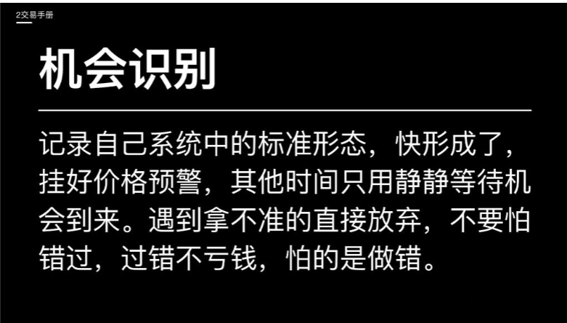
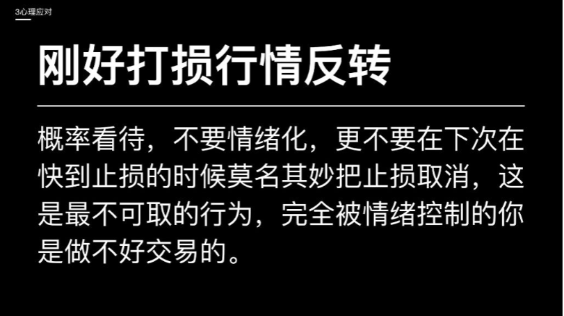

# 交易性格

> 突然之间意识到我的性格。
>
> 不管是工作还是炒股，玩王者荣耀。
>
> 好像总是喜欢一只股票或者只有一份工作，在里边得不到满足，然后又不想走。
>
> 我这种性格适合什么模式的炒股。

> 自己长期关注的股票，如果出现异动，一定要关注，敢于出手。我是来市场赚钱的，不是来谈恋爱的，赚钱才是关键，至于手法什么的，则没那么重要。
>
> 异动：盘面成交量放巨量上涨，第二天下跌，有概念，基本面没有发生巨大变化。
>
> 没有异动，基本面没发生变化，不操作。

> 比较陷阱: 市场中永远存在收益更高、运气更好的人，过度比较会导致心理失衡
>
> 自洽智慧: 即便创造财富，若不懂知足，财富不仅难以守住，还可能带来灾难性后果
>
> 风险警示: 非理性的追求可能导致操作失控，最终将交易者带入深渊

> 你的性格最适合**单标的深耕 + 波段 / 网格 / 做 T**的模式，核心是把一只股做透，用规则替代情绪决策，避免 "拿不住又不想走" 的内耗。

> ### 核心模式与操作要点
> 1. **选股标准（定一只，不轻易换）**：优先选**高流动性、业绩稳健、分红稳定**的蓝筹或行业龙头，最好是你能看懂基本面的标的，排除题材小票和基本面不稳的公司。
> 2. **仓位与资金管理（防满仓风险）**：
>     - 底仓占**50%-60%**，长期持有不动，赚企业成长和分红的钱。
>     - 剩余资金分**2-3 档**，用于波段加仓、做 T 或网格，绝不一次性满仓。
> 3. **核心策略（三选一，或组合用）**：
>     - 🔄 **波段操作**：上涨趋势捂股，跌破关键均线减仓；下跌趋势持币，站稳均线再加仓，设 **10%-15%** 止盈、**5%-8%** 止损。
>     - 🧩 **网格交易**：在震荡区间内，每跌 **3%-5%**加一档，每涨**3%-5%** 卖一档，自动执行，避免情绪干扰。
>     - ⏳ **日内 / 隔夜做 T**：用底仓 + 浮动资金，日内高抛低吸，严格遵守 "**T 完必回**"，不变成加仓或换股。
> 4. **纪律铁则（解决 "不想走" 的痛点）**：
>     - 标的基本面**无重大恶化**时不换股，只调仓位和操作节奏。
>     - 触发止盈 / 止损必须执行，用交易计划或条件单锁定规则，不临时改主意。
>     - 每月复盘一次，只优化参数，不轻易换策略。

> ### 为什么适合你
> + 契合专一性格：聚焦一只股，能快速摸清股性，操作更有把握。
> + 降低决策成本：不用天天选新股、盯多只票，减少焦虑和后悔。
> + 用规则控情绪：明确买卖点和仓位，解决 "得不到满足又不想走" 的纠结。

> ### 快速启动步骤
> 1. 用 1-2 周选定一只符合标准的标的，吃透其基本面和波动规律。
> 2. 制定书面计划：写清底仓比例、加仓 / 减仓阈值、止盈止损线、做 T / 网格的具体参数。
> 3. 用小资金试跑 1-2 个月，优化参数后再放大仓位。

---
> 🏷️ 本文属《投资知识库 · 02-交易心理与悟道》，重排于 2026-11。
