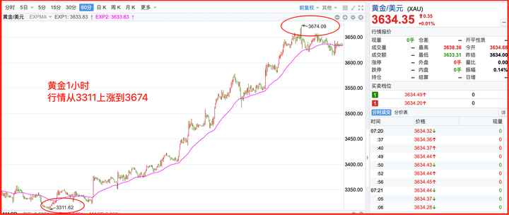
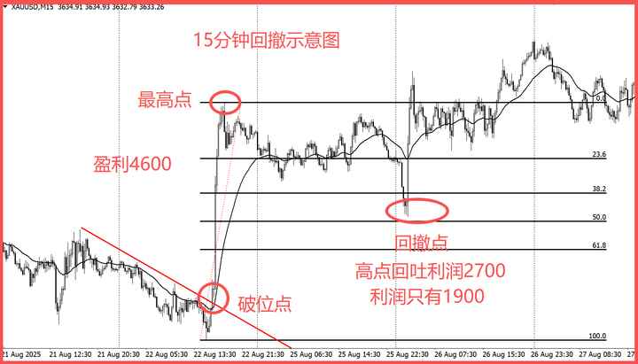
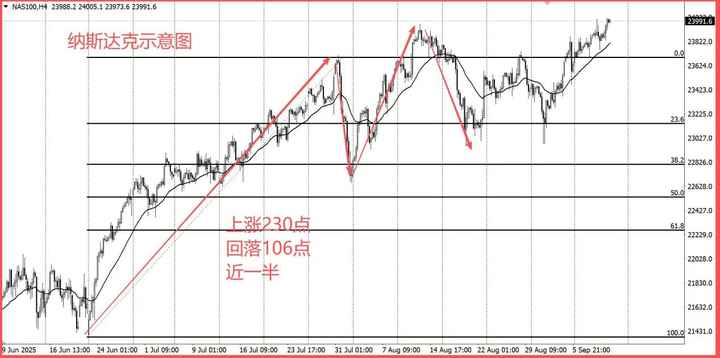

# 大行情来了，你却总是踏空？真相很残酷

最近不管是股市，还是现货黄金，行情都特别大，大家看下方的图片。

黄金1小时级别从8月20号的3311触底，到9月9日的上涨最高到达3674，经过了15个交易日，走出一波300多美金上涨的大行情。

虽然行情大，但最近有人跟我抱怨说，自己踏空了这波大行情，后悔地咬牙跺脚。

确实，大行情来一次不容易，错过的确非常可惜！

**今天我就来跟大家好好聊聊，为啥咱们总是踏空大行情？怎么操作才能拿住做好大行情？**

## 一、为什么你总是踏空大行情？

**第一，可能你的交易计划里根本没有"拿大行情"。**

很多人平时做的就是短线、波段，系统里压根没设计过"吃大趋势"的规则。等行情真走出来了，眼红的是情绪，不是机会。这就是典型的"红眼病"，完全没必要。

要明白：做大趋势的人，在吃肉之前，先被小止损折磨很久。你做波段吃得舒服的时候，他们也在难受。没必要羡慕别人，守住自己那一套就好。

**第二，大部分人拿不住大行情，是因为受不了行情的回撤。**

大家看下方的图表。

图中是黄金15分钟的K线图，这段300美金的大趋势刚启动，15分钟走势就有一波回撤，接近50%。

假如做1手，在破位点进场，到最高点3379，利润4600，而从高点回撤到低点，利润回吐2700，只剩1900美元了。

行情走大趋势总是会洗盘折腾，利润回吐是常态，甚至是大半利润回吐掉，这时候就会有很多人着急忙慌地平仓，害怕把本金全部亏完了，扛不住这种利润回撤，这也是很常见的心理状态。

**第三，周期选择错误。**

大行情要在大周期才能看得清楚。1小时、4小时、日线上的趋势，才是真正的大行情。如果你盯着5分钟、15分钟，一旦出现小级别的反转形态，就会被迫出局。小周期的波动多，噪音大，本身就不可能吃到完整的趋势。

**第四，纪律动摇。**

很多人明明写过规则：只要趋势不破就持有。但真到实盘，一看到盈利回吐就忍不住提前走；或者聪明反被聪明误，想着"先出来，等回调再补进去"，结果行情不给机会，一步踏空。

趋势交易从来不是轻松的旅程，纪律一旦动摇，结局往往就是"完美错过"。

*图：踏空大行情的四大原因（依正文整理）*

<svg xmlns="http://www.w3.org/2000/svg" viewBox="0 0 720 280" font-family="'Microsoft YaHei','PingFang SC',sans-serif">
  <defs>
    <marker id="arw1" markerWidth="8" markerHeight="8" refX="7" refY="3" orient="auto">
      <path d="M0,0 L7,3 L0,6 Z" fill="#94a3b8"/>
    </marker>
  </defs>
  <text x="360" y="30" text-anchor="middle" font-size="15" font-weight="bold" fill="#1e293b">踏空大行情的四大原因</text>
  <rect x="30" y="55" width="660" height="44" rx="8" fill="#eff6ff" stroke="#2563eb" stroke-width="1.5"/>
  <text x="360" y="82" text-anchor="middle" font-size="13" fill="#1e293b">① 交易计划里没有"拿大行情"的规则</text>
  <text x="360" y="118" text-anchor="middle" font-size="12" fill="#475569">短线波段系统 → 行情走出来才眼红 → 红眼病心态</text>
  <rect x="30" y="135" width="660" height="44" rx="8" fill="#fffbeb" stroke="#d97706" stroke-width="1.5"/>
  <text x="360" y="162" text-anchor="middle" font-size="13" fill="#1e293b">② 受不了行情的回撤（利润回吐近50%）</text>
  <text x="360" y="188" text-anchor="middle" font-size="12" fill="#475569">利润回吐 → 着急忙慌平仓 → 只拿到零头</text>
  <rect x="30" y="195" width="660" height="44" rx="8" fill="#eff6ff" stroke="#2563eb" stroke-width="1.5"/>
  <text x="360" y="222" text-anchor="middle" font-size="13" fill="#1e293b">③ 周期选择错误（盯着5分钟/15分钟小周期）</text>
  <text x="360" y="248" text-anchor="middle" font-size="12" fill="#475569">小周期噪音大 → 小级别反转被迫出局 → 吃不到完整趋势</text>
  <rect x="30" y="255" width="660" height="22" rx="6" fill="#fef2f2" stroke="#dc2626" stroke-width="1.5"/>
  <text x="360" y="272" text-anchor="middle" font-size="12" fill="#1e293b">④ 纪律动摇 → 提前走/等回调 → 完美错过</text>
</svg>

## 二、回撤不是风险，而是趋势胜利的"门票"

从技术角度来看，**不存在笔直上涨的趋势**。

上涨的过程中必然伴随着回撤，低点逐步抬升才构成趋势。换句话说，**回撤是趋势的组成部分**，谁也无法改变。

从心态角度，回撤意味着利润回吐，这往往让交易者失去耐心与信心。有人在回撤里被洗出局，成了踏空的；有人死扛到底，结果变成亏损的；只有少数人能熬得住，最终成为盈利的。可以说，**回撤就是拿住趋势必须支付的门票**。

如果把趋势比喻成一个"坏人"，它总会想办法陷害你：制造深回调，放出诱空动作，把你引进坑里，把你的仓位洗掉。多数人就是在这里崩溃离场的。

所以，想吃到大趋势，**关键是别被表象牵着走**。要识破套路，反其道而行之。当大多数人害怕，不敢拿时，坚持住；当市场刻意制造恐慌时，守住自己的规则。看透"坏人"的伎俩，才是破解市场的唯一方法。

大家看下方的图表。

图中是纳斯达克指数4小时K线。它再创新高前，前一段上涨230点，却回落了106点，回吐近一半利润；后一段上涨130点，也回落了100点。趋势就是这样，不可能直线上升，中途一定会有洗盘与诱空。

想拿住大行情，就得接受这种必然。**你想去河里捕鱼，还想不湿鞋？市场不允许。**

## 三、如何识别趋势是"健康回撤"还是"趋势结束"？

实战中也会遇到行情反转了，却以为是回调，最后利润回吐干净，甚至由赢到亏，这就考验咱们技术和经验了，该怎么识别趋势是健康回撤，还是趋势结束？

**技术层面主要参考3个点：**

（1）成交量会萎缩，回调过程中量能减少，这说明是短期的获利盘了结，并不是大资金的出逃。

（2）技术支撑没有破位，价格往往在均线，趋势线或者支撑线上方被托住。

（3）结构没有破坏，上涨的过程中回调会形成了低点，但仍然高于前低，回调之后还能继续创出新高，只要这种"高点更高，低点更高"的结构还在，说明确实没有变，说明行情是健康回调。

**两个注意点**：如果是保守的交易者，出场慢一点，在确认反转的时候，可以把这3个标准都考虑。如果是激进的交易者，就可以只考虑1-2个标准，不符合健康趋势标准就平仓。

## 四、如何控制回撤，抓住大行情？

**（1）分级仓位平仓，留住底仓。**

建仓以后行情发展的过程中，出现了行情的短期回撤，可以部分平仓，但留住底仓，一直持有，直到行情出现了彻底的反转形态后，再全部走。

**（2）移动止损，用结构止损替代价格止损。**

订单进场之后，根据走势的结构调整止损，跟上行情上涨的节奏，可以释放心理压力，因为咱知道行情反转了，也不会出现亏损，还能留住一部分利润。

另外不要因为价格击穿了某一个点位着急止损，而是要结合整体的结构是否出现了反转，比如说走出反向的123的形态在平仓。

这样操作心态更好，也更加稳健。

**（3）用利润加仓，反推信心。**

很多人是一见到利润就想跑，但趋势行情想要真的走出来，会需要很长的一段时间。这时候完全可以用盈利加仓，比如盈利了2%，那么就可以在回撤的点位，利用这2%的利润去加仓，用利润博更大的利润，这样操作首先能控制风险，其次心理压力小，再次利滚利，利润高，一举多得。

**要想抓住大行情，要有一颗强大的心脏，从来没有一帆风顺的行情，回撤也是趋势的一部分，如果一回落就心惊肉跳，急于落袋为安，最终只能拿到趋势的零头，只有承受住波动，才能拿到行情的主升浪。**

---
> 🏷️ 本文属《投资知识库 · 02-交易心理与悟道》，重排于 2026-11。
