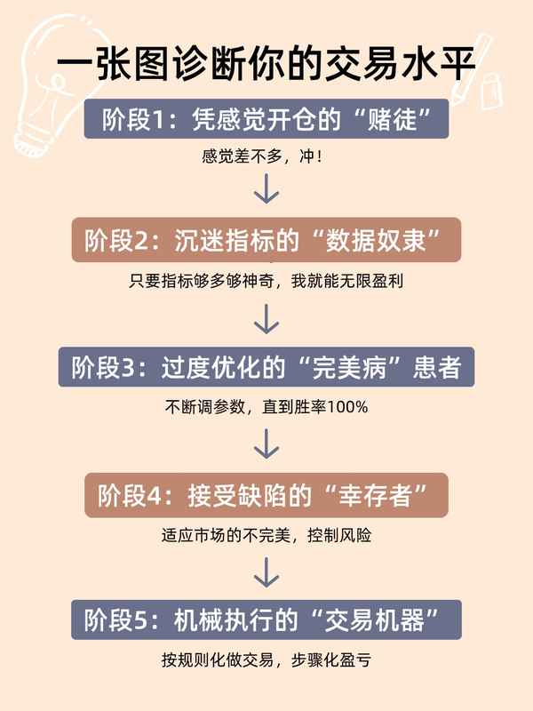

# 一张图诊断你的交易水平，你在哪个阶段？

其实我非常喜欢和交易者聊天，有时候会一起痛骂行情的无情，也会一起调侃曾经傻x的自己，非常畅快。

近期也有一些交易者给到我正反馈，说他们赚钱了，聊他们的交易心得，我觉得非常有意义，在这里也跟大家分享一下。

其中有一位交易者进入外汇不到一年，却已经有了自己稳定的交易策略。他有个理念我印象深刻，叫做"**蚂蚁搬家**"。

他说，大神的玩法很容易翻仓，也很容易爆仓，我们小散最好的做法就是蚂蚁搬家，慢慢盈利，一定要严控自己的风险。

所以近期行情动荡虽然厉害，但是他的交易一直非常稳，风控一流。

**还有另一位兄弟，之前三年的时间亏了几十万，最近三个月，每个月都做了30%的收益。**

他的做法就是把资金分成了几十份，用这种"蚂蚁仓"思维来打复利的效果。他放弃了翻倍的幻想，把仓位管理放在战略地位，也降低了自己的盈利预期，反而做出了效果。

**我其实非常佩服和欣赏他们，因为不是每个人都能放下自己的欲望，走到大彻大悟的这个阶段。**

今天我专门画了一张流程图，梳理了**交易者常见的5个阶段**。每一个阶段，都是咱们自己亲身踩过的坑，走过的弯路。

希望大家能对照一下，看看自己现在在哪一层，心里有个数。只要认清了位置，才能找到真正前进的方向。交易这条路很长，但只要走对了方向，每一步都算数。

文章比较长，建议**收藏**阅读，有收获记得给文章**点个赞**，感谢。

*图：交易者5个阶段自检示意（依正文整理）*

<svg xmlns="http://www.w3.org/2000/svg" viewBox="0 0 620 490" font-family="'Microsoft YaHei','PingFang SC',sans-serif">
  <defs>
    <marker id="ar1" markerWidth="9" markerHeight="9" refX="8" refY="4.5" orient="auto">
      <path d="M0,0 L9,4.5 L0,9 z" fill="#64748b"/>
    </marker>
  </defs>
  <text x="310" y="34" text-anchor="middle" font-size="16" font-weight="bold" fill="#1e293b">交易者常见5个阶段自检</text>
  <rect x="120" y="58" width="380" height="52" rx="8" fill="#fef2f2" stroke="#dc2626" stroke-width="1.5"/>
  <text x="310" y="78" text-anchor="middle" font-size="13" fill="#1e293b">阶段1：凭感觉开仓的"赌徒"</text>
  <text x="310" y="98" text-anchor="middle" font-size="13" fill="#475569">止损：停下来，先学懂再交易</text>
  <line x1="310" y1="110" x2="310" y2="134" stroke="#64748b" stroke-width="1.5" marker-end="url(#ar1)"/>
  <rect x="120" y="140" width="380" height="52" rx="8" fill="#fef3c7" stroke="#d97706" stroke-width="1.5"/>
  <text x="310" y="160" text-anchor="middle" font-size="13" fill="#1e293b">阶段2：沉迷指标的"数据奴隶"</text>
  <text x="310" y="180" text-anchor="middle" font-size="13" fill="#475569">出路：做减法，开始建系统</text>
  <line x1="310" y1="192" x2="310" y2="216" stroke="#64748b" stroke-width="1.5" marker-end="url(#ar1)"/>
  <rect x="120" y="222" width="380" height="52" rx="8" fill="#fef3c7" stroke="#d97706" stroke-width="1.5"/>
  <text x="310" y="242" text-anchor="middle" font-size="13" fill="#1e293b">阶段3：过度优化的"完美病"患者</text>
  <text x="310" y="262" text-anchor="middle" font-size="13" fill="#475569">出路：接受不完美，看100单的结果</text>
  <line x1="310" y1="274" x2="310" y2="298" stroke="#64748b" stroke-width="1.5" marker-end="url(#ar1)"/>
  <rect x="120" y="304" width="380" height="52" rx="8" fill="#eff6ff" stroke="#2563eb" stroke-width="1.5"/>
  <text x="310" y="324" text-anchor="middle" font-size="13" fill="#1e293b">阶段4：接受缺陷的"幸存者"</text>
  <text x="310" y="344" text-anchor="middle" font-size="13" fill="#475569">关键：管住自己，警惕仓位悄悄变重</text>
  <line x1="310" y1="356" x2="310" y2="380" stroke="#64748b" stroke-width="1.5" marker-end="url(#ar1)"/>
  <rect x="120" y="386" width="380" height="52" rx="8" fill="#ecfdf5" stroke="#16a34a" stroke-width="1.5"/>
  <text x="310" y="406" text-anchor="middle" font-size="13" fill="#1e293b">阶段5：机械执行的"交易机器"</text>
  <text x="310" y="426" text-anchor="middle" font-size="13" fill="#475569">情绪平和，反复做正确的事，不着急赚钱</text>
</svg>

## 阶段1：凭感觉开仓的"赌徒"

早期做交易的自己，真的可以用傻x来形容。在那个阶段，我总结了自己身上的四个特征，特别典型。

第一，对市场充满好感，觉得交易是自己走向辉煌人生的大门，梦想着"靠交易自由，靠交易翻身"，一腔热血，眼睛里只有未来，没有风险。

第二，对自己充满自信，真心觉得自己是交易天才，行情一动就以为自己能呼风唤雨，随便抓个波段就能登上人生巅峰。

第三，完全没有规则和方法。今天追涨杀跌，明天猜顶抄底，做多做空全靠感觉，行情涨了看多，跌了看空，翻手为云，覆手为雨，像个盲目的赌徒。

第四，情绪化严重，交易极其频繁。每天十几个小时盯盘，行情一动心跳就加速，浮盈了兴奋，浮亏了沮丧。盈利靠运气，亏损靠扛单，情绪跟着K线上蹿下跳，活脱脱一个行情的人质。

**我当时的操作简直是教科书级的反面案例。**

行情一路下跌，我抄底，连错连亏，不止损被深套。好不容易行情反转，走了多头，我反而因为浮亏太大，心虚砍仓。等行情彻底确认上涨，我的单子已经砍得七七八八了，人也麻了。然后又开始逆势做空，继续深套，继续爆锤。

那个时候我整个人都麻了，但现在回头看，当时并不是什么技术失误，亏损也是必然的，为啥？**因为亏的时候你敢死扛，赚的时候你又拿不住。注定亏钱，毫无悬念。**

这个阶段该怎么办呢？

**很简单，必须停下来。**

别指望自己运气好，别妄想突然开窍。这个阶段继续交易，只会把自己亏成笑话，亏成精神病。停止交易，不是放弃，是止血，是清醒，是给自己留点活路。

**停下来之后，只有两个方向可选：**

第一，退出交易。

认清现实，走这条路要花掉巨量的时间、精力、金钱和心理承受力，而且成功率低得可怜。交易不是适合每个人的游戏。如果认认真真想过，觉得不值得，那就趁早收手，趁你还能全身而退。

第二，决定继续走下去。

那你得明白，从这一刻起，交易不是靠天赋，而是靠学习。而且是系统化地学，是踏踏实实搭建起自己的交易框架，不是边做边学，不是一边亏一边悟。边亏边学，只会越学越乱，越亏越怀疑自己。

先学懂，再交易。懂得慢慢来，才有可能活得久。

## 阶段2：沉迷指标的"数据奴隶"

亏损痛了，人自然就开始找原因。开始意识到直觉靠不住，得学技术。于是开始疯狂学指标，什么MACD、布林带、RSI、KDJ、CCI等等，市面上能搜到的，恨不得全学一遍，全试一遍。

这个阶段有两个典型特征。

**第一，开始纠结哪种指标好。**

有人问我，老师，到底该看K线，还是MACD，还是布林线？

说白了，所有指标本质上都是参考工具，不是答案。

指标永远是概率性的，不存在哪个指标一直准，也不存在一直错。但在这个阶段的交易者眼里，指标出错了，就是"自己还没学好"或者"指标本身不行"。于是换新的，再学新的，越学越急，越学越乱。

结果是，一堆指标学得头头是道，交易照样亏得明明白白。

**第二，只学指标，根本没用。**

交易要的是系统，不是单点技能。方向怎么确认？进场靠什么信号？止损止盈怎么设？仓位怎么管理？这些东西光靠几个指标根本串不起来。指标只是系统里的一个小工具，你只盯着工具，连系统的整体框架都没有，永远拼不出一套能赚钱的东西。

我当时也是，特别刻苦，各种指标背得滚瓜烂熟，还自作聪明叠加一大堆，想着成功率能高一点。结果呢？交易还是做得稀里哗啦，连节奏都找不到。

**那怎么办？很简单，开始建系统。**

去学交易系统的基本结构，了解交易的完整流程：方向、位置、信号、止损止盈、资金管理。然后从自己学过的指标里筛选，留下最熟悉、最顺手的那几个，把它们组装进自己的系统里。

指标不在多，在于精。所以得做减法，总结归纳，搭建自己的系统，才是从"学得多"到"用得准"的真正转变。

## 阶段3：过度优化的"完美病"患者

学完指标，了解了交易系统，大多数人又掉进了另一个坑：**完美病。**

这时候，你已经有了规则，开始按系统操作了，但问题来了。

一次进场，顺利止盈了，但后面行情又拉出一大波，看着没抓住，后悔了。心想：止盈太小，下次得改，得吃到最后一口。

另一次，按规则设置了止损，行情假突破扫掉止损后直接飞了。又懊恼：止损太紧了，要不放大点？或者干脆不止损？

然后你调整规则，下一次遇到震荡行情，本该小赚的单子变成小亏，又开始怀疑：到底怎么做才对？

**就这样，永远在改，永远在怀疑，永远在追求那个不存在的"完美系统"。**

如果你现在也在不断改止盈、改止损，不断测试新指标，不敢正式下场，只在模拟盘上反复打磨，恭喜你，**中了完美病的毒。**

那怎么办？

首先要认清现实：**世界上没有完美的交易系统，就像没有完美的人生一样。交易的本质就是接受"不完美"，接受止损，接受错过，接受吃不到最后一口。你越早接受，越早能走出来。**

其次，眼光放长远。别因为一次假突破就把止损全改了，别因为错过一波行情就乱调止盈。要看的是这套规则长期下来，能不能控制风险？能不能盈利？不是看一单赚没赚，而是看100单之后账户有没有涨，这个更加重要。

交易的终极目标，从来不是打造一个零失误的完美系统，而是搭建一个逻辑清晰、标准明确、你能执行、你能长期活下去的系统。

它不用高大上，不用炫技，只要它能赚钱，只要它你自己用着顺手，就够了。

## 阶段4：接受缺陷的"幸存者"

前面提到的那两位朋友，其实就是典型的处在这个阶段的人。他们的交易很简单，固定一种模式，只做自己看得懂的行情，只盯熟悉的品种，不乱动，不求全。

他们的风险控制非常严，真正明白了一件事：**市场机会从来不缺，关键是你得活着，只有活着才有机会**。这不是空话，是他们一次次熬过来后刻在骨子里的认知。

在心态上，他们也彻底摆脱了追求完美的执念。交易不是没有风险，也不是永远赚钱的游戏，亏损本来就是一部分。他们能坦然接受小亏，能熬住无聊，能在行情不顺的时候耐得住寂寞，不因为一次止损动摇整套逻辑，不因为一次假突破急着改规则。他们不是靠追求完美，而是靠概率和执行，在一笔笔不完美中把账户慢慢做上去。

**至于收益？都不高，但稳**。曲线是缓慢爬升的，不是暴冲，更不是爆炸。账户不大起大落，心态也稳得住。慢慢拉，慢慢堆，耐心熬，像种田一样踏实。

不过，这个阶段也还是暗藏危险，因为有时候人一顺，账户一涨，心里就容易起花。开始想赚得更快，赚得更多，想一把吃大的，警惕心也跟着松了。

慢慢的，仓位悄悄变重，心理压力变大，交易开始变形，动作不标准了。只要一波亏损，就很容易爆发赌性，冲动加码，最后把之前所有的积累，一笔笔吐回去。更可怕的是，一旦滑下去，很难立刻爬回来，还得再重新整理系统，重新找回节奏。

**熬过了凭感觉交易，熬过了沉迷指标，也熬过了完美病，好不容易熬到现在，这个阶段是承上启下的关口。**

表面上你已经能稳定盈利了，但实际上，真正的危险才刚刚开始。

**这里最重要的，不是再去精进什么技巧，而是管住自己**，记住初心，懂得收敛，懂得低头。能稳住的人，才能真正走得长远。市场从来不需要你耀武扬威，它只看你够不够冷静，够不够耐得住。

## 阶段5：机械执行的"交易机器"

到了这个阶段，交易者已经绝对成熟了。仓位控制得非常严格，风险始终在掌控中，交易中几乎没有太大的情绪波动，不会因为止损而过于沮丧，不会因为盈利而超级得意。

有信号就开仓，错了就止损，行情来了就做，行情没走就等，情绪平静，动作利落。

**这个阶段最真实的感受，其实就是——无聊。**

赚钱只是时间问题，做得多不兴奋，做错也不懊悔。

总结成一句话就是：**没有感觉，情绪平和地，一遍一遍反复做正确的事。**

但能做到这种状态，还有一个前提：**就是不着急赚钱。**

要么手上有积蓄，生活无忧；要么有稳定收入，不靠交易养活自己。

只有不急，才等得住机会；只有不急，才愿意接受低回报的稳定增长。

**财不入急门，交易更是如此。**

这也是为啥我老是让大家一定要有自己的收入，尽可能不要以交易为生，因为越急越乱，越乱越亏，最后一头扎进恶性循环，再想爬出来就难了。

交易从来不是雪中送炭，它只是锦上添花。急的人，市场很难给你机会。

所以，如果你读到这里，还能耐心地对照自己的阶段，认真地思考自己卡在哪一关，真的已经比90%的人走得远了。

交易这条路，表面上是在斗市场，其实从头到尾都在斗自己。斗自己的贪婪，斗自己的冲动，斗自己的不甘心，斗自己的幻想。

**希望这篇文章能让你找到自己的位置，也找到继续走下去的勇气。交易路很长，愿咱们都能熬到那个属于自己的春天。**

---
> 🏷️ 本文属《投资知识库 · 02-交易心理与悟道》，重排于 2026-11。
