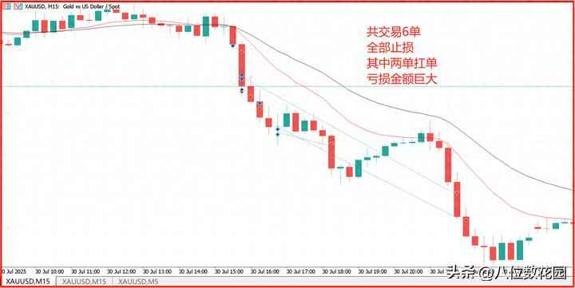

# 止损6单后顿悟：真正赚钱的交易，都是"不用太努力"的

前段时间，一位刚入市的朋友发我一段交易记录，我看完后，心里一阵唏嘘，因为跟我早期做交易的时候一模一样。

他当时想抄黄金的底，思路没问题，大级别是多头，计划等4小时级别出现反转信号再介入。可真正操作时，他坐在电脑前盯着5分钟图，眼见黄金短线急跌，觉得"空间差不多了"，就冲动入场。

这一冲动不要紧，越看越焦虑，一口气在5分钟里下了6单，全部止损。还有两单死扛后被迫砍仓，最终大幅亏损。而回头一看，4小时图根本没有任何反转迹象。他只是在短线波动中被彻底带乱了节奏。

这事让我想起自己刚开始交易的那几年。我曾以为盯盘越久越努力，就可以赚到越多的钱，每天十几个小时坐在电脑前，生怕错过任何机会。

但现实是，真正的亏损，大多不是因为判断错，而是因为盯盘过多，临盘失控。

后来我回看自己的历史交易记录，发现一个惊人的事实：**70%的亏损，都不是因为方向错了，而是计划之外的冲动交易造成的。**

**什么导致冲动？过度盯盘。**

就像上面这位朋友，哪怕方向错了，按4小时计划也只会亏一次，结果在5分钟图上连亏6次，被"节奏错乱"反噬了整个账户。

*图：过度盯盘→冲动交易的恶性循环（依正文整理）*

<svg xmlns="http://www.w3.org/2000/svg" viewBox="0 0 720 280" font-family="'Microsoft YaHei','PingFang SC',sans-serif">
  <defs>
    <marker id="arw1" markerWidth="8" markerHeight="8" refX="7" refY="3" orient="auto">
      <path d="M0,0 L7,3 L0,6 Z" fill="#94a3b8"/>
    </marker>
  </defs>
  <text x="360" y="30" text-anchor="middle" font-size="15" font-weight="bold" fill="#1e293b">过度盯盘 → 冲动交易恶性循环</text>
  <rect x="250" y="55" width="220" height="44" rx="8" fill="#eff6ff" stroke="#2563eb" stroke-width="1.5"/>
  <text x="360" y="82" text-anchor="middle" font-size="13" fill="#1e293b">① 过度盯盘</text>
  <line x1="360" y1="99" x2="360" y2="124" stroke="#94a3b8" stroke-width="1.5" marker-end="url(#arw1)"/>
  <rect x="250" y="130" width="220" height="44" rx="8" fill="#fffbeb" stroke="#d97706" stroke-width="1.5"/>
  <text x="360" y="157" text-anchor="middle" font-size="13" fill="#1e293b">② 行情是情绪的放大器</text>
  <line x1="360" y1="174" x2="360" y2="199" stroke="#94a3b8" stroke-width="1.5" marker-end="url(#arw1)"/>
  <rect x="250" y="205" width="220" height="44" rx="8" fill="#fef2f2" stroke="#dc2626" stroke-width="1.5"/>
  <text x="360" y="232" text-anchor="middle" font-size="13" fill="#1e293b">③ 焦虑催生频繁交易</text>
  <text x="360" y="260" text-anchor="middle" font-size="12" fill="#475569">忽视大局，迷失在细节里 → 连亏6单</text>
</svg>

## 一、为什么"盯盘"反而是多数人亏损的根源？

**1. 因为行情是情绪的放大器。**

当你紧盯行情，看着价格跳来跳去，大脑会自动把每个波动换算成盈亏数字，越看越焦虑，总觉得"眼前这波不能错过"，结果反而做乱。

**2. 焦虑催生频繁交易。**

想赚就急，急了就出手，赚钱想跑，亏钱死扛，这时候你早已不是在执行交易，而是在"情绪交易"。

**3. 忽视大局，迷失在细节里。**

明明计划做4小时级别，结果沉迷5分钟图表，一根K线都能牵动你的心情，做单完全脱离原计划。你以为自己在认真交易，其实只是被行情牵着鼻子走。

## 二、我交易的转折点：少看盘，才是高质量盯盘

我真正开始稳定盈利，就是从"少看盘"开始的。

交易的本质，是捕捉"时间性的机会"。既然是"机会"，就不可能一直都有。

你每天频繁下单，天天盯盘，就是在和"节奏"对抗，不是投机，而是在赌。

后来，我建立了清晰的系统和计划，每天只花一小段时间看行情，标记好关键位置，挂单，设好止损止盈，然后就不再理它了。

心态也从"焦躁等待"变成了"安心等待"，交易反而越做越轻松，账户越来越稳。

## 三、那么，如何正确"盯盘"？

也不是让你不看盘，而是**学会"高质量地看盘"**，方法很简单：

**1. 只盯你该盯的盘。**

比如你专做15分钟整理破位，那就别天天看1分钟，5分钟图。只看自己系统里需要的信号，才能减少噪音干扰。

**2. 做好时间管理。**

比如你专做欧盘或美盘破位，那就集中精力在那几个小时盯盘。或者每天固定3个时间点（比如早9:30、午3:30、晚9:30）快速浏览行情，别把全部精力耗在"等行情"上。

**3. 别做太小级别的交易。**

5分钟是图表中最小的交易周期，再往下就是情绪地雷区。新手在这种周期里极易"手痒"，做出毫无计划的操作。

## 四、最后我想说

交易真正赚钱的秘诀，不是盯盘多，交易多，策略多，而是谁**看得更准、做得更精，更拿得住。**

千万别让"行情走了我没上"这种焦虑驱动你的操作。真正优秀的交易者，一定是那些能够冷静等待机会，按计划执行，不被市场情绪裹挟的人。

减少盯盘，不代表放弃机会，而是为了看得更清、更稳、更有章法。

**记住了，我们要的不是刺激，而是盈利。**

如果你总是账户"起起落落"，也许，少看点盘，就是你翻身的起点。

---
> 🏷️ 本文属《投资知识库 · 02-交易心理与悟道》，重排于 2026-11。
