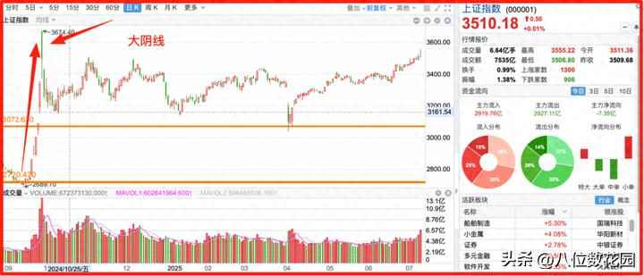
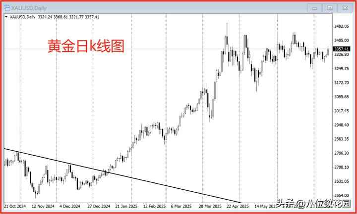

# 反者道之动：一些市场运行的隐秘逻辑

如果你做交易已经有一段时间，可能早就发现一件事：就是市场从不按常理出牌。

你以为大涨还会涨，它却突然反转；你看大家都在看多，它偏偏崩给你看；你技术全到位，却就是拿不住那波利润。

这不是运气不好，是你还没看懂市场深层的规律。

《道德经》说，**"反者，道之动"**。意思是：一切运转，都有反向推动力。顺极则逆，强极则弱，市场也是如此。

今天，我想**分享几个我这些年在交易中反复验证过的"反逻辑"**，它们乍一看不讲道理，但越交易，你越会发现，它们才是**真正的潜规则**。

文章比较长，建议**收藏**阅读，有收获也可以给文章**点个赞**，感谢。

---

## 一、羊群心理与逆向操作

当市场上涨的时候，很多人就更愿意相信"大家都在买，应该不会错"；而当市场下跌时，大家又容易陷入恐慌，跟风抛售。这就是所谓的"羊群效应"，因为只有跟着羊群，大家心里才有安全感，这就是大部分散户的心理状态。

正因为如此，才有**"买在恐惧，卖在贪婪"**这种至理箴言。

当大家都走入极端情绪的时候，市场极度悲观的时候，价格通常已经严重偏离内在价值，这才是逆向交易者布局的好时机。

反之，当市场极度乐观，人心浮躁时，当菜市场大妈都在讨论交易时，这时候反而需要谨慎小心，因为风险已经慢慢在累积，很多"聪明的资金"在悄悄撤退。

举个例子。

**去年9.24之后股市的疯狂我相信很多人都记得，咱们先看图。**

9.24公布了强力的政策组合拳后，当天上证就涨了4.15%，那时候连续涨了很多天，很多人在券商门口排队开账户。

整个市场一片叫好，觉得牛市来了，甚至我常去吃饭的那家面店老板都跟我说，明天歇业一天，去搞一下交易。

那个时候我就感觉到事情不妙，把大部分的钱先撤回了，过了一个相对轻松的国庆，结果节后果然行情下杀，连续几天下跌，结束了热闹哄哄的"牛市"。

**学会这种反向思维，不仅可以让你避免沦为"羊群"中的一员，还可以让你赚到钱，这就是反者道之动的意义。**

*图：羊群心理与逆向操作对照（依正文整理）*

<svg xmlns="http://www.w3.org/2000/svg" viewBox="0 0 720 220" font-family="'Microsoft YaHei','PingFang SC',sans-serif">
  <defs>
    <marker id="arw1" markerWidth="8" markerHeight="8" refX="7" refY="3" orient="auto">
      <path d="M0,0 L7,3 L0,6 Z" fill="#94a3b8"/>
    </marker>
  </defs>
  <text x="360" y="30" text-anchor="middle" font-size="15" font-weight="bold" fill="#1e293b">羊群心理 vs 逆向操作</text>
  <text x="190" y="60" text-anchor="middle" font-size="14" font-weight="bold" fill="#475569">羊群行为</text>
  <text x="530" y="60" text-anchor="middle" font-size="14" font-weight="bold" fill="#16a34a">逆向操作</text>
  <rect x="60" y="75" width="260" height="40" rx="8" fill="#fef2f2" stroke="#dc2626" stroke-width="1.5"/>
  <text x="190" y="100" text-anchor="middle" font-size="13" fill="#1e293b">市场上涨→跟风买入</text>
  <rect x="60" y="125" width="260" height="40" rx="8" fill="#fef2f2" stroke="#dc2626" stroke-width="1.5"/>
  <text x="190" y="150" text-anchor="middle" font-size="13" fill="#1e293b">市场下跌→恐慌抛售</text>
  <rect x="60" y="175" width="260" height="30" rx="6" fill="#fef2f2" stroke="#dc2626" stroke-width="1.5"/>
  <text x="190" y="195" text-anchor="middle" font-size="12" fill="#1e293b">结果：追涨杀跌，成为羊群</text>
  <line x1="330" y1="95" x2="390" y2="95" stroke="#94a3b8" stroke-width="1.5" marker-end="url(#arw1)"/>
  <line x1="330" y1="145" x2="390" y2="145" stroke="#94a3b8" stroke-width="1.5" marker-end="url(#arw1)"/>
  <rect x="400" y="75" width="260" height="40" rx="8" fill="#ecfdf5" stroke="#16a34a" stroke-width="1.5"/>
  <text x="530" y="100" text-anchor="middle" font-size="13" fill="#1e293b">极度恐惧→逆向布局</text>
  <rect x="400" y="125" width="260" height="40" rx="8" fill="#ecfdf5" stroke="#16a34a" stroke-width="1.5"/>
  <text x="530" y="150" text-anchor="middle" font-size="13" fill="#1e293b">极度贪婪→谨慎撤退</text>
  <rect x="400" y="175" width="260" height="30" rx="6" fill="#ecfdf5" stroke="#16a34a" stroke-width="1.5"/>
  <text x="530" y="195" text-anchor="middle" font-size="12" fill="#1e293b">结果：低买高卖，反者道之动</text>
</svg>

## 二、市场不是反应现实，而是反应对未来的猜测

很多人以为，做交易就是自己分析得准，判断得对，市场就会奖励你。

但凯恩斯早在几十年前就提醒过我们，**市场不是一个"谁对谁赢"的地方，而是一个"谁猜对别人会怎么想"的地方。**

他打了一个非常形象的比喻：

报纸上办选美，评委不是投给你心中最美的，而是投给你认为大多数评委会觉得最美的那一个。

所以你在猜的，从来不是"真实的美"，而是"别人心中对美的想象"。

这就是交易中最隐秘、最反直觉的部分：**你不是在买基本面，也不是买现在的价格，你是在买"未来市场对这个标的的态度"。**

在金融市场，这种逻辑几乎无处不在。

比如美联储公布利率决议之前，市场早就猜测是否加息、加多少、语气偏鹰还是偏鸽。

很多时候，哪怕公布的数据本身"利多美元"，但只要市场之前早已"预期透支"，美元指数反而可能利好出尽下跌。

就像有时候加息如期，但措辞不够鹰派，结果美元跌；

利空数据公布，但市场已经提前消化，结果黄金涨；

原油库存下降，看起来利多，但油价不涨反跌，是因为市场原本预期更多等等。

这不是市场疯了，而是**市场早就把消息提前计价了。**你看到的是"现实"，但市场早在交易"预期差"了。

市场不是在对现实做出反应，而是在提前演一出"大家会怎么反应"的剧本。

**你做的不是对未来判断最准的人，你做的是看得懂"预期是否兑现"，并在落地前行动的人。**

这才是高手做交易的方式。

## 三、技术分析的背后是情绪与预期

图形背后是情绪，情绪背后是资金。

技术分析往往被误解为"形而上"的画线游戏，但在真正的市场实战中，K线、形态、指标，其实都是情绪的可视化表达。

**交易的本质，并不是预测市场，而是识别市场预期与现实之间的差异，并在这种"错配"中获取利润。**

**图形的背后其实是"人性的共鸣"。**

每一个经典技术形态的成立，都是集体心理的一次重复，比如头肩顶，是信心的消耗；双底，是恐慌后的企稳；趋势线，是希望与信念的连接。

**那我们如何从K线形态与波动节奏中"嗅出"预期的反转呢？**

其实价格行为中隐藏着大量的非语言线索，真正理解市场预期的关键在于：

（1）节奏是否自然：比如趋势中的"等长波段"开始缩短，预示动力衰竭；

（2）反弹质量：强趋势中的回调若反弹乏力，预期可能正在发生变化；

（3）K线细节：长上影线连发，不一定是"顶部"，可能只是反复诱多；但如果影线集中出现于成交密集区，则暗示大资金的压制；

另外，还有一个重要的判断法则是：如果市场"该涨不涨"，"该跌不跌"，往往意味着预期正在悄然反转。

**这个时候我就要提到一个市场的"最大痛点"原则，就是最大不利持仓区。**

这是我们很多人经常会忽略的一个原则，就是**市场往往会奔向"多数人最难受的位置"，因为资金的运作逻辑是对手盘博弈。**

**最大痛点区=持仓最密集+盈亏最不利的区间。**

这常常体现在以下几种方式：

**（1）关键支撑/阻力附近的虚破：**引发大量止损单，随后快速反向；

**（2）连续震荡后的假突破：**吸引追单入场，制造浮亏筹码，反转拉爆；

**（3）情绪一致性过强：**例如"所有人都看空"的时刻，可能已经无可继续下杀，反而成为反弹的启动点。

这些区域就值得我们去反向思考：**如果我是主力，我会如何利用这些位置洗盘/诱多/拉升？**

只有与主力站在一起，才能更明确地看到市场绝大多数人的情绪结构，才能找到这种预期错配。

价格本身不会说话，但它的节奏与形态，会告诉你人们的想法和恐惧。抓住这些暗流，才是把握趋势的关键。

## 四、反"亏损者"道而行之

市场上盈利者少见，亏损者比比皆是，反其道而行之，就会有不错的效果。

比如大部分人想要赚快钱，那么我们就小心谨慎，遇到好的机会再快准狠地下手。

别人追涨杀跌，毫无规则，我们就建立交易系统。

别人见利就跑，我们就耐心持仓。

别人不止损扛单，我们就严格止损。

**看下边的图。**

图中是黄金的日k线图，今年黄金从2688向上破位最高到达了3499，上涨了800美元，在4个月里就有如此大的涨幅，应该是历史最大的一波上涨。

在这样的走势里，如果没有止损，账户被打爆的人不计其数，子弹都没了，就毫无反击之力了。

咱们经常说，交易者中10%盈利，20%持平，80%亏损，如果你能把亏损的交易者的问题都找出来，并在交易中避免这些错误，那我们至少就能进入20%盈亏持平的人群当中，再努努力，就能跳到10%盈利的群体中，何乐而不为？

## 五、写在最后

做交易的这些年，我越来越相信一句话：

真正的智慧，从来都不是看得比别人多，而是反得过人性，熬得过孤独。

市场不是逻辑推理的试卷，它更像是一面镜子，映出我们的贪婪、恐惧、执念和犹豫。而"反者道之动"，正是对这些人性弱点的一次次校正。

它提醒我们：**当所有人都在兴奋，你要学会冷静；当大家都在恐惧，你反而要更清醒。**

这些"反逻辑"你可能一时看不出价值，**但会在某一天，让你避开一次爆亏，守住一波利润，走出一段迷茫。**

哪怕你今天还在亏，还在学，也别急，因为这条路本就不是为大多数人准备的。

但只要你肯反思，肯修炼，肯坚持，"反者道之动"，终有一天会成为你稳住脚跟的根本法门。

**如果你也认同这些逻辑，欢迎把这篇文章转发给和你一样还在路上的交易者，也许一句话，就能帮他们少走一段弯路。**

---
> 🏷️ 本文属《投资知识库 · 02-交易心理与悟道》，重排于 2026-11。
