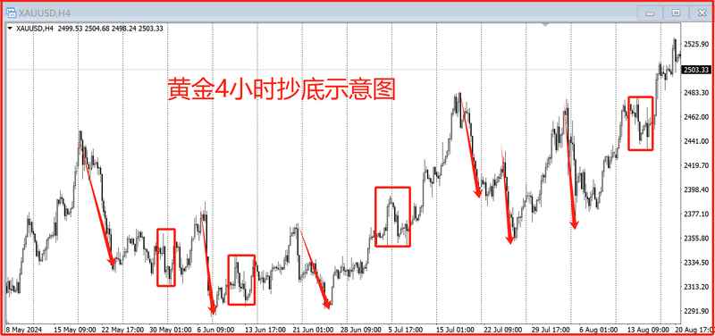
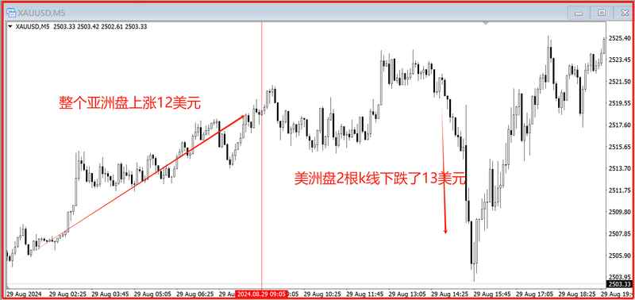

# 大道至简！颠覆你交易思想的好文！

一个交易了8年的朋友最近过来跟我感慨，说自己探索了好多年的技术方法，最后又兜兜转转回到了几年前，发现一开始的方法就是好用的，但一直觉得不够满意才走了这么多的弯路。

"大道至简"这四个字来源于《道德经》，所谓"道常无为而无不为"，所有东西的基本原理和技术方法都是很简单的，不要无端去衍生出无穷无尽的事物。学会顺应自然，顺势而行很重要。

咱们今天的文章也不说什么玄乎的道理，**就说几个交易中最简单，却也最颠覆你认知的思想，让我们的交易更高效地进入盈利。**

文章比较长，建议**收藏**阅读，觉得有收获可以给文章**点个赞**，感谢。

## 一、只做擅长的行情

**一位今年交易战绩很不错的朋友，跟我分享了他近一年的交易思路。**

他只做黄金，而且只做多单，**他的交易思路很简单，就是等黄金出现了深回调之后的多单。**

我问他：你就不怕行情不回调吗？

他说：那就等，没有不回调的多头，也没有不回调的空头。

我又问：那交易机会不多怎么办？

他说：不用天天都交易，甚至不用每周都交易，有把握的机会一年做上几次就够吃了。

**听了他这番话，我突然想起多年前认识的一个小妹妹，她也是差不多的逻辑，一直做的是中概股，一年交易两三次，每年收益都在20%左右。**

这位兄弟每次都会在黄金快速放量大跌之后的支撑位置，观察在支撑位置附近行情是不是有止跌的信号，在4小级别或者1小时级别用k线的反转形态进场，这样的止损很小，只要行情再次向上，至少有10倍以上的盈亏比。

虽然也会遇到抄底失败的时候，但是在如此高盈亏比的交易机会之下，成功率低一点，一样能赚很多。有时候也不得不佩服这些年轻人，交易起来简单粗暴，想得少，反而还赚得多。

**大家看下方的图片。**

图中是黄金4小时级别的k线图，从今年3月份以来，4小时级别出现单边下跌，企稳之后，都会有一波空间很大的上涨，交易机会并不多，但成功率很高。

**他的交易思路真的是超级简单，随便来一个交易者都可以理解他的思路，关键是这种思路还真心有效啊！**

最简单的大趋势判断，最简单的回调做多，最基本的等回调，最简单的开单方式，最简单的高盈亏比的盈利逻辑。

但是区别就在于，我们大家都懂，大家都觉得对，但是真正有耐心去这么等机会，去这么做的人太少。

这就是我说的技术上的大道至简。看到这里大家可以自己在脑海里想一想，做了这么久的交易，是不是心中也有你自己擅长的行情？

如果有的话，可不可以自己找时间去细化，也做到"只交易几次有把握的机会"，拿到该拿的利润？

我相信你们心中有数。

## 二、不做基本面

好多人经常问我，基本面重要还是技术面重要？两者结合怎么做？可不可以通吃？

**我也试过两者都研究，但是效果不好。**

因为我们是普通人，不管你是从哪个渠道获取的信息，它都是倒了好多手的，跟宁波二手车的水一样深，你根本不知道它是真是假，永远都会慢一步。

而且更有甚者，很多人会利用这些信息来引导我们散户去犯错误，好被他们收割。

所以作为普通人去接触到上层信息是很难很难的一件事，也不要扯什么买了小道消息，逻辑很简单，有这种消息的为什么要卖给你？自己闷声发大财不好吗？

还有我自己觉得很难的一点就是，我作为一个不是科班出身的普通人，对经济学和财务知识研究不足，像外汇中的经济数据，利率，通胀，汇率等等，涉及太多方面的知识，如果个个研究透，可能我的人生几十年也就过去了。

**宏观数据也是有滞后性的，我们在的高度和角度，跟索罗斯这样的人是完全不同的，如果无法接触到一手消息，那么宁愿不接触，就不会被影响判断。**

就像8月30号，欧盟公布了欧洲8月份消费物价指数，同比增幅从2.6%降至2.2%，是2021年8月份以来的最低水平，这为欧洲央行继续降息留出了空间。

但这些个描述都非常模糊，到底会降息多少点？不知道。会影响多大空间的行情？空头什么时候启动？什么时候结束？所有的信息都很模糊，让人完全无从下手，怎么形成交易决策？

**所以基本面对我的作用就是：看看就好。大概知道什么时候有重大信息，大趋势如何？会不会出现黑天鹅？要特别注意做好风险管理。**

## 三、人性其实非常简单

之前有个朋友给我留言说：看准的关键位置没进去，行情直接走了一个大单边趋势，我现在感觉既遗憾又有自责，每天难受得要死。

**我知道很多人在交易中有一种心态，叫做"走路不捡钱就像丢钱"。**就像两年前没买英伟达的很多朋友一样，恨不得锤自己两顿。

我们人性就是这么简单呀，特别是到交易中，就会像一个小婴儿一样，完全无法控制自己的情绪，亏了就难受，盈利了就开心，错过行情会遗憾，做错了会懊悔。

即便是日常情绪很稳定的人，可能到了交易中就会变得情绪化，那是因为平时生活可能相对平稳，没有遇到什么事儿，但是到了交易中，行情就是一波又一波的"事儿"，情绪不稳定很正常。

**我觉得唯一的解法就是不要去高估自己，把自己看得简单点，普通点，接受那个不完美的自己。**

我就是觉得自己自控能力太差，自己情绪不稳定，我才会建立交易系统去对自己的行为进行约束。

我就是觉得自己不大行，风险一高心就慌，所以我才降低预期，低仓位运行，我宁愿赚得少一点，我也要赚到钱。

我就是觉得自己很普通，做不成交易的神话，我也不是什么大师，所以我就不会有什么痴心妄想去做到翻几倍，几十倍的利润。

我就想简简单单把自己能做的交易做好，赚到我能力范围内该赚到的钱，我就满足。

我承认自己人性中的不堪，所以我不贪，我顺势而为，这也是我赚到钱的原因吧。

## 四、学会空仓

交易跟其他行业不一样，不是多劳多得，有时候可能还会多劳少得。

我看大家在交易中总是忙忙碌碌的，一天不做个单子浑身痒痒，只要走势还在波动，自己交易就不能停下。

其实做了这么多年交易下来，我发现自己空仓的时间是远远多过于做单的时间的。

像外汇这种可以24小时交易的市场，有亚洲盘，欧洲盘，美洲盘，行情波动都很大，尤其是欧洲盘和美洲盘。

北京时间晚上8-12点是欧洲盘和美洲盘重叠的时间，波动无疑是最大的，有时候美洲盘一根5分钟的k线走出来，比亚洲盘一上午的空间还大。

**如果你做的是日内交易，那么毫无疑问可以选择亚洲盘空仓，做欧洲和美洲盘。**

大家看下方的图片。

图中是黄金5分钟的k线图，整个亚洲盘黄金上涨了12美元，在美洲盘时段，行情借着美国的数据下跌，两根5分钟k线就下跌了13美元。

**要做出漂亮的盈利，就需要高质量的交易机会。**

虽然市场无时无刻都在波动，但好机会都是等来的，不是找来的。就像文章开头的那位兄弟，等待符合自己交易逻辑的机会，才能稳稳地赚到钱。

## 五、永远不满仓

这市场上的神话还是蛮多的，大部分都是满仓梭哈，然后一下子翻了几十倍，看得人肾上腺素飙升。

爽剧大家都喜欢，但应用到自己身上容易变成悲剧。因为很多成功并不是偶然，少部分源于运气，大部分归结于你对某个行业的理解，研究的深度，还有胆量，所以不要轻易去模仿。

**我觉得不满仓的感受，就是给你的交易上一道保险。**

这种感觉会非常舒服，因为你觉得你手上永远都有筹码，心态就不会慌。

期货和外汇都有杠杆，行情波动也更大一些，如果是一下子满仓或者重仓，都会带来完全不可控的风险，这是非常可怕的。

作为做了多年交易的老鸟，我一定不会让这种事情发生。所有历史上快速升起又快速陨落的交易明星，也都是因为风险控制没有做到位。

**满仓意味着你被绑架了，失去了交易中的主控性和灵活性，面对未来市场行情的变化，你是毫无办法的，不要让自己陷入这种境地，会非常无助。**

而且你满仓交易的时候，心理压力是巨大的，有时候一点点小小的波动都会让你极度恐慌，可能因为这种情绪就乱平仓了，结果亏多盈少。

反正不要满仓去赌行情，即便是一开始可能会突然产生高额的回报，但是这种盈利不是可持续性的，可能某次遇到走势不利，一下子就清零了。

## 六、关于技术指标和技术形态

**技术指标跟技术形态大家都掌握一个"KISS原则"吧，"Keep It Simple, Stupid"。**

意思就是，保持简单，保持傻的状态。

很多人看不上一些指标啊，比如什么均线，裸K，黄金分割，觉得只有复杂的指标才能配得起自己高贵的交易策略，特别是那种让人捉摸不透的，一看就很高大上的指标。

**但是等你兜兜转转一圈回来，一定会大喊三声：简单的指标和技术形态才是永远的神！**

比如做趋势你用均线，做震荡你用RSI和MACD，技术形态用支撑压力位，反转形态用双顶双底，中继形态用三角形和矩形，k线形态用吞没和黄昏星，启明星。

曾经你看不上的这些指标和技术形态，在行情中被无数次验证，为啥？因为它有效啊！

而且越简单的东西越好识别，你想想看，在那么复杂的行情里，你要一眼就找到自己能做的行情，没有一个简单好识别的技术形态，你可能找着找着，行情就过了，这还怎么整？

在交易中我们老是谈到执行力这个问题，所谓的大道至简，为的就是让自己的技术标准变得简单，变得易操作，这样我们才有可执行性，才能坚持下去。

**所以不要把事情搞得太复杂，就像咱们人到中年的人际关系，越简单，越舒服，越好。**

## 七、关于成功率和盈亏比

我经常会被问到一类问题：我的交易系统采用固定盈亏比的模式，盈利还比较稳定，就是有时候止盈了行情继续推动，就会错过大利润，有没有什么办法也能抓住大利润？

**兄弟们咱们要了解一个事情啊，人生的绝大多数痛苦，都是来源于"既要又要"，很多失败也是来源于追求完美。**

如果你的方法已经可以赚到钱，可以稍微优化一下利润，但是不要去大刀阔斧地改了，因为你不可能赚到所有的钱，能赚钱已是大幸，不可贪心。

**我们在成功率和盈亏比之间，可以寻找两个平衡点：**

一个是数学上的平衡点，也就是成功率和盈亏比的数据是能够盈利的，比如成功率60%，盈亏比1:1，这个交易数据就是可以做到盈利的。

一个是情感上的平衡点，有的人喜欢高成功率的策略，虽然每笔交易的盈利不高，但是可以带来稳定的满足感；有的人就喜欢高盈亏比，在多次小亏损之后迎来一笔大盈利，喜欢这种刺激的感觉，这都是可以的。

**多的不说，就一句话，适合自己的就是最好的，不要贪心，这世界上很多事情都能做成。**

---
> 🏷️ 本文属《投资知识库 · 02-交易心理与悟道》，重排于 2026-11。
