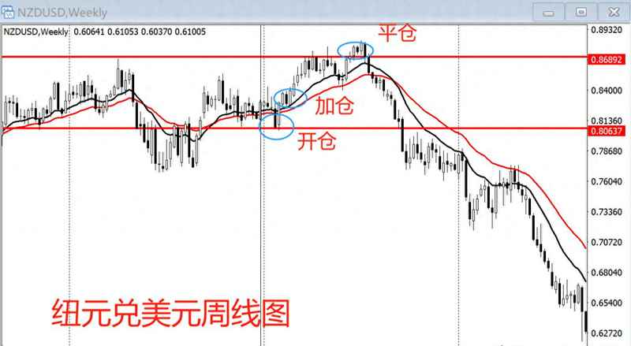

# 交易中的几个顿悟瞬间

我做交易十几年的时间，遇到过很多亏损，遇到过很多困惑，遇到的问题都没有人能给你答案，你也不知道去哪里寻找答案。

幸运的是，你会遇到很多人，很多书，很多经历，总会遇到一些契机，让你突然打破了原有的认知，解决了心底的疑惑，找到了一个清晰的方向。

这些都被我称之为顿悟的瞬间，对我来说也算是交易路上的"神药"，因为解决了我曾经焦头烂额的问题，也帮助我找到真正能走向盈利的路。

所以今天我会把这些顿悟的契机，和顿悟的内容都分享给你们，希望你们在未来的交易中也可以顿悟出自己的交易之道，做到盈利。

文章比较长，建议**收藏**阅读，觉得有收获可以给文章**点个赞**。

*图：交易生涯中的三次顿悟（示意）*

<svg xmlns="http://www.w3.org/2000/svg" viewBox="0 0 720 200" font-family="'Microsoft YaHei','PingFang SC',sans-serif">
  <defs>
    <marker id="arw1" markerWidth="8" markerHeight="8" refX="7" refY="3" orient="auto">
      <path d="M0,0 L7,3 L0,6 Z" fill="#94a3b8"/>
    </marker>
  </defs>
  <rect x="20" y="50" width="200" height="100" rx="8" fill="#eff6ff" stroke="#2563eb" stroke-width="1.5"/>
  <text x="120" y="85" text-anchor="middle" font-size="14" font-weight="bold" fill="#1e293b">顿悟一 · 见路不走</text>
  <text x="120" y="110" text-anchor="middle" font-size="12" fill="#475569">不照搬别人的系统</text>
  <text x="120" y="130" text-anchor="middle" font-size="12" fill="#475569">走契合自己的路</text>
  <line x1="220" y1="100" x2="260" y2="100" stroke="#94a3b8" stroke-width="1.5" marker-end="url(#arw1)"/>
  <rect x="265" y="50" width="200" height="100" rx="8" fill="#fffbeb" stroke="#d97706" stroke-width="1.5"/>
  <text x="365" y="85" text-anchor="middle" font-size="14" font-weight="bold" fill="#1e293b">顿悟二 · 止损铁律</text>
  <text x="365" y="110" text-anchor="middle" font-size="12" fill="#475569">不论轻重仓位</text>
  <text x="365" y="130" text-anchor="middle" font-size="12" fill="#475569">不止损必亏</text>
  <line x1="465" y1="100" x2="505" y2="100" stroke="#94a3b8" stroke-width="1.5" marker-end="url(#arw1)"/>
  <rect x="510" y="50" width="200" height="100" rx="8" fill="#eff6ff" stroke="#2563eb" stroke-width="1.5"/>
  <text x="610" y="85" text-anchor="middle" font-size="13" font-weight="bold" fill="#1e293b">顿悟三 · 人为自然立法</text>
  <text x="610" y="110" text-anchor="middle" font-size="12" fill="#475569">为自己创造规则</text>
  <text x="610" y="130" text-anchor="middle" font-size="12" fill="#475569">用系统观察市场</text>
</svg>

## 顿悟瞬间一

曾经我有一段时间是属于交易中的"尴尬期"，我已经知道了交易系统的存在，也知道交易系统可以带我走向盈利，但是陷入一种奇妙的怪圈。

我觉得这世界上一定存在一种神奇的交易系统，可以同时做到高盈亏比，高胜率，并且能做到稳定盈利。

所以我花了很多时间去疯狂寻找和学习别人的交易系统，也花了很多钱去参加各式各样的培训，我希望通过复制别人的成功经验，让自己更快速进入盈利。

但是每次试验下来，我发现根本没有遇到一个好的交易系统，因为每个都有问题，要么是盈利不稳定，要么是回撤太严重，要么是交易频率太低，等的时间太久，兜兜转转下来，钱亏了很多，方法还是没找到。

**我那个时候开始怀疑自我，觉得自己运气实在是太糟糕了，是不是老天就注定了我不可能做到盈利？**

后来我在一个契机之下，看到了一本书叫《天幕红尘》，其中有一个观点叫"见路不走"。

书里谈到，每个成功经验的背后，都有着不一样的天然条件，比如成功者的成长经历，受教育的程度，他的思想觉悟，社会背景，运气等等，天时地利人和，不是单纯取缔他的经验方法就能成功了。

我刚开始并不能完全理解，觉得自己不成功是否就是因为没有成功者的背景和气运。

**后来再看到书的后面才明白，所谓的见路不走，不是让你不要走别人的老路，而是要走"自己的路"。**

交易系统不是不可以照搬别人的，只是别人的交易系统与你自己并不契合，你要找到与自己契合的交易系统。

但是单纯通过找，你是不可能找到的，因为每个人的交易习惯都不同，只有自己创造的才最契合自己。

你可以通过借鉴别人的东西，通过改良和优化，结合自己的性格特征，以及交易习惯，创造出属于自己的交易系统。

我现在正在使用的交易系统，就是通过整合我曾经看到过的所有交易系统，从中摘选了我觉得好用且有效的策略，再经过长期的复盘和模拟盘测试，一点点优化修改成我自己的交易系统，沿用至今。

就像很多成功的公司，总有一群跟风者一拥而上，但是同样成功的却寥寥无几，就是同样的道理。

有的人想成为利弗莫尔，有的人想成为索罗斯，有的人想成为巴菲特，但百年的金融史上依然只有这几个人。

**这个世界上大到一个国，小到一个公司，个人，没有一条可以100%照搬的成功道路，只能借鉴，改造，实践，为我所用，这样的过程才是最终的解决之道。**

## 顿悟瞬间二

在我十几年的交易生涯中，有两笔订单是终生难忘的，都跟止损有关系。

> 不论是重仓还是轻仓，只要不止损，最终都会亏损严重，只不过死法不一样罢了。要想一直交易下去，要想盈利，就一定要先做好止损。

一次是欧元兑美元重仓多单不止损的爆仓经历，那次亏损严重，之前我在文章里讲过，这件事情让我开始明白止损的重要性。

但我又不太甘心，觉得也许是因为重仓不止损才会爆仓，如果轻仓就不会有这个问题。因为轻仓进场对了就拿钱走人，错了就让订单飘着，总会飘回来的，飘不回来，轻仓加仓，等回调，也是能回来的。

一旦有一个品种被套牢，账户不能盈利了，就用另外的品种补充交易。

**确定了模式以后，我在这样的思路下，就有了2014年0.05手做空纽元的交易经历。**

当时的本金是1万美元，在外汇中，1万美金做0.05手的仓位是很小的。

**大家看下方的图片，是纽元兑美元的周线图，是当时交易的示意图。**

讲一下当时的交易经历，在2014年的2月份，价格在0.80600的位置，我做空了纽元兑美元0.05手。当时进场是因为这里有一个向下的突破，但突破之后行情马上向上反转，其实突破是一个诱空的假动作。

订单被套之后，因为仓位很小，我并没有着急，想等行情飘回来。

但行情从0.80600的位置直接反转向上，连续走了两周的阳线之后，第3周收出阴线，我又加了0.05手的空单，价格在0.82800。

二次做空之后，行情又继续向上，当行情测试到前高0.86800的时候，账户的浮亏已经达到了50%。

我当时想再加仓，但浮亏太大，已经不敢了，就这样一直持有浮亏单。

三四个月的时间，我的内心就已经被这两个浮亏的订单搞得精疲力尽，心力憔悴，信心完全被磨掉了。

有很多次想要把订单平仓解脱的冲动，那时真实的想法就是"钱不钱的无所谓了，就是不想再受煎熬了"。

一边担心坚持下去会爆仓，一边又纠结现在平仓万一行情又回头了怎么办？

直到后面行情站上0.86900之后，新西兰公布了一次重要的经济数据，行情跳空快速上涨，在那一霎那，我的内心彻底被击溃，把亏损单平仓，解脱了。

但可笑的是，行情跳空快速上涨，又是一次诱多，我在平仓之后，行情经过震荡就大幅度下跌，我再次倒在黎明前。

**从这次以后，我真的顿悟了。**

不论是重仓还是轻仓，只要不止损，最终都会亏损严重，只不过死法不一样罢了。要想一直交易下去，要想盈利，就一定要先做好止损。

另外我还顿悟到，一个方案就算技术上可行，但心理层面上坚持不了也是不行的。

这波操作能坚持下来确实不会被爆仓，行情也反转了，但反转之前，我心态已经崩溃了，心态一崩，一切归零。

鲁迅曾经说过，人教人，教不会；事教人，一次就好了。

后来的每一次交易，只要不设置止损，曾经爆仓的经历就会一直浮现在我眼前，也彻底断了这个臭毛病。

## 顿悟瞬间三

我曾经读到过一本非常好的书，叫《澄明之境》，相信很多朋友也都读过。我看过很多遍，其中有一段话，让我思考了很久，也让我对交易的理解发生了翻天覆地的变化。

> 我们所有人面对的都是同一个无序波动的市场，我们永远不可能找到行情运行背后的确定性规律。

**作者讲到自己的交易受到康德"人为自然立法"的哲学思想的影响。**

什么是"人为自然立法"？康德理解的世界法则是，事物之间普遍必然联系，不是自然界所固有的，而是人类认识形式所具有的。

简单理解就是，这个世界的规则不是自然界本来就有的，而是我们人类赋予的认知。

比如我们一天有24个小时，一周有7天，而古代却只有12个时辰，人类怎么去定义时间，时间就是什么样的。

**因为自然是无序的，我们为它定义了规则，它才有迹可循，我们才能生活。**

刚开始交易的那几年，我在很多交易的交流群里看到各式各样的观点。面对同一个品种，同一个周期，使用不同技术理论，每个交易者都有截然不同的看法，有的看涨，有的看跌，每个人都振振有词，都说得很有道理。

直到看了书中的"人为自然立法"的观点，我才明白，我们所有人面对的都是同一个无序波动的市场，我们永远不可能找到行情运行背后的确定性规律。

**就是因为这样，我们才需要为自己创造一个规则，用来观察和理解行情，通过这套规则给自己的行动提供依据。**

这套规则也就是我们的交易系统，交易系统的第一个要素就是确认趋势。一旦有了系统，观察的视角也就清晰了，看到的不再是混沌的市场，而是有序的波动，找出符合自己规则的行情去交易，看不懂的行情就不做，把握住属于自己的机会。

之前交易的时候，行情跌了，就找各种原因分析为什么行情跌，哪里才是底部呀，是应该追空，还是等到底以后做多？

有了规则后，行情跌了，是什么原因跌的，就变得一点都不重要了，哪里是底也不去分析，只要下跌走势中形成了符合我进场的标准，我就操作一下。

这时交易的感觉不再是漫无目的地追行情，而是有目标地等待机会的到来，交易的节奏完全掌握在自己的手里。

**规则就是我观察市场的视角，而且我发现想法简单，欲望低，要求低，规则简单，看到的行情就简单，反之，看到的行情就复杂。**

这些就是我交易生涯中比较重要的几次顿悟瞬间。还有几个经常被大家问到的问题，我也借着这个机会跟大家聊聊。

## 常见问题

**1：顿悟并非都是亏损了才会产生的。**

有这样一句话，"人生没有白走的路，每一步都算数"。总有人说交易实现盈利的过程都是亏出来的，方法是亏损练出来的，好像亏多了就自然能盈利了，其实也不能这么说。

我们的钱都是有限的，不可能让你无限地试错下去，我就遇到过很多亏损了多年，还是做不到盈利的人。

亏损和失败确实更能让人痛定思痛，但如果没有思考，没有复盘，那经历过的痛苦就仅仅是单纯的痛苦而已。

所以我们所谓的顿悟，大多数是来源于自己失败过，自己总结过，自己思考过，再借助一些外力，从而让自己真正明白了一些道理，这才是有意义的痛。

**2：经常有人三天一小悟，五天一大悟。**

经常有朋友跟我分享自己交易中的顿悟，今天顿悟到自己贪了，明天顿悟到自己着急了，顿悟到侥幸心理太严重了，这样的顿悟太多了。

但大多数人，只知道一个错误的大方向，却没有追究细节，因为从未想过要真正地去改，这样即便是悟到了，也是无意义的。

比如大家都知道贪念使不得，但其实贪念在交易中的表现有很多种，包括到了止盈位置不止盈，看的品种太多，就想多做多赚，看的级别太多，做短线又想拿长期的趋势等等，追究到每个细节，一点点去纠正去改，你的"顿悟"才有意义。

我知道很多人都在不断错，不断悟，不断亏的过程中徘徊。

这种短期简单的对自己错误的理解，也不该称为顿悟。真正的顿悟一定是你彻头彻尾地懂了，并且下定决心一定改了，一定去做了，实现了，这才是真正顿悟了。

新的一年，希望大家都能有所顿悟，走向盈利。

---
> 🏷️ 本文属《投资知识库 · 02-交易心理与悟道》，重排于 2026-11。
