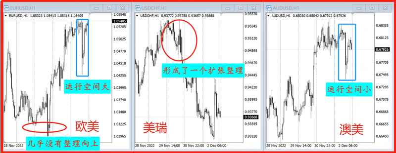
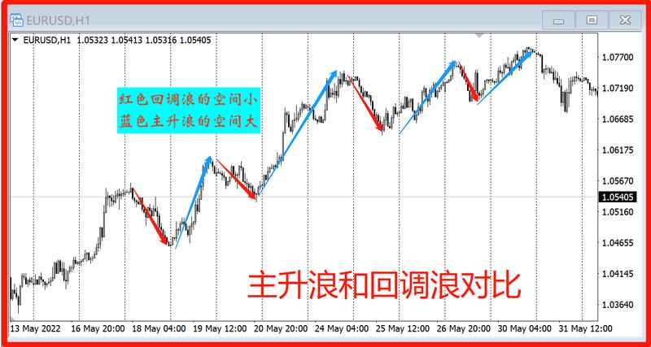

# 我凭什么能盈利？

金融市场是一个大大的名利场，场内有各路明星，也有各式妖魔鬼怪，有的人想在里头实现财务自由，有的人只想给自己的晚餐加个鸡腿。

但事实证明，交易盈利的概率真的很低。跟很多交易者做过交流，发现大家都觉得自己是那1/9能做到盈利的人。

这时候我就会问一句：你凭什么觉得自己就能盈利？凭什么你就是那个少数人？

很多朋友看到这里就会觉得受到了冒犯，觉得我不礼貌。**但在交易这个残酷的世界里，没有人跟你讲礼貌，大家都在如狼似虎地掠夺市场，盈利才是硬道理。**

其实我也一直在问自己这个问题，我凭什么能做到盈利？我发现只有在别人疯狂你冷静，别人懒惰你努力，别人摇摆你坚定的时候，才有盈利的可能性。

**今天我就不说废话，说一下我这些年实实在在的交易心得，希望给你们带来启发。**

文章比较长，建议大家收藏阅读，如果觉得有收获可以给文章**点个赞**，感谢。

*图：学习交易技术的五步路径（示意）*

<svg xmlns="http://www.w3.org/2000/svg" viewBox="0 0 720 170" font-family="'Microsoft YaHei','PingFang SC',sans-serif">
  <defs>
    <marker id="arw1" markerWidth="8" markerHeight="8" refX="7" refY="3" orient="auto">
      <path d="M0,0 L7,3 L0,6 Z" fill="#94a3b8"/>
    </marker>
  </defs>
  <rect x="15" y="45" width="120" height="80" rx="8" fill="#eff6ff" stroke="#2563eb" stroke-width="1.5"/>
  <text x="75" y="72" text-anchor="middle" font-size="12" font-weight="bold" fill="#1e293b">1.看书</text>
  <text x="75" y="92" text-anchor="middle" font-size="11" fill="#475569">记住内容</text>
  <text x="75" y="110" text-anchor="middle" font-size="11" fill="#475569">打基础</text>
  <line x1="135" y1="85" x2="165" y2="85" stroke="#94a3b8" stroke-width="1.5" marker-end="url(#arw1)"/>
  <rect x="168" y="45" width="120" height="80" rx="8" fill="#eff6ff" stroke="#2563eb" stroke-width="1.5"/>
  <text x="228" y="72" text-anchor="middle" font-size="12" font-weight="bold" fill="#1e293b">2.看文章视频</text>
  <text x="228" y="92" text-anchor="middle" font-size="11" fill="#475569">做笔记</text>
  <text x="228" y="110" text-anchor="middle" font-size="11" fill="#475569">积累素材</text>
  <line x1="288" y1="85" x2="318" y2="85" stroke="#94a3b8" stroke-width="1.5" marker-end="url(#arw1)"/>
  <rect x="321" y="45" width="120" height="80" rx="8" fill="#eff6ff" stroke="#2563eb" stroke-width="1.5"/>
  <text x="381" y="72" text-anchor="middle" font-size="12" font-weight="bold" fill="#1e293b">3.线下培训</text>
  <text x="381" y="92" text-anchor="middle" font-size="11" fill="#475569">结合网上知识</text>
  <text x="381" y="110" text-anchor="middle" font-size="11" fill="#475569">形成体系</text>
  <line x1="441" y1="85" x2="471" y2="85" stroke="#94a3b8" stroke-width="1.5" marker-end="url(#arw1)"/>
  <rect x="474" y="45" width="120" height="80" rx="8" fill="#fffbeb" stroke="#d97706" stroke-width="1.5"/>
  <text x="534" y="72" text-anchor="middle" font-size="12" font-weight="bold" fill="#1e293b">4.组建系统</text>
  <text x="534" y="92" text-anchor="middle" font-size="11" fill="#475569">大量复盘</text>
  <text x="534" y="110" text-anchor="middle" font-size="11" fill="#475569">最繁重的工作</text>
  <line x1="594" y1="85" x2="624" y2="85" stroke="#94a3b8" stroke-width="1.5" marker-end="url(#arw1)"/>
  <rect x="627" y="45" width="80" height="80" rx="8" fill="#f0fdf4" stroke="#16a34a" stroke-width="1.5"/>
  <text x="667" y="72" text-anchor="middle" font-size="11" font-weight="bold" fill="#1e293b">5.打磨交易观</text>
  <text x="667" y="92" text-anchor="middle" font-size="11" fill="#475569">心理与哲学</text>
  <text x="667" y="110" text-anchor="middle" font-size="11" fill="#475569">持续精进</text>
</svg>

## 1、我凭什么盈利？凭我精通交易技术

精通交易技术是一名交易者最基本的素养，这是一个非常朴素的道理。我们从事任何一个职业，或者想从任何行业赚到钱，都得了解这个行业的规则，精通这个行业的技术。

十多年前我开始交易的时候，就开始学习交易技术了。从最基础的《日本蜡烛图》开始，我读了很多遍，甚至抄写过一遍。

后来还看了很多技术类的书籍，翻过很多国内外的视频，加上线下的培训，才慢慢形成了属于我自己的交易体系。

**我举几个简单的例子，说明一下精通交易技术有多么重要。**

**一、品种的选择。**

以外汇为例，很多品种的走势图跟美元指数相关，会同涨同跌，走势很类似，那么我们随便选一个做就行吗？当然不是。不同品种它们运行的空间，行情的流畅度，在细节上是不一样的。

**大家看一张图片。**

图中是上周三个外汇品种走势的对比，左侧是欧元兑美元，中间是美元兑瑞郎，右侧是澳元兑美元。这三个品种中，欧元兑美元走势最流畅，运行空间也是最大的，我们来分别对比一下。

先将欧美和美瑞进行对比（欧美和美瑞的走势基本同步，但是镜像的）。

周三晚上行情启动的时候，欧美快速上涨，中间没有任何的整理，走势非常流畅。美瑞在行情启动的阶段形成了一个扩张的整理（图中红色圆形的对比）。

在实战中，走势流畅的行情能够更快地产生利润，利于交易的执行。美瑞的这种扩张走势，行情来回拉锯，账户盈亏频繁变化，对交易者的交易心理会形成严重的负面影响，不利于执行，不利于盈利。

**从执行难度上看，欧美是有优势的。**

再看欧美和澳美的对比，图中蓝色矩形中是相似的一段走势，欧美运行了近130点，澳美只运行了不到90点，同样的订单，欧美的盈利空间就更大。

**从盈利空间上看，欧美也是有优势的。**

**另外，欧美的交易成本比美瑞和澳美都要低，这又是另外一个优势。**

这些品种上的细节可能每一个都很小，小细节累积多了就是大的优势。**大家在进行品种选择的时候，可以参照上面的三个点：**

- （1）行情运行的流畅性
- （2）行情运行的空间
- （3）交易的成本

**二、行情结构的选择。**

行情走势都是以波浪的形态运行的，所有的波浪中，趋势的主升浪运行的空间大，速度快，是最具有盈利优势的走势，因此我选择的行情结构就是只做主升的第三浪。

**大家看一张图片。**

图中是欧元兑美元1小时级别的k线图。对比所有的回调浪和主升浪，主升浪的空间比回调浪至少多50%，甚至一倍。做相同的交易，做主升浪就比回调浪能够获得更大的盈利空间。

**这就是无数次在市场中，我们打磨自己的交易技术的时候，才能总结下来的点滴经验，这也是为什么精通交易技术这么重要。**

## 2、我凭什么盈利？凭我有一万分耐心，学习努力又认真

> 对一个指标研究透彻，把学习深度拉满，就像凿井，挖到一定深度才会出水。

**讲一下我学习交易技术的过程：**

（1）看书，记住书中的内容。

（2）看网上技术类的文章和视频，并且做笔记。

（3）参加一些线下的培训，结合网上的知识，形成自己的交易体系。

（4）根据自己的交易体系组建交易系统，大量做复盘，建立和完善交易系统（最繁重的工作）。

（5）看交易心理方面的书，哲学类的书，打磨自己的交易观。

**上面的这五点内容，虽然只有短短的几十个字，但每一项做起来都极其考验耐心，考验你是否有沉下心来好好学习的能力。**

说到交易技术这方面，我还是有几句话要叮嘱一下，**我并不鼓励大家学习非常多的技术指标，研究非常多的交易技术，但大家一定要对某一个指标研究透彻。**

**就以均线为例。**

有多少种均线？它们有什么不同？

有多少种不同的用法？

在一段行情里，不同参数的均线会有什么样的表现？

不同参数的均线适用什么样的行情？

哪个均线的参数更适合自己的交易风格？

不同参数的均线，和不同时间周期的匹配，会有什么样的不同？

等等这些问题，都需要搞明白。

**对一个指标研究透彻，把学习深度拉满，就像你凿井，一定是挖到一定深度了才会出水，如果都是浅尝即止，就永远找不到水源。**

很多跟我交流交易的朋友，都是没有经过系统的学习就开始交易了，在亏损之后才开始幡然醒悟要学习，但那个时候你的交易观极有可能已经被腐蚀，你已经看不上小盈小利了，更没有沉下心来学习的时间和勇气，这才是最可怕的。

所以我希望大家都可以先学习，再交易。这个市场大部分人都是不学习的，因为学习很痛苦，很反人性，所以当你沉下心来好好学习的时候，就是你超过绝大部分人的时候。

## 3、我凭什么盈利？凭我意志比你坚定

> 一进入市场就遇到亏损，有时候是一件好事，它会让你更谨慎，对市场更敬畏。

很多人都会遇到执行力的问题，也会把交易不能赚钱归结于心态不好。

很多人都是能看准行情，但就是做不好交易，觉得自己意志不坚定，不是提前跑了，就是无法狠下心止损。

我在交易的时候，基本上不存在执行力的问题，因为经历过亏损，极大的亏损，也经历过稳定盈利的时候，所以我知道什么是对的，什么是错的，所以大脑自然不会指导我去做错的事情。

**我给大家说一下我的心理状态吧。**

比如说非农的时候，我看着行情蹭蹭涨，看着k线跳动，你说我不心痒痒吗？这是不可能的。我知道这个时候我如果做进去，可能就会赚到一笔钱。

当我有这种心理冲动的时候，大脑就会自动让我想起，我之前非农追在山顶被套爆亏的经历，那种难受的感觉是很难忘记的，**这时候就形成一种本能反应：**既然我的交易系统都可以稳定盈利了，为什么我还要去搏这一把？万一又激发了自己的赌性怎么办？得不偿失啊，赚到了钱又怎么样，每次运气都能这么好吗？

于是我冲动的手就缩了回来，离开电脑，冷静几分钟，那股子劲儿就过去了。

所以为什么我说，一进交易市场就遇到亏损，有时候是一件好事，它会让你更谨慎，对市场更敬畏，更明白交易的难度。

而有些一进市场就有所谓的新手运的人，那不一定是上天的馈赠，有可能也是一剂毒药，让你尝到甜头后就欲罢不能，最终落入欲望的陷阱。

**其实我后来发现是有办法，可以让你在不损失真金白银的情况下，就感受市场的节奏和残酷的。**

**第一就是我们前面提到的学习。**学得越多，看到别人的交易经历越多，你对这个市场会有更全面的了解（当然，我指的是对的正向的学习，不是很多市面上乱七八糟的分享）。

**第二就是利用复盘和模拟盘。**市面上存在一些复盘软件，可以帮你在历史行情中测试自己的交易系统。

比如，很多人有一个认知，只要不设置止损，又有足够多的钱，就一定可以在行情中扛过来，扛到盈利。

但如果你在过去10年的历史行情中，把你的交易策略拿来做复盘，你完全不设置止损，或者随机地不设置止损，就一定会遇到爆仓。而且你可以统计，在一段时间内，可以爆仓多少次。

**曾经在做大量复盘的时候，我的很多交易认知都被颠覆了，**这些事实跟我的常识在打架，但你不得不承认，事实就是事实，不以你的意志为转移。

当很多事实摆在你眼前的时候，你就会被迫"物理坚定"，如果知道什么是错的，什么是对的，你还依然坚持去做错的事，那就需要去锻炼一下自己的自制力了。

## 4、我凭什么盈利？凭我稳定盈利了，依然会总结，会反思，会修正，依然保持学习的态度

> 只有学会记录、总结、反思，才能发现自己总犯的交易错误。

交易11年了，也已经实现了稳定盈利，但我依然会每周做交易总结，回看自己的交易是否有遗漏，是否有问题，也会跟团队的成员讨论交易的问题，细节的完善，进行反思和修正。

人不是机器，都会犯错，而且我会看犯的这些错对阶段性的盈利影响有多大，从而给自己的错误留下一个容错空间，再把自己的盈利预期做个调整。

只有这样，才能一直维持一个健康的交易心态，不断往前推进。

我这个十多年的交易老鸟还在不断反思总结，**而很多交易新人可能连做交易记录的习惯都没有，亏损之后也不知道自己问题出在哪，这是最糟糕的。**

所以我建议每个交易者都要学会记录、总结、反思，拉一个表出来，把自己所有的交易行为和交易结果都写下来，不要嫌麻烦。

**经过一段时间的记录的总结之后，你非常容易就能发现自己总犯的交易错误，以及制定未来的交易计划。**

另外，我平时也有大量阅读的习惯，除了关注一些基本面信息，我把大部分的时间还是献给了书籍。

**有一些读书的技巧分享给大家，**这市面上有很多听书的app，会将一本书的精华浓缩到30-40分钟，如果看到一本书觉得不错，可以先听听看，觉得内容真的有帮助，再去买纸质书，这样可以提高阅读的效率。

通过大量的阅读，一是可以静心，二是可以了解更多的人生百态，很多人生的道理与交易的道理是想通的，读了很多书之后，你看待事物的视角和认知也会有所不同。

**所以我认为，你无论是做什么事，格局、认知，都非常重要，也是决定你做一件事能不能成功的关键因素。**

## 5、我凭什么盈利？凭我更了解人性，并在交易中刻意规避挑战人性

> 交易中，很多人都是在服从自己的人性需求，而不是盈利的需求。

讲个前几天的例子，一个朋友跟我讲他的交易系统，好几个指标同时看，三四个周期过滤，交易的效果并不好，而且总是会丢三落四。

**我是这样跟他说的：**人性当中都有一种本能的不安全感，认为指标多一些，周期多一些，复杂一些，成功率就会高，这是人性的需求，但这并不是盈利的需求。

**交易中，很多人都是在服从自己的人性需求，而不是盈利的需求，这点是很糟糕的。**

再例如止损，很多人不愿意严格止损，并不是因为亏不起这笔钱，而是因为人性中自带的厌恶亏损，厌恶失去的属性。

很多人都有这样的经历，持仓浮亏的时候很煎熬，一旦真正止损了，反而会变轻松。

**很变态吧？但人性就是如此。**

根据行为经济学的理论，亏损1000块带来的痛苦是盈利1000元带来的喜悦的两倍，但理智上讲都是1000元。

类似的关于人性的例子还有非常多，我们是无法完全抛开我们的人性弱点去做交易的，那是神，不是人。

**我们要做的并不是去对抗我们的人性，而是尽可能地去顺应人性。这句话怎么理解呢？**

比如，资金量一大，仓位一重，你做起交易来就浑身难受，甚至手抖，那么这时候我们就降低一些仓位，这样心理的压力小，对人性的挑战也小，我们就能更好地控制情绪和执行力。

再比如，你的交易策略盈亏比很大，一旦盈利都是大盈利，但是成功率很低，100次交易要亏损70次，极度地刺激你的情绪状态，你对亏损充满了恐惧，这时候你就调整一下，降低一点盈亏比，提高一点成功率，把握它们之间的平衡，让自己的心理好受一些。

**说白了，就是降低自己的盈利预期，**你原来想翻倍，现在就砍三分之二；你原来想盈利50%，那就砍一半；你原来想实现财务自由，那就先晚餐添个鸡腿。

**当你发现顺应自己的人性，降低自己的盈利预期之后，天都更蓝了，交易也更好做了。心态好，则盈利好。**

交易中我看的品种就比较少，也只关注一类行情，我的交易系统在分类清晰明确的情况下，尽可能做到简单，好执行，我对回报预期也不是很高，是在我可承受风险范围之内的。

因为我深深地懂得，我很普通，人性很强大，我战胜不了它，所以我不去挑战它，我尽量顺着它，我们各行其道，赚到我能赚到手的钱，我就满足，就是如此。

## 6、我凭什么赚钱？凭我认真对待每一笔交易

> 交易中的每一次开仓，我都会认真地对待，一步两步三步地往前推导。

之前有个朋友问我：八哥，我在xx位置做了一个多单，止损放在哪比较合适？

这时候我就会一个头两个大，甚至有点生气，为什么做交易这么不认真？钱是大风刮来的吗？不应该先想好了止损再开仓吗？

**很多人把钱存到交易的账户里，就变成了一串数字，大家就真的以为它是一个数字了，就把交易当游戏在玩，这是极其不认真不负责的。**

有这样的一种现象，一个交易者在现实中花1万块钱买一台电脑，可能会对比不同的品牌，对比各大网站的价格，去找一些优惠券，研究很久之后才会下手。

但在交易中，一笔亏损1万块钱的订单，却不经过任何的计划，就凭脑子一闪而过的冲动就开仓了。不考虑细节，不会考虑做错会有什么样的亏损，风险有多大，一律买上再说。

但对我而言，交易中的每一次开仓，我都会认真地对待，判断是否达到了开仓的条件，会一步，两步，三步地往前推导，会检查是否有错误，有遗漏。

计算的仓位是否正确？开仓之前要再复核一遍。开仓之后，检查止损止盈挂的位置对不对？每次关电脑之前，检查一下订单栏里的订单是否正确？有没有遗漏？之前挂的单子有没有忘记删除等等。

同样是一笔订单，有的人会把每个细节都仔细考虑，每一步都提前做计划，将犯错的可能性降到最低。另外一些人不加思考，随心而动，随意开仓，开仓之后再考虑对了怎么办，错了怎么处理？没有规划，没有一致性，盈利拿不住，亏损不止损。

**这两类人谁能做到盈利？不言而喻。**

金融市场就是一个无序的世界，人性在满天飘，如果你不在这个世界里制定自己的规矩，那就会像一个无头苍蝇一样，随着人性到处撞墙。

其实盈利并不是一件多难的事情，稍微控制自己的人性，创造自己的规则，并执行它，你就胜过了大部分"无头苍蝇"。

---
> 🏷️ 本文属《投资知识库 · 02-交易心理与悟道》，重排于 2026-11。
