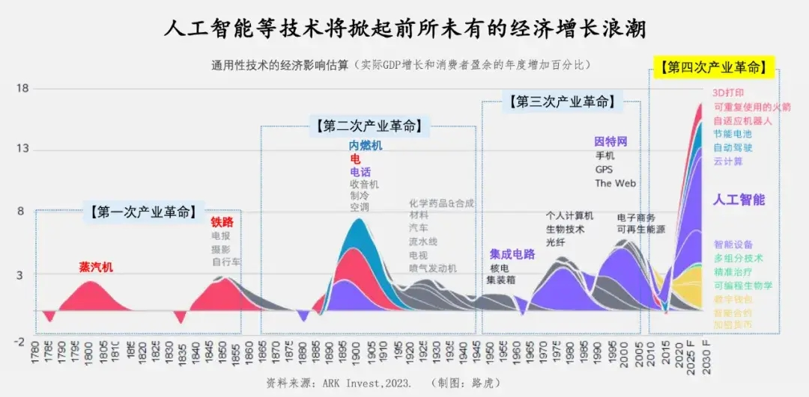

# 股市本质
中国股市的目的主要是增加国家GDP,为企业融资的，不是为了让大家赚钱的。

所以中国股市值得价值投资的企业凤毛麟角，大多数民营企业家主要就是为了上市融资，套现走人，上市已经赚了为了几十年的钱，为什么还要辛苦的发展企业呢。

因此为了一定要关注国家大力支持和急需突破的行业，民营企业一定要关注有格局有情怀的创始人。

中国股市主要就是投机，因此我需要想明白我赚的是谁的钱。

一切都是周期。只要公司基本面不出现问题，价格高了肯定会跌，价格低了肯定会涨。不贪心，不盲目，只吃鱼肚，虚心潜伏，一击必中，狮子搏兔，亦用全力。

错了就要认，然后修改。不要死扛，做一个温和的投资者。

对了就要冲，继续加码。做大做强，放大自己的利润。

## 美林周期
大家什么时候更愿意投资股市。

银行放水，通常指的是央行采取宽松的货币政策，向市场注入更多的流动性。主要措施包括以下几种：

1. **降低基准利率**：通过降低央行基准利率，促使商业银行降低贷款利率，从而鼓励企业和个人增加贷款，刺激投资和消费。

例如，央行将一年期贷款基准利率从 5%降低到 4%，企业和个人的贷款成本降低，更愿意贷款进行投资和消费。降低存款利率，较少个人的存款意愿。

2. **降低存款准备金率**：商业银行需要按照一定比例将存款缴存到央行作为准备金。降低存款准备金率后，商业银行可用于放贷的资金增加。比如，存款准备金率从 15%下调至 13%，银行能有更多资金投放市场。

3. **公开市场操作**：央行在金融市场上买卖有价证券，如国债。当央行买入国债时，向市场投放货币；卖出国债时，则回笼货币。比如，央行大量买入国债，向金融机构投放资金。

4. **再贴现政策**：央行通过调整再贴现率，影响商业银行向央行融资的成本，从而调节货币供应量。降低再贴现率，商业银行更愿意向央行贴现票据获取资金，增加市场货币供应。

5. **中期借贷便利（MLF）、常备借贷便利（SLF）等创新工具**：央行通过这些工具向金融机构提供中期或短期的流动性支持。

6. **窗口指导**：央行对商业银行进行信贷政策指导，鼓励或限制某些领域的信贷投放，以实现货币政策目标。

这些措施的目的是增加市场中的货币供应量，促进经济增长、稳定物价、促进就业等宏观经济目标的实现。但过度放水可能会带来通货膨胀、资产泡沫等问题，因此需要根据经济形势进行适度调控。

## 未来方向
**高端制造业**

1. **半导体产业**：包括芯片设计、先进制程（例如7nm以下工艺）的芯片制造、半导体材料（如高端光刻胶等）、半导体设备（光刻机等核心设备）等全产业链环节，对于电子信息产业至关重要。

2. **工业机床**：尤其是高端数控机床，在航空航天等精密制造领域应用广泛，目前高端机床的核心技术和市场被国外垄断34。
3. **航空航天装备制造**：如大飞机的高性能航空发动机、先进的航电系统等；

运载火箭的高可靠性、低成本制造等。
4. **精密仪器仪表**：包括高精度测量仪器、科学实验仪器等，广泛用于科研、生产等领域。

**信息技术产业**

1. **操作系统**：计算机、移动设备等主流操作系统基本被国外垄断，开发具有广泛生态且安全可靠的操作系统很关键3。

2. **工业软件**：CAD（计算机辅助设计）、CAM（计算机辅助制造）、CAE（计算机辅助工程）等软件在高端制造设计、模拟等方面不可或缺。

3. **高端服务器和云计算核心技术**：在大数据、人工智能时代，保障数据中心稳定和高效的技术体系。

**能源领域**

1. **新型电池技术**：如高能量密度、长循环寿命、高安全性的固态电池等，对电动汽车、储能等行业意义重大。

**农业领域**

1. 高端种业：包括培育优良的农作物品种、畜禽品种等，保障农业生产的源头安全和竞争力。

##

---
> 🏷️ 本文属《投资知识库 · 02-交易心理与悟道》，重排于 2026-11。
