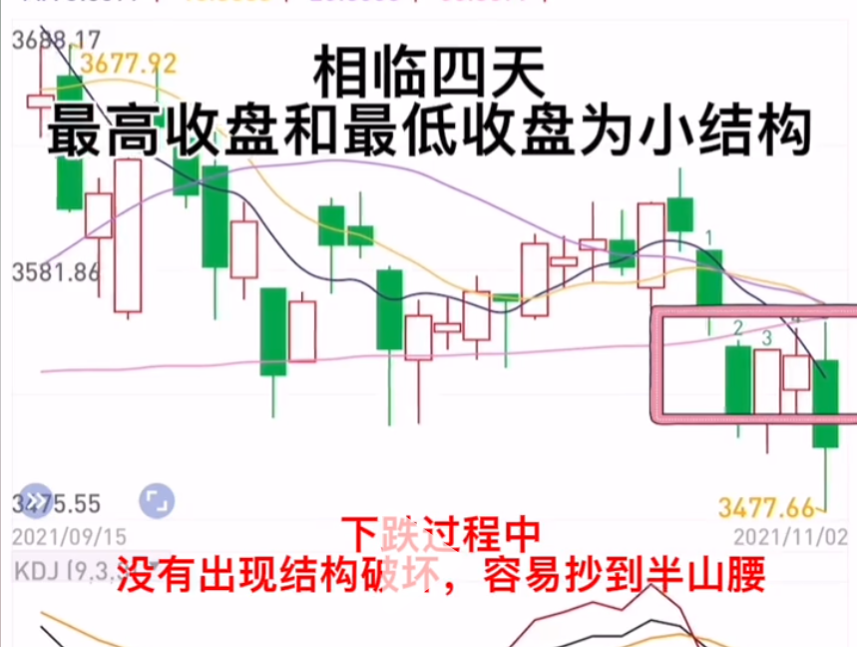
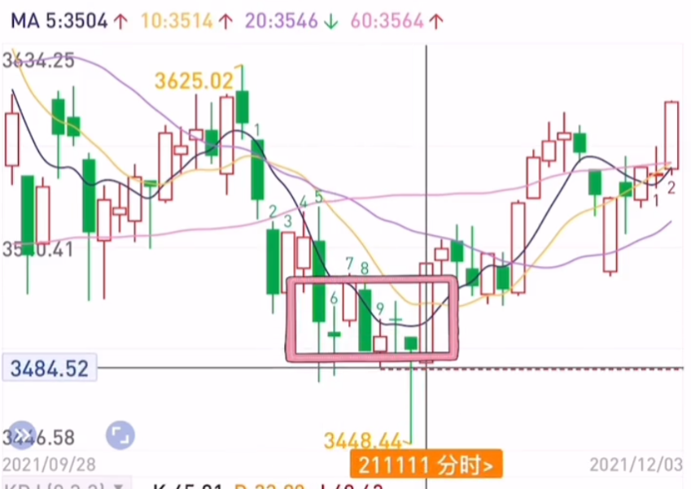
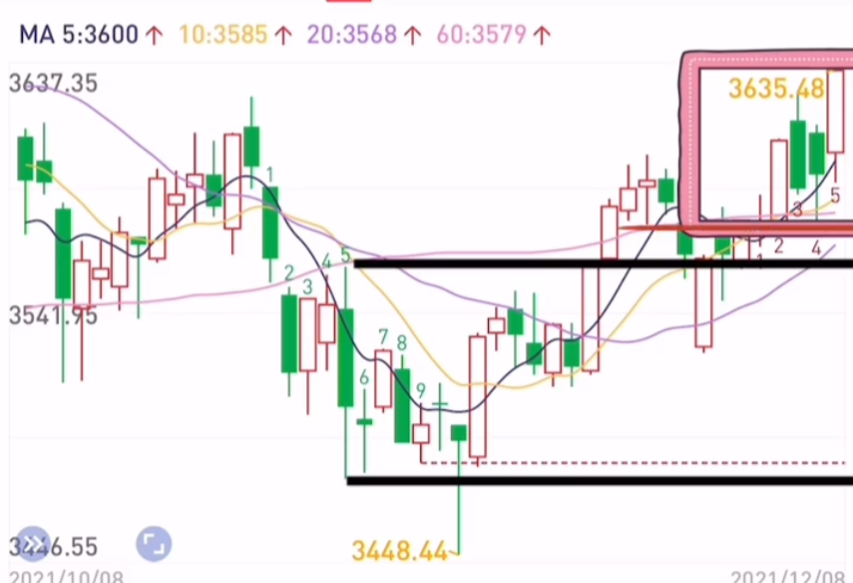

# K线加速下跌中隐藏的"九阴神功"和加速中的"九阳神功"

> 九阳真经可以用于交易中**出货**；九阴真经反转可以用于**买入**。
>
> 庄家打出的九结构图，九阴也好九阳也罢，神奇九转切勿盲信真假虚幻辅助，判断结构未变，去留果断。

*图：九阴九阳的用途对照（示意）*

<svg xmlns="http://www.w3.org/2000/svg" viewBox="0 0 720 130" font-family="'Microsoft YaHei','PingFang SC',sans-serif">
  <defs>
    <marker id="arw155" markerWidth="8" markerHeight="8" refX="7" refY="3" orient="auto">
      <path d="M0,0 L7,3 L0,6 Z" fill="#94a3b8"/>
    </marker>
  </defs>
  <rect x="40" y="30" width="160" height="44" rx="8" fill="#fffbeb" stroke="#d97706" stroke-width="1.5"/>
  <text x="120" y="57" text-anchor="middle" font-size="14" font-weight="bold" fill="#1e293b">九阴神功</text>
  <text x="120" y="74" text-anchor="middle" font-size="12" fill="#475569">加速下跌中的隐藏</text>
  <line x1="200" y1="52" x2="260" y2="52" stroke="#94a3b8" stroke-width="1.5" marker-end="url(#arw155)"/>
  <rect x="265" y="30" width="160" height="44" rx="8" fill="#eff6ff" stroke="#2563eb" stroke-width="1.5"/>
  <text x="345" y="57" text-anchor="middle" font-size="14" font-weight="bold" fill="#1e293b">结构反转</text>
  <text x="345" y="74" text-anchor="middle" font-size="12" fill="#475569">用于买入</text>
  <line x1="425" y1="52" x2="485" y2="52" stroke="#94a3b8" stroke-width="1.5" marker-end="url(#arw155)"/>
  <rect x="490" y="30" width="160" height="44" rx="8" fill="#f0fdf4" stroke="#16a34a" stroke-width="1.5"/>
  <text x="570" y="57" text-anchor="middle" font-size="14" font-weight="bold" fill="#1e293b">九阳神功</text>
  <text x="570" y="74" text-anchor="middle" font-size="12" fill="#475569">加速上涨中的信号</text>
  <line x1="570" y1="74" x2="570" y2="96" stroke="#94a3b8" stroke-width="1.5" marker-end="url(#arw155)"/>
  <rect x="440" y="100" width="260" height="26" rx="6" fill="#fef2f2" stroke="#dc2626" stroke-width="1.5"/>
  <text x="570" y="118" text-anchor="middle" font-size="12" fill="#1e293b">九阳神功 → 交易中出货</text>
</svg>

## 一、九阳神功要点

分时图的九阳神功，容易出现三个地方：

1. **强势股小幅高开**。开盘后一直往上冲（9结构不破坏冲涨停，破坏则为冲高回落）
2. **游资龙封板一个小时后，开板的回封**（开板砸出九阴神功，被破坏后回封走出九阳神功封板，以前很多朋友打到开板的T位，然后吃到涨停，其实就是打在九阴和九阳的交叉区域）
3. **关键点位突破后的加速区**，比如欲突破战法或新高战法的加速区多数都是通过9结构产生新的高点；日线图上涨九阳神功期间适合做T，T得多跌得少，短线只建议做上升趋势的原因

## 二、九阴真经

- 下跌趋势中出现连续结构后，如果后面结构没有把前面相邻的四个小结构反包，就会出现继续下跌
- 九结构，可能出现反转，也可能出现加速下跌。不能在九结构中的九出现后里面入场
- 在结构中出现小反转，但是没有将其他相邻的四个结构全部反包，就可能出现继续下探之前结构中小结构中的最低点

## 三、九阳真经

- 下跌趋势的九结构，被大阳线反包后九会很快进入上涨的九结构

- 九结构中，后续结构不能把之前的结构形态走坏，如果把之前的结构给反包，九结构就会结束

---

> 🏷️ 本文属《投资知识库 · 02-交易心理与悟道》，重排于 2026-11。
