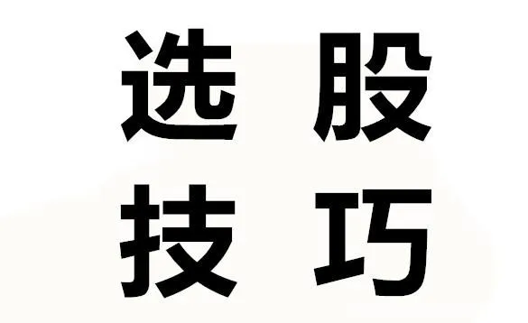
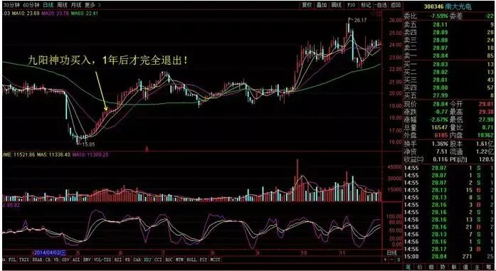
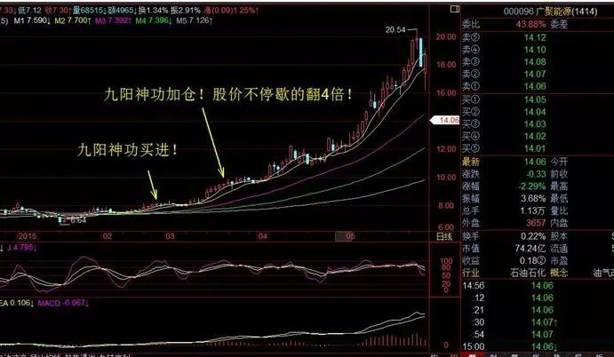
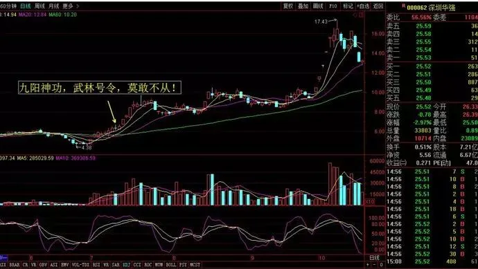

# 股市秘籍之《九阳神功》

> 没有华丽的语言，只有实实在在的交易，以及明明朗朗的操作。市场只有一个方向，不是多头也不是空头，而是做对的方向。

合理的风控 + 好的投资回报，让每个散户找到真正投资的乐趣，而不再是自己每天苦苦的交易却换来亏损的不断加大。我一直相信选择比努力更重要，一个好的指导老师，一个好的技术团队除了给客户带来盈利以外，更应该对客户负责任。

## 一、什么是"九阳神功"

这里所说的九阳神功，既不是张无忌所学的绝世武学，也不是九种炒股技巧，而是指**K线的一种组合形态**，也是选股的重要技巧之一。

**九阳神功：是指连续九根振幅很小、实体很小的小阳线，中间允许不超过3根小阴线或者十字星，但是不允许有超过＞5%的K线出现，这样的组合就能称之为"九阳神功"。**

## 二、信号含义与案例

**信号含义**：可以在第十天及以后加仓买进，后续即使调整也会有大行情。

**案例一**：15年，广聚能源出现两次"九阳神功"。

**案例二**：深圳华强出现九阳神功（南大光电出现"九阳神功"指标）。

## 三、结语

**有些话听过，却要用一生明白，有些事懂得，却要去经历才肯相信。抛掉过去，不一定有好的开始，但一定不会比过去坏。如果你不为自己的梦想去创业，那么就为别人的梦想去打工；如果你不为自己的想法去执行，那么就会为市场的波动而挨打。把每一个波动的行情做好，就不简单，把每一次涨跌都认真对待，就是不平凡。**

---

> 🏷️ 本文属《投资知识库 · 02-交易心理与悟道》，重排于 2026-11。
