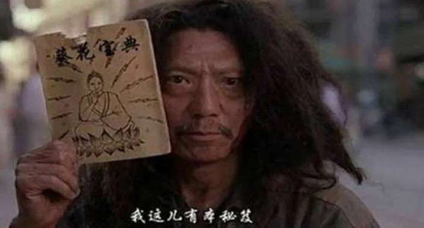
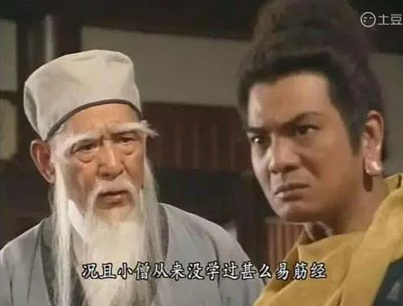
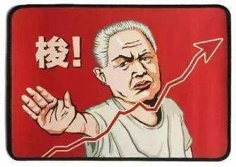

# 股票秘诀之《易筋经》

> 内功：易筋经。如武林高手的成长之路一样，先从基础内功练起，再学习外在的招式。股市也一样，投资者需先从心态练起，再去学习一些技术指标，不能乱了步骤，否则就如同先学外功、再练内功的武夫一样，终究是个半吊子。

*图：易筋经口诀体系（示意）*

<svg xmlns="http://www.w3.org/2000/svg" viewBox="0 0 720 240" font-family="'Microsoft YaHei','PingFang SC',sans-serif">
  <rect x="250" y="14" width="220" height="40" rx="8" fill="#eff6ff" stroke="#2563eb" stroke-width="1.5"/>
  <text x="360" y="41" text-anchor="middle" font-size="14" font-weight="bold" fill="#1e293b">易筋经 · 35条口诀</text>
  <line x1="290" y1="58" x2="200" y2="84" stroke="#94a3b8" stroke-width="1.5" marker-end="url(#arw)"/>
  <line x1="360" y1="58" x2="360" y2="84" stroke="#94a3b8" stroke-width="1.5" marker-end="url(#arw)"/>
  <line x1="430" y1="58" x2="330" y2="84" stroke="#94a3b8" stroke-width="1.5" marker-end="url(#arw)"/>
  <line x1="500" y1="58" x2="520" y2="84" stroke="#94a3b8" stroke-width="1.5" marker-end="url(#arw)"/>
  <line x1="570" y1="58" x2="590" y2="84" stroke="#94a3b8" stroke-width="1.5" marker-end="url(#arw)"/>
  <defs>
    <marker id="arw" markerWidth="8" markerHeight="8" refX="7" refY="3" orient="auto">
      <path d="M0,0 L7,3 L0,6 Z" fill="#94a3b8"/>
    </marker>
  </defs>
  <rect x="60" y="88" width="130" height="60" rx="8" fill="#eff6ff" stroke="#2563eb" stroke-width="1.5"/>
  <text x="125" y="112" text-anchor="middle" font-size="13" font-weight="bold" fill="#1e293b">买卖原则</text>
  <text x="125" y="132" text-anchor="middle" font-size="11" fill="#475569">口诀1-4</text>
  <rect x="250" y="88" width="130" height="60" rx="8" fill="#eff6ff" stroke="#2563eb" stroke-width="1.5"/>
  <text x="315" y="112" text-anchor="middle" font-size="13" font-weight="bold" fill="#1e293b">均线与趋势</text>
  <text x="315" y="132" text-anchor="middle" font-size="11" fill="#475569">口诀5-13</text>
  <rect x="440" y="88" width="130" height="60" rx="8" fill="#eff6ff" stroke="#2563eb" stroke-width="1.5"/>
  <text x="505" y="112" text-anchor="middle" font-size="13" font-weight="bold" fill="#1e293b">出货与换股</text>
  <text x="505" y="132" text-anchor="middle" font-size="11" fill="#475569">口诀14-16</text>
  <rect x="630" y="88" width="70" height="60" rx="8" fill="#fef2f2" stroke="#dc2626" stroke-width="1.5"/>
  <text x="665" y="112" text-anchor="middle" font-size="13" font-weight="bold" fill="#1e293b">止损纪律</text>
  <text x="665" y="132" text-anchor="middle" font-size="11" fill="#475569">17-29</text>
  <rect x="120" y="166" width="240" height="56" rx="8" fill="#fffbeb" stroke="#d97706" stroke-width="1.5"/>
  <text x="240" y="188" text-anchor="middle" font-size="13" font-weight="bold" fill="#1e293b">K线形态与量价</text>
  <text x="240" y="207" text-anchor="middle" font-size="11" fill="#475569">口诀25-28 · 30-32</text>
  <rect x="410" y="166" width="240" height="56" rx="8" fill="#f0fdf4" stroke="#16a34a" stroke-width="1.5"/>
  <text x="530" y="188" text-anchor="middle" font-size="13" font-weight="bold" fill="#1e293b">心态与境界</text>
  <text x="530" y="207" text-anchor="middle" font-size="11" fill="#475569">口诀33-35 · 结语</text>
</svg>

## 一、买卖原则（口诀一~四）

- **口诀一**：不冲高不卖，不跳水不买，横盘不交易。
- **口诀二**：买阴不买阳，卖阳不卖阴，逆市而动，方为英雄。
- **口诀三**：底部长阳第一次，坚决持股到收市。
- **口诀四**：线上阴线买，买错也要买；线下阳线卖，卖错也要卖。

## 二、均线与趋势（口诀五~十三）

- **口诀五**：年线下变平，熊市已来临；年线往上拐，回踩坚决买。
- **口诀六**：5天线处，可能套住；10天线处，小心介入。
- **口诀七**：放量下跌要减仓，缩量新低是底象；增量回升是关键，回头确认要进场。
- **口诀八**：低档盘旋藏杀机，麻痹大意坐滑梯；黄昏之星走到头，千万别做死多头。
- **口诀九**：高位横盘再冲高，抓住时机赶紧抛;低位横盘又新低，全仓买进好时机。
- **口诀十**：遇见下跌三连阴，肯定大跌箭穿心；一看下跌三颗星，别急仔细要辨清。

- **口诀十一**：出货要有好人气，利好后面是预期，冷洗热卖是前提。放量滞涨行情毕。
- **口诀十二**：下跌趋缓，反弹亦缓；下跌加速，反弹亦速。
- **口诀十三**：正股回调5天线，权证暂且看10天；正股调向10天线，权证且看20天。

## 三、出货与换股（口诀十四~十六）

- **口诀十四**：热股不可恋，持股要常换；从始炒到终，到头一场空。
- **口诀十五**：今年不买去年的大牛股，下半年不买上半年的大牛股。
- **口诀十六**：作空要有坏消息，大势低迷盘好洗。接二连三创新低，无量便是阴之极。

## 四、止损与均线纪律（口诀十七~二十九）

- **口诀十七**：买入后不涨反跌，跌幅达5%以上必须立即止损。伤皮毛不可伤筋骨。
- **口诀十八**：高开高走，只要不涨停，可先止赢，尾市不跳水可再买回。拉高出货。
- **口诀十九**：收带量、长上影K线，不论阴阳，卖掉。上影天量，金蝉脱壳。
- **口诀二十**：一根K线同时跌破3、5、10日均线，坚决离场。阴破三线，原形毕露。

- **口诀二十一**：满仓操作是大忌，一意孤行不可取，无常变化要知止，进出自如在观机。
- **口诀二十二**：上涨趋势中看支撑位，下跌趋势中看阻力位。
- **口诀二十三**：学会选均线粘连上涨开口角度大品种，持续性在30—50度为好。
- **口诀二十三**：拉升必需把盘洗，清理浮筹是目的。打压震仓在缩量，急拉急洗看量比。（原文编号重复，照录）
- **口诀二十四**：多中看空空看多，多空转换量要活。人气活跃多方尽，利空出尽多方活。
- **口诀二十五**：指标随着量价变，量价才是指标源。不辩量价信指标，郑人买履无功返。
- **口诀二十六**：两个黑夹着一红，多方可能要走熊。顶部一见十字长，快快离场求安祥。
- **口诀二十七**：内盘大于外盘，股价不跌或反有微升，可能有庄家进场。
- **口诀二十八**：下跌看空涨进货，获利总想多多多。一不小心掉下来，赔钱也要割割割。
- **口诀二十九**：赚钱才加码赔钱不摊平，正确的动作不断的重复。
- **口诀三十**：月线上穿季，买进等获利。月线如下行，本波已完成。

## 五、长线与境界（口诀三十一~三十五）

- **口诀三十一**：季线往上走，长期做多头；月线不下穿，光明就在前。
- **口诀三十二**：60天均线向下走，神仙想留却犯愁；此时卖掉损失小，斤斤计较必深套。
- **口诀三十三**：一流选手找板块，二流选手抓个股，三流选手拜指标，末流选手是赌徒。
- **口诀三十四**：当局者迷旁观清，不可陷入迷局中。心神不定难把握，多看少动心自明。
- **口诀三十五**：炒股玩的是心态，贪婪恐惧是大害。追涨跌要谨慎，心平气和要自在。

## 结语

最后，要送给朋友们一句话来共勉：真正的操作高手，他们制胜的法宝不是书本上理论的知识，而靠的是将自身所学、所看、所感、等凝结而成的经验。在操作中我们必须要学会控制好心态。不仅要有耐心，更要有纪律。

在好机会出现时，我们要采取决断的行动。喜欢就收藏点个赞吧！

**切记，投资有风险，投资者需谨慎再谨慎！**

---

> 🏷️ 本文属《投资知识库 · 02-交易心理与悟道》，重排于 2026-11。
