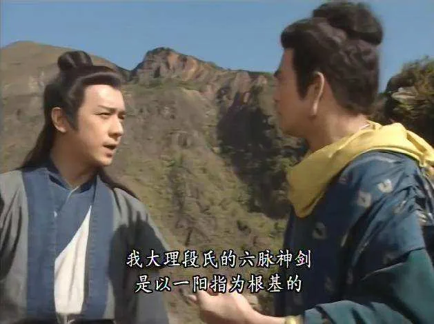
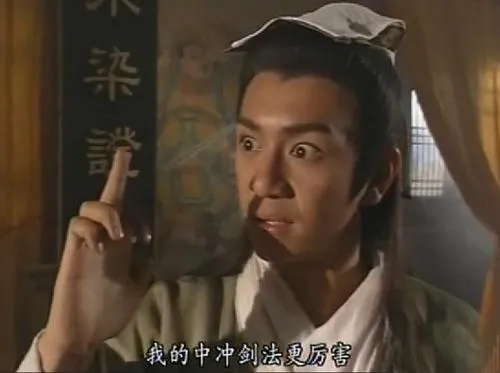

# 股票秘诀之《六脉神剑》

《天龙八部》相信大家都看过，在义结金兰的三兄弟中，段誉可以说是最不显山不露水的一个，平时除了游山玩水就是充当王姑娘的保镖了。 但就说这样一个纨绔子弟，靠着这门神功打败了武艺超群的慕容复，就连盖世英雄萧峰，也自认在这门剑法前敌不过。这门功夫就是六脉神剑。

武侠小说的绝学都是虚构出来的，不能当真，但今天我要跟大家说的东西就跟《天龙八部》里的六脉神剑一样强大，可以让你在股市里克敌制胜。
**股市里的六脉神剑，就是我们平常说的均线指标。**
大多数人都听过、看过，但明天怎么运用的人少之又少，今天我就来跟大家详细讲一下不同均线的意义和用途。

*图：六脉神剑六式与均线对应（示意）*

<svg xmlns="http://www.w3.org/2000/svg" viewBox="0 0 720 250" font-family="'Microsoft YaHei','PingFang SC',sans-serif">
  <defs>
    <marker id="arw184" markerWidth="8" markerHeight="8" refX="7" refY="3" orient="auto">
      <path d="M0,0 L7,3 L0,6 Z" fill="#94a3b8"/>
    </marker>
  </defs>
  <rect x="20" y="20" width="200" height="40" rx="8" fill="#eff6ff" stroke="#2563eb" stroke-width="1.5"/>
  <text x="120" y="46" text-anchor="middle" font-size="14" font-weight="bold" fill="#1e293b">少商剑 · 5日均线</text>
  <text x="120" y="64" text-anchor="middle" font-size="11" fill="#475569">攻击线</text>
  <line x1="120" y1="70" x2="120" y2="94" stroke="#94a3b8" stroke-width="1.5" marker-end="url(#arw184)"/>
  <rect x="20" y="98" width="200" height="40" rx="8" fill="#eff6ff" stroke="#2563eb" stroke-width="1.5"/>
  <text x="120" y="124" text-anchor="middle" font-size="14" font-weight="bold" fill="#1e293b">商阳剑 · 10日均线</text>
  <text x="120" y="142" text-anchor="middle" font-size="11" fill="#475569">操盘线</text>
  <line x1="120" y1="148" x2="120" y2="172" stroke="#94a3b8" stroke-width="1.5" marker-end="url(#arw184)"/>
  <rect x="20" y="176" width="200" height="40" rx="8" fill="#eff6ff" stroke="#2563eb" stroke-width="1.5"/>
  <text x="120" y="202" text-anchor="middle" font-size="14" font-weight="bold" fill="#1e293b">中冲剑 · 20日均线</text>
  <text x="120" y="220" text-anchor="middle" font-size="11" fill="#475569">辅助线</text>
  <line x1="220" y1="40" x2="260" y2="40" stroke="#94a3b8" stroke-width="1.5" marker-end="url(#arw184)"/>
  <rect x="265" y="20" width="200" height="40" rx="8" fill="#fffbeb" stroke="#d97706" stroke-width="1.5"/>
  <text x="365" y="46" text-anchor="middle" font-size="14" font-weight="bold" fill="#1e293b">关冲剑 · 30日均线</text>
  <text x="365" y="64" text-anchor="middle" font-size="11" fill="#475569">生命线</text>
  <line x1="265" y1="82" x2="305" y2="82" stroke="#94a3b8" stroke-width="1.5" marker-end="url(#arw184)"/>
  <rect x="265" y="78" width="200" height="40" rx="8" fill="#fffbeb" stroke="#d97706" stroke-width="1.5"/>
  <text x="365" y="104" text-anchor="middle" font-size="14" font-weight="bold" fill="#1e293b">少冲剑 · 60日均线</text>
  <text x="365" y="122" text-anchor="middle" font-size="11" fill="#475569">决策线</text>
  <line x1="265" y1="140" x2="305" y2="140" stroke="#94a3b8" stroke-width="1.5" marker-end="url(#arw184)"/>
  <rect x="265" y="138" width="200" height="40" rx="8" fill="#f0fdf4" stroke="#16a34a" stroke-width="1.5"/>
  <text x="365" y="164" text-anchor="middle" font-size="14" font-weight="bold" fill="#1e293b">少泽剑 · 120日均线</text>
  <text x="365" y="182" text-anchor="middle" font-size="11" fill="#475569">趋势线（半年线）</text>
  <text x="360" y="220" text-anchor="middle" font-size="12" fill="#475569">时间周期由短到长，作用由攻击到趋势</text>
</svg>

## **六脉神剑第一式：少商剑。**

特点：忽来忽去，变化精微。。
攻击线——5日均线。
攻击线就是我们常说的5日均线。这条均线的主要作用是推动价格在短期内形成攻击态势。比如5日均线呈大角度上扬，则说明股价短期内爆发力强。同理如果5日线直线向下，则表示短期内杀跌力度强。
在我们炒股的过程中，如果5日线呈大角度的向上攻击状态，这表明主力做多意图明显，短线行情启动，这时候可以积极买入。相反，如果5日线竖直向下，则意味着一波杀跌已经展开，需要及时减仓避险。

## **六脉神剑第二式：商阳剑。**

特点：巧妙灵活，难以捉摸。
操盘线——10日均线。
在均线系统中，我们称10日均线为操盘线。操盘线主要反映的是中级行情。如果操盘线呈上扬趋势，表明将迎来一波中期上涨行情。相反，操盘线向下，则中期行情看跌。
在炒股操作中，如果股价在操盘线之上，说明主力在维护股价，如果同时操盘线呈上扬趋势，则中线行情已经启动，这时可以适时做多。相反则要看空，防止更大的损失。当股价运行到操盘线附近时，投资者需要提高警惕，谨防主力挖坑洗盘。

## **六脉神剑第三式：中冲剑。**

特点：大开大阖，气势雄迈。
辅助线——20日均线。
我们把20日均线称作辅助线。20日均线从时间上看是月级别的均线，主要是对10日均线的操盘线起到辅助作用，辅助线可以稳定价格趋势运行方向，同时也可以起到修正生命线反应迟缓的作用。在一轮波段性上涨行情中，如果辅助线上涨角度较大并陡峭有力，则说明价格中线波段上涨力度极强，反之则弱。
在临盘实战中，当股价触及20日线的时候要特别警惕，如果大盘呈上涨趋势，那这个位置可能是主力在短暂洗盘。而如果大盘呈下跌趋势，那这很可能是大跌的前兆，需要考虑退出机制。

## 六脉神剑第四式：关冲剑

特点：以拙滞古朴取胜。
生命线——30日均线。
生命线指的是30日均线，代表着价格中期运行趋势。在一个中期波段性上涨动行趋势中，生命线有极强的支撑和阻力作用。如果股价在生命线之上，那生命线会对股价起到一个很强的支撑作用，相反股价在生命线之下，生命线则是一个很强的压力位。
生命线是一轮大波段上涨或下跌行情的生命基础。在临盘实战中，当价格有效突破生命线，生命线呈拐头向上攻击状态时，则意味着中线大波段行情已经启动，此时应中线积极做多。生命线在一轮大波段行情的阶段性调整过程中，不会轻易被击穿。然而，一量当价格有效跌破生命线，生命线呈拐头向下状态时，则意味着更大级别的调整或下跌行情已经展开，此时应立即执行退出机制。

## **六脉神剑第五式：少冲剑。**

特点：轻灵迅速。
决策线——60日均线。
60日均线为决策线。决策线所反映的时间区间大概为3个月。主要作用是指明价格的中期反转趋势，指导价格大波段级别运行于既定的趋势之中。
价格突破决策线时，一般情况下不会在较短时间内出现反方向运行，即是主力作出诱多或诱空动作，这时要做出相应的操盘决策。
在实战中，主力对决策线有清醒的认识。决策线在主力机构的操盘计划中有着对行情性质决定性的重大意义。因此，当价格突破决策线，决策线呈拐头向上的攻击状态时，则意味着中线大趋势多头行情已经形成，此时应中线积极做多。决策一旦形成，一般情况下均不会轻易更改。所以，价格一旦突破决策线后，即不会在阶段性调整中轻易击穿这一决策性支撑。然而，一旦当价格向下击穿决策线，决策线呈向下拐头状态时，则意味着一轮大级别的下跌行情已经展开，此时应中线果断做空。

## 六脉神剑第六式：少泽剑

特点：剑路雄劲，颇有石破天惊，风雨大至之势。
趋势线——120日均线，也叫半年线。
最后的趋势线是指的120日均线。和决策线一样，趋势线的主要作用也是指明价格中长期的反转趋势，引导或指导价格大波段大级别运行于既定的趋势之中。
当价格放量向上或向下突破趋势线时，则说明价格大趋势已经发生逆转，临盘应做出相应的操盘决策。

**以上所说的就是我们在技术分析中常用到的均线系统，均线是一个非常实用的技术分析工具。**
**了解每条均线的意义，并知道如何使用，可以让你在实际操作中掌握股价的压力位和支撑位，从而更准确的对趋势做出预判。**

---
> 🏷️ 本文属《投资知识库 · 02-交易心理与悟道》，重排于 2026-11。
